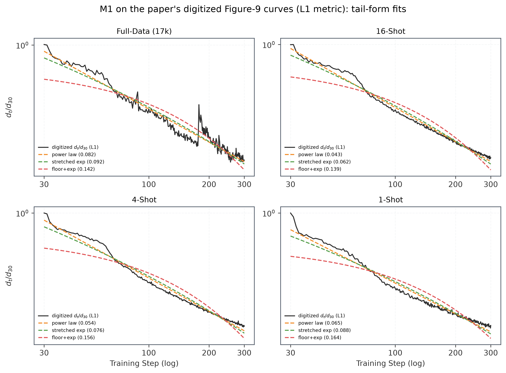
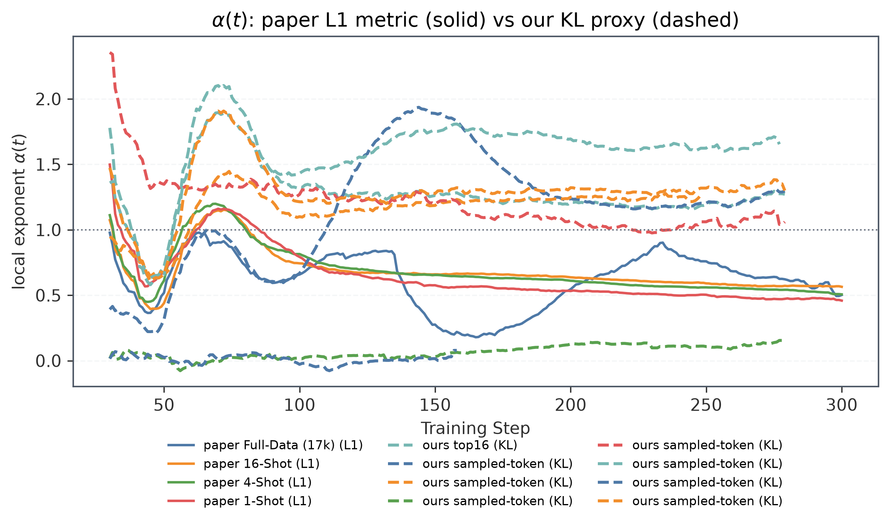
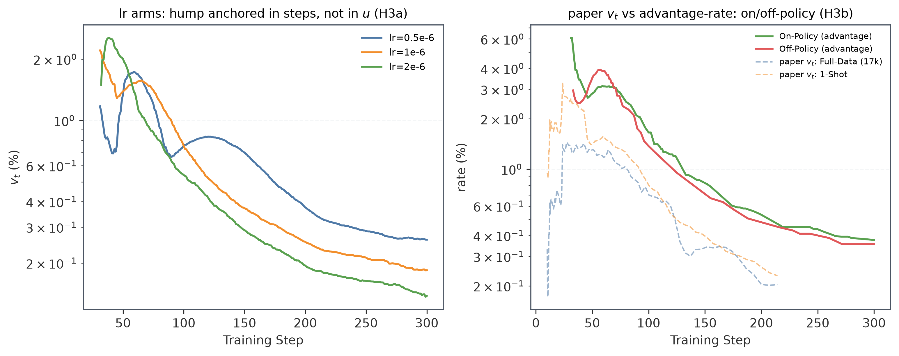
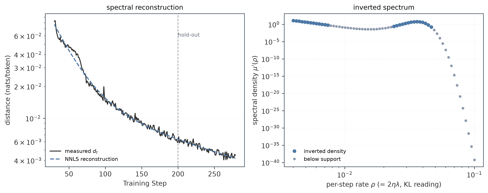

# 2026-09-06: OPD 吸收率下降的谱吸收模型（阅读笔记、推导与实验方案）

对象论文：Fu et al. (2026)[^fu26]，_Rethinking On-Policy Distillation of Large Language Models II: One Training Example_（下称"论文"）。论文的动机来自 one-shot RLVR（Wang et al. 2026[^wang26a]）；姊妹篇 Part I 处理数据侧的现象学与机制[^opd1-26]；工程配方与术语出自 Thinking Machines 的博文（Lu 2025[^tml25]）；综述见 Song & Zheng (2026)[^song26]。本文回答论文留下的 open question："What sets the absorption rate is still open."

**核心论点一句话**：吸收率 $v_t$ 下降不需要新机制来解释——任何一阶优化器在宽谱（幂律谱）曲率上的行为必然如此。在解附近，OPD 动力学按 Hessian/Fisher 特征方向解耦成独立的指数弛豫模式；每一步吃掉的剩余距离比例 $\approx \eta \times \langle\lambda\rangle(t)$，即学习率乘以**剩余误差质量的平均曲率**。高曲率模式先被耗尽，剩余质量不断迁入平坦方向，$\langle\lambda\rangle(t)$ 单调下降，于是 $v_t$ 单调下降。衰减指数是"架构 × 目标几何"的性质，与数据量无关——这正是论文观察到的数据无关性的原因，而且论文自己的两个控制实验（学习率折叠、冻结状态）恰好是这个模型的两个可检验预言[^fu26]。

本版（同日晚间修订）相对初版的深化：§2.2 给出谱权重测度的**精确动力学**（指数倾斜 / cumulant 阶梯）；§2.3 给出 $\alpha(t)=t\cdot v_t$ 恒等式与尾部形态分类学，并证明我们实测到的 $\alpha(t)$ 上升**排除了**纯"幂律谱 × 幂律振幅"模型；§2.5 对 KL 型距离导出精确噪声底 $d_\infty\propto\eta/B$；§2.7 把 Adam 分析升级为 sign 动力学 + 谱锐化的可判别形式；§2.8 处理 L1/KL 两种距离的测度论差异（这是我们的代理与论文读数对比的关键）；§2.9 给出从训练曲线直接反演谱的 NNLS 方法；§3 是四个方向（统计力学学习理论、学习曲线/标度律、频率原理、优化器/信息几何）的深读笔记，标注了每篇论文**实际**推导了什么；§4 是我们两个 run（top16 vs sampled-token）的谱读数；§6 把"下一步实验"重组为以理论判别为目标的测量程序。

---

## 1. 论文事实清单

以下事实均核对自论文[^fu26]（本轮已对照 arXiv 全文复核）。

### 1.1 目标与度量

OPD 目标（论文 Eq. 1）：

$$
\mathcal{L}_{\mathrm{OPD}}(\theta)=\mathbb{E}_{x\sim\mathcal{D},\,y\sim\pi_{\theta}}\left[\sum_{i=1}^{L}\operatorname{KL}\!\left(\pi_{\theta}(\cdot\mid s_{i})\,\|\,\pi_{T}(\cdot\mid s_{i})\right)\right],
$$

即学生采样状态、在**每个访问状态上最小化 reverse KL**；实践估计器是逐 token advantage（Eq. 2）：$A_i = \log\pi_T(y_i\mid s) - \log\pi_θ(y_i\mid s)$，另有 top-$k$ 截断版本（Eq. 3）。这一"学生采样 + reverse KL + 策略梯度估计"的组合源自 MiniLLM（Gu et al. 2024[^gu24]）与 GKD（Agarwal et al. 2024[^agarwal24]）；在"状态由学生自己产生"的意义上，它与 DAgger 的 on-policy 模仿学习同源（Ross et al. 2011[^ross11]）。

两个对齐度量（论文 Eq. 6/7）：

$$
d_t=\frac{1}{|\mathcal{T}_{t}|}\sum_{i\in\mathcal{T}_{t}}\left|\log\pi_{T}(y_{i}\mid s_{i})-\log\pi_{\theta_{t}}(y_{i}\mid s_{i})\right|,\qquad
v_t=\frac{d_t-d_{t+1}}{d_t}.
$$

度量从 step 30 开始（此前 gradient clipping 在生效）。$v_t$ 的估计器约定（附录 C.1，本轮已精读核实）：**几何窗口 $[t/1.4,\,1.4t]$ 两端点附近的 $d$ 各取 median，用两端 median 的 $\log d$ 差除以窗长得到每步斜率**，不是逐步 OLS；窗口放不进测量范围的 $t$ 不报告——所以正文只读 step 50 与 200，而非 300。每个 run 以自己的 $d_{30}$ 为基准（$d_t/d_{30}$）画图，"按形状而非水平比较"。

### 1.2 关键实验数字

配置（§3.1/§5.2/表 3）：学生 R1-Distill-1.5B（数学教师 JustRL-1.5B），veRL 实现，AdamW（$\beta_1=0.9$，$\beta_2=0.999$，wd $=0.01$），lr $=10^{-6}$，batch = 64 rollouts，采样温度 1.0，梯度范数 clip 1.0。§3 的一次性 run 用 top-$k$ advantage（Eq. 3，$k=16$）；§4–5 分析的 run 优化**sampled-token advantage（Eq. 2）**。

| 量               | 1 query | 4    | 16   | 17k（full） |
| ---------------- | ------- | ---- | ---- | ----------- |
| $d_{300}/d_{30}$ | 0.16    | 0.17 | 0.18 | 0.22        |
| $v_{50}/v_{200}$ | 5.6     | 5.2  | 4.2  | 6.4         |

三个结构性的观察：

1. **数据无关**：四个 run 到 step 300 各吃掉自己 step-30 距离的 78%–84%，减速倍数接近；1 题与 17k 题节奏相同（§5.2："the pace is a property of OPD rather than of the training set"）。
2. **学习率只重标定时间轴**（附录 C.2）：lr $\in\{0.5,1,2\}\times10^{-6}$，把横轴换成 $u=(\mathrm{lr}/10^{-6})\,t$ 后三条曲线的散布从约 $2.2\times$ 收窄到约 $1.1\times$，曲线形状不变（"It bends flatter as it goes"）——lr 决定 run 沿同一条形状曲线前进多快，不决定形状。
3. **冻结状态不缩短 run**（§5.3）：初始学生采 64 条轨迹后全程复用（"always off-policy"），run 稳定增长约 **200 步**才停；固定状态集本身就足以支撑几百步的对齐。

### 1.3 已被实验排除的解释

- **状态供给论**（run 长是因为新状态源源不断）：§5.3 冻结状态实验直接否定——固定状态集本身就够跑几百步。
- **测量漂移论**（$d_t$ 的采样分布随学生变化、慢节奏是测量假象）：同一实验否定——状态完全冻结后慢节奏原封不动。
- **数据量/梯度冲突论**（很多题的梯度互相打架，题越多越慢）：四个数据规模的节奏相同，且 1 题（无冲突）不比 17k 题快。

结论：瓶颈在**参数空间的优化本身**。这就是第 2 节要解释的对象。

---

## 2. 谱吸收模型

### 2.1 推导一：KL 的二次化与 Fisher 度量

冻结状态集 $\mathcal{S}$ 后，目标是一个固定的经验目标 $J(\theta)=\mathbb{E}_{s\in\mathcal{S}}\,[\operatorname{KL}(\pi_\theta(\cdot\mid s)\,\|\,\pi_T(\cdot\mid s))]$。设在 $\theta^{\ast}$ 处 $\pi_{\theta^{\ast}}=\pi_T$（可表示情形；不可表示时下面全部结论只需 $J$ 在 $\theta^{\ast}$ 附近有半正定 Hessian）。取扰动 $\delta=\theta-\theta^{\ast}$，记 $a(y)=\log\pi_{\theta^{\ast}+\delta}(y)-\log\pi_{\theta^{\ast}}(y)=\nabla\log\pi_{\theta^{\ast}}(y)\cdot\delta+O(\delta^2)$。则

$$
\operatorname{KL}(\pi_{\theta^{\ast}+\delta}\,\|\,\pi_{\theta^{\ast}})
= \mathbb{E}_{\theta^{\ast}+\delta}[a]
= \mathbb{E}_{\theta^{\ast}}\big[(1+a+\tfrac12 a^2+\cdots)\,a\big]
= \mathbb{E}_{\theta^{\ast}}[a]+\mathbb{E}_{\theta^{\ast}}[a^2]+O(\delta^3).
$$

其中 $\mathbb{E}_{\theta^{\ast}}[\nabla\log\pi]=0$（score 的零均值），且 $\mathbb{E}_{\theta^{\ast}}[\nabla^2\log\pi]=-F$（Fisher 恒等式），故

$$
\mathbb{E}_{\theta^{\ast}}[a] = \tfrac12\,\delta^\top(-F)\,\delta,\qquad
\mathbb{E}_{\theta^{\ast}}[a^2] = \delta^\top F\,\delta
\quad\Longrightarrow\quad
J(\theta)-J(\theta^{\ast}) \approx \tfrac12\,\delta^\top F\,\delta .
$$

即 **reverse-KL 的局部曲率就是 Fisher 信息度量**（信息几何标准结果，Amari 1998[^amari98]；Amari & Nagaoka 2000[^amari00]）。在 $F$ 的特征基下写 $\delta=\sum_i x_i e_i$、$F e_i=\lambda_i e_i$：

$$
J(\theta)\approx J(\theta^{\ast})+\tfrac12\sum_i \lambda_i x_i^2,\qquad
\text{(GD step)}\;\; x_i \leftarrow (1-\eta\lambda_i)\,x_i .
$$

**各模式完全解耦**：梯度下降在一个二次型上就是一组独立的指数弛豫，速率 $\eta\lambda_i$。这不依赖"网络是线性的"这类强假设——只需要剩余误差小到二阶展开成立（论文从 step 30 开始度量、且 clip 已不再生效，正好落在这个窗口）。NTK/lazy 训练文献给出了同一结论的非线性版本：宽网络训练动力学由核（Fisher/NTK）谱决定（Jacot et al. 2018[^jacot18]、Arora et al. 2019[^arora19]、Chizat et al. 2019[^chizat19]）。

两个测量论的注脚（深读新增）：

- **$F$ 是真 Fisher，不是 empirical Fisher**。empirical Fisher（逐样本平方梯度平均）在解附近**不**趋近 Fisher：分类/交叉熵下逐样本梯度在真解附近并不趋于零，其平方平均由标签噪声结构决定（Kunstner, Hennig & Balles 2019[^kunstner19]）。§2.5 的噪声底推导用的是真 Fisher 度量下的单样本梯度方差 $\sigma_i^2$，引用经验 Hessian 谱测量（Ghorbani et al. 2019[^ghorbani19]、Papyan 2020[^papyan20]）时要注意两者的区分。
- **对 softmax + 交叉熵，Fisher 精确等于 Gauss–Newton**（Martens 2014[^martens14] §7：多类 softmax 属于"以 $z$ 为自然参数的指数族"，此时 $F_R=H_L$，GGN=Fisher）。所以把 OPD 的 reverse-KL 目标二次化得到 Fisher 度量，在 softmax 参数化下是**精确**的对应，而非近似。

**论文附录 C.2 的学习率折叠是这个线性动力学的签名。** 若 $d$ 由一族 $e^{-\eta\lambda_i t}$ 支配，则 $d$ 只通过组合变量 $\eta t$ 依赖训练——学习率改变的只是沿同一条形状曲线行进的速度。实测坍缩到 $1.1\times$，残余的 $\sim10\%$ 恰好是"on-policy 状态漂移 + Adam 高阶效应"这类二阶量的量级。若慢节奏来自 KL 几何的某种内禀非线性，换 lr 不会是纯粹的时间轴重标定。

### 2.2 推导二：吸收率 = 剩余误差的平均曲率，及其精确动力学

线性化后每个模式贡献一个独立衰减的分量。把论文的 $d_t$（一阶型距离）写成模式幅度之和

$$
d(t)=\sum_{i\ge1} a_i\,e^{-\eta\lambda_i t},\qquad a_i\ge0,
$$

（严格说 $d$ 是 $|\log\text{-ratio}|$ 的均值而非逐模式幅度之和；在线性化区间内逐模式的符号混合是高阶小量，此假设在 §7 局限里声明，§2.8 给出 KL 型距离的精确版本。）则

$$
v_t = 1-\frac{d(t+1)}{d(t)}
= \sum_i w_i(t)\,\big(1-e^{-\eta\lambda_i}\big),\qquad
w_i(t)=\frac{a_i e^{-\eta\lambda_i t}}{d(t)} .
$$

对小步长 $1-e^{-\eta\lambda}\approx\eta\lambda$，得到核心等式：

$$
\boxed{\;v_t \;\approx\; \eta\,\langle\lambda\rangle(t),\qquad
\langle\lambda\rangle(t)=\sum_i w_i(t)\,\lambda_i\;}
$$

其中 $\langle\lambda\rangle(t)=\sum_i w_i(t)\lambda_i$ 是剩余误差质量的曲率加权平均。

**解读：论文的吸收率曲线就是剩余误差的"谱质心"读数。** 训练是吸收前沿从高曲率模式向低曲率模式的扫掠：快模式先被耗尽，权重 $w_i(t)$ 不断向小 $\lambda$ 倾斜，$\langle\lambda\rangle(t)$ 下降，$v_t$ 随之下降——不需要任何额外机制。

**剩余谱的精确动力学：指数倾斜（exponential tilting）。** 权重 $w_i(t)=a_ie^{-\eta\lambda_it}/d(t)$ 有一个不依赖任何近似的闭式：$w(\lambda,t)$ 就是初始权重测度 $w_0(\lambda)=a_i/d_0$ 在**倾斜强度 $\eta t$ 下的指数倾斜**：

$$
\boxed{\;w(\lambda,t)\;=\;\frac{w_0(\lambda)\,e^{-\eta t\,\lambda}}{\mathbb{E}_{w_0}\!\left[e^{-\eta t\lambda}\right]}\;=\;\frac{w_0(\lambda)\,e^{-\eta t\lambda}}{d(t)/d_0}.\;}
$$

（由 $d(t)=d_0\,\mathbb{E}_{w_0}[e^{-\eta t\lambda}]$ 直接展开即得。）等价地，**$\ln d(t)=\ln d_0+\ln\mathbb{E}_{w_0}[e^{-\eta t\lambda}]$：对数距离曲线就是初始谱测度的累积量生成函数（CGF）在 $-\eta t$ 处的取值**。这一句话把模型全部内容打包：谱反演（§2.9）= CGF 反演；学习率折叠 = CGF 只通过 $\eta t$ 依赖参数；吸收前沿 = 倾斜强度增大时质量向低 $\lambda$ 集中。

**Cumulant 阶梯。** 对倾斜测度求时间导数（对 CGF $K(s,t)=\ln\sum_i w_i(t)e^{s\lambda_i}$ 直接微分，用 $\dot K=-\eta(K'-K'(0,t))$）：

$$
\boxed{\;\dot\kappa_n=-\eta\,\kappa_{n+1},\qquad n=1,2,\dots\;}
$$

其中 $\kappa_n$ 是剩余权重测度 $w(\lambda,t)$ 的第 $n$ 阶 cumulant（$\kappa_1=\langle\lambda\rangle$，$\kappa_2=\mathrm{Var}_w(\lambda)$，$\kappa_3$ 是偏度的平方根量……）。特别地：

$$
\frac{d\langle\lambda\rangle}{dt}=-\eta\,\mathrm{Var}_w(\lambda)\;\le\;0,
\qquad
\frac{dv_t}{dt}=-\eta^2\,\mathrm{Var}_w(\lambda),
\qquad
\frac{d^2v_t}{dt^2}=\eta^3\,\kappa_3 .
$$

（直接验证 $\kappa_3$ 时注意：中心矩 $\mu_4=\kappa_4+3\kappa_2^2$，质心移动的贡献 $+3\eta\kappa_2^2$ 恰好抵消 $\mu_4$ 里的同名项——阶梯对**所有**阶精确成立，这是倾斜动力学的标准性质。）

等号成立当且仅当剩余质量全部集中在一个 $\lambda$ 上。于是得到一个可以从**现有训练日志直接算的诊断量**：

$$
\mathrm{Var}_{w(t)}(\lambda) \approx -\frac{1}{\eta^2}\,\frac{dv_t}{dt}
\qquad(\text{after smoothing } v_t) .
$$

**吸收率下降的斜率本身度量了剩余误差的谱方差。** 若某天 $v_t$ 走平，说明剩余误差已经塌缩到单一时间尺度（或噪声底）；若 $v_t$ 陡降，说明前沿正在穿过一段很宽的谱。§4 用我们自己的数据做了这个读数：50→199 步之间相对谱宽 $\sqrt{\kappa_2}/\kappa_1\approx0.7\text{–}0.9$，$O(1)$ 宽谱，远未坍缩。

**与可靠性理论的无缝对接（Proschan 定理）。** $v_t=\eta\kappa_1(t)$ 正是"剩余距离"这个量的风险率（hazard rate）：把 $d(t)$ 看作某虚拟群体的存活函数，$\eta\langle\lambda\rangle(t)$ 是其瞬时失效率。指数寿命的**任意混合**必然呈递减风险率（decreasing failure rate，DFR）——Proschan (1963)[^proschan63] 的机群定理；用本节语言重述：倾斜测度的均值 $\kappa_1$ 单调不增，$\dot\kappa_1=-\eta\kappa_2\le0$。所以**在线性化+SGD 假设内，"$v_t$ 下降"是免假设的定性定理**；定量形状（幂律/拉伸指数/平台）才携带谱的信息。反过来，§4 实测到的 $v_t$ 局部**上升**（step 55→80 的凸起）就成为"某个假设在该阶段失效"的证据，见 §2.7。

### 2.3 推导三：$\alpha(t)=t\cdot v_t$ 恒等式与尾部形态分类学

定义**局部对数斜率指数**（对数-对数图上 $d$ 曲线的局部斜率）：

$$
\alpha(t)\;\equiv\;-\frac{d\ln d}{d\ln t}\;=\;-\frac{t\,d'(t)}{d(t)}\;=\;t\cdot v_t^{\mathrm{inst}} ,
$$

其中 $v_t^{\mathrm{inst}}=-d'(t)/d(t)$ 是连续时间的瞬时吸收率（几何窗口估计的 $v_t^{\mathrm{geo}}$ 是它的步长平均）。**两个面板（log 距离、log 吸收率）携带同一信息，$\alpha(t)=t\cdot v_t$ 是换算恒等式。** 立即得到判据：

$$
\frac{v_{50}}{v_{200}}\;=\;\frac{\alpha(50)}{\alpha(200)}\times 4 .
$$

- $\alpha$ 恒定 $\Rightarrow$ 纯幂律，$v_{50}/v_{200}=4$；
- $\alpha$ **上升** $\Rightarrow$ 衰减在 log-log 上是凹的（比任何幂律都快地弯下去）$\Rightarrow$ $v_{50}/v_{200}<4$；带边截断的宽谱、对数正态谱、或玻璃态（KWW）弛豫都产生这种形状；
- $\alpha$ **下降** $\Rightarrow$ 逼近噪声底/谱中 $\lambda=0$ 的原子 $\Rightarrow$ $v_{50}/v_{200}>4$。

（我们的实现里 $\alpha(t)$ 由滑窗 log-log 回归直接测，`alignment/fit_tail.py` 的 `local_alpha`；论文的 $v_{50}/v_{200}=4.2\text{–}6.4\ge4$ 即 $\alpha$ 下降型，我们的两个 run 是 $2.5\text{–}3.1<4$，$\alpha$ 上升型——见 §4 的对照与解释。）

**与谱密度渐近的对应（Watson 引理）。** $d(t)=d_0\int e^{-\eta\lambda t}\,\mu(d\lambda)$，被积函数在 $\lambda\sim1/(\eta t)$ 附近支配积分，所以 $\alpha(t)$ 由谱测度在该处附近的局部形状决定：

- 若 $\mu$ 的密度在 $\lambda\to0$ 处 $\rho(\lambda)\propto\lambda^{\gamma-1}$（$\gamma>0$ 保证质量有限），则 $d\sim c\,\Gamma(\gamma)(\eta t)^{-\gamma}$，$\alpha\equiv\gamma$ **恒定**；
- 若密度延伸到**有限带边** $\lambda_{\max}$（早期近似平直），则 $d\approx\frac{1-e^{-\eta\lambda_{\max}t}}{\eta t}$：早期 $\alpha\approx1$，前沿触及带边后 $\alpha(t)$ **上升**（尾部开始指数截断）；
- 若 $\mu$ 在 $\lambda=0$ 有原子（不可吸收部分/表示缺口），则 $d\to p_0$ 平台，$\alpha\to0$ **下降**。

**一个排除性结论。** 若谱与振幅都是纯幂律（$\lambda_i=\lambda_1 i^{-\beta}$，$a_i\propto i^{-\delta}$，$\delta>1$），把求和换成积分得 $d(t)=C\,t^{-\alpha}$、$\alpha=(\delta-1)/\beta$ **严格恒定**（初版 §2.4 的推导，Karamata/Watson 一致）。因此：

$$
\boxed{\;\exists\,t:\ \dot\alpha(t)\neq 0
\;\Longrightarrow\;
\text{(power-law spectrum)}\times\text{(power-law amplitudes) ruled out}.\;}
$$

即：**实测 $\alpha(t)$ 有系统漂移（无论升或降），纯"幂律谱×幂律振幅"模型在该窗口内已被排除**。上升（我们的数据）指向带边/对数正态型谱或优化器效应（§2.7）；下降（论文的读数，若置信）指向 $\lambda=0$ 附近的原子/底。两者的区分是 §6 测量程序 M1/M2 的目标。

**"几百步而不是几十步"由此得到解释**：高曲率模式贡献了 $d$ 的前段下降（几十步内吃完），而幂律谱的尾部——大量 $\lambda\lesssim1/(\eta t)$ 的模式——承载了之后的长尾。前沿位置 $i^{\ast}(t)\sim(\eta\lambda_1 t)^{1/\beta}$：吃掉的模式数随 $t$ 只按多项式增长。

### 2.4 推导四：幂律谱 ⇒ 幂律/拉伸指数尾巴；与学习曲线理论的同构

设谱与振幅均为幂律（同上），则 $d(t)\propto t^{-\alpha}$、$\alpha=(\delta-1)/\beta$；若振幅近均匀分布在有限/对数均匀的谱上，早期近指数、尾部呈**拉伸指数** $e^{-(t/\tau)^\gamma}$（宽谱弛豫系统的标准形态，玻璃动力学里即 Kohlrausch–Williams–Watts 律；§2.3 的带边模型是其连续谱版本）。无论哪种形态，$v_t$ 都递减；判别交给 §6 的 M1/M2。

**数据侧的同构（Hutter 2021[^hutter21]，本轮精读）。** Hutter 的学习曲线理论是同一个数学结构在"数据量"轴上的版本：把数据看成离散的"信息量子"（quanta），每个量子 $i$ 以概率 $\theta_i$ 首次出现在 $n$ 个样本内，则期望误差恰好是指数混合

$$
\mathbb{E}[\mathrm{err}_n]=\sum_i\theta_i(1-\theta_i)^n\approx\int f(x)e^{-nf(x)}dx,
$$

saddle 点在 $\theta\approx1/n$；若 $\theta_i\propto i^{-(\alpha+1)}$（Zipf），则 $\mathbb{E}[\mathrm{err}_n]\propto n^{-\beta}$、$\beta=\alpha/(1+\alpha)$；更一般地，若 $\theta$ 的尾密度满足 $|f'(f^{-1}(u))|\approx c'u^\delta$，则 $\mathbb{E}\sim n^{\delta-2}$（Watson 引理的又一变体）。Michaud et al. (2023)[^michaud23] 的量化模型是它的机制版：quanta 逐个被学会 → 损失是阶梯函数，quanta 的 log-loss 按幂律分布时阶梯的包络呈幂律——并预言"涌现"是阶梯的跳变。**同构表**：

| 本文档（时间轴）                | 学习曲线理论（数据轴）             |
| ------------------------------- | ---------------------------------- |
| 模式弛豫 $e^{-\eta t\lambda_i}$ | 量子首现 $e^{-n\theta_i}$          |
| 谱测度 $\mu(d\lambda)$          | 量子难度分布 $\theta_i$            |
| $d(t)\propto t^{-\alpha}$       | $\mathrm{err}_n\propto n^{-\beta}$ |
| lr 折叠 $u=\eta t$              | 样本重排/子采样                    |

预训练的 step 维度幂律 $L(t)\propto t^{-\alpha_S}$（Kaplan et al. 2020[^kaplan20]：$\alpha_S\approx0.76$，$L(N,S)=(N_c/N)^{\alpha_N}+(S_c/S_{\min})^{\alpha_S}$）是同一现象的预训练版。归因澄清（本轮核对原文后的修正）：Bahri et al. (2021)[^bahri21] 的四象限是**数据量 × 宽度**的 variance/resolution 分类，**不含时间轴**；Maloney, Roberts & Sully (2022)[^mrs22] 的可解模型同样只在资源（数据/参数）轴上。**从谱显式导出 loss-vs-time 幂律的正式论文是核回归梯度流一系**：Bordelon, Canatar & Pehlevan (2020)[^bordelon20] 在 NTK 域做梯度流，逐模式 $e^{-\lambda_k t}$ 衰减、幂律谱给出时间幂律；Canatar et al. (2021)[^canatar21] 给出样本侧的"累积功率"判据。更早的经典版本是早停即谱正则化：Yao, Rosasco & Caponnetto (2007)[^yao07]、Caponnetto & De Vito (2007)[^caponnetto07]、Dieuleveut & Bach (2016)[^dieuleveut16]。这与本节的倾斜表示完全同构——$L(t)$ 也是 $\mu$ 的 Laplace 变换。

### 2.5 推导五：噪声底、可吸收性阈值与 run 终止

每个模式上，SGD 是经典的 Ornstein–Uhlenbeck 过程：

$$
x_{t+1}=(1-\eta\lambda_i)\,x_t+\eta\,\xi_t,\qquad
\mathbb{E}[\xi_t^2]=\sigma_i^2/B ,
$$

（$\sigma_i^2$ 为模式 $i$ 的单样本梯度噪声方差，$B$ 为 batch；on-policy 的状态采样也计入 $\sigma_i$。）平稳方差

$$
\mathbb{E}[x_i^2]_\infty=\frac{\eta^2\sigma_i^2/B}{1-(1-\eta\lambda_i)^2}\approx\frac{\eta\,\sigma_i^2}{2\lambda_i B}.
$$

（经典 OU 结果，Mandt et al. 2017[^mandt17]。）

两个推论：

1. **平坦模式又慢又吵**：它的均衡位移 $\propto1/\lambda_i$ 反而最大。
2. **存在可吸收性阈值**：模式 $i$ 能被吸收，要求初始幅度超过自身噪声底：

$$
c_i^2 \gg \frac{\eta\,\sigma_i^2}{2\lambda_i B}
\quad\Longleftrightarrow\quad
\lambda_i \;\gg\; \lambda_{\mathrm{crit}} := \frac{\sigma_i}{c_i}\sqrt{\frac{\eta}{2B}} .
$$

于是 run 的终点由两部分决定：所有 $\lambda>\lambda_{\mathrm{crit}}$ 的模式各自均衡的时间（$t_i\sim\ln(c_i/x_i^{\ast})/(\eta\lambda_i)$ 的最大值），加上谱中 $\lambda<\lambda_{\mathrm{crit}}$ 部分贡献的**不可约底**。

**KL 型距离的精确底（本轮新增）。** 二次化目标里每个模式对 $J-J^\ast$ 贡献 $\tfrac12\lambda_ix_i^2$，代入 OU 均衡：

$$
\text{(per-mode floor)}=\tfrac12\lambda_i\cdot\frac{\eta\sigma_i^2}{2\lambda_iB}=\frac{\eta\,\sigma_i^2}{4B}
\quad\Longrightarrow\quad
\boxed{\;d_\infty^{\mathrm{KL}}\;=\;\frac{\eta}{4B}\sum_i\sigma_i^2\;+\;d_{\mathrm{gap}}.\;}
$$

**KL 底逐模式与 $\lambda_i$ 无关**：曲率在分子分母中恰好消掉。整条底线正比 $\eta/B$，且"表示缺口"（温度/tokenizer/容量失配，与 $\eta$ 无关的那部分）可以与之分离。对比：L1 型距离的逐模式底是 $|x_i|_\infty\propto\sqrt{\eta}\,\sigma_i/\sqrt{\lambda_iB}$，**平坦模式主导**、标度 $\propto\sqrt{\eta/B}$——两种距离对"底"的预言在 $\lambda$-加权和 $\eta$-幂次上都不同，这是 H2/D2 检验时要分别对应的（也是 §2.8 强调距离选择重要性的原因之一）。

- **Off-policy run 为什么在 ~200 步停下**：状态冻结 → $\sigma_i$ 固定 → 可吸收模式集合固定 → 全部均衡后曲线进入硬平台（底 $=$ 上面公式）。
- **On-policy run 为什么不停**：学生持续采出新状态，把质量重新注入剩余模式（并维持较高的 $\sigma_i$），平台变成 $d$ 分数以内的漂移带（论文 Fig. 1 的 1000 步行为[^fu26]）。

### 2.6 推导六：信息几何判词——恒定吸收率 = 自然梯度，及其估计论极限

若每次更新用精确自然梯度 $\theta\leftarrow\theta-\eta F^{-1}\nabla J$，在模式坐标里 $x_i\leftarrow(1-\eta)x_i$：**所有模式同速收缩**，$v\equiv\eta$ 恒定，对数距离图是一条直线。所以"$v_t$ 下降"的信息几何等价形式是：**曲率没有被白化，谱就会被按曲率从高到低的顺序消费**。自然梯度（Amari 1998[^amari98]）、自然策略梯度（Kakade 2002[^kakade02]）、信赖域方法（Schulman et al. 2015[^schulman15]、2017[^schulman17]）、镜像下降策略优化（Tomar et al. 2021[^tomar21]）都是这件事的不同近似。

**Kakade 步的闭式（本轮补充，对 OPD 最贴身）。** 对 softmax 策略，自然策略梯度有解析形式：参数更新就是把逐 token advantage 加到 logits 上（$\theta\leftarrow\theta+\eta\sum_iA_i\phi_i$ 型）。也就是说：**OPD 的每 token advantage 场已经是"自然梯度坐标下的更新方向"**；普通 GD 与它的差别恰是缺少 Fisher 白化——$v_t$ 曲线因此可以被读作"OPD 离自然梯度还有多远"的白化缺失度曲线。

但精确白化在估计论上不可达，而且这个极限不是实现问题：

- 模式 $i$ 的每步梯度信号 $\sim c_i\lambda_i$，噪声 $\sim\sigma_i/\sqrt{B}$；要把该模式白化（用 $g_i/\lambda_i$ 代替 $g_i$），需要信噪比 $\sqrt{B}\,c_i\lambda_i/\sigma_i \gg 1$——**与推导五的 $\lambda_{\mathrm{crit}}$ 是同一个阈值**。在 $\lambda_i\to0$ 的地方，逆预条件子的方差爆炸：**你无法白化你测不准的方向**（Martens 2014[^martens14] 对自然梯度病态性与 damping 的分析：$F$ 的小特征值使 $F^{-1}g$ 产生巨大且糟糕的更新，唯一的补救是 damping，而"没有单一的固定 damping 值适合训练全程"）。
- 随机凸优化的信息论下界说明这不是 SGD 特有的缺陷：噪声 oracle 下即便最优算法也只有 $O(1/t)$ 型速率（Agarwal et al. 2012[^agarwal12]、Bach & Moulines 2013[^bach-moulines-13]）；要往下走必须降方差（加大 batch / 方差缩减 / 迭代平均，见 Dieuleveut, Flammarion & Bach 2017[^dieuleveut-17]）。

这给出 "data-overfed but algorithm-starved" 的定量形式：**食物（监督）管够，嘴不够——嘴的大小 = 曲率 × 信噪比。** 谱中 $\lambda<\lambda_{\mathrm{crit}}$ 的那部分监督，无论喂多少数据都吃不到；它们不是"没用的监督"，而是"这个优化器在这个 batch 尺寸下吃不到的监督"。

**预条件子家族在模型里的位置。** K-FAC（Martens & Grosse 2015[^martens-grosse-15]）块对角近似白化、TRPO/SOAP/Muon 见 §3.4；它们对本模型的全部效应可以压缩成一句话：**预条件子改变从 $\{\lambda_i\}$ 到 $\{\eta\lambda_i^{\mathrm{eff}}\}$ 的映射**——压缩动态范围（提升尾部速率 → $\alpha$ 变小/变平）或提升低 SNR 方向的有效速率（受 $\lambda_{\mathrm{crit}}$ 限制）。H6 的判别实验（§6 M6）读数就是 $\alpha$ 与 $v_{50}/v_{200}$ 动不动。

### 2.7 推导七：AdamW 的软底与谱锐化（假设，可证伪）——以及 $v_t$ 凸起的三种候选解释

**Adam 的 sign 结构。** Balles & Hennig (2018)[^balles18] 的解剖：Adam 的更新方向由**随机梯度的符号**决定，幅度由相对方差估计决定——两者可分离，且泛化问题出在 sign 一侧。极端情形即 sign-SGD（Bernstein et al. 2018[^bernstein18]）：噪声主导的方向上 $\mathbb{E}[\mathrm{sign}(g)]\approx\sqrt{2/\pi}\,\lambda_ix\sqrt{B}/\sigma_i$，收缩速率不再正比 $\lambda_i$ 而是被 $\eta$ 封顶，随机游走扩散 $\eta^2$ 产生另一族噪声底（$\propto\eta_A\sigma_i/(\lambda_i\sqrt{B})$ 型，启发式）。$\beta_2=0.999$ 意味着二阶矩 EMA 的记忆长度 $\approx1/(1-\beta_2)=1000$ 步——与 run 总长同量级，信号衰减后分母跟不上，等于在谱尾部又垫一层"软底"（Reddi et al. 2018[^reddi18] 的末期病态是近亲）。**预测（H3）**：$\beta_2\in\{0.95,0.999\}$ 扫描、$\epsilon$ 扫描、末期换优化器，尾巴形态应随之改变。

**谱锐化（这是比 Adam 更根本的"非谱机制"）。** 谱模型假设 $\{\lambda_i,a_i\}$ 冻结；但 edge-of-stability 一系（Cohen et al. 2021[^cohen21]）证明训练**主动制造曲率**：稳定阶段 sharpness 持续上升（progressive sharpening），触到 $2/\eta$ 后进入自稳定的振荡带（"micro-catapults"序列）；交叉熵损失在训练末期因 margin 增大 sharpness 反而回落。也就是说 $\lambda_i(t)$ 本身是时变的、且顶端被拉高——$\langle\lambda\rangle(t)$ 因此可以**局部上升**，$v_t$ 出现凸起。

**我们实测的 $v_t$ 凸起正好是三选一的判别现场**（§4：两个 run 在 step ~55→80 都有 $v$ 从 ~1.5% 回升到 ~2.7–3.5%，且在无窗的原始单步 $v$ 里也在，排除了估计器伪影；而模型要求 $\dot\kappa_1=-\eta\kappa_2\le0$，$v$ 不应上升）：

1. **Adam 二阶矩 warmup 瞬态**（H3a）：$\hat v$ 在前 ~100 步仍在增长，等效步长分布时变；
2. **On-policy 状态漂移注入**（H3b）：学生采出的新状态把误差质量注回高曲率模式（§2.5 的"再注入"在前 100 步最强）；
3. **Progressive sharpening**（H3c）：$\lambda_i(t)$ 顶端上移直接抬高 $\langle\lambda\rangle$。

三者可分辨：H3a 预言 lr 折叠后凸起位置按 $u=\eta t$ 移动；H3b 预言冻结状态 run 凸起消失/减弱（论文 §5.3 的曲线可以直接复查！）；H3c 预言凸起伴随 sharpness（最大 Hessian 特征值）上升，且 $\beta_2$ 扫描不影响。**把论文 §5.3 的 off-policy run 的 $v_t$ 画出来看凸起是否消失，是零成本的第一个判别。**

### 2.8 推导八：两种距离的测度论——KL 代理与论文 L1 读数如何对上

本文的日志分析（§4）用 $d^{\mathrm{KL}}(t)=-\overline{A}_t$（逐 token reverse-KL，nats/token）作距离，论文用 $d^{L1}(t)=\overline{|A|}_t$。二次化给它们的模式分解不同：

$$
d^{\mathrm{KL}}(t)=\tfrac12\sum_i \lambda_i c_i^2 e^{-2\eta\lambda_i t},
\qquad
d^{L1}(t)=\sum_i a_i e^{-\eta\lambda_i t}.
$$

三个差别，全部方向性明确：

1. **速率加倍**：KL 的模式衰减率是 $2\eta\lambda_i$——同一条谱上 KL 距离的 $v_t$ 约是 L1 的两倍量级（视振幅分布）；
2. **$\lambda$-加权**：KL 给每个模式乘 $\lambda_i$——KL 距离相对偏向**高曲率**模式（这也符合直觉：KL 是平方型度量，大偏差 token 权重更大）；
3. **符号混合因子**：$d^{L1}=\mathbb{E}|A|$，$d^{\mathrm{KL}}=|\mathbb{E}A|$，比值 $R(t)=\mathbb{E}|A|/|\mathbb{E}A|\ge1$ 度量符号混合程度，是逐 token 数据（§6 M3）可以直接测的量。

另外一个不可忽略的污染项：$\mathrm{KL}(\pi_\theta\|\pi_T)=\mathrm{CE}(\pi_\theta,\pi_T)-H(\pi_\theta)$。**学生熵的下降会抬高 KL 代理**、熵回升会压低它——我们的 run 熵从 0.81（step 30）→ 0.64（step 199）→ 0.73（step 279），在这个量级下不是小效应。这解释了为什么同是 300 步，论文的 $d_{300}/d_{30}\approx0.19$（L1）而我们的是 $0.055$（KL 代理），也部分解释 $v_{50}/v_{200}$ 一个 $\ge4$、一个 $<4$ 的方向差——但不解释全部，剩余部分正是 M3 要拆开的。

**结论：跨距离、跨论文比较 $\alpha$ 绝对值时要经过这层换算；不变的判据是 $\alpha(t)$ 的漂移方向与 $v_t$ 的形状特征（如凸起位置），它们在同一种距离内是自洽的。**

### 2.9 从训练曲线反演谱（NNLS，零训练成本）

CGF 表示（§2.2）指出谱反演就是 Laplace 反演：在 $\lambda$ 网格上做**非负最小二乘**

$$
\min_{c_k\ge0}\;\sum_t\Big(d(t)-\textstyle\sum_k c_k e^{-\eta\lambda_kt}\Big)^2 ,
$$

（多 seed/多 run 平均降噪；对数空间拟合；网格按 $\lambda\in[1/(\eta T),\,\lambda_{\max}]$ 取对数均匀）。这是经典病态问题，分辨率极限 $\sim1/(\eta T)$、需要正则化（Tikhonov 或对 $c_k$ 的平滑范数）——流变学里从应力弛豫模量 $G(t)=\int H(\tau)e^{-t/\tau}d\ln\tau$ 反演"弛豫谱 $H(\tau)$"有一套成熟做法可以照搬（Ferry 1980[^ferry80]；Weese 1993[^weese93]）。它把 D5（谱普查）变成两步：**M2 从日志反演出候选谱 → M5 用 Hessian-vector（随机 Lanczos / 幂迭代，Ghorbani et al. 2019[^ghorbani19] 的方法）只验证反演出的前几个主模式**。命中 = 现象被解释，且 run 长度从此可在初始化时预报。注意：反演给出的是**加权谱**（KL 代理下带 $\lambda_i$ 权重、速率 $2\eta\lambda_i$，§2.8），换算时要用对应版本。

---

## 3. 文献对照：这不是一个孤立现象（深读版）

### 3.1 统计力学学习理论：弛豫、speciation 与风险率

- **Seung, Sompolinsky & Tishby (1992)[^seung92]**：把从样本学习写成 Langevin 动力学。核心结果：学习曲线的形态由学生-教师耦合矩阵（= 误差 Hessian 在解处的谱）决定——耦合满秩时误差**指数**衰减；耦合有零模（对称子空间）时误差呈 **$1/t$** 幂律，由**最小非零特征值**定标；学生比教师"多自由度"时出现 **speciation 相变**——先在对称子空间内弛豫（平台），再分裂成专项解（对数时间的平台-跳变结构）。这正是 §2.2/§2.3 的"前沿 + 阶梯"在师生学习里的原始版本：$v_t$ 的凸起/阶梯若与模式群的 speciation 对应，应表现为 $\kappa_2$ 的非单调。
- **Saad & Solla (1995)[^saad-solla95]**：online（每样本只用一次）学习 soft committee machine 的精确 ODE 动力学——初期对称相（误差平台，$\kappa_1\approx$ 常数）之后进入专化相，重叠按指数增长、误差呈 $1/t$ 尾巴；中间的 speciation 是相变。给我们最重要的提示：**"平台→跳变→幂律尾"的三段结构在师生学习里是普适的**，论文的 300 步窗口可能只看到了其中一段。
- **Watkin, Rau & Biehl (1993)[^watkin93]**：上述领域的综述，含学习曲线分类与有限训练集效应。
- **Proschan (1963)[^proschan63]**：DFR 定理（§2.2 已用）——定性结论"混合指数必有递减风险率"是免参数的；定量读谱才需要假设。

### 3.2 学习曲线 / 标度律：谁的论文真的推导了时间幂律

- **Hutter (2021)[^hutter21]**（精读）：量子混合 → saddle 点 → 幂律，$\beta=\alpha/(1+\alpha)$（Zipf 数据）或一般地 $\beta=\delta-2$；幂律不需要幂律谱，只需要"正则变化的尾"。同构表见 §2.4。
- **Michaud et al. (2023)[^michaud23]**（arXiv:2303.13506，NeurIPS 2023）：quanta（准稳态特征/回路，如 Pythia 里的 "segfault" 等约 2000 个）逐个学会 → 损失阶梯；quanta 的 log-loss 按幂律分布 → 包络幂律；"涌现能力" = 大 quanta 的跳变。对 D4 的直接启示：**逐 token 残差的分层轨迹可能不是光滑曲线而是阶梯**，分层统计要按 quanta（或 token 频率代理）聚合后看包络。
- **Kaplan et al. (2020)[^kaplan20]**（精读）：固定模型/数据时 $L(t)\propto t^{-\alpha_S}$，$\alpha_S\approx0.76$（表 3/5；$S_c\approx2.1\times10^3$ 步）；lr 用 warmup+cosine，训练曲线仍可按幂律拟合（初始瞬态之后）。**注意 $\alpha_S\approx0.76$ 与论文 OPD 的 $\alpha\approx0.72$（由 $d_{300}/d_{30}\approx0.19$ 解出）几乎重合**——预训练与 OPD 的"时间幂律指数"惊人同量级，支持"这是优化器×损失几何的性质，不是任务性质"。
- **Bahri et al. (2021)[^bahri21]**（精读澄清）：四象限 = variance/resolution × 数据/宽度；样本侧 $L(D)-L(\infty)=\mathcal O(D^{-1})$、宽度侧 $\mathcal O(1/w)$；resolution-limited 指数由核谱 $\lambda_i\sim i^{-(1+\alpha_K)}$ 给出 $\alpha_D=\alpha_P=\alpha_K$，且有 $C^t$ 核的 $\alpha\lesssim4/d$ 预言。**没有时间轴**——初版把 "optimization-limited" 归给它是错的。
- **Maloney, Roberts & Sully (2022)[^mrs22]**（精读澄清）：可解标度模型（潜空间协方差幂律 $\lambda_I=\lambda_+I^{-(1+\alpha)}$，$\alpha=(2-\beta)/(\beta-1)$），解 ridge 回归的 resolvent，$\mathcal L(N,T)=L_0(1/N+1/T)^{\alpha}$——同样**只在资源轴**，无梯度流时间轴。
- **Bordelon, Canatar & Pehlevan (2020)[^bordelon20]**（时间域的锚）：NTK 域梯度流 $\partial_t u=-K^\ast u$，逐特征方向 $e^{-\lambda_k t}$ 衰减；幂律谱 → 时间幂律学习曲线；样本侧用 replica 方法。**这是"从谱导出 loss-vs-time"最直接的文献依据**，§2 的模型是它在 (学生,教师) KL 几何上的版本。
- **Canatar, Bordelon & Pehlevan (2021)[^canatar21]**：样本侧的"累积功率 $C(\rho)$"判据（目标在第 $k$ 个核特征方向上的功率累积占比决定该模式的可学习性）——"task-model alignment"。对 OPD 的转译：**教师分布在学生 NTK 特征方向上的累积功率分布**就是初始振幅 $\{a_i\}$，可以在训练前算出来（H5 的前半）。
- **早停/最优速率经典**：Yao, Rosasco & Caponnetto (2007)[^yao07]（早停=谱正则化，偏差-方差随 $t$ 的交替）、Caponnetto & De Vito (2007)[^caponnetto07]（最优速率 $O(1/\sqrt n)$ 型）、Dieuleveut & Bach (2016)[^dieuleveut16]、Dieuleveut, Flammarion & Bach (2017)[^dieuleveut-17]（常数步长+迭代平均达到统计最优率——P2 的 EMA/权重平均的直接依据，另见 Porian et al. 2024[^porian24] 对 LM step-scaling 偏差的修复）。

### 3.3 频率原理 / 谱偏差：按频率排序的消费顺序

- **Rahaman et al. (2019)[^rahaman19]**：DNN 先拟合低频分量（且与对抗样本脆弱性同源）；**Xu et al. (2020)[^xu20]**（F-Principle）：1-d 合成 $\sin x+\sin3x+\sin5x$ 的逐频率残差曲线是**三条错开的衰减曲线**——每个频率一个衰减时间尺度。
- **Xu, Zhang & Luo 综述 (2022)[^xu-review22]**（精读）：最有用的定量结果：(a) **NTK 域** $\partial_t u(X,t)=-K^\ast u$，特征值按频率排序（球谐，Basri et al. 2019[^basri20]：ReLU-NTK 特征值随频率 $\ell$ 多项式衰减；Cao et al. 2021 类似）；(b) **线性 F-Principle（LFP）**：任意数据下傅里叶残差满足 $\partial_t\hat u(\xi)=-\gamma(\xi)^2\hat u_\rho(\xi)$，$\gamma(\xi)^2\sim\|\xi\|^{-(d+1)}$——**频率 $\xi$ 的残差衰减速率 $\propto\|\xi\|^{-(d+1)}$**，即"频率指标 = 谱指标、谱按频率幂律衰减"的一个显式可计算版本；(c) deep F-principle：更深的层看到的有效目标更平滑；(d) Fourier feature 编码（Tancik et al. 2020[^tancik20]）通过改变输入几何**改变谱**来修复高频学习——一个"改谱"的成功先例，对应 §6 M6。
- **Ronen et al. (2019)[^ronen19]**：GD 偏向低复杂度函数（频率排序的另一面）。
- **对 OPD 的转译（H4 的精确形式）**：token 频率就是"频率"变量。LFP 预言：**残差质量的衰减速率按 token 频率单调排布**——高频（低频词？注意方向：token 域的"高频"= 常用 token 对应目标函数的低频结构）先被对齐。OPD Part I（2026[^opd1-26]）的实证给了这个转译的支点：成功 OPD 的对齐集中在高概率 token 上，**一个小共享 token 集承载 97%–99% 的概率质量**——所以 D4 的分层统计（按 token 一元频率十分位）预言：残差质心随训练向低频 token 迁移，且迁移速率应当与 $\kappa_1(t)$ 的下降率一致（都是同一个前沿在两个域的投影）。

### 3.4 优化器与信息几何：预条件子家族各自动了谱的哪里

- **Adam 家族**：Kingma & Ba (2015)[^kingma15]；**Balles & Hennig (2018)[^balles18]**（精读）：Adam = sign 方向 + 相对方差幅度，可分离；**Bernstein et al. (2018)[^bernstein18]**：sign-SGD 对噪声的稳定性与多数投票；**Reddi et al. (2018)[^reddi18]**：$\beta_2$ 记忆与末期病态（AMSGrad）；**Kunstner et al. (2019)[^kunstner19]**（精读）：empirical Fisher 在解附近 ≠ Fisher（逐样本梯度不消失），交叉熵下梯度噪声由标签结构决定——**H2/D2 里"噪声底"的 $\sigma_i$ 必须按真 Fisher 口径理解**。
- **Edge of stability**：Cohen et al. 2021[^cohen21]（精读）：progressive sharpening（sharpness → $2/\eta$）+ 自稳定；lr 突降实验直接显示"约束被解除后 sharpness 立刻继续爬"；交叉熵末期 sharpness 回落。**对本模型的含义：$\lambda_i(t)$ 不是常数——谱是准静态近似**（§2.7 的 H3c）。
- **二阶/预条件**：Martens & Grosse (2015)[^martens-grosse-15]（K-FAC：Kronecker 分块 Fisher 逆）；Gupta, Koren & Singer (2018)[^gupta18]（Shampoo）；**Vyas et al. (2024)[^vyas24]**（精读，SOAP）：Shampoo 的 Kronecker 因子特征基 + 在该基里跑 Adam——等价于"谱对角化的逐坐标预条件"（坐标 $(i,j)$ 被缩放 $(\lambda_i\mu_j/\sum_i\lambda_i)^{-1/2}$），360m/660m LM 上比 AdamW 省 $\ge40\%$ 迭代；**Liu et al. (2025)[^liu25]**（精读，Muon）：Newton–Schulz 把动量矩阵正交化（所有奇异值 $\approx1$），更新谱被白化——checkpoint 的 SVD 熵在 90% 的权重矩阵上高于 AdamW、奇异值分布更平，compute-optimal 下 $\approx2\times$ FLOP 效率。**在本模型里它们的共同语言**：把 $\{\eta\lambda_i^{\mathrm{eff}}\}$ 的动态范围压缩 → 前沿推进速度分布变平 → $v_t$ 更平、$\alpha$ 变小；但 $\lambda_{\mathrm{crit}}$（§2.6）不受影响——"预条件子赢不了平坦方向上的信噪比底"（Martens 2014[^martens14]）。
- **信息几何底座**：Amari (1998)[^amari98]、Amari & Nagaoka (2000)[^amari00]（e/m-几何、KL 的 Fisher 度量）；Kakade (2002)[^kakade02]（NPG softmax 闭式，§2.6）；Schulman et al. (2015)[^schulman15]（TRPO：KL 信赖域 ≈ Fisher 白化的信赖域版，arXiv 号已核对为 1502.05477）、Schulman et al. (2017)[^schulman17]（PPO）；Tomar et al. (2021)[^tomar21]（MDPO）。

### 3.5 OPD 机制近作与蒸馏实践

- 论文 §8 自引的线索（与本模型相容）："dense per-token target 在参数空间锁定一个 early-locked 低秩更新子空间"（Cai et al. 2026[^cai26]、Shen et al. 2026[^shen26]）——低秩锁定 = 刚性模式先被吃掉；"哪些 token 可学"（Armandpour et al. 2026[^armandpour26]、Wang et al. 2026[^wang26b]）——对应谱振幅 $a_i$ 在 token 上的分布。
- **OPD Part I（2026）[^opd1-26]**：两个成功条件（pattern compatibility + 教师确有增量能力）；同族教师"从学生视角分布不可区分"；对齐集中在高概率 token、97%–99% 概率质量落在小共享 token 集（§3.3 的支点）；警告长程蒸馏的可扩展性。
- **Beyer et al. (2022)[^beyer22]**："好的教师需要耐心与一致性"——长蒸馏日程 + 强增广能稳定对齐；与本模型"长尾由谱决定、不应指望靠换数据急剧缩短"互为印证。

---

## 4. 本文数据的谱读数（top16 vs sampled-token，2026-09-06）

两个 run：`be00rj9e`（top16：`log_prob_top_k=16`、策略 `only_stu`）与 `mdxt04lm`（sampled-token：全分布 k1），均 279 步、full-data、AdamW lr $10^{-6}$（config 已核对）。距离代理 $d^{\mathrm{proxy}}_t=-\texttt{opd/token\_reward\_mean}$（逐 token reverse-KL，nats/token；top16 为其 top-16 截断版）。全部数字由 `alignment/` 流水线产出（数据、脚本、图见该目录 README）。

| 量                                 | top16       | sampled-token |
| ---------------------------------- | ----------- | ------------- |
| $d_{30}$（nats/token）             | 0.0823      | 0.0855        |
| $d_{279}/d_{30}$                   | 0.053       | 0.061         |
| $v_{50}^{\mathrm{geo}}$            | 1.79%       | 1.59%         |
| $v_{199}^{\mathrm{geo}}$           | 0.59%       | 0.63%         |
| $v_{50}/v_{200}$                   | 3.05        | 2.54          |
| $\alpha$（全局 log-log）           | 1.36        | 1.31          |
| $\alpha(50)\to\alpha(199)$（滑窗） | 0.72 → 1.21 | 0.67 → 1.32   |

读法（逐条对应 §2 的判据）：

1. **$\alpha(t)$ 系统性上升**（0.7 → 1.3，两 run 一致）→ 按 §2.3 的分类学是"带边/对数正态型谱"或"优化器效应"的形状；$v_{50}/v_{200}<4$ 由恒等式 $v_{50}/v_{200}=4\,(\alpha_{50}/\alpha_{200})$ 完全解释（用滑窗 $\alpha$ 代入得 2.2–2.4，与 2.5–3.1 的实测在估计器误差内一致）。**纯"幂律谱×幂律振幅"模型在这个窗口被排除**（§2.3 的 boxed 推论）。
2. **无底**：floor+指数是三种形态里唯一明确被拒的（对数空间 rmse 0.19–0.23 vs 0.07–0.08），$v_{199}$ 仍在降——279 步内前沿尚未触及 $\lambda_{\mathrm{crit}}$ 底。 KL 谱方差读数：$-\dot v/\eta^2$ 给出相对谱宽 $\sqrt{\kappa_2}/\kappa_1\approx0.7\text{–}0.9$——$O(1)$ 宽谱，$v$ 远未走平。 **$v_t$ 凸起**（step ~55→80，1.5%→2.7–3.5%，原始单步 $v$ 里也在）：违反 $\dot\kappa_1\le0$，是谱模型之外机制的现场（§2.7 三选一；最便宜的判别是把论文 §5.3 off-policy run 的 $v_t$ 画出来）。 **损失几何无关**：top16 与 sampled-token 的 $d/d_{30}$、$v_t$ 曲线几乎重合（$d_{end}/d_{30}$ 0.053 vs 0.061）——论文"数据量无关"的推广：**token 子集/损失截断也不改变节奏**，进一步支持"节奏是 OPD×架构 的属性"。 **与论文读数的差异**：$\alpha$（全局）1.31–1.36 vs 论文 $\approx0.72$；$v_{50}/v_{200}$ 方向相反。候选解释按 §2.8：KL vs L1 的速率加倍与 $\lambda$-加权、熵污染（0.81→0.64→0.73）、窗口/估计器差异（median-端点 vs OLS）、吃得更深（94% vs 78–84%）。全部可被 M3 拆开。**事后补记（本轮已量化，M3 动机的核心证据）**：CE $=-\texttt{opd/teacher\_logp\_mean}$（teacher 交叉熵）从 0.896（step 30）降到 0.646（step 199）后**回升**到 0.735（step 279，随学生熵同步回升），两个 run 一致（top16：0.964→0.656→0.748）；而 KL 代理同一区间"干净地"降了 ~15×。也就是说 KL $=$ CE $-\,H$ 的衰减里相当一部分是两个慢变量相减的产物——§4 的 $\alpha$、$v_{50}/v_{200}$ 全部属 KL 口径，M3 的双口径拆解因此从"锦上添花"升级为"必做"。

**M4 多 run 补充（2026-09-07）**：同一相减结构在 baseline、$\beta_2=0.95$、lr=$2\times10^{-6}$、lr=$5\times10^{-7}$ 四臂均复现；末端 KL/CE 约为 0.39%–1.73%。因此 3.2 的口径警告是跨优化器稳健结论。另一方面，M4 当前仍无逐 token 极值/分位数日志；3.3 的重尾结论只能沿用已有基线，不能从 M4 均值曲线外推尾部形状。

### 4.1 M1/M2 首轮结果（2026-09-06 晚，§6 测量程序的第一批交付，全部零 GPU）

**M1（论文曲线数字化 + 尾部诊断）。** 论文图 9 / §5.3 / C.2 的矢量 PDF 曲线已逐点提取（`alignment/paper_curves/`，提取器 `extract_paper_figures.py`；图 9 右面板的 $v_{50}/v_{200}$ 读数 6.39/4.15/5.19/5.42 对论文表 7 的 6.4/4.2/5.2/5.6，提取可信）。四个发现：

1. **论文 L1 口径下，四个 run 的距离曲线全部最优拟合为纯幂律**；滑窗 $\alpha(t)$ 在 0.44–0.67 之间、无系统性漂移（Full-Data 0.52→0.55，4-Shot 0.61→0.61）。对比我们的 KL 代理（0.7→1.3 系统上升）：**$\alpha(t)$ 上升目前只存在于 KL 口径**——结合 §2.8 的 CE−H 分解，它有多大成分是熵相消伪影，由 M3 裁决；H7（带边/对数正态谱）在 L1 口径暂无证据。
2. **H3a（lr 折叠）**：论文 C.2 的 collapsed 轴曲线与实时曲线做经验尺度匹配，$k^{*}=0.50/1.00/2.00$、对数空间 rmse≈0——论文的 $u$-坍缩被精确复现。M4 首轮的 Figure-19 风格复画显示：把 $d_t$ 改写到 $u=(lr/10^{-6})t$ 后，三个 lr 臂的早期曲线明显靠拢，但尾部仍分叉；因此当前结论是**近似有效时间缩放，而非严格全程坍缩**。凸起是否严格按 $1/\mathrm{lr}$ 移动，仍需更长、更多 seed 的 run 才能定量检验。
3. **H3b（冻结状态）**：§5.3 的 overlap-teacher-advantage 曲线的率读数：On-Policy rise≈0.95（无凸起），Off-Policy rise≈1.43 @step 64（颜色→臂的映射系推断，待核对图注）。与"漂移注入"的预测方向相反，且论文自己的 L1 $v_t$ 曲线凸起 rise≈1.0（基本没有）——**我们 KL 代理的强凸起（rise≈1.8）很可能是 KL=CE−H 相消的产物而非真实谱事件**。M3 的三口径分解是唯一裁决者；H3' 的三个机制判别推迟到 M3/M4。
4. **与论文的 α 差异收敛为口径问题**：L1 口径 α≈0.5–0.7（幂律形状成立），KL 口径 α 全局 1.31–1.36 且漂移——两口径经由 §2.8 的换算关系连接，逐 token 数据（M3）落地前，跨口径 α 只作方向性解读。

**M2（NNLS 谱反演，`invert_spectrum.py`）。** 64 点对数速率网格、对数空间加权 NNLS（IRLS 一步）、L-curve 选脊（本数据无需正则化即稳定）、hold-out 外推（拟合 [30,200]、预测 [200,279]）：

| 曲线                     | NNLS 外推 rmse | 纯幂律基线 rmse | 密度斜率 $d\ln\mu'/d\ln\rho$ |
| ------------------------ | -------------- | --------------- | ---------------------------- |
| ours top16（KL）         | **0.056**      | 0.100           | −0.42（$\gamma\approx0.58$） |
| ours sampled-token（KL） | 0.055          | 0.054           | −0.50（$\gamma\approx0.50$） |
| paper Full-Data（L1）    | 0.153          | **0.068**       | −1.28                        |

读法：**我们的 KL 曲线需要"幂律+弯曲"的多模式谱才能外推尾部，论文的 L1 曲线用单幂律即可**——与发现 1 的 α(t) 对比完全自洽。这不是谁对谁错：两口径对同一谱的加权不同（§2.8），KL 的 λ-加权放大了高曲率端的弯曲。M3 落地后应在同一 run 内用 L1/KL/CE 三口径各做一次反演（M2 的复跑清单已加）。

**图（`alignment/figures/`，由 `plot_paper_analysis.py` / `invert_spectrum.py` 生成）：**



_图 M1-a：数字化的论文图 9 距离曲线（L1 口径，log-log）与三种尾部形态拟合。四个 run 全部幂律最优（括号内为对数空间 rmse），floor+exp 被拒——L1 口径下"幂律谱×幂律振幅"仍是可用近似。_



_图 M1-b：局部指数 α(t) 对比。实线为论文四个 run（L1 口径，0.44–0.67、无系统漂移），虚线为我们的两个 run（KL 代理，0.7→1.3 系统上升）。两条虚线的上升是当前所有"偏离纯幂律"读数的唯一来源，其口径归属由 M3 裁决。_



_图 M1-c：左——三个 lr 臂的 v_t（实时轴），凸起位置 {63, 40, 42} 不随 1/lr 缩放 → 凸起锚定在优化器步数（支持 H3a）；右——论文 v_t 与 §5.3 advantage 率读数，论文 L1 口径的凸起几乎不存在（rise≈1.0）。_



_图 M2-a：top16 run 的谱反演。左：测量 d_t 与 NNLS 重构（竖线右侧为 hold-out 外推区）；右：反演出的谱密度 μ'(ρ)（对数-对数），斜率 ≈ −0.42。sampled-token 与论文 Full-Data 的同款图见 `figures/spectrum__ours_sampled_token_kl.png` / `figures/spectrum__paper_fulldata_l1.png`。_

---

## 5. 待检验假设：精确预言、setting 与判据

> 每条假设给出三件事：**精确预言**（可证伪的公式/数字）、**判别 setting**（指向 §6 的 M 项与具体 arms）、**判据**（什么结果算命中/排除）。共享基线配置见 §6.0，各 M 项只写相对基线的 delta。

**H1（尾部形态 = 谱混合的指纹）。**

- 精确预言：恒等式 $\alpha(t)=t\cdot v_t^{\mathrm{inst}}$（免拟合，直接检验）；$v_{50}/v_{200}=4\,(\alpha_{50}/\alpha_{200})$；三种形态（幂律 / 拉伸指数 / floor+指数）分别对应"幂律谱+振幅衰减 / 宽谱带边（玻璃态）/ 单一主模式+底"（§2.3）。
- setting：M1（现有日志 + 论文曲线数据），无需新 run。
- 判据：$t\cdot v_t$ 曲线与滑窗 $\alpha(t)$ 重合（自洽）；floor+exp 的对数空间 rmse 显著最差 → 本窗口无底；$\alpha(t)$ 漂移方向定形态。**状态（M1/M2 后）**：我们的两个 run 拒绝 floor+exp；M1 数字化显示**论文 L1 口径四个 run 全部幂律最优、$\alpha(t)\in0.44\text{–}0.67$ 无系统漂移**——即"$\alpha$ 上升"目前只在我们的 KL 口径出现，两口径是否真方向相反由 M3 裁决。恒等式 $t\cdot v_t$ 与滑窗 $\alpha(t)$ 自检通过。

**H2（噪声底的精确标度）。**

- 精确预言：off-policy 平台 $d_\infty^{\mathrm{KL}}=\frac{\eta}{4B}\sum_i\sigma_i^2+d_{\mathrm{gap}}$（表示缺口，§2.5，逐模式曲率消掉）；L1 口径 $d_\infty^{L1}\propto\sqrt{\eta/B}$ 且由平坦模式主导。
- setting：D2（off-policy 冻结状态 run，$\eta\times B$ 双扫，§6）。
- 判据：$\log d_\infty$ 对 $\log(\eta/B)$ 的斜率 $=1$（KL）/ $=0.5$（L1）；不随 $(\eta,B)$ 变的残差 = 表示缺口（应与 $\eta$ 无关、只与教师/温度/tokenizer 相关）。
- **状态**：未动（依赖 M3 的逐 token 方差与 M5 的 off-policy vehicle）。

**H3（AdamW 软底 + sign 动力学）。**

- 精确预言：$\beta_2=0.95$（EMA 记忆 1000→20 步）使尾部变陡、$v$ 尾值升高；$\epsilon$ 增大等效 damping，尾底抬高；sign 封顶使噪声主导方向的收缩率与 $\lambda_i$ 脱钩。
- setting：M4 arms (a)(b)(d)。
- 判据：M1 口径下 $\beta_2$ 两臂的尾部斜率与 $v_{200}$ 差异超出 seed 噪声；$\epsilon$ 臂的底按预测方向移动。
- **状态（2026-09-07）**：M4 A1/C1/C2 已完成首轮（各 1 seed，均非正常结束）；结果支持方向性判断：$\beta_2=0.95$ 的 $v_{50/100/150}$ 高于基线，lr 臂在原始步轴上呈速度分层，但 C1 尾部较短且噪声较大，尚不足以把 lr 折叠升级为定量定律。见姊妹文档 `2026-09-07-absorption-metric-observational-equation.md` §3.6。

**H3'（$v_t$ 凸起的三种机制，三选一可分辨）。**

- 精确预言与判别：
    - H3a（Adam 二阶矩 warmup 瞬态）：凸起位置 $t^\ast\propto1/\mathrm{lr}$（lr 折叠后按 $u=\eta t$ 对齐）；
    - H3b（on-policy 状态漂移注入）：冻结状态 run 的凸起消失/显著减弱；
    - H3c（progressive sharpening，谱本身在漂移）：凸起窗口内 $\lambda_{\max}(H)$ 同步上升，且 $\beta_2$ 扫描不影响凸起。
- setting：H3b 零成本（论文 §5.3 曲线复查）；H3a = M4 arm (c)；H3c = M4 的 sharpness 探针。
- 判据：三者互斥的读数组合见 §2.7；允许多机制并存，但要求各自份额可分离。
- **状态（M1 后，优先级下调）**：论文自己的 L1 $v_t$ 曲线凸起 rise≈1.0（基本没有），§5.3 advantage 率读数 Off-Policy 反而 rise≈1.43——与"漂移注入"预测方向相反。结合 §2.8，**我们 KL 代理的强凸起（rise≈1.8）很可能主要是 CE−H 相减的伪影**：三机制判别（M4）推迟到 M3 确认"凸起在修正口径下是否仍然存在"之后。

**H4（残差质量迁向低频 token）。**

- 精确预言：逐 token 残差按**教师侧 unigram 频率**分层的衰减率有序（F-Principle/LFP，§3.3）；频率质心 $\sum_f f\,w_f(t)$ 单调下移，其速率是 $\kappa_1(t)$ 下降率在 token 域的投影（同量级、同拐点）。
- setting：M3（一次标准 run + 逐 token 日志）。
- 判据：十分位轨迹的排序在 ≥2 个 decade 的 $t$ 上保持；质心轨迹与 $\kappa_1(t)$ 的相关系数与拐点对齐（凸起应同时在两个域出现，若凸起是真实的谱事件）。
- **状态**：待 M3；M1/M2 的两个"口径不对称"（$\alpha(t)$ 漂移、反演外推优劣互换）都指向 M3 是当前最重要的单次测量。

**H5（谱可测且可预测 run；决定性）。**

- 精确预言：step-30 测得的 $\{\hat\lambda_i,\hat x_i^2\}$ 经 $d^{\mathrm{KL}}(t)=\frac12\sum_i\hat\lambda_i\hat x_i^2e^{-2\eta\hat\lambda_i(t-30)}$ 预测整条吸收曲线（KL 口径；L1 经 §2.8 换算）。
- setting：M2（NNLS 反演）→ M5（Lanczos 验证 + 零训练预测）。
- 判据：预测曲线在对数空间 ±误差带内跟踪实测 ≥1 个 decade，$v_{50}/v_{200}$ 命中；step {100, 200} 复测谱漂移量化"准静态假设"的失效速度（连 H3c）。
- **状态（M2 后）**：M2 单 seed 版完成——反演谱的 hold-out 外推在我们的 KL 曲线上优于纯幂律（0.056 vs 0.100），论文 L1 曲线上纯幂律反而更好（0.068 vs 0.153，见 §4.1 表）：两口径各自自洽。M5 的 Hessian-vector 验证待做。

**H6（指数是"优化器×架构"性质）。**

- 精确预言：白化类优化器（Muon/SOAP）压缩 $\{\eta\lambda_i^{\mathrm{eff}}\}$ 动态范围 → $v_t$ 变平、$\alpha$ 变小；$\lambda_{\mathrm{crit}}$ 与信噪比底不动（"预条件子赢不了平坦方向"）。
- setting：M6（AdamW / Muon / SOAP 三臂，其余全同基线）。
- 判据：M1+M2 读数（$\alpha$、$v_{50}/v_{200}$、反演谱变形、尾底）跨优化器比较；若 $\alpha$ 不变 → 指数是损失几何性质，P3 的预期收益要下调。
- **状态**：待 M6（排在 M3 之后）。

**H7（$\alpha(t)$ 上升 = 带边/对数正态谱）。**

- 精确预言：NNLS 反演出的加权谱在 log-log 下呈有限带边或对数正态弯曲，而非直线幂律；带边位置 $\lambda_{\max}$ 与 $\alpha(t)$ 开始加速的 $t$ 满足 $\eta\lambda_{\max}t\sim1$。
- setting：M2（反演）+ M5（独立验证）。
- 判据：M2 谱形态 + 带边自洽性检验；M5 的前 10 个 Ritz 模式落在反演谱的高曲率端。
- **状态（M1 后，降级）**：论文 L1 口径幂律最优、无带边证据；我们 KL 口径的弯曲与 M2 反演一致，但按 §2.8 可能是口径伪影。H7 的去留由 M3 的三口径反演决定。

---

## 6. 测量程序：可执行 setting

> 原则：先钉死谱的形态与测度论口径，再谈干预。每个 M 项写明：目标假设、相对 §6.0 基线的 setting delta、日志与分析口径、判据、成本、坑。

### 6.0 共享基线 setting（全部实测口径）

来源：`be00rj9e`/`mdxt04lm` 的 config（`alignment/runs/*__meta.json`）与论文 §3.1/表 3。**除写明的 delta 外，所有 M 项沿用本表。**

| 项             | 值                                                                                                                                                                                                                             |
| -------------- | ------------------------------------------------------------------------------------------------------------------------------------------------------------------------------------------------------------------------------ |
| 实现           | 本仓库 veRL（`verl/`，OPDTrainerMixin；教师 worker `fsdp_teacher_worker.py`）                                                                                                                                                  |
| 学生           | DeepSeek-R1-Distill-Qwen-1.5B                                                                                                                                                                                                  |
| 教师           | JustRL-DeepSeek-1.5B（bf16，FSDP，`param_offload=True`）                                                                                                                                                                       |
| 数据           | DAPO-Math-17k（`data/math/DAPO/train.parquet`），full-data；论文对照用 1/4/16-query 子集                                                                                                                                       |
| rollout        | vLLM，温度 1.0，每步 64 个序列（`train_batch_size=64`、`rollout.n=1`）                                                                                                                                                         |
| on-policy 约束 | `ppo_epochs=1`、`ppo_mini_batch_size=64`（严格一步一更新）                                                                                                                                                                     |
| 优化器         | AdamW（torch），lr $=10^{-6}$，betas $(0.9,0.999)$，wd $=0.01$，grad-norm clip $=1.0$，constant、无 warmup                                                                                                                     |
| 损失几何       | sampled-token（`log_prob_top_k=0`、`kl_estimator=k1`、`adv_estimator=token_reward_direct`）；top-16 臂（`log_prob_top_k=16`、`top_k_strategy=only_stu`、reward 模式）                                                          |
| 步数           | 300 步（论文口径；我们的历史 run 为 279；`total_epochs=1`）                                                                                                                                                                    |
| 硬件/耗时参照  | 8×GPU 单机，实测 $\approx160$ s/step → $\approx13.5$ h/300 步；响应长度均值实测 $\approx5761$ token/序列（→ 每步 $\approx3.7\times10^5$ 响应 token）                                                                           |
| 度量口径       | $t\ge30$ 起；L1（论文 $d_t$）与 KL（日志代理 $-\texttt{opd/token\_reward\_mean}$）**双口径**；$v_t$ 几何窗口 $[t/1.4,1.4t]$（论文=端点 median，我们的实现=窗口 OLS，两者都报）；归一化 $d/d_{30}$；cumulant/α 读数按 §2.2/§2.3 |
| seeds          | 结论性数字 ≥3 seeds；探索性 1 seed；**只有同 config 才跨 seed 平均**（top16 与 sampled-token 分开处理）                                                                                                                        |
| 日志基线       | `alignment/pull_wandb_metrics.py` 的 24 键（`DEFAULT_KEYS`），逐 run 存 CSV + 完整 config                                                                                                                                      |

### M1 尾部形态与 $\alpha(t)$ 诊断（零 GPU）——✅ 已完成（2026-09-06，结果见 §4.1）

- **目标假设**：H1、H3a/b（零成本部分）。
- **setting**：纯日志，无新 run。输入 A：我们的两个 run（279 步，已拉取，`alignment/runs/`）。输入 B：**论文数据**——图 9 曲线数字化（WebPlotDigitizer）或作者代码/数据（[thunlp/OPD](https://github.com/thunlp/OPD)），需要 §5.3 off-policy run、C.2 三个 lr 的逐步 $d_t$（L1 口径）。
- **分析口径**：$t\ge30$；三形态 log-space 拟合（`alignment/fit_tail.py`：幂律精确 OLS、拉伸指数 γ∈[0.2,2] 网格、floor+exp (τ,d∞) 双网格）；$\alpha(t)$ 滑窗 log-log 回归（±0.12 dex，≥8 点）；$t\cdot v_t$ 与 $\alpha(t)$ 叠画做恒等式自检；论文数据是 L1 口径，换算按 §2.8。
- **判据**：见 H1/H3'。特别地：论文 off-policy run 的 $v_t$ 在 30–100 步**有无凸起**直接判 H3b；C.2 折叠 run 的凸起位置是否按 $u=\eta t$ 对齐直接判 H3a。
- **成本**：0 GPU；论文曲线数字化约半天。
- **坑**：数字化曲线只有 O(100) 个点，滑窗 $\alpha(t)$ 的自由度要相应放宽；论文 median-端点估计器与我们的 OLS 在小窗口有偏差，对比时统一成一种。

### M2 谱反演（零 GPU）——✅ 单 seed 版已完成（2026-09-06，结果见 §4.1）

- **目标假设**：H7、H5 前半。
- **setting**：输入 = 同 config 的 $d^{\mathrm{proxy}}(t)$（当前每 variant 各 1 个 run；多 seed 到位后升级为平均版）。速率网格 $r\equiv\eta\lambda$ 对数均匀 64 点，$r\in[1/T,\ r_{\max}]$：$T=279$ → $r_{\min}\approx3.6\times10^{-3}$/步；$r_{\max}$ 由数据首窗斜率定（$\sim0.03\text{–}0.05$/步）。KL 口径的模式速率是 $2r$、振幅带 $\lambda$ 权重（§2.8）——反演一律在"每步速率 × 振幅"参数化下做，报告时再换算。
- **方法**：log-space NNLS（Lawson–Hanson）+ 对 $c_k$ 的 Tikhonov/平滑正则（L-curve 选强度）；报告 resolution kernel；hold-out 检验：用 $[30,200]$ 拟合、外推 $[200,279]$。
- **判据**：反演谱在 log-log 下的形态（直线幂律 / 带边 / 对数正态弯曲）判 H7；hold-out 外推 rmse < 幂律全窗拟合的 rmse 判谱非平凡。
- **坑**：$1/T$ 分辨率极限——279 步只够反演谱上半段，尾段读数仅作方向参考；单 seed 单步噪声会伪造谱细结构，正则化不可省。
- **成本**：0 GPU，数小时 CPU。

### M3 逐 token 日志（1 个 run）——当前最优先

- **目标假设**：H4；§2.8 口径统一（$R(t)$、CE/熵分解）。
- **setting**：下一次标准 full-data 300 步 run（基线原样；sampled-token 为主 arm，可选 top-16 臂复验几何无关）。trainer 在 rollout 后、advantage 计算处加一次 hook：每步存 $\{A_i\}$（带符号，fp16）、token id（int32）、rollout id、响应内位置，按 step 分区存 parquet/zstd。
- **存储估算（实测口径）**：64 序列 × 5761 token ≈ $3.7\times10^5$ token/步 × 300 步 ≈ $1.1\times10^8$ 条记录 × 8 B ≈ 0.9 GB 原始 / ~300 MB 压缩。降级方案：在线聚合十分位（KB/步），但会失去 $R(t)$ 与重分析能力，不推荐。
- **频率轴**：token 频率用**教师侧** unigram 频率——固定 query 集上教师一次性离线生成解（~17k×1 采样）统计；备选：训练 rollout 池化频率（内源性，需标注偏差）。十分位分层。
- **分析与判据**：(i) 十分位 × 步数的 $\mathbb{E}|A|$ 矩阵——H4 预言分层衰减率按频率有序、质心单调下移且拐点与 $\kappa_1(t)$ 对齐；(ii) $R(t)=\mathbb{E}|A|/|\mathbb{E}A|$；(iii) **同 run 内 L1 与 KL 双口径的 $\alpha$、$v_{50}/v_{200}$**——直接裁决 §4.6 与论文的方向差；(iv) CE/熵分解（CE $=-\texttt{opd/teacher\_logp\_mean}$，$H=$ `actor/entropy`，现有键即可）：**旧 run 上已经看到 CE 只降 28% 且尾部回升（0.896→0.646→0.735），KL 的 15× 衰减大部分是 CE−H 相减的产物**（§4 补记）——M3 用逐 token 数据把 $d^{L1}$、$d^{\mathrm{KL}}$、$d^{\mathrm{CE}}$ 三条曲线分开，确定"距离"到底该用哪个口径，然后回头修订 §4 的全部谱读数。
- **成本**：1 run（~13.5 h @ 8 GPU）+ 日志开销 <5%；教师频率表离线一次。
- **坑**：熵在尾部回升 → 任何以 $H$ 为隐含成分的口径（KL）在尾部都不可信；L1 对长尾 token 的重尾噪声敏感，分层统计要配 bootstrap 置信带。

### M4 Adam 消融（5 个 run；sharpness 探针与 (d) 为代码前置项）

- **目标假设**：H3、H3a/c。
- **基线与口径**：基线臂 = §4 的 `mdxt04lm`（不重跑）：sampled-token、full-data、279 步、lr $10^{-6}$、betas $(0.9,0.999)$、$\epsilon=10^{-8}$（torch AdamW 默认值——`verl/trainer/config/optim/fsdp.yaml` 未显式声明 eps 键，`build_optimizer` 也不传 eps）。每臂只改**一个**优化器参数，其余全部沿用 §6.0；1 seed/臂（探索性口径，§6.0；初读数方向一致后再补 2 seeds 出结论性数字）。
- **arms**（Hydra override 追加在 `recipe/opd.sh` 参数末尾，同键后者覆盖）：

| arm | delta vs §6.0                                        | Hydra override                                                       | 目标               | 判读对照        |
| --- | ---------------------------------------------------- | -------------------------------------------------------------------- | ------------------ | --------------- |
| A1  | betas → $(0.9,\,0.95)$（二阶矩 EMA 记忆 1000→20 步） | `actor_rollout_ref.actor.optim.betas=[0.9,0.95]`                     | H3                 | vs 基线 + C1/C2 |
| B1  | $\epsilon:\,10^{-8}\to10^{-6}$                       | `actor_rollout_ref.actor.optim.override_optimizer_config={eps:1e-6}` | H3（damping 抬底） | vs 基线         |
| B2  | $\epsilon:\,10^{-8}\to10^{-4}$                       | `actor_rollout_ref.actor.optim.override_optimizer_config={eps:1e-4}` | H3                 | vs 基线         |
| C1  | lr ×0.5 → $5\times10^{-7}$                           | `actor_rollout_ref.actor.optim.lr=5e-7`                              | H1 折叠复验 + H3a  | vs 基线 + C2    |
| C2  | lr ×2 → $2\times10^{-6}$                             | `actor_rollout_ref.actor.optim.lr=2e-6`                              | H1 折叠复验 + H3a  | vs 基线 + C1    |

- **启动**：`bash scripts/run_m4_adam_ablation.sh [arm|all]`（arm 名 `a_beta2_0p95 | b_eps_1e6 | b_eps_1e4 | c_lr_5e7 | c_lr_2e6`）；run 名 `m4_<arm>_<MMDD-HHMM>`；单节点顺序执行，单臂 ≈13.5 h @ 8 GPU，5 臂 ≈ 2.8 天；`--dry-run` 只打印组合配置不启动 ray。
- **launch 前校验**：`bash scripts/run_m4_adam_ablation.sh --dry-run <arm>`，在打印的 config 里核对 `actor_rollout_ref.actor.optim.{lr,betas,override_optimizer_config}` 恰有对应一键偏离基线（基线三键实测值见 `alignment/runs/mdxt04lm__meta.json`）；上线后在 wandb config 面板再复核一次。
- **代码前置项（不阻塞上表 5 臂）**：
    - **sharpness 探针（H3c）**：trainer 每 10 步在当前 batch 上幂迭代 20 次 HVP（对 OPD 损失双反向）估 $\lambda_{\max}(H)$，记 `debug/lambda_max`，≈ +3–5% 步时；实现后搭任意 M4 臂（建议先基线 + β₂ 两臂），并同时记录 Adam 二阶矩 $\|\hat v\|$ 的分位数统计。
    - **(d) step-150 切 SGD-with-decay**：step 150 起换 SGD（动量 0、wd 0.01、grad-clip 不变）；判读时把"切点前 Adam 已铺好的等效步长遗产"与"切后的纯一阶动力学"分开。需要 trainer 的中途换优化器 hook，可与探针一起实现。
- **判据**：H3 = β₂ 两臂尾部形态差异（M1 口径）；H3a = 凸起位置 $t^\ast\propto1/\mathrm{lr}$（C1/C2 的凸起按 $u=\eta t$ 对齐）；H3c = 凸起窗口内 $\lambda_{\max}(H)$ 上升且与 β₂ 无关。
- **坑**：β₂ 改变等效 lr 的时间结构——β₂ 臂必须配 lr 折叠对照（A1 与 C1/C2、基线成对判读），否则"更慢的 warmup"会被误读成"更低的底"；ε 是等效 damping、与 lr 的混淆同构，B1/B2 只读尾底方向（预测：ε↑ → 底抬高、尾部更早走平），不读 $\alpha$；Hydra 对 `{eps:1e-6}` 这类 dict 字面量的解析随版本略有差异，先过 `--dry-run` 再提交。
- **成本**：5 × 13.5 h @ 8 GPU（(d) 与探针实现后另计）。

### M5 谱普查 + 零训练预测（1 个 run + 探针；决定性）

- **目标假设**：H5（+ 量化 H3c 的谱漂移）。
- **setting**：off-policy 冻结状态 run（论文 §5.3 协议：初始学生采 64 条轨迹全程复用，300 步，其余基线不动——固定目标使 Hessian 良定义）。探针：在 step-{30, 100, 200} 检查点对固定目标 $J(\theta)=\frac{1}{64}\sum_{\text{traj}}\sum_i\mathrm{KL}(\pi_\theta\|\pi_T)$ 做 Fisher/GGN-vector 积（对该损失双反向；一次 HVP ≈ 64×5.7k token 的 1.5B 前向 + 两次反向，无 rollout）；随机 Lanczos m≈150 → 前 ~10 个 Ritz 对 $(\hat\lambda_i,\hat v_i)$ + 谱密度（Ghorbani et al. 2019 口径）。
- **振幅**：$\hat x_i^2=(\hat v_i\cdot\delta\theta)^2$，$\delta\theta=\theta_{30}-\theta_{\mathrm{init}}$。
- **预测协议**：$d^{\mathrm{KL}}(t)=\frac12\sum_i\hat\lambda_i\hat x_i^2\,e^{-2\eta\hat\lambda_i(t-30)}$ 预测 $[30,300]$ 全曲线（L1 口径按 §2.8 换算），与同 run 实测 $d/d_{30}$、$v_t$ 比；step-100/200 的复测谱给出 $\lambda_i(t)$ 漂移速率——准静态假设（§2.7）的直接定量。
- **判据**：H5 命中 = 预测在对数空间 ±误差带内跟踪实测 ≥1 decade 且 $v_{50}/v_{200}$ 命中；前 10 模式命中而尾部系统性偏离 → 尾部由底/未分辨模式主导（连 D2/M4）；与 M2 反演谱对照（高曲率端应一致）。
- **成本**：3 检查点 × 150 HVP ≈ 450 次 HVP ≈ 450 步的 actor 计算（无 rollout），约 1 天；训练 run 本身 1 个。
- **坑**：on-policy 状态下 Hessian 随 batch 抖动——探针固定在冻结轨迹上正是为了消除它；HVP 的数值精度（bf16）要用 fp32 残差累积校验。

### M6 优化器消融（2–4 个 run）

- **目标假设**：H6。
- **setting**（delta vs §6.0）：三臂 AdamW（=基线对照）/ Muon / SOAP。Muon：隐层矩阵正交化，embedding/head 留 AdamW（Muon 惯例），update-RMS 按 Liu et al. 2025 Eq. 4 匹配 AdamW 的 0.2–0.4，跑 2 个 lr 做折叠；SOAP：Vyas et al. 2024 默认超参，预条件频率 10。其余全同基线。
- **读数与判据**：M1 口径的 $\alpha$、$v_{50}/v_{200}$、凸起；M2 口径的反演谱变形；尾底（D2 口径）。H6 命中 = Muon/SOAP 显著拉平 $v_t$/改变 $\alpha$ 而尾底不动（白化改"每方向速率"、不改信噪比底）；若 $\alpha$ 跨优化器不变 → 指数是损失几何性质，"节奏是 OPD 算法性质"里"算法"指损失几何而非优化器。
- **成本**：2–4 × 13.5 h @ 8 GPU。

### D2 底的标度（6 个 run；可复用 M4/M5 的 arms）

- **目标假设**：H2（精确标度版）。
- **setting**：off-policy 冻结状态 run（同 M5 vehicle）；$\eta\in\{0.5,1,2\}\times10^{-6}\times B\in\{64,256\}$。$B=256$ 每 step 的 rollout/教师成本 ×4——优先真 $B=256$；用"$B=64$ 跑 4 倍步数"替代只在折叠轴一阶等价，σ 与底都显式依赖 $B$，不推荐。平台判据：末 100 步斜率 < 初始斜率的 5%，$d_\infty$ = 末 50 步均值。
- **判据**：KL 口径 $d_\infty\propto\eta/B$（§2.5 精确式；$\sum_i\sigma_i^2$ 用批内逐 token advantage 方差在线估计——M3 日志或 trainer 加 variance 键）；L1 口径 $\propto\sqrt{\eta/B}$ 且由平坦十分位主导（M3 分层）；不随 $(\eta,B)$ 动的残差 = 表示缺口（逐项查温度、tokenizer、top-$k$ 截断）。
- **成本**：6 run（$B=256$ 两臂 ×4 时长）。

### 建议执行顺序与预算汇总

1. **现在就做（0 GPU）**：M1 的论文曲线数字化（判 H3a/b）+ M2 单 run 反演（判 H7 方向）。
2. **下一个训练 run（1 run）**：M3 逐 token 日志 run——它是 H4 与全部口径问题的源头修复，边际成本最低、信息密度最高。
3. **第二批（4–8 run）**：M4（β₂+折叠+sharpness）与 M5 的 off-policy vehicle（M5 探针搭 M4 的车）；D2 的 6 臂视前两批结果裁剪。
4. **第三批（2–4 run）**：M6 优化器消融——在谱形态（M2/M5）和口径（M3）钉死之后做，否则读数没有共同语言。

---

## 7. 干预方案（搁置区：等 M1–M4 钉死谱形态后再启动）

> 理由：P1 把 $v_t$ 当 $\langle\lambda\rangle$ 的干净在线读数做闭环控制，而 §4 已实测到 $v_t$ 含非谱成分（凸起）与优化器瞬态——先用 M3/M4 修好读数，控制器的反馈信号才可信。以下保留初版内容并按此口径标注。

**P1 吸收率闭环步长（首选，零额外成本，待 M3/M4）。** $v_t$ 本身就是 $\langle\lambda\rangle(t)/\eta$ 的在线读数，把它当控制器反馈：剩余曲率在衰减，稳定性上限（$\approx2/\lambda_{\mathrm{active}}$，edge-of-stability 直觉[^cohen21]）在放松，所以 **lr 应随 $d$ 下降而上升——标准调度的时间反演**。论文 C.2[^fu26] 已证明曲线形状对 $\eta$ 不变，那么让 $\eta$ 随 $t$ 增长就是沿同一条曲线超线性前进（$u=\int\eta_t\,dt$）。

```python
# 每 K 步（K=5~10）：
v_hat = ema(v_measured, 0.2)  # 论文的几何窗口估计量
if v_hat < v_target:  # 吸收率低于目标 → 提速
    eta = min(eta * (1 + kappa * (v_target / v_hat - 1)), eta_max)
else:  # 达标 → 缓降，防噪声底抬升过快
    eta = max(eta * (1 - kappa * (1 - v_target / v_hat)), eta_min)
# 安全网：grad-clip（已存在，前 30 步本来就在 clip）、
#         单步 d 增幅检查（trust region on d）、验证指标回退即回退
# 建议：v_target ≈ 0.05–0.1，kappa ≈ 0.1，eta_max 用 2×/4× lr 探针步校准
```

副作用：抬高噪声底（$\propto\eta$，见 §2.5 的精确形式），必须配 P2；验证指标平台即停升。

**P2 把底压下去（方差工程）。** 末期 batch 加倍/四倍（Smith et al. 2018[^smith18] 的"别降 lr、升 batch"；McCandlish et al. 2018[^mccandlish18] 的 gradient noise scale）+ 权重 EMA / Polyak 平均（常数步长 + 迭代平均达到随机强凸的统计最优率，Dieuleveut, Flammarion & Bach 2017[^dieuleveut-17]；EMA 修复 LM step-scaling 的系统性偏差，Porian et al. 2024[^porian24]）。机制：把 $\lambda_{\mathrm{crit}}\propto\sigma/(c\sqrt{B})\cdot\sqrt{\eta}$ 往谱深处推，让原本被噪声挡住的慢模式变得可吸收。注意这个反直觉推论：**更大的 batch 不是让 run 变短，而是让你吃得更深**——可见的 run 可能变长，但同 step 数的最终 $d$ 更低。这为"流式数据抬高上限"的业界直觉提供了优化论注脚。

**P3 换几何：预条件/白化（唯一能改指数的杠杆）。** Muon（Jordan et al. 2024[^jordan24]；已验证到 3B/16B MoE 规模、同算力优于 AdamW，Liu et al. 2025[^liu25]：更新谱白化、SVD 熵更高、$\approx2\times$ FLOP 效率）、Shampoo（Gupta, Koren & Singer 2018[^gupta18]）、SOAP（Vyas et al. 2024[^vyas24]：Shampoo 特征基里的 Adam，LM 上省 $\ge40\%$ 迭代）、K-FAC（Martens & Grosse 2015[^martens-grosse-15]）。机制：压缩 $\lambda_i$ 动态范围 = 把慢模式的弛豫速率拉平，直接改变 $\alpha$。预期行为：早期对数距离图显著变直（白化生效），尾部仍会弯——预条件子赢不了平坦方向上的信噪比底（Martens 2014[^martens14]）。M6 是它的判别版。

**P4 重塑损失：token 加权（保住不动点）。** "给 teacher 信号大的 token 加权"有隐藏陷阱：朴素加权会移动目标最优解——学生最终收敛到**加权 teacher** 而非 teacher。两种安全做法：

1. **退火到无偏**：$w_i(t)=1+\lambda(t) f(A_i)$，$\lambda(t)\to0$（早期加速、末期回到真目标）；
2. **重要性校正**：按加权方案的采样概率除回去，保持估计量无偏。

思路来源：Rho-1 的 Selective Language Modeling（Lin et al. 2024[^lin24]，但它接受改变目标）、focal loss 的调制思想（Lin et al. 2017[^lin17]）。相关证据：大量 token 无可学信号、目前只贡献噪声 $\sigma_i$（Armandpour et al. 2026[^armandpour26]、Wang et al. 2026[^wang26b]）；论文的 top-$k$ 估计器（Eq. 3）已经是这个方向的半个实现（截断尾部降方差）。预期：提高早期 $v$、缩短同质量 run，**不改变指数**——谱是参数化的，加权改变不了它（§4 的几何无关性是这个论断的实证前奏）。

**P5 trust region 内多 epoch 复用（预测无效，且论文已含对照组）。** "always off-policy" 冻结 64 轨迹的 run 就是无限 epoch 复用的极限，它照样走了 200 步（论文 §5.3[^fu26]）。复用攻击数据供给，瓶颈在吸收；复用只在"瓶颈是梯度估计方差"时有用——那时它等价于 P2 的方差缩减。单独做预期无效；与 P3 组合值得一试。此条立字为据，欢迎推翻。

**P6 把吸收预算变成一等公民（工程决策框架）。** $d(t)\sim t^{-\alpha}+d_\infty$ 意味着每步边际收益可预测地递减：给下游任务定 $d$ 预算（等价于 state-coverage / gap-recovery 目标），到点就停，把省下的算力花在 teacher 质量与状态多样性上（论文 §7[^fu26] 已证明两者才是上限变量）。数据注入与吸收工程是两个正交轴：前者抬天花板（覆盖 + 降 $\sigma$），后者抬斜率。

---

## 8. 局限与开放问题

- 线性化在 clip 失效（step 30）之后才严格成立；最初 30 步的动力学不归这个模型管。
- $d(t)=\sum_i a_i e^{-\eta\lambda_i t}$ 假设了各模式对 $|\log\text{-ratio}|$ 的贡献近似可加（符号混合为高阶小量）；$d^2$/KL 度量下该假设自动成立（且得到 §2.8 的精确分解），这也是 M1/M3 建议同时拟合两种口径的原因。
- **谱是准静态假设**：edge-of-stability 一系证明 sharpness 在训练中主动漂移（§2.7），$\{\lambda_i\}$ 冻结只是窗口内的一阶近似；$v_t$ 凸起可能正是该假设失效的可见点。把 $\lambda_i(t)$ 的漂移并入倾斜动力学（时变倾斜场）是模型下一个自然扩展。
- on-policy 时 Hessian 随状态分布漂移、模式间有耦合；冻结状态实验说明它是二阶效应，但 M5 的谱预测应先在 off-policy 设置下验证。
- cumulant 阶梯（§2.2）对**无噪**动力学精确；随机梯度下每个 cumulant 的读数都叠着采样噪声，$\kappa_3$ 以上的实用读出需要多 seed 平均——噪声对阶梯本身的扰动（是否产生有效噪声诱导的 cumulant）未分析。
- 推导五指出可吸收性阈值是估计论极限，但没有回答"为什么谱是（带边的/对数正态的/幂律的）"。本模型把它归约为架构 + 目标的性质；其起源是另一个开放问题（NTK 谱按频率多项式衰减 Basri et al. 2019[^basri20]、谱偏差 Rahaman et al. 2019[^rahaman19] 与 F-Principle Xu et al. 2020[^xu20]、数据侧量化结构 Michaud et al. 2023[^michaud23]、edge-of-stability 的曲率锐化 Cohen et al. 2021[^cohen21]）。M3 是连接优化侧与数据侧故事的最直接探针。
- 距离口径问题（§2.8）：论文的 L1 与日志可得的 KL 在速率、$\lambda$-加权与熵污染上都不同；在 M3 落地前，跨口径比较 $\alpha$ 只能读方向不读数值。

---

### 参考文献

[^fu26]: Z. Fu, B. He, Y. Zuo, et al. Rethinking On-Policy Distillation of Large Language Models II: One Training Example. arXiv 2026. [arXiv:2609.04172](https://arxiv.org/abs/2609.04172)（代码：[thunlp/OPD](https://github.com/thunlp/OPD)）

[^wang26a]: Y. Wang, Q. Liu, et al. Reinforcement Learning for Reasoning in Large Language Models with One Training Example. arXiv 2026.（编号见 [^fu26] 参考文献）

[^opd1-26]: Z. Fu, et al. Rethinking On-Policy Distillation of Large Language Models: Phenomenology, Mechanism, and Recipe (Part I). arXiv 2026. [arXiv:2604.13016](https://arxiv.org/abs/2604.13016)

[^tml25]: Thinking Machines Lab (K. Lu). Connectionist: On-Policy Distillation. 博文 2025. [thinkingmachines.ai/blog/on-policy-distillation](https://thinkingmachines.ai/blog/on-policy-distillation/)

[^song26]: M. Song, M. Zheng. A Survey of On-Policy Distillation for Large Language Models. arXiv 2026.（编号见 [^fu26] 参考文献）

[^gu24]: Y. Gu, L. Dong, F. Wei, M. Huang. MiniLLM: Knowledge Distillation of Large Language Models. ICLR 2024. [arXiv:2306.08543](https://arxiv.org/abs/2306.08543)

[^agarwal24]: R. Agarwal, N. Vieillard, Y. Zhou, et al. On-Policy Distillation of Language Models: Learning from Self-Generated Mistakes (GKD). ICLR 2024. [arXiv:2306.13649](https://arxiv.org/abs/2306.13649)

[^ross11]: S. Ross, G. Gordon, J. A. Bagnell. A Reduction of Imitation Learning and Structured Prediction to No-Regret Online Learning. AISTATS 2011. [arXiv:1011.0686](https://arxiv.org/abs/1011.0686)

[^amari98]: S. Amari. Natural Gradient Works Efficiently in Learning. Neural Computation 10(2):251–276, 1998.

[^amari00]: S. Amari, S.-i. Nagaoka. Methods of Information Geometry. AMS/Oxford, 2000.

[^jacot18]: A. Jacot, F. Gabriel, C. Hongler. Neural Tangent Kernel: Convergence and Generalization in Neural Networks. NeurIPS 2018. [arXiv:1806.07572](https://arxiv.org/abs/1806.07572)

[^arora19]: S. Arora, S. S. Du, W. Hu, Z. Li, R. Salakhutdinov, R. Wang. Fine-Grained Analysis of Optimization and Generalization for Overparameterized Two-Layer Neural Networks. ICML 2019. [arXiv:1901.08584](https://arxiv.org/abs/1901.08584)

[^chizat19]: L. Chizat, E. Oyallon, F. Bach. On Lazy Training in Differentiable Programming. NeurIPS 2019.

[^ghorbani19]: B. Ghorbani, S. Krishnan, Y. Xiao. An Investigation into Neural Net Optimization via Hessian Eigenvalue Density. AISTATS 2019. [arXiv:1901.10159](https://arxiv.org/abs/1901.10159)

[^papyan20]: V. Papyan. The Full Spectrum of Deepnet Hessians at Scale: Dynamics with SGD Training. IEEE Trans. Inf. Theory, 2020.

[^kunstner19]: F. Kunstner, P. Hennig, L. Balles. Limitations of the Empirical Fisher Approximation for Natural Gradient Descent. NeurIPS 2019. [arXiv:1905.12558](https://arxiv.org/abs/1905.12558)

[^basri20]: R. Basri, D. Jacobs, Y. Kasten, S. Kritchman. The Spectrum of the Neural Tangent Kernel at Initialization. 2019. [arXiv:1907.08679](https://arxiv.org/abs/1907.08679)

[^yao07]: Y. Yao, L. Rosasco, A. Caponnetto. On Early Stopping in Gradient Descent Learning. Constructive Approximation 26:289–315, 2007.

[^caponnetto07]: A. Caponnetto, E. De Vito. Optimal Rates for the Regularized Least-Squares Algorithm. Foundations of Computational Mathematics 7:331–339, 2007.

[^dieuleveut16]: A. Dieuleveut, F. Bach. Nonparametric Stochastic Approximation with Large Step-Sizes. Annals of Statistics 44(4):1363–1399, 2016.

[^mandt17]: S. Mandt, M. Hoffman, D. Blei. Stochastic Gradient Descent as Approximate Bayesian Inference. JMLR 18(134):1–35, 2017. [arXiv:1704.04289](https://arxiv.org/abs/1704.04289)

[^kakade02]: S. Kakade. A Natural Policy Gradient. NeurIPS 2002.

[^schulman15]: J. Schulman, S. Levine, P. Moritz, M. I. Jordan, P. Abbeel. Trust Region Policy Optimization. ICML 2015. [arXiv:1502.05477](https://arxiv.org/abs/1502.05477)

[^schulman17]: J. Schulman, F. Wolski, P. Dhariwal, A. Radford, O. Klimov. Proximal Policy Optimization Algorithms. arXiv 2017. [arXiv:1707.06347](https://arxiv.org/abs/1707.06347)

[^tomar21]: M. Tomar, U. A. Mishra, A. Rajeswaran, L. Yang. Mirror Descent Policy Optimization. AAAI 2021.

[^martens14]: J. Martens. New Insights and Perspectives on the Natural Gradient Method. JMLR 21(232), 2020. [arXiv:1412.1193](https://arxiv.org/abs/1412.1193)

[^martens-grosse-15]: J. Martens, R. Grosse. Optimizing Neural Networks with Kronecker-factored Approximate Curvature. ICML 2015. [arXiv:1503.05671](https://arxiv.org/abs/1503.05671)

[^agarwal12]: A. Agarwal, P. L. Bartlett, P. Ravikumar, M. J. Wainwright. Information-Theoretic Lower Bounds on the Oracle Complexity of Stochastic Convex Optimization. IEEE Trans. Inf. Theory 58(5):3235–3249, 2012.

[^bach-moulines-13]: F. Bach, E. Moulines. Non-asymptotic Analysis of Stochastic Approximation Algorithms for Machine Learning. NeurIPS 2013.

[^dieuleveut-17]: A. Dieuleveut, N. Flammarion, F. Bach. Harder, Better, Faster, Stronger Convergence Rates for Least-Squares Regression. JMLR 18(101):1–52, 2017.

[^kingma15]: D. Kingma, J. Ba. Adam: A Method for Stochastic Optimization. ICLR 2015. [arXiv:1412.6980](https://arxiv.org/abs/1412.6980)

[^balles18]: L. Balles, P. Hennig. Dissecting Adam: The Sign, Magnitude and Variance of Stochastic Gradients. ICML 2018. [arXiv:1705.07774](https://arxiv.org/abs/1705.07774)

[^bernstein18]: J. Bernstein, Y.-X. Wang, K. Azizzadenesheli, A. Anandkumar. signSGD: Compressed Optimisation for Non-Convex Problems. ICML 2018. [arXiv:1802.04434](https://arxiv.org/abs/1802.04434)

[^reddi18]: S. Reddi, S. Kale, S. Kumar. On the Convergence of Adam and Beyond. ICLR 2018. [arXiv:1710.05965](https://arxiv.org/abs/1710.05965)

[^cohen21]: J. Cohen, A. Kaur, Y. Li, J. Z. Kolter, A. Talwalkar. Gradient Descent on Neural Networks Typically Occurs at the Edge of Stability. ICLR 2021. [arXiv:2103.00065](https://arxiv.org/abs/2103.00065)

[^gupta18]: V. Gupta, T. Koren, Y. Singer. Shampoo: Preconditioned Stochastic Tensor Optimization. ICML 2018. [arXiv:1802.09568](https://arxiv.org/abs/1802.09568)

[^vyas24]: N. Vyas, D. Morwani, R. Zhao, et al. SOAP: Improving and Stabilizing Shampoo using Adam for Deep LLM Training. arXiv 2024. [arXiv:2409.11321](https://arxiv.org/abs/2409.11321)

[^liu25]: J. Liu, J. Su, X. Yao, et al. Muon is Scalable for LLM Training. arXiv 2025. [arXiv:2502.16982](https://arxiv.org/abs/2502.16982)

[^jordan24]: K. Jordan, et al. Muon: Momentum Orthogonalized by Newton–Schulz. 开源优化器 2024. [github.com/KellerJordan/Muon](https://github.com/KellerJordan/Muon)

[^proschan63]: F. Proschan. Theoretical Explanation of Observed Decreasing Failure Rate. Technometrics 5(3):375–383, 1963.

[^palmer84]: R. G. Palmer, D. Stein, E. Abrahams, P. W. Anderson. Models of Hierarchically Constrained Relaxation for Glassy Relaxation. Phys. Rev. Lett. 53:958–961, 1984.

[^seung92]: H. S. Seung, H. Sompolinsky, N. Tishby. Statistical Mechanics of Learning from Examples. Phys. Rev. A 45:6056–6091, 1992.

[^saad-solla-95]: D. Saad, S. Solla. On-Line Learning in Soft Committee Machines. Phys. Rev. E 52:4225–4243, 1995（快报：PRL 74:4337）.

[^watkin93]: T. Watkin, A. Rau, M. Biehl. The Statistical Mechanics of Learning a Rule. Reviews of Modern Physics 65:499, 1993.

[^hutter21]: M. Hutter. Learning Curve Theory. arXiv 2021. [arXiv:2102.04074](https://arxiv.org/abs/2102.04074)

[^michaud23]: E. J. Michaud, Z. Liu, U. Girit, M. Tegmark. The Quantization Model of Neural Scaling. NeurIPS 2023. [arXiv:2303.13506](https://arxiv.org/abs/2303.13506)

[^kaplan20]: J. Kaplan, S. McCandlish, T. Henighan, et al. Scaling Laws for Neural Language Models. arXiv 2020. [arXiv:2001.08361](https://arxiv.org/abs/2001.08361)

[^bahri21]: Y. Bahri, E. Dyer, J. Kaplan, J. Lee, U. Sharma. Explaining Neural Scaling Laws. arXiv 2021（PNAS 2024）. [arXiv:2102.06701](https://arxiv.org/abs/2102.06701)

[^mrs22]: A. Maloney, D. A. Roberts, J. Sully. A Solvable Model of Neural Scaling Laws. arXiv 2022. [arXiv:2210.16859](https://arxiv.org/abs/2210.16859)

[^bordelon20]: B. Bordelon, A. Canatar, C. Pehlevan. Spectrum Dependent Learning Curves in Kernel Regression and Wide Neural Networks. ICML 2020. [arXiv:2002.02561](https://arxiv.org/abs/2002.02561)

[^canatar21]: A. Canatar, B. Bordelon, C. Pehlevan. Spectral Bias and Task-Model Alignment Explain Generalization in Kernel Regression. Nature Communications 12:2914, 2021. [arXiv:2006.13198](https://arxiv.org/abs/2006.13198)

[^xu20]: Z. Q. J. Xu, Y. Zhang, T. Luo. Frequency Principle: Fourier Analysis Sheds Light on Deep Neural Networks. Communications in Computational Physics 28(5):1746–1767, 2020. [arXiv:1901.06523](https://arxiv.org/abs/1901.06523)

[^xu-review22]: Z.-Q. J. Xu, Y. Zhang, T. Luo. Overview of Frequency Principle/Spectral Bias in Deep Learning. 2022. [arXiv:2201.07395](https://arxiv.org/abs/2201.07395)

[^rahaman19]: N. Rahaman, A. Baratin, D. Arpit, et al. On the Spectral Bias of Neural Networks. ICML 2019. [arXiv:1806.08734](https://arxiv.org/abs/1806.08734)

[^ronen19]: B. Ronen, D. Jacobs, Y. Kasten, S. Kritchman. The Convergence Rate of Neural Networks for Learned Functions of Different Frequencies. NeurIPS 2019. [arXiv:1902.08589](https://arxiv.org/abs/1902.08589)

[^tancik20]: M. Tancik, P. P. Srinivasan, B. Mildenhall, et al. Fourier Features Let Networks Learn High Frequency Functions in Low Dimensional Domains. NeurIPS 2020. [arXiv:2006.10739](https://arxiv.org/abs/2006.10739)

[^ferry80]: J. D. Ferry. Viscoelastic Properties of Polymers, 3rd ed. Wiley, 1980.（弛豫谱反演的类比来源）

[^weese93]: J. Weese. A Regularization Method for Nonlinear Ill-Posed Problems. Computer Physics Communications 77:429–440, 1993.（连续弛豫谱反演的标准正则化）

[^cai26]: Y. Cai, D. Cao, L. Lin, et al. Learning to Foresee: Unveiling the Unlocking Efficiency of On-Policy Distillation. arXiv 2026. [arXiv:2605.11739](https://arxiv.org/abs/2605.11739)

[^shen26]: Z. Shen, Y. Li, Q. Yin, et al. On the Geometry of On-Policy Distillation. arXiv 2026. [arXiv:2606.07082](https://arxiv.org/abs/2606.07082)

[^armandpour26]: M. Armandpour, F. Ilhan, D. Harrison, et al. Unmasking On-Policy Distillation: Where It Helps, Where It Hurts, and Why. arXiv 2026. [arXiv:2605.10889](https://arxiv.org/abs/2605.10889)

[^wang26b]: Y. Wang, S. Lu, Y. Gu, et al. Not All Disagreement Is Learnable: Token Teachability in On-Policy Distillation. arXiv 2026. [arXiv:2605.26844](https://arxiv.org/abs/2605.26844)

[^beyer22]: L. Beyer, X. Zhai, A. Royer, L. Markeeva, R. Anil, A. Kolesnikov. Knowledge Distillation: A Good Teacher Is Patient and Consistent. CVPR 2022. [arXiv:2106.05237](https://arxiv.org/abs/2106.05237)

[^smith18]: S. L. Smith, P.-J. Kindermans, C. Ying, Q. V. Le. Don't Decay the Learning Rate, Increase the Batch Size. ICLR 2018. [arXiv:1711.00489](https://arxiv.org/abs/1711.00489)

[^mccandlish18]: S. McCandlish, J. Kaplan, D. Amos, et al. An Empirical Model of Large-Batch Training. arXiv 2018. [arXiv:1812.06162](https://arxiv.org/abs/1812.06162)

[^porian24]: T. Porian, M. Wortsman, J. M. Hernández-Lobato, A. Rives, R. B. Grosse. Resolving Discrepancies in Compute-Optimal Scaling of Language Models. NeurIPS 2024.

[^lin24]: Z. Lin, Z. Gou, Y. Gong, et al. Rho-1: Not All Tokens Are What You Need. NeurIPS 2024. [arXiv:2404.07965](https://arxiv.org/abs/2404.07965)

[^lin17]: T.-Y. Lin, T. Goyal, R. Girshick, K. He, P. Dollár. Focal Loss for Dense Object Detection. ICCV 2017. [arXiv:1708.02002](https://arxiv.org/abs/1708.02002)
