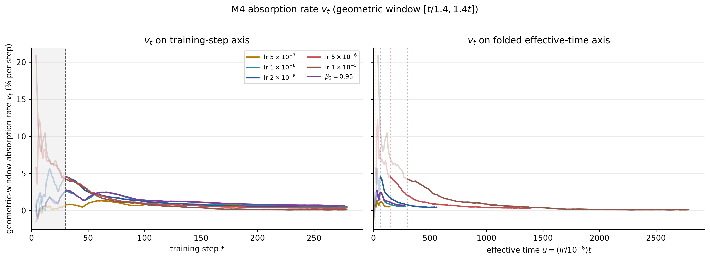
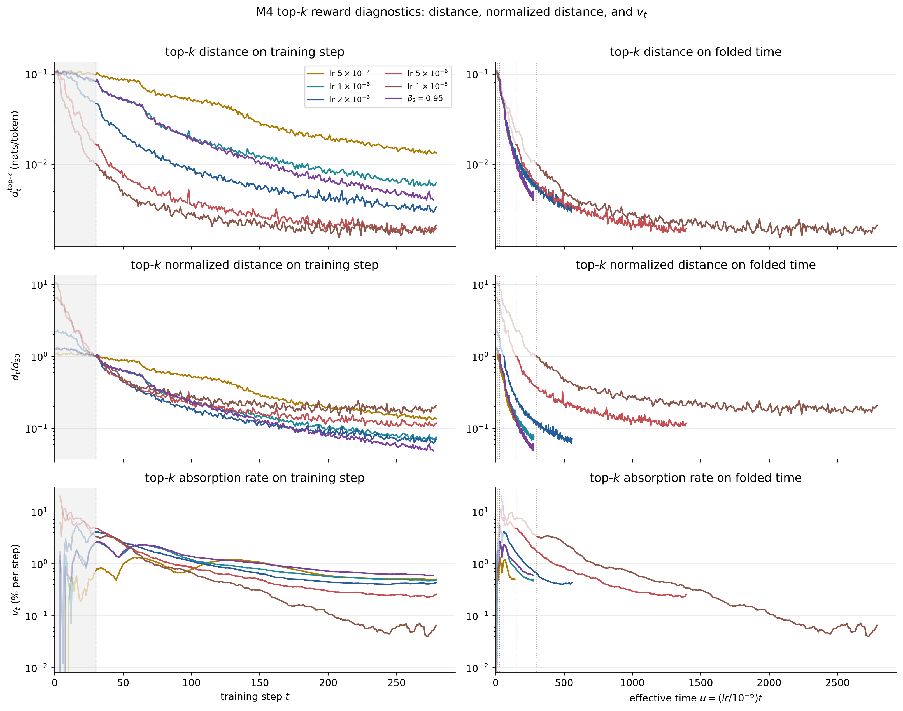
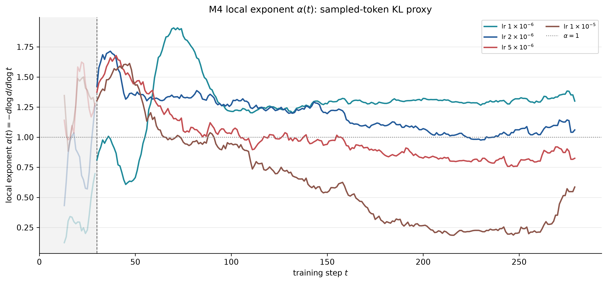
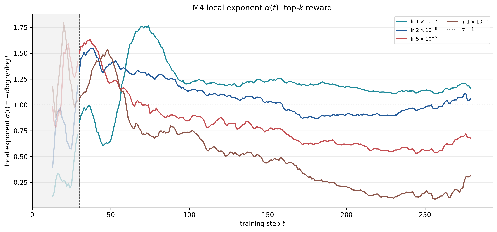
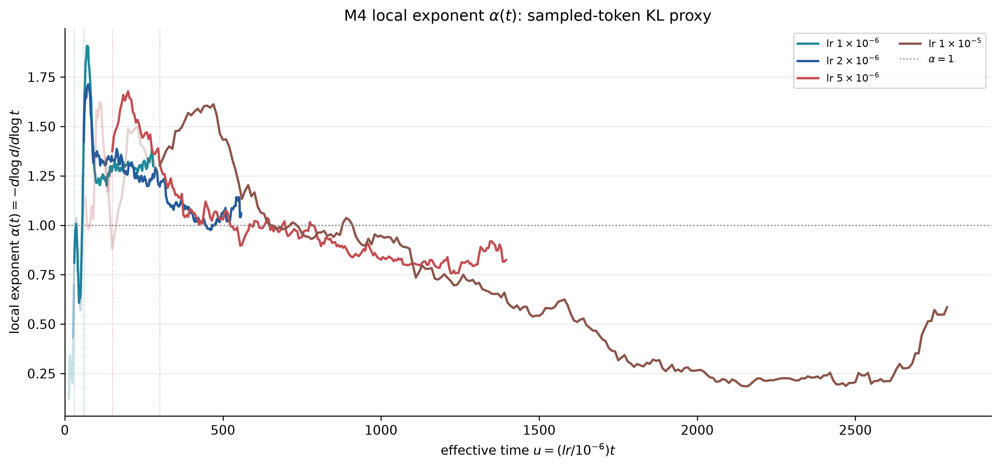
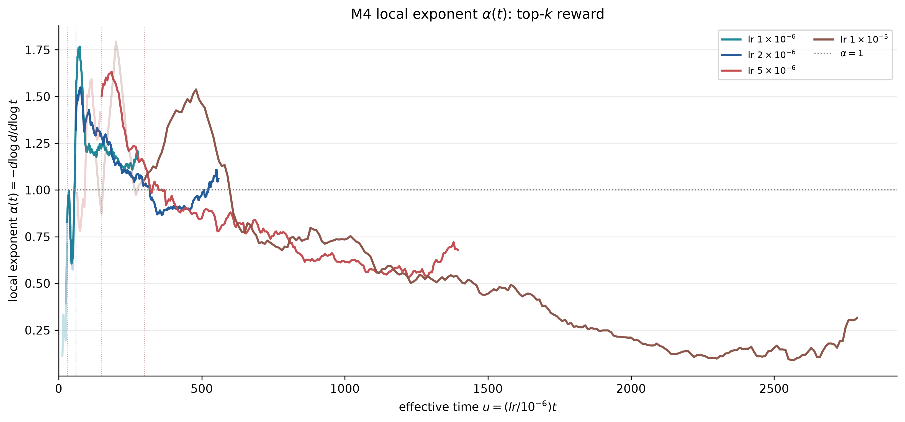
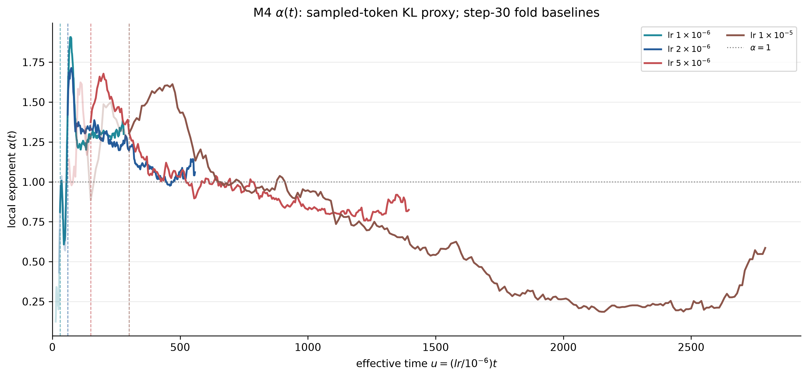
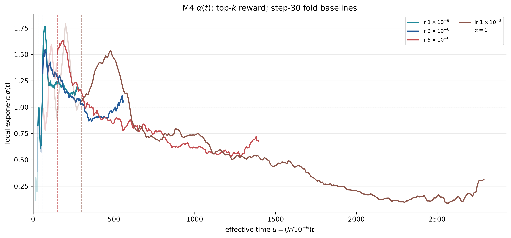
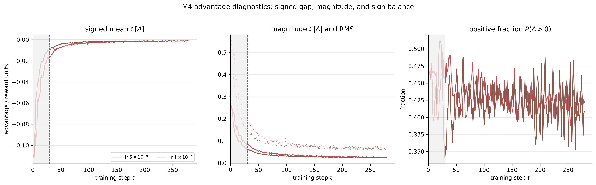
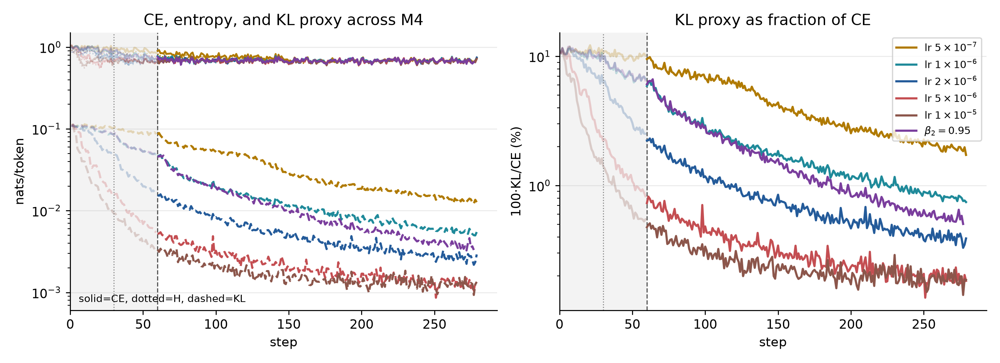

# 从“距离下降”到“观测方程”：重新解释 M4 的吸收率

这份笔记换一个角度处理 M4：先问日志里的标量到底是哪一种误差的投影，再讨论哪条 $v_t$ 曲线下降得最快。这个问题决定了 $v_t$ 能否被解释为 2026-09-06 谱理论中的有效吸收率。

结论是：当前主线

$$
d_t^{\rm signed}=-\mathbb E[A_t],\qquad A_t=\log\pi_T(y_t\mid s_t)-\log\pi_{\theta_t}(y_t\mid s_t)
$$

这里的 signed 并不是问题本身。对 sampled-token direct-k1，$y\sim\pi_\theta(\cdot\mid s)$ 时有

$$
\mathbb E_y\left[\log\pi_T(y\mid s)-\log\pi_\theta(y\mid s)\right]
=-D_{\rm KL}\!\left(\pi_\theta(\cdot\mid s)\Vert\pi_T(\cdot\mid s)\right),
$$

所以 $-\mathbb E[A]$ 是 reverse-KL 的无偏 Monte Carlo 估计；它只是“单样本 reward 带符号”，不是一个有符号的 KL。真正需要区分的是 full-support sampled-token 估计和 top-$k$ 截断估计：后者通常对完整词表 KL 有偏，但候选集合内求和后方差更小。当前 $v_t$ 因而可以直接作为 KL 型距离的动力学读数；$\mathbb E\mid A\mid$、RMS 是回答“单 token 缺口幅度”的另一组指标，不是对 signed KL 的纠正。

## 1. 观测方程：训练动力学经过了哪几层投影

冻结状态集后，局部参数误差可写成

$$
\delta_t=\theta_t-\theta^*=\sum_jx_j(t)e_j,\qquad x_j(t+1)\simeq q_jx_j(t).
$$

其中 $q_j=1-\eta\lambda_j$；Adam 时应理解为 $P_tH_t$ 的有效模态，而不是固定 Hessian 的特征值。token advantage 不是直接的 $x_j$，而是经过 score 投影后的量：

$$
A_i(t)\simeq A_i(0)-\sum_jc_{ij}x_j(t).
$$

日志再对 $A_i$ 做一次聚合，得到 $d_t=G(A_1(t),\ldots,A_n(t))$。实际观测链因此是

$$
\text{谱模态 }x_j(t)\to\text{token score 投影 }A_i(t)\to\text{聚合 }G\to d_t\to v_t.
$$

这带来一个识别边界：$d_t$ 下降，只能证明当前采样测度和当前聚合口径可见的投影在下降，不排除不可见方向旋转、未访问状态上的残差，或正负 token 缺口彼此抵消。

当前代码中的距离是

$$
d_t^{\rm signed}=-\operatorname{mean}(\texttt{opd/token\_reward\_mean}),
$$

几何吸收率为

$$
v_t^{\rm geo}=1-\exp\!\left(\operatorname{slope}_{u\in[t/1.4,1.4t]}\log d_u\right).
$$

它是窗口内 $\log d$ 斜率的指数变换，不是逐步精确的 $1-d_{t+1}/d_t$。窗口估计更稳，但牺牲时间分辨率，且在曲线末端会因窗口不足而提前结束。

## 2. 换 $d_t$ 的四种含义

| 口径                         | 定义                                                                     | 与谱模型的关系                                 | 主要风险                                          |
| ---------------------------- | ------------------------------------------------------------------------ | ---------------------------------------------- | ------------------------------------------------- |
| sampled-token KL（当前主线） | $-\mathbb E_{\pi_\theta}[A]$                                             | 对 reverse-KL 无偏；二次区间内是平方型谱读数   | 单样本方差较大，状态分布仍是 on-policy            |
| top-$k$ KL 指标              | 候选集合内的加权 $\sum_{c\in C_t}w_t(c)[\log\pi_T(c)-\log\pi_\theta(c)]$ | 对完整词表 KL 通常有偏；在固定候选集上方差较小 | 偏差取决于 $C_t$、重归一化和 top-$k$ 策略         |
| L1 幅度                      | $\mathbb E\mid A\mid$                                                    | 符号抵消较弱时近似 $\sum_i a_iq_i^t$           | 它测的是幅度，不是 KL；模式交叉项使其不是严格可加 |
| RMS                          | $\sqrt{\mathbb E[A^2]}$                                                  | 线性单模态下与 L1 同速；平方量速率加倍         | 对少数大缺口更敏感                                |
| KL / top-$k$ KL              | $\mathbb E_sD_{\rm KL}(\pi_\theta\Vert\pi_T)$ 或截断版                   | 二次区间内近似 $\sum_i a_iq_i^{2t}$            | 需整词表或 top-$k$ 重算                           |

在严格二次 KL 模型中，若 $d_t=\sum_i a_iq_i^t$、$a_i\ge0$，逐步定义满足

$$
v_t=1-\frac{d_{t+1}}{d_t}=\eta\langle\lambda\rangle_t.
$$

而平方型距离对应 $q_i^{2t}$，有效速率约为 L1 的两倍。不同 $d_t$ 不是互相矛盾，而是对同一模态施加了不同观测函数；sampled-token KL 的核心问题是采样方差，top-$k$ 的核心问题是截断偏差。

## 3. M4 run：从“谁最快”改成“测到了什么”

用 \`opd/top_k_reward_mean\` 重算后，top-$k$ 距离的形状与 sampled-token KL 很接近，但不同 run 的相对尾部排序会改变：例如 \`mdxt04lm\`、\`yj2w13fq\` 和 \`tjjxnvw9\` 的 top-$k$ 尾部比例分别约为 0.072、0.066 和 0.054；\`l0a6rsc1\` 则约为 0.183。早期 $v_{50}$ 仍随 lr 增大而上升并在高 lr 处平台，说明 top-$k$ 读数保留了相同的“快启动—慢尾部”动力学。top-$k$ 与全量 sampled-token 的差异更适合解释为候选支持集和权重改变，而不是训练动力学完全不同。

局部指数直接由未归一化的实际距离计算：

$$
\alpha(t)=-\frac{d\log d_t}{d\log t}.
$$

如果以 step 30 作为每个 run 的基线，归一化距离定义为

$$
d_t^{(30)}=\frac{d_t}{d_{30}},
\qquad
d_{30}=d_{t=30}.
$$

对应的 normalized alpha 为

$$
\alpha_{\rm norm}(t)
=-\frac{d\log d_t^{(30)}}{d\log t}
=-\frac{d\left(\log d_t-\log d_{30}\right)}{d\log t}
=-\frac{d\log d_t}{d\log t}
=\alpha(t).
$$

因此，step-30 normalization 不会改变 alpha 的数值；它的作用是把每条距离曲线放到同一个纵向基线，并明确“从 step 30 以后相对下降了多少”。图中的竖线位于各 run 的 folded baseline

$$
u_{30}=30\frac{lr}{10^{-6}},
$$

并将竖线左侧的曲线降低透明度。这里移除了 $5\times10^{-7}$ 和 $\beta_2=0.95$ 两条线，只保留四个 lr run：$10^{-6}$、$2\times10^{-6}$、$5\times10^{-6}$ 和 $10^{-5}$；step 0 仍只是横轴起点，因为 $\alpha(0)$ 在 $\log t$ 坐标下没有定义。

两张图都只保留五个 lr run，排除了 $\beta_2=0.95$。中后段 sampled-token 的 $\alpha(t)$ 通常高于 top-$k$，尤其是 $5\times10^{-6}$ 与 $10^{-5}$ 两个 run；这表示 full sampled-token KL 的相对衰减更快，而 top-$k$ 支持集保留了更慢的尾部。step 0 只作为横轴起点：因为 $\log t$ 在 $t=0$ 不定义，$\alpha(0)$ 本身没有数值，曲线从第一个正 step 开始绘制。step 1–80 的尖峰和凹陷包含明显的局部窗口与优化器瞬态，不宜单独作谱结论；中后段的稳定区间更适合比较。

| run        |                配置 | 最后 step | $d_{30}^{\rm signed}$ | $v_{50}$ | $v_{100}$ | $v_{150}$ | $d_T/d_{30}$ |
| ---------- | ------------------: | --------: | --------------------: | -------: | --------: | --------: | -----------: |
| `ybi7q89v` | lr $5\times10^{-7}$ |       279 |                0.1033 |    0.98% |     0.80% |     1.13% |        0.126 |
| `mdxt04lm` | lr $1\times10^{-6}$ |       279 |                0.0855 |    1.59% |     1.22% |     0.82% |        0.061 |
| `yj2w13fq` | lr $2\times10^{-6}$ |       279 |                0.0483 |    2.51% |     1.26% |     0.76% |        0.053 |
| `ml6mz58f` | lr $5\times10^{-6}$ |       203 |                0.0156 |    2.75% |     0.99% |     0.64% |        0.101 |
| `l0a6rsc1` | lr $1\times10^{-5}$ |       198 |                0.0092 |    2.69% |     0.87% |     0.38% |        0.142 |
| `tjjxnvw9` |      $\beta_2=0.95$ |       277 |                0.0847 |    1.77% |     1.40% |     1.11% |        0.045 |

较大学习率提高早期 $v_t$，但没有形成单纯的线性时间缩放：$5\times10^{-6}$ 和 $10^{-5}$ 在 step 50 已接近平台，随后明显减速。按 $u=\eta t$ 折叠不能完全重合，说明 Adam 预条件、曲率或轨迹本身也随 lr 改变。

高 lr 的“快启动—早减速”符合先消化高曲率可见模态、再由低曲率尾部接管的谱图景。$\beta_2=0.95$ 的尾部表现与较短二阶矩记忆相符，但没有匹配 seed 和 update 前后 policy KL，不能作因果结论。

## 4. 关键证据：signed 距离比幅度距离下降得更快

只有 `ml6mz58f` 和 `l0a6rsc1` 记录了完整 advantage 聚合量。到末段：

- `ml6mz58f`：signed $d_T/d_{30}\approx0.101$，但 $\mathbb E\mid A\mid_T/\mathbb E\mid A\mid_{30}\approx0.335$，RMS 比例约 0.361；
- `l0a6rsc1`：signed 比例约 0.142，$\mathbb E\mid A\mid$ 比例约 0.409，RMS 比例约 0.439。

signed KL proxy 的下降明显快于 $\mathbb E\mid A\mid$ 幅度。这个差异不说明 signed 指标失效，而是说明 KL（二次型、带学生概率权重）与 L1（逐 token 幅度）对同一训练状态的加权不同；正负 advantage 分解仍有助于判断单 token 缺口是否集中或重排。

top-$k$ reward 始终比全量 reward 更负，说明重点 token 的缺口更大，但不能把前者当作全量距离的替代。CE、entropy 与 student NLL 在末段彼此接近，故 signed $d_t$ 是两个大数之差，距离越小，相对数值误差越容易放大。

## 5. 与谱理论是否相符？

答案分层看：

1. **定性相符。** 早期速率较高、随后下降；高 lr 加快前段；固定谱无法解释的局部凸起可以归因于 Adam、状态漂移、噪声或距离口径。
2. **对当前 sampled-token KL 主线相符。** 在固定状态、学生采样和局部二次区间内，$-\mathbb E[A]$ 是 reverse-KL 的无偏估计，可使用 KL 型平方谱读数；有限 batch 只引入 Monte Carlo 方差。
3. **top-$k$ 是另一种 bias–variance trade-off。** top-$k$ 候选集减少了估计方差，但相对完整词表 KL 存在截断/重归一化偏差；它适合比较曲线形状和重点 token，不应与 full sampled-token KL 的绝对水平直接混合。

因此，当前 run 没有推翻谱理论；sampled-token signed mean 本身就是合理的 KL 读数。真正需要做的是把 full sampled-token、top-$k$ 和 L1/RMS 并列，分别标注无偏性、截断偏差和方差，避免把不同估计对象的数值直接比较。

## 6. 建议的报告方式

后续每个 run 至少同时报告

$$
\big(d_t^{\rm signed},d_t^{\rm L1},d_t^{\rm RMS},d_t^{\rm KL}\big),\qquad\big(v_t^{\rm geo},\mathrm{window},d_t\big),
$$

并在固定教师状态集上重算。这样可以把三个问题分开：位置（还剩多少）、移动（policy KL 或参数更新量）、效率（每步下降多少）。当前 `actor/ppo_kl` 恒为 0，不能承担第二个问题。

最小方案是：每个 lr 补一个独立 seed；让高 lr run 运行到相同步数；固定 rollout 定期重算 L1/RMS/top-$k$ KL；同时记录 update 前后 policy KL。

指标定义位于 `plots/core/metrics.py`，run 标签与 effective-time scale 位于 `plots/config/runs.py`。对应图已使用现有 M4 输出，无需新增绘图脚本。
