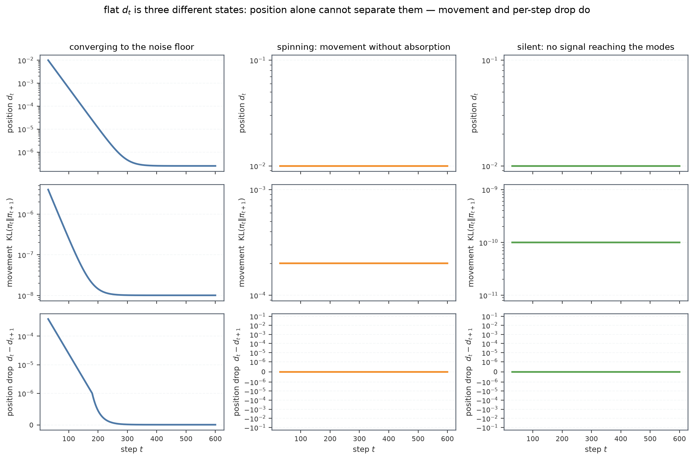
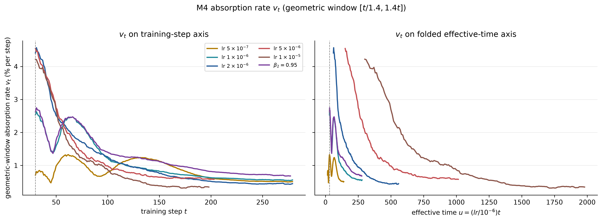
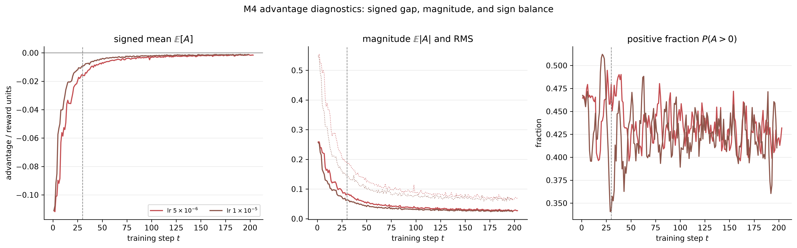
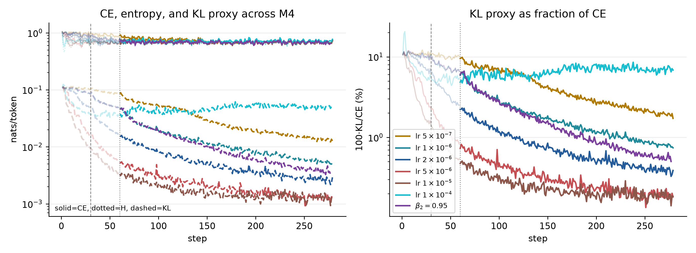
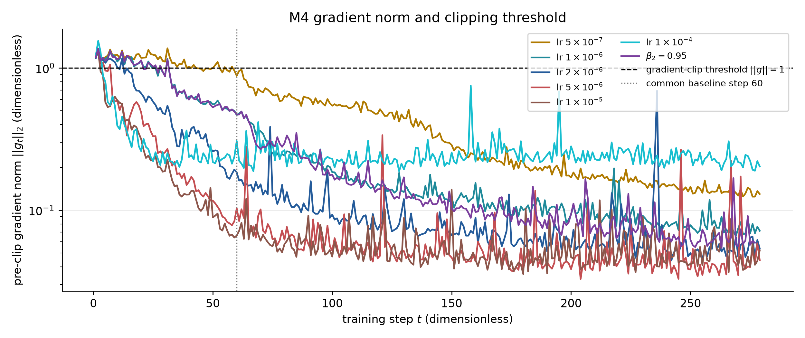
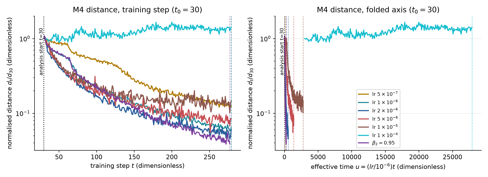
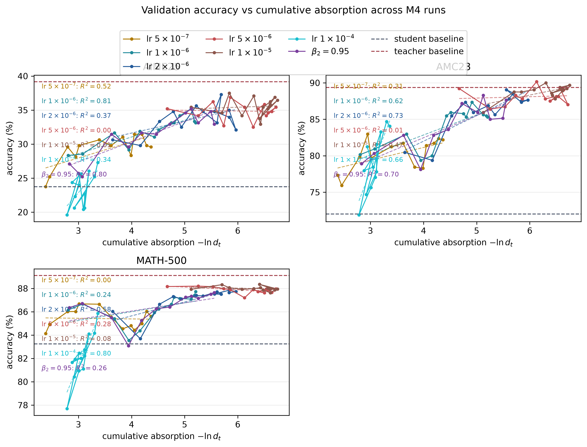

# 吸收率的观测定义与 M4 实证

本文从当前代码和当前 M4 history 重新定义“吸收”这个词。目标不是为已有结论补一段说明，而是回答三个具体问题：日志里的距离到底测到了什么，$v_t$ 如何从距离得到，以及在六个 M4 run 上能否据此比较训练速度。

结论先说清楚：当前日志提供的是一个正距离代理

$$d_t=-\operatorname{mean}(\texttt{opd/token\_reward\_mean}),$$

以及它的相对下降率。本文使用的主读数是几何窗口估计

$$v_t=1-\exp\left(\operatorname{slope}_{u\in[t/1.4,\,1.4t]}\log d_u\right).$$

它近似表示窗口内每一步保留距离的比例下降，而不是每一步减少了多少 nats。$v_t=0.02$ 的含义是局部指数模型下，每步约保留 $98\%$ 的剩余距离。窗口估计牺牲时间分辨率换取稳定性，因此曲线末端会提前结束；这不是数据丢失。

## 1. 从日志到指标

### 1.1 观测对象

`opd/token_reward_mean` 是训练 batch 上 token reward 的均值。代码把它取负，得到正的 $d_t$。因此 $d_t$ 不是参数空间距离，也不是完整分布之间的严格 KL；它是当前采样测度下、训练日志能提供的 teacher–student 不一致程度代理。

这个限定很重要。采样 token 的分布随训练变化，所以 $d_t$ 的变化同时可能来自两部分：学生在相同类型 token 上变得更接近教师，以及学生改变了自己访问哪些 token。仅凭一条 $d_t$ 曲线，不能把两者完全分开。

### 1.2 两个 $v_t$ 估计器

代码同时计算：

- 直接估计：$v_t^{\mathrm{direct}}=(d_t-d_{t+1})/d_t$。它保留单步变化，但会把 batch 噪声直接放大；
- 几何窗口估计：在 $[t/1.4,1.4t]$ 上回归 $\log d$ 对 $t$ 的斜率，再转换为 $1-e^{\mathrm{slope}}$。本文的跨 run 比较使用这个估计器。

如果 $d_t$ 在窗口内近似指数衰减 $d_t\propto e^{-\rho t}$，则 $v_t=1-e^{-\rho}$；小速率时 $v_t\approx\rho$。所以 $v_t$ 是局部有效速率，不是额外的损失函数。

### 1.3 能从 $v_t$ 推断什么

在固定测量集、固定有效步长、无噪声的单指数模型中，$v_t$ 应接近常数；多个时间尺度混合时，快成分先被消化，剩余曲线的有效速率通常下降。实际训练还包含 Adam 状态、曲率漂移、采样测度变化和梯度噪声，因此局部上升只应被解释为“固定谱近似暂时失效”的信号，不能直接解释成吸收变成了负数。

### 1.4 一个更完整的观测方程

令 $a_i(t)=\log\pi_T(y_i\mid s_i)-\log\pi_{\theta_t}(y_i\mid s_i)$。如果把参数位移投影到局部曲率方向 $e_j$，则在小位移近似下

$$a_i(t)=a_i(0)-\sum_j c_{ij}x_j(t)+O(\|x\|^2).$$

因此训练真正产生的是一个不可直接观察的模式振幅 $x(t)$，日志只看到它经过 token score 矩阵 $C=(c_{ij})$ 投影后的统计量。$d_t$ 是这个投影的一个标量聚合，并不是“全部未吸收误差”的充分统计量。某些模式如果在当前采样 token 上投影很小，就会成为观测盲区；距离下降只能证明可见投影在下降。

在固定谱的理想二次模型中，$x_j(t)\approx e^{-\rho_jt}x_j(0)$，于是距离是多个指数的混合。单条 $d_t$ 曲线最多给出剩余模式的局部平均速率，不能唯一反推出谱的形状。这里的“谱解释”是一个有用模型，而不是对现有日志的直接观测。


图中两个不同的谱可以生成几乎相同的归一化距离曲线。这是一个识别边界：曲线拟合可以描述局部衰减，却不能单独证明底层谱的具体形状。

### 1.5 三种不同的距离不能混写

需要区分三种对象：

1. 逐 token 的 $|A|$ 或 $A^2$ 聚合，它们保留幅度信息；
2. 带符号的 $\mathbb E[A]$，正负缺口会相互抵消；
3. 当前日志的 $-\texttt{opd/token\_reward\_mean}$，它是 on-policy batch 上的带符号均值代理。

因此本文不会把 $d_t$ 直接称作严格 KL。只有在采样测度、符号和近似条件都满足时，它才可以被解释为 KL 型距离。训练中学生改变采样分布、熵发生变化时，$d_t$ 的变化可能混合了“学得更像”和“访问了不同 token”两种效应。

## 2. 应该同时看哪些量

一个可用的吸收诊断至少需要三个层次：

| 层次   | 指标                            | 当前日志状态                                   | 能回答的问题               |
| ------ | ------------------------------- | ---------------------------------------------- | -------------------------- | ------------------------------------------- | -------------------------- |
| 位置   | $d_t=-\mathbb E[A]$、$\mathbb E | A                                              | $、$\sqrt{\mathbb E A^2}$  | 新 lr 有 signed/absolute/RMS，旧 run 不完整 | 还剩多少可见缺口           |
| 形状   | 正负均值、$P(A>0)$、分位数、$P( | A                                              | <\varepsilon)$             | 新 lr 有正负均值和正比例；没有分位数        | 缺口是否集中、是否符号抵消 |
| 动力学 | $v_t$、grad norm、policy KL     | $v_t$ 与 grad norm 有；`actor/ppo_kl` 全部为 0 | 下降速度、更新是否仍在发生 |

这也是为什么不能只增加一张 $v_t$ 图：$v_t$ 是位置曲线的局部斜率，只覆盖“下降多快”，不覆盖“下降的是什么”和“是否还有未观测尾部”。

对同一批 token 使用不同聚合口径，可以把这个盲区缩小。$\mathbb E|A|$ 保留幅度，$\sqrt{\mathbb E A^2}$ 对大缺口更敏感，$\mathbb E[A]$ 则最容易被正负抵消。理想单模态下，平方型口径的局部速率约为 L1 口径的两倍；宽谱或符号混合时，这个比例会随时间变化。因此跨口径比较应看斜率和相对趋势，而不是直接比较数值大小。


位置、移动和下降速度也需要分开。当前 history 里的 `actor/grad_norm` 只能表示梯度信号规模，`actor/ppo_kl` 恒为 0，不能作为真实 policy movement。没有 update 前后 KL，就无法判定距离平台究竟是噪声底、旋转还是更新停滞。



## 3. M4 的新图



左图按实际训练步比较；右图把横轴换成 $u=(lr/10^{-6})t$，用于检查学习率是否主要改变了时间尺度。所有曲线都从 step 30 开始展示，因为当前分析把 step 30 作为共同 baseline；$v_t$ 本身的窗口仍要求窗口内有足够的 history。

## 3. 六个 M4 run 的结果

| run        |                配置 | 最后 step | $d_{30}$ | $v_{50}$ | $v_{100}$ | $v_{150}$ | $d_T/d_{30}$ |
| ---------- | ------------------: | --------: | -------: | -------: | --------: | --------: | -----------: |
| `ybi7q89v` | lr $5\times10^{-7}$ |       279 |   0.1033 |    0.98% |     0.80% |     1.13% |        0.123 |
| `mdxt04lm` | lr $1\times10^{-6}$ |       279 |   0.0855 |    1.59% |     1.22% |     0.82% |        0.064 |
| `yj2w13fq` | lr $2\times10^{-6}$ |       279 |   0.0483 |    2.51% |     1.26% |     0.76% |        0.060 |
| `ml6mz58f` | lr $5\times10^{-6}$ |       203 |   0.0156 |    2.75% |     0.99% |     0.64% |        0.103 |
| `l0a6rsc1` | lr $1\times10^{-5}$ |       198 |   0.0092 |    2.69% |     0.87% |     0.38% |        0.130 |
| `tjjxnvw9` |      $\beta_2=0.95$ |       277 |   0.0847 |    1.77% |     1.40% |     1.11% |        0.039 |

这六个 run 都是单 seed，且 W&B 状态为 failed；因此表格适合做机制诊断，不适合估计最终 checkpoint 的泛化性能。新加入的两个高学习率 run 只有约 200 步，不能与 279 步 run 直接比较尾部 $d_T/d_{30}$。

### 3.1 学习率改变了早期速度，但不是单纯的线性缩放

在 step 50，$v_t$ 随 lr 从 $5\times10^{-7}$ 到 $5\times10^{-6}$ 整体上升：0.98%、1.59%、2.51%、2.75%、2.69%。这说明更大的 actor lr 确实提高了早期距离下降速度，但从 $5\times10^{-6}$ 到 $1\times10^{-5}$ 已经出现平台。

在 step 100 之后，排序明显收敛：$2\times10^{-6}$、$5\times10^{-6}$ 和 $1\times10^{-5}$ 的 $v_t$ 都落到约 0.9%–1.3% 区间。也就是说，lr 主要改变了前段推进速度；进入尾部后，曲率、优化器状态或噪声底成为同等重要的限制因素。

右图的 folded axis 没有把五条 lr 曲线完全重合。这个结果否定了一个过强的说法：不能把所有差异都归结为单一的 $u=\eta t$ 时间重参数化。学习率还会改变有效曲率、Adam 的二阶矩状态和训练轨迹本身。

### 3.2 $\beta_2=0.95$ 的尾部表现最好，但不能单独归因

`tjjxnvw9` 在 step 100 和 150 的 $v_t$ 都高于 $1\times10^{-6}$ baseline，并且最终 $d_T/d_{30}=0.039$，是六个 run 中最低的值。这与更短的二阶矩记忆有利于尾部继续移动的解释一致，但当前没有匹配 seed，也没有记录每步策略移动量，因此这仍是相关性，不是因果识别。

### 3.3 高 lr 的“快启动”伴随更早的尾部减速

`l0a6rsc1` 和 `ml6mz58f` 在 step 50 的 $v_t$ 最高，但到 step 150 已降到 0.38% 和 0.64%。结合它们较短的训练长度，较合理的解读是：高 lr 迅速消化了可见的快成分，随后进入由慢成分、状态漂移或噪声底主导的阶段。不能仅凭这张图判断哪一个 run 的最终吸收更充分。

### 3.4 新 lr 的 A 指标：幅度下降比 signed mean 更慢



这张图只对记录了完整 A 聚合量的两个新 run 绘制：`l0a6rsc1`（$1\times10^{-5}$）和 `ml6mz58f`（$5\times10^{-6}$）。实线是均值或比例，虚线是 RMS 的辅助参考。

从 step 30 到末步，$d_t=-\mathbb E[A]$ 的相对比例分别降到 0.130 和 0.103，但 $\mathbb E|A|$ 只降到 0.380 和 0.328，RMS 只降到 0.439 和 0.361。这说明 signed mean 的下降明显快于幅度统计，不能把 $d_t$ 的快速下降直接等同于所有 token 缺口都同比缩小。正负项的抵消、以及少数较大缺口的保留，都可能造成这个差异。

两个 run 的差异也有明确方向：$5\times10^{-6}$ 的 RMS 从 0.1906 降到 0.0688，$1\times10^{-5}$ 从 0.1454 降到 0.0639。绝对终值不能只看比例，因为两个 run 在 step 30 的初始尺度不同；比例上，$5\times10^{-6}$ 的 A 幅度衰减更充分，但它的训练也多了 5 步，仍不能视为同预算因果比较。

### 3.5 正负不对称揭示了 signed mean 的风险

`l0a6rsc1` 在 step 30 的正 advantage 均值为 0.0271、负 advantage 绝对均值为 0.0363，$P(A>0)=0.342$；末步对应 0.0115、0.0127 和 0.410。`ml6mz58f` 在 step 30 对应 0.0337、0.0493 和 0.479，末步为 0.0128、0.0144 和 0.432。

两条曲线都显示负侧绝对均值在早期更大，随后收缩；但正比例并不朝同一个方向变化：$1\times10^{-5}$ 逐渐上升，而 $5\times10^{-6}$ 先下降后回到约 0.42。这意味着 A 的分布变化不是简单的“整体缩放”，而是幅度和符号结构同时变化。对这种数据，单独报告 $\mathbb E[A]$ 会丢掉重要信息；至少应配合 $\mathbb E|A|$、RMS 和正负分解。

### 3.6 top-k reward 与全量 reward 的差异

新 run 的 `opd/top_k_reward_mean` 在 step 30 比全量 `opd/token_reward_mean` 更负：`l0a6rsc1` 为 -0.0101 对 -0.0092，`ml6mz58f` 为 -0.0165 对 -0.0156；末步分别为 -0.00178 对 -0.00120、-0.00214 对 -0.00161。top-k 子集的缺口始终更大，但两者都下降。

这说明高概率或被选中的 token 子集并没有与全量 token 完全同步。top-k 读数适合作为“重点 token 的位置头”，但不能直接替代全量 $d_t$。两者的差距本身值得监控：如果差距扩大，说明剩余误差越来越集中在 top-k 相关区域；如果差距缩小，说明重点 token 与总体的相对难度在接近。

### 3.7 CE、熵和 KL 代理：相减病理仍然存在



对新 run，teacher log-prob 的负值、student NLL 和 entropy 在末段仍彼此接近：`l0a6rsc1` 在 step 30 的 CE/H/学生 NLL 约为 0.652/0.642/0.643，末段约为 0.628/0.625/0.626；`ml6mz58f` 从约 0.707/0.690/0.691 变为约 0.674/0.672/0.673。与它们相减得到的 $d_t$ 已经降到 0.0012–0.0016。

因此 $d_t$ 是两个大而相近的量之差，末段的相对误差会被放大。新 run 并没有消除这个结构性问题，反而因为 $d_t$ 更小而更明显。CE、entropy、student NLL 应作为质量控制曲线一起看，不能把 KL proxy 的末端小数值当成高精度真值。

### 3.8 grad norm 与“还在不在更新”



两个新 run 的 `actor/grad_norm` 在 step 30 分别为 0.256（$5\times10^{-6}$）和 0.189（$1\times10^{-5}$），末段降到约 0.049 和 0.044；历史最大值都约 1.33。梯度范数总体下降，与 $d_t$ 和 A 幅度下降一致，说明训练信号确实在减弱。

但 `actor/ppo_kl` 在所有 run 中恒为 0，因此不能据此判断策略是否仍在移动，也不能区分“已到噪声底”和“更新在不可见方向旋转”。当前位置 $d_t$、梯度幅度和 $v_t$ 只能组成不完整的动力学诊断；需要真正的 update 前后 policy KL 才能补齐移动轴。

### 3.9 validation 与累计吸收





validation accuracy 仍应单独和 $-\ln d_t$ 对照。这个关系在有 headroom 的任务上可能近似线性，但在接近任务上限时会平台。因而“距离继续下降但准确率不变”并不矛盾：它可能表示能力已经饱和，也可能表示当前距离代理在测量任务无关的残差。现有 eval-fit 图保留这一对照，不能用一个跨任务的总斜率概括所有 benchmark。

## 4. 这张图不能回答什么

第一，$v_t$ 不能区分“没有剩余误差”和“还有误差但更新没有传到可观测方向”。需要同时记录距离位置、每步 policy KL 或参数更新量，才能区分收敛、旋转和哑火。

第二，$v_t$ 不能证明谱的具体形状。它只是 $\log d_t$ 的局部斜率；不同的多时间尺度组合可以产生相似曲线。谱反演需要额外的固定状态探针或 Hessian/Fisher 信息。

第三，当前 history 没有逐 token 的 $|A|$ 分位数、吸收分数，也没有冻结教师轨迹上的对照测量。因此本文可以确认“均值代理的局部下降速率”，不能确认尾部 token 是否真的被吸收。

## 5. 下一步测量建议

1. 在固定教师轨迹上定期重算 $\mathbb E|A|$、$\sqrt{\mathbb E A^2}$ 和分位数，避免把采样分布变化误认成吸收。
2. 记录 update 前后的 policy KL，和 $d_t$、$v_t$ 一起构成位置–移动–效率三元组。
3. 对每个 lr 至少补一个独立 seed，并让高 lr run 运行到与 279 步相同的预算，再比较尾部。
4. 报告 $v_t$ 时同时报告窗口、可用步数和末端距离；不要把单个 $v_{50}$ 当作整条训练轨迹的吸收能力。

## 6. 可复现命令

```bash
.venv/bin/python -m alignment.pipelines.m4.absorption
```

图像输出为 `alignment/figures/m4/absorption-rate_vs_step-and-effective-step__runs-m4__geometric.png`。指标定义位于 `alignment/core/metrics.py`，M4 run 的标签和 effective-time scale 位于 `alignment/config/runs.py`。
