# 2026-09-07: 吸收的度量——d_t 的观测方程与升级方案

本文回答一个度量设计问题:**我们能不能找到一个比 $d_t$ 更好地衡量"吸收"的指标?**

结论先行:

1. 不存在一个单一标量能"替代"$d_t$。但 $d_t$ 作为一个裸均值,有四个可以从第一性原理推出、并被我们 run 数据实证的测量病理(单观测向量盲区、口径相减污染、均值坍缩、与噪声底混淆)。
2. 正确的升级不是换指标,而是**把"吸收状态"的可观测代理从一个标量升级为一组正交量**:位置(多口径)、形状(分位数/吸收分数)、移动(每步策略 KL)、以及两个派生读数(跨口径斜率比 $S(t)$、效率 $\Delta d/m$),外加两个定期探针(floor、教师侧)。全部是 `rm_scores` 同一个向量的聚合统计,KB/步量级。
3. $d_t$(多口径版)保留为位置头牌:实测下游准确率对 $\ln d$ 近似线性(R² 0.74–0.87),即 $\ln d$ 已经是能力转移的近似充分统计量;升级的目的是让它可信、完整、可判停,而不是推翻它。

本文是 `2026-09-06-absorption-rate-spectral-theory*.md` 的姊妹篇:那边回答"吸收率为什么下降",本文回答"怎么把'吸收'本身测对"。理论图与实测图由 `alignment/plot_metric_theory.py` 生成;本轮 M4 分析只纳入标准 sampled-token 基线、$\beta_2=0.95$ 和两个 lr 臂。

---

## 1. d_t 在衡量什么:观测方程

### 1.1 概念前置:这里说的"谱"是什么

冻结状态集后,OPD 目标 $J(\theta)=\mathbb E_s\,\mathrm{KL}(\pi_\theta\|\pi_T)$ 在解附近二次化,曲率矩阵是 Fisher/GGN 型的 $A=\mathbb E_c[J_c^\top F_c J_c]$[^amari98][^martens14]。对 $A$ 做特征分解 $Ae_i=\lambda_i e_i$,把参数位移投影到特征基:$\delta=\sum_i x_i e_i$。梯度下降在二次型上**严格解耦**为独立弛豫:

$$x_i(t)=q_i^{\,t}x_i(0),\qquad q_i=1-\eta\lambda_i\approx e^{-\eta\lambda_i t}.$$

**谱**就是这个分解的两件东西:(i) 曲率特征值 $\{\lambda_i\}$(每个方向"多快被吸收");(ii) 误差质量在方向上的初始分布 $\{a_i\} \propto \tfrac12\lambda_i x_i(0)^2$("每个方向上最初有多少要吸收")。把它们合在一个坐标轴上看:定义每步速率 $\rho_i=\eta\lambda_i$,称

$$\nu_0(\mathrm d\rho)=\sum_i a_i\,\delta_{\rho_i}(\mathrm d\rho)$$

为**初始加权谱测度**——一张"按吸收速度分箱的误差质量直方图"。训练即吸收前沿从高 $\rho$ 端向低 $\rho$ 端扫掠这张直方图;剩余距离是它的 Laplace 变换 $d(t)=\int e^{-\rho t}\nu_0(\mathrm d\rho)$,吸收率是剩余质量的谱质心 $v_t\approx\eta\langle\rho\rangle_{w(t)}$[^bordelon20]。这是"吸收"一词在本项目里的全部操作含义:**说得出剩余质量在速率轴上怎么分布,才说得出吸收进行到哪了。**

注意口径:这里的 $A$ 是真 Fisher/GGN,不是 empirical Fisher(后者在解附近不趋近前者)[^kunstner19];SLQ/Lanczos 测的 trace 谱还要再乘任务振幅才是 $\nu_0$(姊妹文档 `2026-09-06-lanczos-fisher-hvp-survey.md`)。

### 1.2 观测方程:$d_t$ 是模式振幅的一个标量泛函

可测量的从来不是 $x_j(t)$,而是每个 token 的带符号缺口。一阶展开给出**观测方程**:

$$a_i(t)\;\equiv\;\log\pi_T(y_i\mid s_i)-\log\pi_{\theta_t}(y_i\mid s_i)\;=\;a_i(0)\;-\;\sum_j c_{ij}\,x_j(t)\;+\;O(\delta^2),\qquad c_{ij}=\langle g_i,e_j\rangle,$$

其中 $g_i=\nabla_\theta\log\pi_{\theta_0}(y_i\mid s_i)$ 是该 token 的 score。也就是说:**token 层可观测状态 $a(t)=a(0)-Cx(t)$,是模式振幅向量经过固定"设计矩阵" $C$ 线性投出来的影子。** 而 $d_t$ 是 $a(t)$ 的一个标量泛函:

- **L1 口径**(论文的 $d_t=\mathbb E|A|$)[^fu26]:在 $a_i$ 符号不翻转的窗口内,$d^{\mathrm{L1}}(t)\approx\sum_j b_jx_j(t)+\text{const}$,观测向量 $b_j=-\overline{\mathrm{sign}(a_i(0))\,c_{ij}}$ 固定——线性泛函,速率 $\eta\lambda_j$;
- **KL 口径**(on-policy 的 $-\mathbb E[A]=\mathrm{KL}(\pi_t\|\pi_T)$/token):$\approx\tfrac12\sum_j\lambda_jx_j^2(t)$——二次泛函,速率 $2\eta\lambda_j$,且带 $\lambda_j$ 加权(大偏差 token 权重更大)。

一句话:**$d_t$ 是用一只固定麦克风(观测向量 $b$)录下来的多模式弛豫过程。** 这个形式化立刻给出三个推论。

### 1.3 推论一:单观测向量有盲区

$b_j\approx0$ 的模式**永远不可见**:学生采样分布不激励的模式($g_i$ 在该方向无一致投影)、师生符号在该模式上互相抵消的模式,无论 $x_j$ 多大都不进入 $d_t$。反之,$d_t$ 的"递减"只说明 $\langle b,x(t)\rangle$ 在降——若 $b$ 与某些模式负相关,那些模式的吸收甚至会让 $d_t$ **上升**。所以实测 $v_t$ 的局部凸起未必是伪影,也可能是真实谱事件(三机制判别见姊妹文档 H3′)。

### 1.4 推论二:曲线形状识别不了谱(简并)

$d(t)=\int e^{-\rho t}\,\nu_0(\mathrm d\rho)$ 只是 $\nu_0$ 的 Laplace 变换。单条有限窗口、带噪声的曲线反演 $\nu_0$ 是经典病态问题;下图是它的合成版:谱 A(离散幂律级联)与谱 B(连续 Γ 密度、有限带边)结构上毫无关系,但 $d(t)/d(30)$ 在整个可测区间吻合到 log-rmse **0.0015**——而单 run 的步间噪声约 ±2%(灰带),是两条曲线差异的 13 倍。

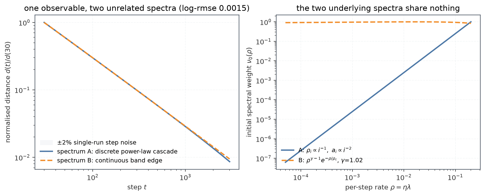

_图 T1:左——两个无关谱的归一化距离曲线在可测区间内不可区分;右——两个底层加权谱 $\nu_0(\rho)$ 形状完全不同。$d(t)$ 的形状最多确定 $\nu_0$ 的逐时刻矩(局部对数斜率),确定不了 $\nu_0$ 本身;族假设必须来自别处的直接测量(如固定状态上的 Lanczos/GGN 探针[^ghorbani19]),不能靠拟合自举。_

### 1.5 推论三:estimand 混淆——三种 $d_t$ 不是同一个量

同一个符号 $d_t$ 混着三个 estimand:

1. **on-policy 口径**:$d_t=\mathbb E_{y\sim\pi_t}|A|$ 或 $-\mathbb E[A]$——比较集(学生采样的 token)每步都在变;学生可以通过"回避"(熵坍缩、不再访问某些 token)压低它而不学教师;
2. **冻结测度口径**(论文的固定 $\mathcal T_t$、冻结状态 run):比较集定常,才是"固定课表的吸收";
3. **日志代理**:$-\texttt{opd/token\_reward\_mean}$ 是 (1) 的 mini-batch 估计,还叠着 $\mathrm{KL}=\mathrm{CE}-H$ 的熵污染(见 §3.2)。

测度的定常性是要求 R5 的来源;教师 token 探针(在教师轨迹上测同一组量)是堵"通过回避来吸收"漏洞的对照侧。

---

## 2. 应该测什么:六条要求与每步记录向量

### 2.1 六条要求

吸收过程的完整状态是 $\{x_j(t)\}$(不可测);可观测的是 $a(t)$ 的统计量。一个量要配叫"吸收指标",应满足:

| #   | 要求                | 内容                                       | $d_t$ 现状                            |
| --- | ------------------- | ------------------------------------------ | ------------------------------------- |
| R1  | 模式可加            | 可写成 $\sum_i w_i(\text{mode})$,$w_i\ge0$ | L1 近似满足;$\mathbb E[A]$ 受符号抵消 |
| R2  | **纯弛豫下单调**    | 见下                                       | L1 满足;KL 代理受熵污染               |
| R3  | 与底分离            | 进度 $=\,(d-d_\infty)$ 的相对变化          | 完全没有                              |
| R4  | 谱可读              | 每步给出剩余质量的谱位置                   | 只有曲线形状一条间接路                |
| R5  | estimand 定常且双侧 | 固定探针 + 学生/教师两侧                   | on-policy 单侧                        |
| R6  | 配速度              | 位置分不开收敛/旋转/哑火                   | 无移动记录(`ppo_kl`≡0)                |

**R2 的展开:什么叫"纯弛豫下单调"。** 纯弛豫指模型最理想的一档动力学:无梯度噪声(SGD→GD)、模式间无耦合、谱冻结($\lambda_i$ 不随时间漂移)、测量集冻结、优化器预条件固定——此时 $x_i(t)=q_i^tx_i(0)$ 严格成立。要求 R2 说的是:**对任意非负初值 $\{x_i(0)\}$ 的纯弛豫轨迹,一个合格的吸收指标必须非增。** 这一条把候选量分成两类:

- **满足者**:$\mathbb E[A^2]$ 的每项是 $\tfrac12\lambda_ix_i^2q_i^{2t}$,非负、递减,精确;$\mathbb E|A|$ 在符号冻结窗口内逐项递减,近似满足。对这类量,"下降"没有别的解释,只能来自吸收——这正是把 $v_t$ 读作 $\eta\langle\lambda\rangle$ 的合法性来源;"混合指数的失效率必然递减"(Proschan 的 DFR 定理[^proschan63])是同一件事的免假设版本。
- **违反者**:$\mathbb E[A]$ 带符号,两类错误(教师更高概率 vs 学生更高概率)的抵消随训练此消彼长,可以假降也可以假升;"两个大数相减"的口径(如 $\mathrm{KL}=\mathrm{CE}-H$)更糟——两个各变 ~20% 的慢变量相减出 ~15× 的"信号",operand 的微小口径误差被放大两个数量级(§3.2 实证)。

两个必要的补充。其一,R2 只在**纯弛豫**下要求:实测 $v_t$ 局部上升恰恰是"某个理想化假设失效"的诊断信号(progressive sharpening、Adam 瞬态、状态漂移[^cohen21]),不是指标失败。其二,R2 与 R1 合起来解释了为什么"口径"重要:同一谱上 $\mathbb E|A|$ 与 $\mathbb E[A^2]$ 的模式分解不同(速率 $\eta\lambda$ vs $2\eta\lambda$、有无 $\lambda$ 加权),跨口径比较 $\alpha$、$v$ 必须换算(姊妹文档 §2.8)。

### 2.2 每步记录向量

满足 R1–R6 的最小设计,全部是 `rm_scores`(即 $\{A_i\}$,含符号)的聚合统计:

$$\boxed{\;\underbrace{\mathbb E|A|,\;\sqrt{\mathbb EA^2},\;\mathbb E[A]}_{\text{位置:三只麦克风}}\;+\;\underbrace{P(|A|<\varepsilon),\ \text{quantiles}}_{\text{形状:吸收分数/分位数}}\;+\;\underbrace{\mathrm{KL}(\pi_t\|\pi_{t+1})}_{\text{移动}}\;+\;\underbrace{R(t),\ S(t),\ \Delta d/m}_{\text{派生}}\;}$$

- **三只麦克风**:每个口径是不同的观测向量,联合起来消盲区、消简并;其中 $\mathbb E|A|$ 与论文同口径,$\mathbb EA^2$ 是唯一严格满足 R1/R2 的量,$R(t)=\mathbb E|A|/|\mathbb EA|$ 是符号混合度(免费);
- **形状**:$P(|A|<\varepsilon)$(几个 $\varepsilon$ 阈值)是最可解释的吸收读数——"百分之多少的 token 已在 $\varepsilon$ nats 内";对重尾稳健,且对量化式吸收(一个 quantum 一步被学会)敏感[^michaud23];分位数补上均值丢失的分布信息(§3.3 实证均值已经坍缩);
- **移动**:$\mathrm{KL}(\pi_t\|\pi_{t+1})$,即每步策略真实移动量——R6 的速度轴。当前训练路径里 `actor/ppo_kl` 恒为 0(未计算),需要补:一次 update 前后学生 logp 的 KL,成本 ~一次 forward;
- **派生**:效率 $\Delta d_t/m_t$ 与跨口径斜率比 $S(t)$(§2.3、§2.4);
- **探针(定期)**:(i) **floor 探针**——冻结状态 + 放大 batch 短程估局部噪声底,把 $d$ 换成可吸收剩余 $d-d_\infty$(理论标度 $d_\infty^{\mathrm{KL}}\propto\eta/B$[^mandt17]),回答"没得吸了还是吸不动";(ii) **教师 token 探针**——固定教师轨迹集上 forward-only 重测上述量,同时把测量集定常化(R5)。

### 2.3 为什么要算跨口径斜率比 $S(t)$

这是本文认为最值得新增的单个派生量,理由有四。

**第一,它把"谱宽"变成每步、免拟合的读数。** 单口径的 $v_t$ 只给出剩余谱质心 $\langle\rho\rangle_w$;要知道谱宽(二阶矩)得对 $v_t$ 再求时间导数(噪声放大、需要长窗)。而两个口径各有自己的加权谱质心,对 $\ln d^{\mathrm{KL}}$ 与 $\ln d^{\mathrm{L1}}$ 各求局部斜率:

$$S(t)\;=\;\frac{\dot{\ln d^{\mathrm{KL}}}}{\dot{\ln d^{\mathrm{L1}}}}\;=\;\frac{2\,E_u[\rho]}{E_w[\rho]},\qquad u\;\propto\;\rho\,e^{-\rho t}\,w,$$

比值把公共的时间参数化消掉,剩下的纯粹是两个加权质心之比——**谱形状的逐时刻签名**。

**第二,零假设便宜且精确。** 单模式(剩余质量集中在一个 $\lambda$ 上)时 $S\equiv2$ 严格成立、免参数:KL 口径的速率恰好是 L1 的两倍。偏离 2 的幅度与方向由谱形状决定,不需要任何谱族假设。要诚实说明:$S-2$ 的**方向不固定**——$u$ 的倾斜因子 $\rho e^{-\rho t}$ 一项向前沿集中、一项向前沿外扩散,合成宽谱上 $S$ 从 2.21 穿过 2 降到 1.85 再回到 1.96(下图右),这条轨迹本身就是读数,而不是某个单调判据。

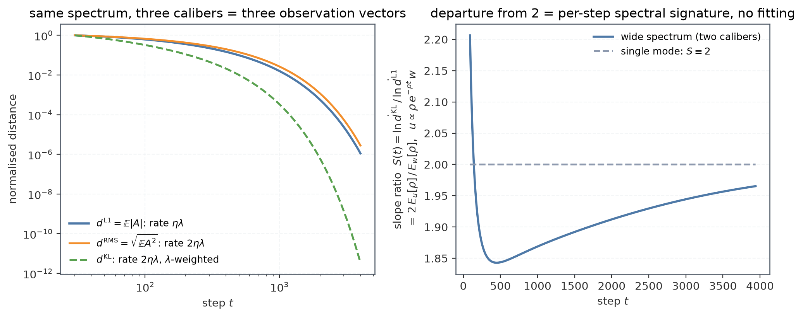

_图 T2:左——同一宽谱下三个口径的归一化距离曲线($\mathbb E|A|$ 速率 $\eta\lambda$;$\sqrt{\mathbb EA^2}$ 速率 $2\eta\lambda$;$\mathbb E[A]$ 的 KL 型速率 $2\eta\lambda$ 且 $\lambda$ 加权);右——斜率比 $S(t)$:单模式恒为 2(灰虚线),宽谱系统性偏离。_

**第三,它是口径纯度的监控器。** 若独立证据说明谱宽是 $O(1)$(如姊妹文档由 $-\dot v/\eta^2$ 读出的相对谱宽 0.7–0.9),而 $S(t)$ 钉死在 2,说明两个口径被同一个非谱项主导——典型嫌疑是固定测度下的线性项或熵污染。$S(t)$ 因此同时是 R1/R2 是否被当前日志口径满足的在线检验。

**第四,它与 cumulant 阶梯交叉验证。** 单口径给出 $\kappa_1=v_t/\eta$;$S(t)$ 给出两个不同加权下 $\kappa_1$ 的比值;联合 $\dot\kappa_1=-\eta\kappa_2$ 可互检估计器伪影(几何窗口 vs OLS、median 端点 vs 全窗)。三套读数在同一 run 内自洽,谱读数才可信。

### 2.4 位置–移动–每步下降三元组:三种"平 $d_t$"的判别

"d 平了"在模型里有三种不相干的原因:**到达噪声底**(位置停在 $d_\infty$,移动停在 OU 扩散水平)、**旋转**(巨大的正交参数移动,$d$ 不动)、**哑火**(没有信号到达任何模式,移动 $\approx0$)。位置永远分不开三者;配上移动 $m_t=\mathrm{KL}(\pi_t\|\pi_{t+1})$ 与每步下降 $\Delta d_t=d_t-d_{t+1}$,三者特征分明,而 $\Delta d_t/m_t\to0$ 就是"停止吸收"的判据——它也是 P1 吸收率闭环控制器真正需要的反馈信号(姊妹文档 §7)。

_图 T3:合成三情景(单模式 + OU 梯度噪声)。收敛:位置衰减 ~4×10⁴ 倍、移动衰减 ~400 倍到扩散水平、每步下降归零;旋转:位置停在底、移动大且恒定;哑火:位置停在高处、移动近零。_

---

## 3. 实测确认(2026-09-07 重拉)

### 3.1 跨 run 总览

| run        | 配置                        | $T$ | $d_{30}$ | $d_T/d_{30}$ | $v_{50}$ | $v_{100}$ | $v_{150}$ |
| ---------- | --------------------------- | --: | -------: | -----------: | -------: | --------: | --------: |
| `mdxt04lm` | 1.5B sampled-token          | 279 |   0.0855 |        0.064 |    1.59% |     1.22% |     0.82% |
| `tjjxnvw9` | $\beta_2=0.95$ (M4 A1)      | 277 |   0.0847 |        0.045 |    1.77% |     1.40% |     1.11% |
| `yj2w13fq` | lr $2\times10^{-6}$ (M4 C2) | 279 |   0.0483 |        0.053 |    2.51% |     1.26% |     0.76% |
| `ybi7q89v` | lr $5\times10^{-7}$ (M4 C1) | 224 |   0.1033 |        0.126 |    0.98% |     0.80% |     1.13% |

$v_t$ 用几何窗口估计(窗口 $[t/1.4,\,1.4t]$ 必须完整落在 $[30,T]$ 内);例如 $v_{200}$ 只有在 $T\ge280$ 时才有定义,因此 C1 臂的末段只能报告到 $v_{150}$ 附近。$d$ 为 KL 代理 $-\texttt{opd/token\_reward\_mean}$。M4 三臂均为单 seed、非正常结束(run state=failed),以下只作方向性证据。论文 L1 口径自己的读数是 $d_{300}/d_{30}\approx0.16$–$0.22$、$v_{50}/v_{200}=4.2$–$6.4$[^fu26],与我们的 KL 口径不可直比(§3.2)。

### 3.2 口径病理:KL 代理 = 两个大慢变量相减

`mdxt04lm` 上 step 30→278:CE($-\texttt{opd/teacher\_logp\_mean}$)只降到 ×0.82,$H$(`actor/entropy`)只降到 ×0.90,而相减出的 KL 代理降到 ×0.077。末段 KL 仅占 CE 的 **0.78%**(step 30 时为 9.3%)——operand 有 1% 的口径误差,读数错 100%。这是 R1/R2 被当前日志口径违反的直接实证,也是"直接测 $\mathbb E|A|$、$\mathbb EA^2$,不做减法"的依据。

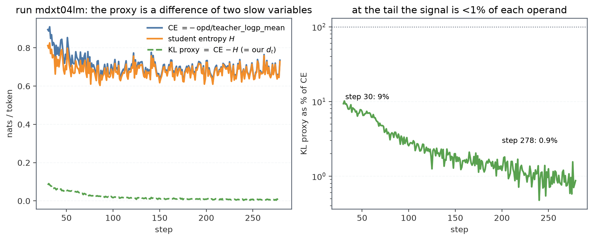

_图 D1:左——CE、学生熵、KL 代理三条曲线(KL 是两条慢变量的差);右——KL 代理占 CE 的百分比,末段 <1%。_

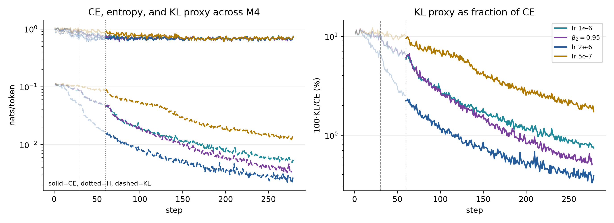

_图 D1b：实线为 CE，点线为学生熵，虚线为 KL 代理；右图显示 KL/CE。四个 run 都在训练后段进入百分比级 KL，说明相减病理是共同结构。_

四个有效 run 的端点分解如下（step 30 → 最后一步；KL/CE 为末端相对占比）：

| run                          |          CE |  学生熵 $H$ |   KL 代理 $d$ | 末端 $d/CE$ |
| ---------------------------- | ----------: | ----------: | ------------: | ----------: |
| baseline lr $1\times10^{-6}$ | 0.896→0.735 | 0.812→0.729 | 0.0855→0.0055 |       0.75% |
| $\beta_2=0.95$               | 0.891→0.655 | 0.807→0.654 | 0.0847→0.0033 |       0.50% |
| lr $2\times10^{-6}$          | 0.773→0.748 | 0.724→0.744 | 0.0483→0.0029 |       0.39% |
| lr $5\times10^{-7}$          | 0.980→0.736 | 0.874→0.722 | 0.1033→0.0127 |       1.73% |

这确认相减病理并非基线独有：四臂末端 KL 都只占 CE 的约 0.4–1.7%，其中 2e-6 臂最极端；因此任何 CE 或熵的微小系统误差都会显著放大到 KL 代理。

### 3.3 均值坍缩:重尾从未被均值代表

$\mathbb E[A]$ 降 15.6× 的同时,批内极值 $|A_i|$ 恒在 4–24 nats,极值/均值比从 164(step 30)涨到 2449(step 278,末帧尖峰 4844)。单个均值对"还剩什么没吸收"失去表达能力——吸收分数 $P(|A|<\varepsilon)$ 与分位数补的正是这一块。

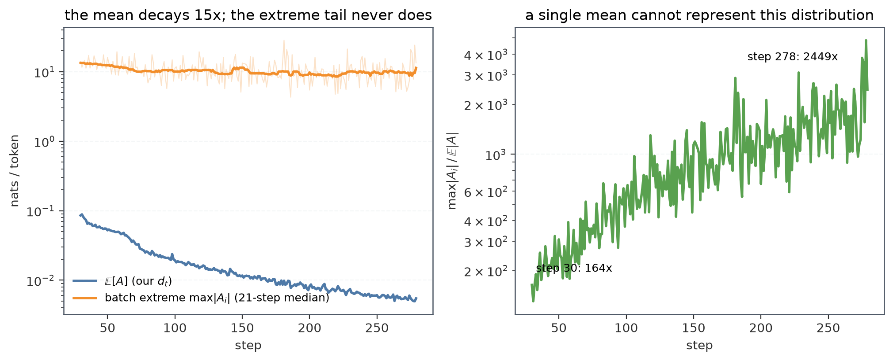

_图 D2:左——均值衰减 15.6×,极值带(21 步中位数)不降;右——极值/均值比的两个数量级爬升。_

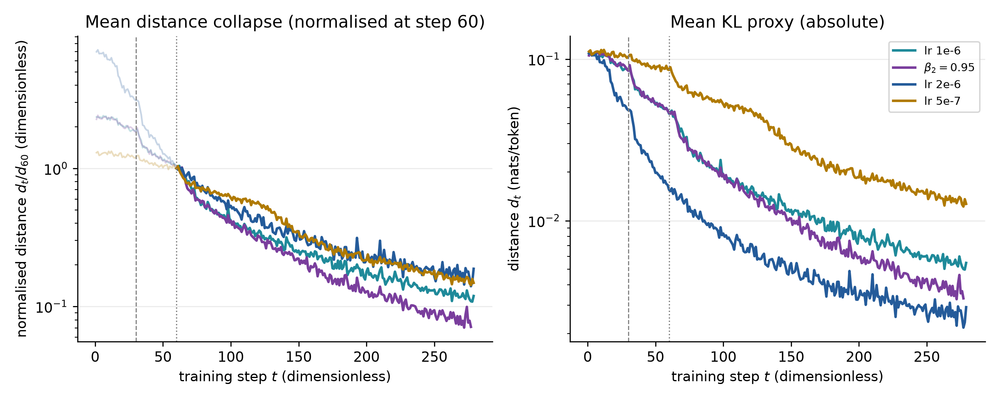

_图 D2b：左图统一以 step 60 的 $d_{60}$ 归一化，但完整显示 step 0–末步；step 30/60 用竖线标出，左侧浅色仅表示“未纳入主拟合区间”。右图为从 step 0 开始的绝对 KL 代理。lr=5e-7 的下降最慢；β₂=0.95 与 lr=2e-6 的末端均值接近，但这仍然不是逐 token 重尾证据。\_

需要区分“均值坍缩”和“重尾本身”：当前 W&B history 只记录了 `token_reward_mean`，没有逐 token $|A_i|$ 分位数或极值，因此无法对 M4 三臂直接复算 D2 的极值/均值比。可复核的替代读数是均值代理的衰减：baseline、β₂=0.95、lr=2e-6、lr=5e-7 的 $d_T/d_{30}$ 分别为 0.061、0.045、0.053、0.126；这说明低学习率臂的整体均值下降较慢，但不能据此断言其尾部更轻或更重。逐 token hook（M3）仍是补齐 3.3 的必要条件。

### 3.4 位置与能力的连接:ln d 是近似充分统计量,但有任务依赖斜率

`mdxt04lm` 每 20 步测了下游 eval(`val-core`,mean@16;缓存于 `alignment/runs/mdxt04lm__eval.csv`)。对 $-\ln d_t$ 线性回归:AIME25 $R^2=0.87$、AMC23 $R^2=0.74$、MATH-500 $R^2=0.36$;每 1 e-fold 吸收对应 AIME +2.8 分、AMC +3.3 分、MATH-500 +0.8 分。即:**在还有 headroom 的任务上,$\ln d$(累计吸收)是能力的近似充分统计量;近天花板处脱钩**(MATH-500 在 step 60 已达 0.867,终值 0.877,其后 $d$ 再降 8 倍只换 1 分)。这是保留 $d$ 为位置头牌的依据,也是不能只看 $d$ 判停的依据。

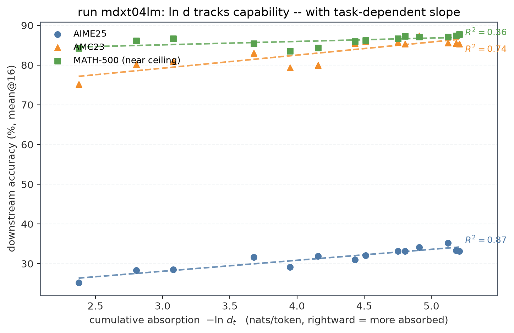

_图 D3:三个 benchmark 的准确率对 $-\ln d$ 散点与线性拟合。_

本轮把同一拟合扩展到四个有效训练 run（每个 run、每个 benchmark 单独回归；$x=-\ln d_t$，准确率为 mean@16）：

| run                          | AIME25 $R^2$ / slope | AMC23 $R^2$ / slope | MATH-500 $R^2$ / slope |
| ---------------------------- | -------------------: | ------------------: | ---------------------: |
| baseline lr $1\times10^{-6}$ |          0.81 / 2.45 |         0.62 / 2.76 |            0.24 / 0.76 |
| $\beta_2=0.95$               |          0.80 / 2.97 |         0.70 / 3.05 |            0.26 / 0.71 |
| lr $2\times10^{-6}$          |          0.37 / 1.76 |         0.73 / 3.51 |            0.58 / 1.20 |
| lr $5\times10^{-7}$          |          0.52 / 2.37 |         0.31 / 1.74 |           0.00 / −0.05 |

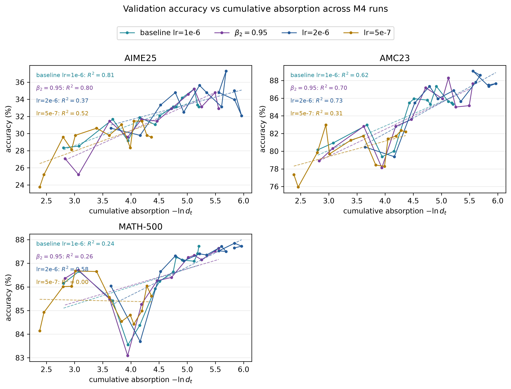

_图 D3b：四个 run 的逐 benchmark 拟合。AIME25/AMC23 在基线与 β₂ 臂上仍有较强线性关系；lr=5e-7 的 MATH-500 基本处于平台，说明接近任务天花板时 $d_t$ 不是能力的充分统计量。_

### 3.6 节奏是优化器×几何的性质:指标必须跨优化器可比

M4 三臂的最新 history 给出更清晰但仍属探索性的信号。其一,$\beta_2=0.95$ 臂的 $v_{50}/v_{100}/v_{150}=1.77/1.40/1.11\%$,相对基线 `mdxt04lm` 的 1.59/1.22/0.82% 均更高,支持“更短二阶矩记忆 → 更少软底/更快尾部衰减”的 H3 方向。其二,lr 臂在原始步轴上呈现预期的速度差:$2\times10^{-6}$ 在 step 50 的 $v=2.51\%$,基线为 1.59%,而 $5\times10^{-7}$ 仅 0.98%。在折叠轴 $u=(\mathrm{lr}/10^{-6})t$ 上,旧有的局部比例仍近似成立,但由于 C1 只有 224 步且尾部 $v_t$ 噪声较大,不能把单点比值升级为定量定律。换优化器会移动整个 $\{\eta\lambda^{\mathrm{eff}}\}$ 谱(H6/M6),所以吸收指标必须定义在跨优化器可比的口径上——这是本文主张“多口径聚合量”而非“某个论文标量”的又一理由。

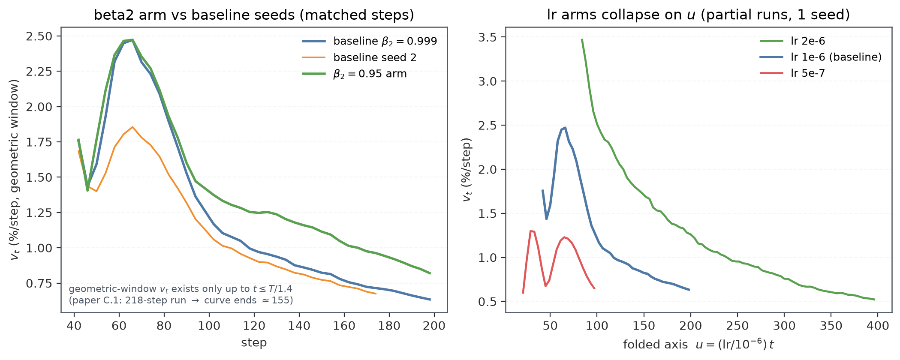

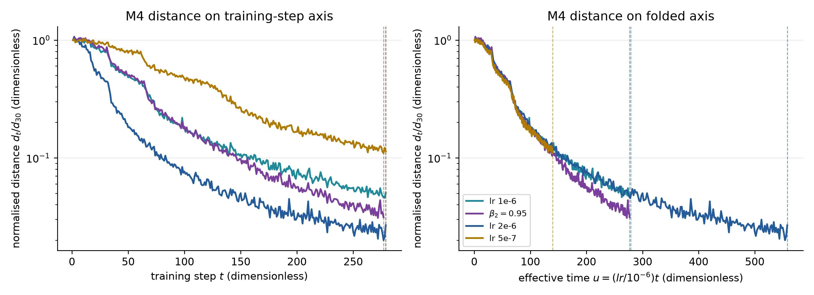

_图 D5b：加入基线、β₂=0.95、lr=2e-6、lr=5e-7 四条实际 run。原始步轴上学习率决定早期下降速度；折叠到 $u=(lr/10^{-6})t$ 后，早期差异收窄但没有全程重合，低 lr 臂尾部偏离最明显。β₂=0.95 的曲线整体接近快速吸收组，提示 Adam 二阶矩记忆也会改变有效时间尺度。_

### 3.7 Figure 19 风格的 M4 图

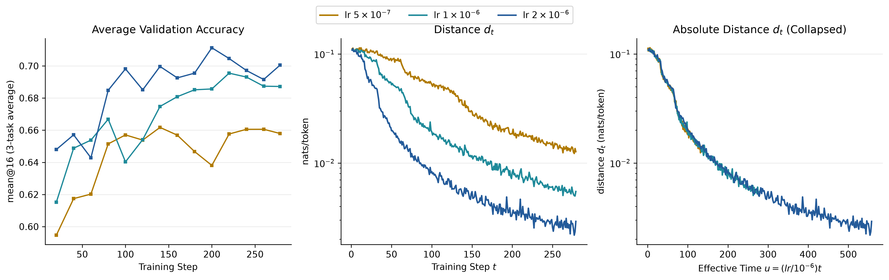

这张图沿用 Figure 19 的三栏布局。左栏单独显示三任务平均 validation accuracy；中栏显示从 step 0 开始的原始距离 $d_t$；右栏同样显示从 step 0 开始的绝对距离，只把横轴换成 $u=(lr/10^{-6})t$。因此右栏不是归一化距离，不能与 D5b 的 $d_t/d_{30}$ 或 $d_t/d_{60}$ 直接比较。折叠后早期曲线明显更接近，说明 lr 主要改变有效时间尺度；但尾部仍有可见分叉，尤其是 $5\times10^{-7}$ 臂，表明 Adam 的状态记忆、噪声底和有限 run 长度不能被单一 lr 缩放完全消除。因此这里支持“近似 lr 折叠”，不宣称严格普适坍缩。

### 3.8 clipping 基准的敏感性

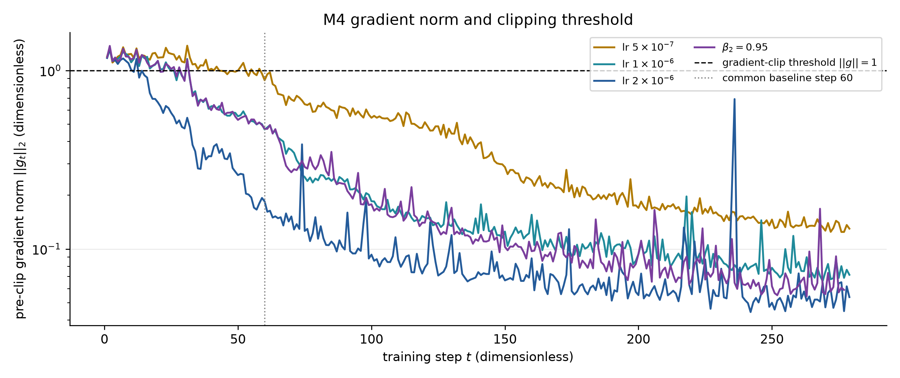

_图 D6：`actor/grad_norm` 是裁剪前梯度范数，虚线为配置中的阈值 $||g||_2=1$。四个 run 最后一次超过阈值的 step 分别为 baseline=31、$\beta_2=0.95$=31、lr=$2\times10^{-6}$=12、lr=$5\times10^{-7}$=58；因此 step 60 是四臂共同的保守无 gradient-clipping 起点。_

为检查这个选择是否改变结论，分别以 step 30 与 step 60 作为归一化和折叠起点重画了两套图。图中的彩色竖向虚线标出每条 run 的实际截断位置，并直接标注 step 或折叠后的 $u$ 数值；黑色点虚线标出共同分析起点。

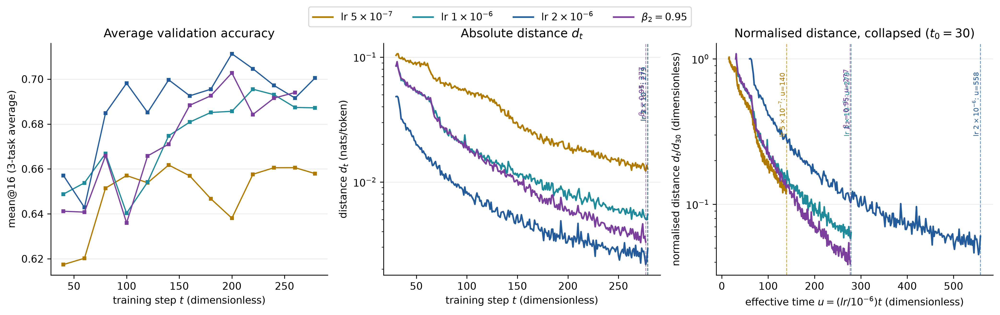

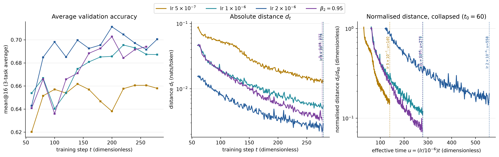

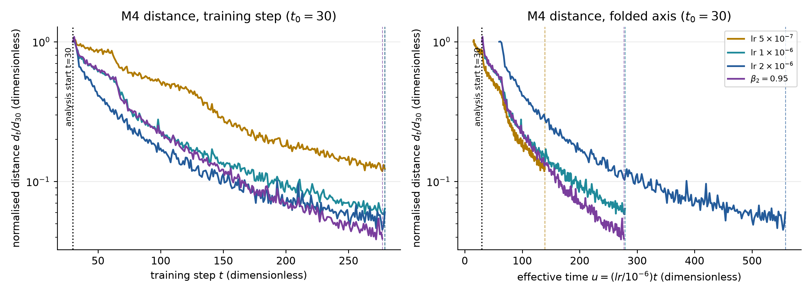

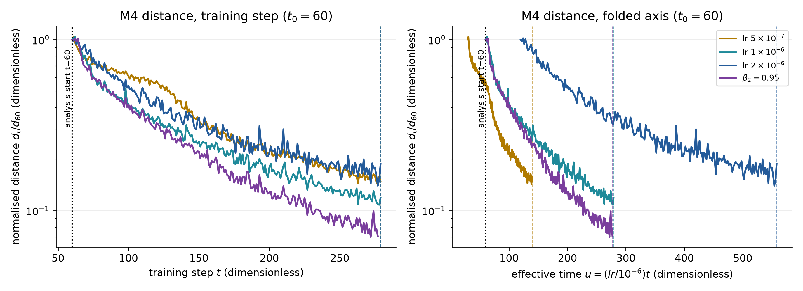

step 60 会缩短可用尾部窗口，但不改变主要排序：lr=$2\times10^{-6}$ 早期下降最快，lr=$5\times10^{-7}$ 最慢，$\beta_2=0.95$ 接近快速吸收组；折叠后早期趋同、尾部仍分叉。后续跨 run 的定量比较优先采用 step 60，step 30 版本保留用于与历史结果对照。

### 3.9 统一的六面板距离图

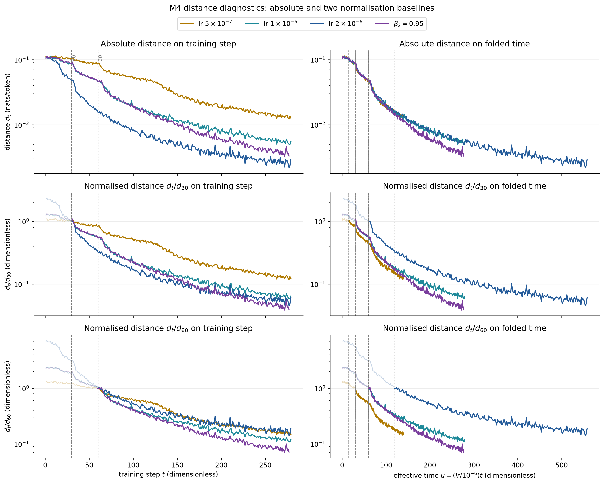

左列使用原始训练步 $t$，右列使用折叠时间 $u=(lr/10^{-6})t$；三行分别是绝对距离 $d_t$、以 step 30 归一化的 $d_t/d_{30}$、以及以 step 60 归一化的 $d_t/d_{60}$。每个面板都从 step 0 开始显示：step 30（灰色虚线）与 step 60（灰色点线）只是分析基准，不再截断曲线；基准左侧用浅色表示，避免把“展示范围”和“拟合范围”混为一谈。

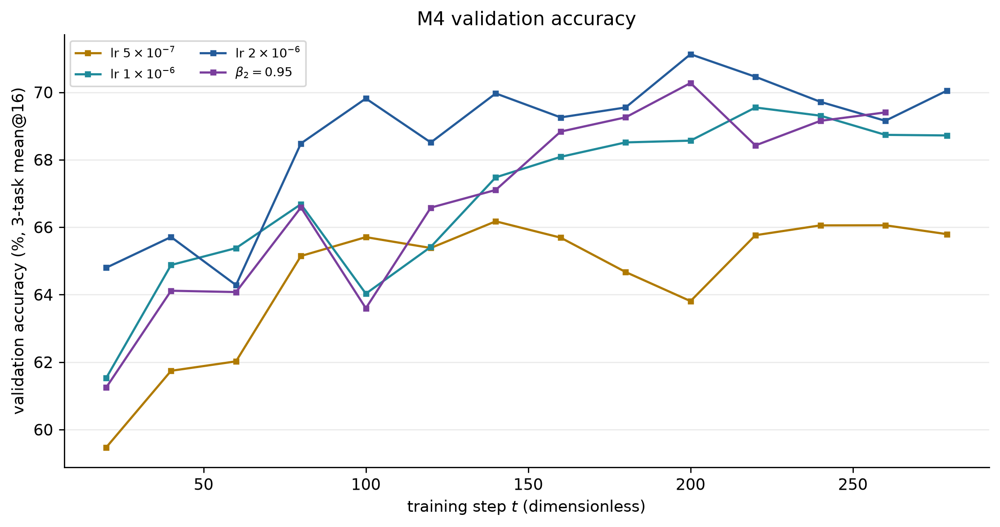

验证准确率单独绘制，不与距离的三种纵轴口径混在同一图中。这样可以分别回答“模型实际距离是多少”“相对吸收进度如何”“折叠后动力学是否接近”以及“下游能力是否同步变化”。

_图 D5:左——$\beta_2=0.95$ 臂对两个基线种子的匹配步数对比(几何窗口 $v_t$ 仅存在到 $t\le T/1.4$,论文 C.1 约定);右——lr 三臂在折叠轴 $u$ 上,$v$ 按预测比例缩放。_

---

## 4. 结论与执行清单

**对标题问题的回答**:$d_t$ 是一只麦克风——固定观测向量对剩余模式振幅的(近似)线性/二次泛函。它满足六条要求中的 R1(近似)与 R2(L1 口径),违反 R3–R6。没有单一标量能同时回答"还剩多少、还在动吗、还在吸收吗";正确做法是把可观测代理升级为一个每步向量 + 两个派生读数,$d_t$(多口径)保留为位置头牌。

按成本排序:

1. **零成本(现有日志)**:(i) 把 eval↔$\ln d$ 校准固化进 alignment 流水线(§3.4);(ii) $d$ 斜率 + CE + $H$ + grad_norm 四线告警,及时拦截 advantage 配置异常;(iii) 用修正后的几何窗口($v$ 只在窗口完整落在 $[30,T]$ 时报告)重算全部历史读数。
2. **小改动(trainer hook,~10 个聚合量/步)**:$\mathbb E|A|$、$\mathbb EA^2$、$P(|A|<\varepsilon)$×4、$|A|$ 分位数×3、符号分解 $d^\pm$、修复 `ppo_kl`;`pull_wandb_metrics.py` 的 `DEFAULT_KEYS` 同步扩展。这一步落地后,$S(t)$、$R(t)$、效率曲线全部免费。
3. **每 run 一次**:冻结探针集(16–64 条 step-0 轨迹 + 缓存教师 logp,每步 forward-only)把测量集定常化;floor 探针(放大 batch 短程)给出 $d-d_\infty$。
4. **已规划的大件不变**:M3 逐 token parquet(分位数/十分位谱反演需要重分析能力)、M5 Lanczos($\nu_0$ 的直接测量,是 T1 简并的唯一出路)[^ghorbani19]。

### 参考文献

[^fu26]: Z. Fu, B. He, Y. Zuo, et al. Rethinking On-Policy Distillation of Large Language Models II: One Training Example. arXiv 2026. [arXiv:2609.04172](https://arxiv.org/abs/2609.04172)

[^amari98]: S. Amari. Natural Gradient Works Efficiently in Learning. Neural Computation 1998.

[^martens14]: J. Martens. New Insights and Perspectives on the Natural Gradient Method. JMLR 2020. [arXiv:1412.1193](https://arxiv.org/abs/1412.1193)

[^bordelon20]: B. Bordelon, A. Canatar, C. Pehlevan. Spectrum Dependent Learning Curves in Kernel Regression and Wide Neural Networks. ICML 2020. [arXiv:2002.02561](https://arxiv.org/abs/2002.02561)

[^kunstner19]: F. Kunstner, P. Hennig, L. Balles. Limitations of the Empirical Fisher Approximation for Natural Gradient Descent. NeurIPS 2019. [arXiv:1905.12558](https://arxiv.org/abs/1905.12558)

[^ghorbani19]: B. Ghorbani, S. Krishnan, Y. Xiao. An Investigation into Neural Net Optimization via Hessian Eigenvalue Density. AISTATS 2019. [arXiv:1901.10159](https://arxiv.org/abs/1901.10159)

[^proschan63]: F. Proschan. Theoretical Explanation of Observed Decreasing Failure Rate. Technometrics 1963.

[^cohen21]: J. Cohen, A. Kaur, Y. Li, J. Z. Kolter, A. Talwalkar. Gradient Descent on Neural Networks Typically Occurs at the Edge of Stability. ICLR 2021. [arXiv:2103.00065](https://arxiv.org/abs/2103.00065)

[^michaud23]: E. J. Michaud, Z. Liu, U. Girit, M. Tegmark. The Quantization Model of Neural Scaling. NeurIPS 2023. [arXiv:2303.13506](https://arxiv.org/abs/2303.13506)

[^mandt17]: S. Mandt, M. Hoffman, D. Blei. Stochastic Gradient Descent as Approximate Bayesian Inference. JMLR 2017. [arXiv:1704.04289](https://arxiv.org/abs/1704.04289)
