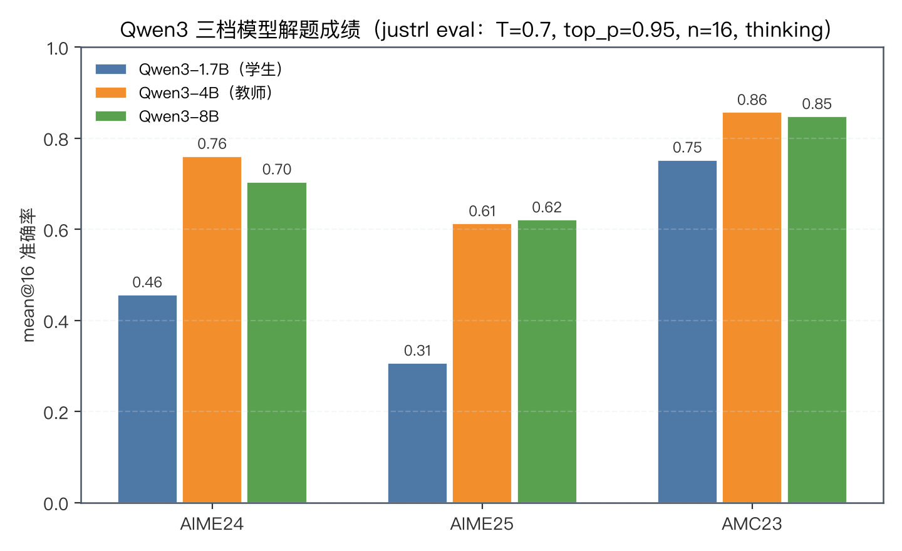
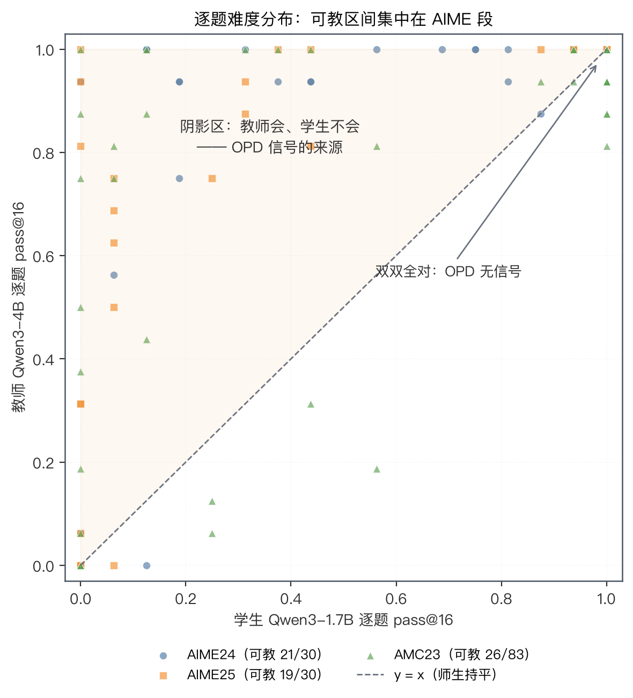
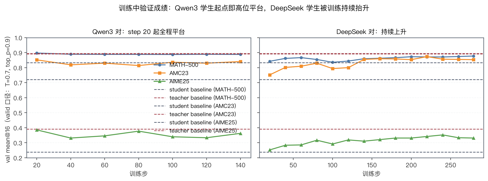

# Qwen3 师生对 OPD 平坦 gap 诊断：eval setting 对照与"学生太强"假说检验

> 状态：诊断完成（2026-09-07，单 run 单 seed 口径）。run `um5vzc6m`（`0906-opd_math_full_Qwen3-1.7B-sampled_adv_direct-T_1.0-0728`）158 步时 OPD gap 无衰减迹象。
> 配套图由 `alignment/pipelines/qwen3/main.py` 生成，位于 `alignment/figures/qwen3/`。

## 0. 结论（TL;DR）

1. **"学生太强、教师教不了东西"这个假说只说对一半，且与最关键的观测方向相反**。在训练分布对应的难度段（MATH-500 / AMC23）上，学生确实已经与教师持平——这部分题上 OPD 没有信号；但 AIME 段教师仍强 25–30pp，"有东西可学"的题大量存在。
2. 若"没东西可学"是主因，OPD gap 应该**小**；实测 Qwen3 对的 gap（≈0.14/token）反而是 DeepSeek 对基线初始值（≈0.09）的 1.5 倍，且 158 步零衰减。**gap 大而不是小，指向的不是"信号缺失"，而是"信号大部分不可对齐"**。
3. 与 DeepSeek 对（`mdxt04lm`，同 lr 同配方）对照：同源师生 200 步内 top-k 重叠率 0.82→0.94、gap 衰减 89%；异源师生重叠率 0.76→0.77 纹丝不动。**师生分布是否同族（可对齐），比学生强弱更是 OPD 有效性的前提**（H-同源，见 §5）。
4. eval setting 对照（§2）：justrl eval 与我们 valid 的核心采样协议一致（n=16、T=0.7、max_tokens=31744、thinking 模式），差异在 top_p（0.95 vs 0.9）与题集组成；同一模型同题分数差几 pp（AIME25 0.31 vs 0.39），不改变任何定性结论，但两套口径的分数**不可直接横比**。

## 1. 背景

Qwen3-1.7B（学生）→ Qwen3-4B（教师）[^qwen3] 的 full-data run `um5vzc6m`（OPD 配方 [^fu26]，即 §6.0 基线 recipe）在 step 20–158 间 `opd/token_reward_mean` 死平在 −0.14（线性拟合 138 步总漂移仅 1.4%），而 DeepSeek 对基线 `mdxt04lm` 同窗衰减 89%（§4 图）。该 run 并非 M4 arm（config 与基线仅差模型路径与新增 metrics 钩子），是为 Qwen3 对铺路的基线复现。本文回答三个问题：

- justrl 侧对 Qwen3 的评测 setting（`OPD/scripts/val/eval`）与我们的 valid 差别大不大？
- 学生是不是已经太强，导致教师没有可教的东西？
- OPD 关键指标（overlap 等）在 Qwen3 对上到底长什么样？

## 2. eval setting 对照：justrl eval vs 我们的 valid

| 项              | justrl eval（`OPD/scripts/val/eval/gen_vllm.py`） | 我们 valid（`val_kwargs`，um5vzc6m 实测 config）        |
| --------------- | ------------------------------------------------- | ------------------------------------------------------- |
| 题集            | AIME24、AIME25、AMC23（83 题扩展版）              | MATH-500、AMC23、AIME25（无 AIME24）                    |
| n / temperature | 16 / 0.7                                          | 16 / 0.7                                                |
| top_p           | **0.95**                                          | **0.9**                                                 |
| max_tokens      | 31744                                             | 31744                                                   |
| thinking        | 是（路径判定 thinking 模式）                      | 是（`apply_chat_template_kwargs.enable_thinking=True`） |
| prompt          | 题面 + "Please reason step by step, … \boxed{}"   | 取 val parquet 的 prompt 字段                           |
| 判分            | 规则判分（mathd 系）+ VLM 兜底                    | reward 函数（规则判分）                                 |
| 触发方式        | 手动、按 checkpoint 批量                          | `test_freq` 周期、`val_before_train=False`              |

**差别不大，但不能横比。** 采样协议（n、T、max_tokens、thinking）完全一致——显然同源；实质差异只有两点：top_p（0.95 vs 0.9）与题集（我们多了 MATH-500、少了 AIME24；AMC23 题集版本可能不同：justrl 用 83 题，我们 val 的 AMC23 待核对题数）。同题对照可得的 AIME25 上，同一学生 justrl 口径 0.306、我们 valid step-20 口径 0.385，差约 8pp——量级上属于采样宽度 + 判分兜底的正常波动，不影响"学生强"的定性判断，但**两套口径的绝对分数不能直接放同一张表里比较**。

## 3. 学生到底强不强：三档模型与逐题可教区间

用 justrl 的逐题 jsonl（`justrl_eval_outputs/thinking/`）+ 其规则判分函数（`grade_answer_verl`，复算均值与官方 `grading_results.json` 完全一致）得到逐题 pass@16：

- 学生 Qwen3-1.7B：AIME24 0.46、AIME25 0.31、AMC23 0.75。**这不是一个"没法学"的弱学生，但也绝不强到与教师无差**。
- 教师 Qwen3-4B：AIME24 0.76、AIME25 0.61、AMC23 0.86。AIME 段领先 +30pp/+31pp，AMC 段只领先 +10pp。
- Qwen3-8B 与 4B 基本持平（AIME25 0.62 vs 0.61）——**教师侧横向升级空间不大**，4B 的天花板就是 8B 的地板。

逐题看（上图，学生 pass@16 × 教师 pass@16）：

| 任务   | 双双全对（OPD 无信号） | 教师会、学生不会（可教信号） | 双双全挂    |
| ------ | ---------------------- | ---------------------------- | ----------- |
| AIME24 | 4/30（13%）            | 21/30（70%）                 | 4/30（13%） |
| AIME25 | 4/30（13%）            | 19/30（63%）                 | 6/30（20%） |
| AMC23  | 44/83（53%）           | 26/83（31%）                 | 3/83（4%）  |

**AMC/MATH 段一半以上的题师生双双全对**——OPD 在这些题上本就没有梯度可言；AIME 段 63–70% 的题存在"教师会而学生不会"的真信号。所以"学生太强"在训练分布（DAPO-math-17k，难度以 AMC/MATH 段为主）对应的题面上成立，在 AIME 段不成立。

## 4. OPD 关键指标：gap 大且平，overlap 不升

与 DeepSeek 对基线 `mdxt04lm`（同 lr=1e-6、同 betas/eps、同数据 pipeline）对照：

- **gap（|`opd/token_reward_mean`|）**：Qwen3 对起点 0.16、158 步后仍 0.13–0.14，无趋势；DeepSeek 对起点 0.11、200 步衰减到 0.005（同窗 89%）。
- **top-k 重叠率（`opd/top_k_overlap_ratio`，k=16）**：Qwen3 对 0.76 → 0.77（+0.01/150 步）；DeepSeek 对 0.82 → 0.94（+0.12/200 步）。
- `opd/teacher_logp_mean` 两对接近（Qwen3 对 ≈ −0.50，DeepSeek 对 ≈ −0.65–0.73），说明教师侧置信度同量级，gap 差异来自学生侧分布的位置。

valid 口径（T=0.7, top_p=0.9, n=16）的佐证：Qwen3 学生 **step 20 即平台**（MATH-500 ≈0.89、AMC23 ≈0.84、AIME25 ≈0.36，140 步内波动 ±0.02）；DeepSeek 学生被训练持续抬升（AMC23 0.75→0.86、AIME25 0.25→0.33）。注意我们 val 的 AMC23 分数（0.84）高于 justrl 口径（0.75），正是 §2 所说题集/口径差异，不影响"平台 vs 上升"的形态对比。

## 5. 判读：修正"学生太强"假说

三个观测放在一起：

1. gap **大**（0.14/token）——排除"没东西可学"（那样 gap 应小且快速见底）；
2. 重叠率**不升**（0.76→0.77 vs 同源 0.82→0.94）——学生对齐方向的优化没有发生；
3. val **平台**但起点高——学生在答案层面的能力不弱，缺的是逐 token 分布上向教师收敛。

**修正后的解释：gap 的主要成分是"异源分布差"而非"能力差"。** DeepSeek 对的学生（DeepSeek-R1-Distill-Qwen-1.5B）与教师（JustRL-DeepSeek-1.5B）同族同源、逐 token 分布天然接近，OPD 的逐 token 对齐目标大部分可达，信号能被优化器消费（gap 收敛、overlap 上升、val 上涨三者的正反馈闭环）；Qwen3 对的 1.7B 与 4B 是独立预训练的两个模型，逐 token 的选择差异大部分来自"模型风格/族差"而非"学生不会"——这部分是**不可约分量**，OPD 再怎么训也压不掉，于是 gap 平坦、overlap 不动。可教信号（AIME 段 63–70% 的题）存在，但被淹没在不可约分量里，信噪比不足以驱动可见的收敛。

换句话说：**"学生太强"的正确打开方式不是"学生没有可学的东西"，而是"学生与教师在 token 层面太不一样，且不一样的部分大多与对错无关"**。这与 §4.6/§6（M3）的口径结论一致——读 OPD 的衰减必须先把不可约分量从 $d(t)$ 里剥出来；换师生对时不可约分量的大小本身就是第一个要控制的变量。

## 6. 下一步（按性价比排序）

1. **别再给 Qwen3 对堆步数**：158 步平坦 + 同源对照反差已经足够定性，剩余 ~17.6 h（523 s/步）信息量≈0，建议停掉（见 M4 例行检查的结论）。
2. **教师侧升级基本无戏**：8B ≈ 4B，换 32B 级教师才可能有实质能力差，但那同时拉大了分布族差——在 H-同源成立的前提下方向存疑。
3. **若坚持 Qwen3 对，先做 gap 分解**：M3 的逐 token 日志（频率十分位 × 步数的 $\mathbb{E}|A|$ 矩阵）正适合把"不可约风格分量"与"可对齐知识分量"分开；若分解后可对齐分量确实在缓慢衰减，再谈加步数/加 lr。
4. **回到同源对**：要验证"换更强模型对"的价值，同族构造（同一基座蒸馏/RL 出的学生-教师对）比跨族 1.7B→4B 更干净——先确认 H-同源，再谈规模差。

## 7. 复现

- 判分与作图：`alignment/pipelines/qwen3/main.py`（依赖 `OPD/scripts/val/eval/utils.py` 的 `grade_answer_verl`；逐题 pass 缓存在 `alignment/figures/qwen3/per_problem_pass_cache.json`）。
- OPD 训练指标：`alignment/runs/{um5vzc6m,mdxt04lm}__history.csv`（`alignment/pull_wandb_metrics.py` 拉取）。
- val 成绩：wandb `val-core/{task}/acc/mean@16`（`val_kwargs: T=0.7, top_p=0.9, n=16`）。
- 注意：repo 根目录的 `wandb/` 本地目录会遮蔽 `import wandb`，一律用 `.venv/bin/python` 并在 repo 外运行跨仓脚本。

### 参考文献

[^qwen3]: Q. Yang, et al. Qwen3 Technical Report. arXiv 2025. [arXiv:2505.09388](https://arxiv.org/abs/2505.09388)

[^fu26]: Z. Fu, B. He, Y. Zuo, et al. Rethinking On-Policy Distillation of Large Language Models II: One Training Example. arXiv 2026. [arXiv:2609.04172](https://arxiv.org/abs/2609.04172)（代码：[thunlp/OPD](https://github.com/thunlp/OPD)）
