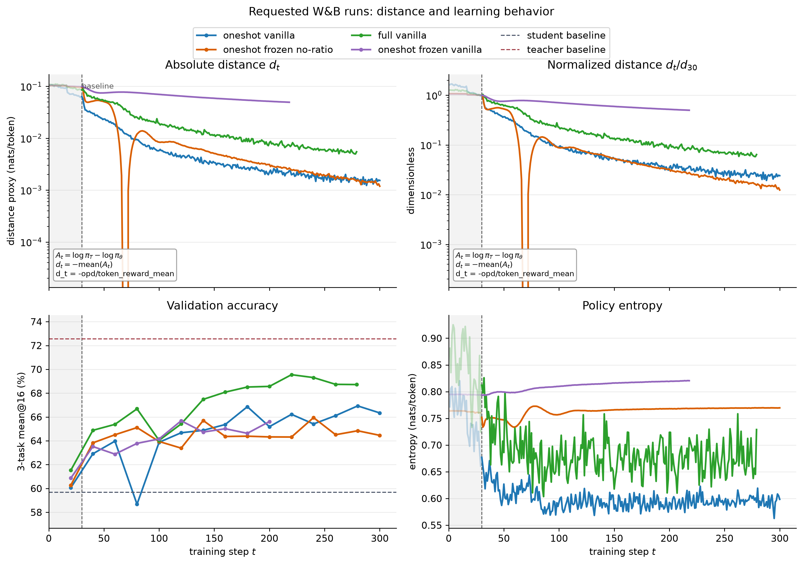
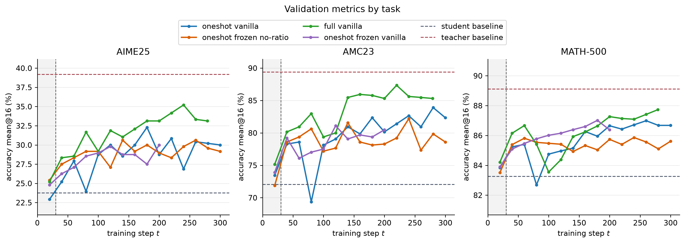
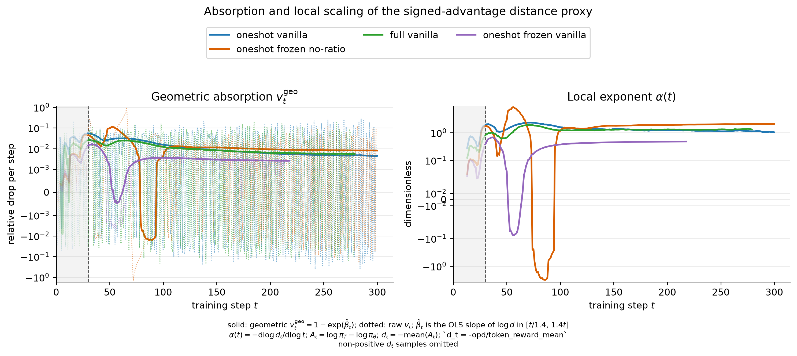
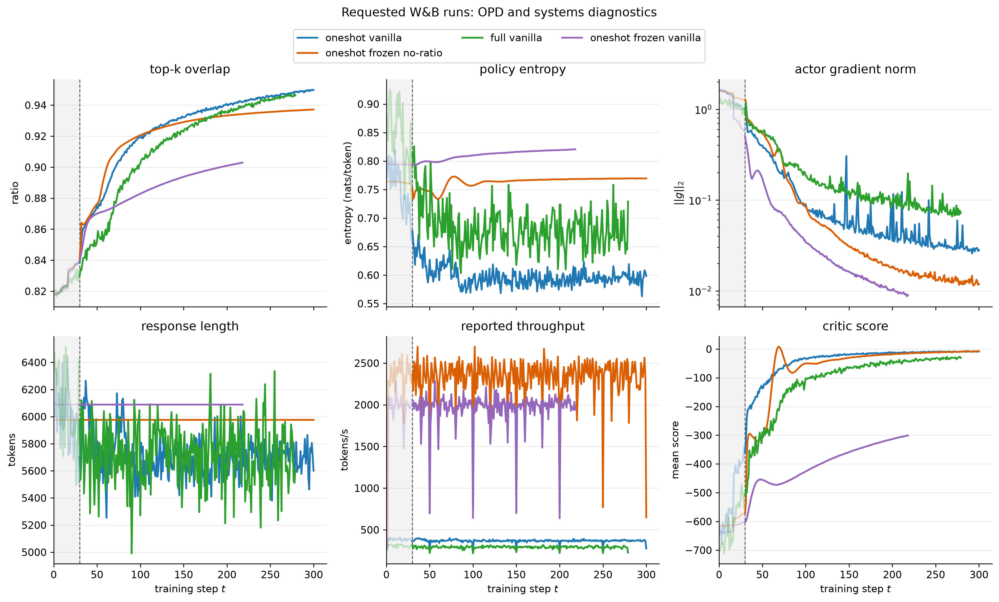

# W&B 目标 Run 拉取与对比分析

**日期**：2026-09-09  
**项目**：`One-Shot-OPD`
**对象**：`5aub1k4h`、`ceejzu26`、`mdxt04lm`

## 结论摘要

本地可以直接判断已经拉取过的 run 的 ID、名称、状态和配置。判断依据是：

- `plots/runs/<run_id>__meta.json`：保存 W&B run 元数据和扁平化配置 `config_flat`；
- `plots/runs/<run_id>__history.csv`：保存按 step 拉取的指标历史；
- 文件名中的 `<run_id>` 就是 W&B 的短 run ID，不需要从 run 名称反推。

本次 3 个目标 run 已全部落盘。它们不是同条件重复实验：

| Run                                                            | 状态     | 核心设置                               | 数据                      | 最后 step |
| -------------------------------------------------------------- | -------- | -------------------------------------- | ------------------------- | --------: |
| [5aub1k4h](https://wandb.ai/wncfht/One-Shot-OPD/runs/5aub1k4h) | finished | online rollout + `vanilla` policy loss | one-shot `t22.parquet`    |       300 |
| [ceejzu26](https://wandb.ai/wncfht/One-Shot-OPD/runs/ceejzu26) | finished | `frozen_rollout=True` + `opd_noratio`  | one-shot `t22.parquet`    |       300 |
| [mdxt04lm](https://wandb.ai/wncfht/One-Shot-OPD/runs/mdxt04lm) | finished | `vanilla` policy loss，旧基线          | full DAPO `train.parquet` |       279 |

最重要的比较结果是：`ceejzu26` 的末步 distance 最低，`5aub1k4h` 也在完整 300 steps 内快速收敛；`mdxt04lm` 的验证集准确率最好，但它使用了不同训练数据、prompt 长度和旧版配置，因此不能把这个结果归因于 policy loss 单一因素。

## 本地数据与配置

当前目标 run 的本地文件为：

- [5aub1k4h history](../plots/runs/5aub1k4h__history.csv)；[metadata](../plots/runs/5aub1k4h__meta.json)
- [ceejzu26 history](../plots/runs/ceejzu26__history.csv)；[metadata](../plots/runs/ceejzu26__meta.json)
- [mdxt04lm history](../plots/runs/mdxt04lm__history.csv)；[metadata](../plots/runs/mdxt04lm__meta.json)

配置核对得到以下结果：

| 配置项                        | `5aub1k4h`                 | `ceejzu26`                 | `mdxt04lm`            |
| ----------------------------- | -------------------------- | -------------------------- | --------------------- |
| `data.train_batch_size`       | 64                         | 64                         | 64                    |
| `data.train_files`            | `DAPO-oneshot/t22.parquet` | `DAPO-oneshot/t22.parquet` | `DAPO/train.parquet`  |
| `data.max_prompt_length`      | 8192                       | 8192                       | 4096                  |
| `data.max_response_length`    | 7168                       | 7168                       | 7168                  |
| actor learning rate           | `1e-6`                     | `1e-6`                     | `1e-6`                |
| critic learning rate          | `1e-5`                     | `1e-5`                     | `1e-5`                |
| `algorithm.adv_estimator`     | `token_reward_direct`      | `token_reward_direct`      | `token_reward_direct` |
| `actor.policy_loss.loss_mode` | `vanilla`                  | `opd_noratio`              | `vanilla`             |
| `algorithm.frozen_rollout`    | `False`                    | `True`                     | 旧配置中缺失          |
| rollout temperature           | 1                          | 1                          | 1                     |
| 训练目标 steps                | 300                        | 300                        | 279                   |

因此，`5aub1k4h` 与 `ceejzu26` 是更接近的对照组：数据、prompt 长度、batch size、actor/critic 学习率和 teacher/model 路径一致，主要差异是 `vanilla` 对 `opd_noratio` 以及 online 对 frozen rollout。`mdxt04lm` 更适合作为历史 full-data baseline，而不是严格 ablation 对照。

## 图表









图由 [offpolicy_exp.py](../plots/pipelines/offpolicy_exp/main.py) 生成，并满足项目约定：absolute 曲线从 step 0 展开；normalized 曲线也从 step 0 展开，在 step 30 画 baseline 竖线，并将左侧区间淡化。可复现的机器可读摘要在 [offpolicy_exp_summary.json](../plots/derived/offpolicy_exp_summary.json)。

## Distance 与验证集

这里使用训练器记录的带符号 token advantage 的负均值作为 distance proxy。训练器定义

$$
A_t=\log\pi_T(y_t\mid s_t)-\log\pi_\theta(y_t\mid s_t),
$$

并分别记录 `opd/adv_mean`、`opd/adv_abs_mean` 和 `opd/token_reward_mean`。当前 `token_reward_direct` 目标下，`token_reward_mean` 与 `adv_mean` 对齐；`adv_abs_mean` 是另一条 L1 诊断曲线，不是本报告的 `d_t`：

$$
d_t^{\mathrm{KL\ proxy}}=-\operatorname{mean}(A_t)=-\texttt{opd/token\_reward\_mean}
$$

对 student-sampled token，它是 sampled-token reverse-KL 的 Monte Carlo proxy，不是 full-vocabulary KL。若使用论文的 L1 距离，则应另写 $d_t^{\mathrm{L1}}=\operatorname{mean}(|A_t|)$，不能把两种口径混为一谈。这个量可以用来比较同一指标的衰减形状；尤其不应跨不同 reward estimator、数据分布和 prompt 长度直接比较绝对水平。

图中的 `v_t` 使用同一 `d_t`：raw one-step 版本是 $v_t=(d_t-d_{t+1})/d_t$，实线几何窗口版本是在 $[t/1.4,1.4t]$ 拟合 $\log d_t$ 后的 $v_t^{\mathrm{geo}}=1-\exp(\hat\beta_t)$。图中的 $\alpha(t)=-\mathrm d\log d_t/\mathrm d\log t$ 也是从同一 signed-advantage proxy 计算；所有这些定义都已写在图内。

下表给出几何窗口指标在 `t=50` 和 `t=100` 的代表性数值。`v_t^{geo}` 和 `alpha(t)` 都基于当前 signed-advantage `d_t`，只用于描述局部衰减速度，不是额外的训练 loss：

| Run        | `v_geo(50)` | `alpha(50)` | `v_geo(100)` | `alpha(100)` |
| ---------- | ----------: | ----------: | -----------: | -----------: |
| `5aub1k4h` |     0.02798 |       1.324 |      0.01542 |        1.582 |
| `ceejzu26` |     0.09725 |       2.916 |      0.00420 |        1.167 |
| `mdxt04lm` |     0.01592 |       0.665 |      0.01225 |        1.214 |

| Run        |   `d_1` |  `d_30` | `d_100` | 末 step distance | 末值 / `d_30` |
| ---------- | ------: | ------: | ------: | ---------------: | ------------: |
| `5aub1k4h` | 0.10352 | 0.06364 | 0.00578 |    0.00154 @ 300 |        0.0241 |
| `ceejzu26` | 0.10314 | 0.09580 | 0.00842 |    0.00119 @ 300 |        0.0124 |
| `mdxt04lm` | 0.10846 | 0.08547 | 0.01930 |    0.00548 @ 279 |        0.0641 |

观察：

1. `5aub1k4h` 在前 100 steps 内 distance 已由约 0.064 降至约 0.0058，下降很快；更新后的 W&B history 已完整记录到 step 300，末值约为 0.00154。
2. `ceejzu26` 在 step 30 的 distance 反而高于另外两条曲线，但之后下降更持续，step 300 达到三者最低的 distance。frozen rollout + no-ratio policy loss 的组合在这个 one-shot 设置下表现出更强的长期收敛趋势。
3. `mdxt04lm` 的 distance 下降较慢，但验证集均值最高。它的训练集是 full DAPO，prompt 上限也是 4096，样本分布和上下文预算都不同，这个优势不能单独解释为 `vanilla` 更好。

验证集均值由 `val-core/AIME25`、`AMC23` 和 `MATH-500` 的 `acc/mean@16` 对可用任务取平均：

| Run        | 首次均值 | 最后均值 | 最大均值 | 最大值 step |
| ---------- | -------: | -------: | -------: | ----------: |
| `5aub1k4h` |   60.06% |   66.34% |   66.93% |         280 |
| `ceejzu26` |   60.27% |   64.46% |   65.95% |         240 |
| `mdxt04lm` |   61.53% |   68.72% |   69.55% |         220 |

验证记录是稀疏的，且三个 run 的验证 cadence 不完全一致；表中的最后值和最大值应作为观测点比较，不应当作连续曲线的严格极值估计。

## OPD 与系统诊断

- `opd/top_k_overlap_ratio`：三条曲线都从约 0.82 上升到约 0.94，说明 student 与 teacher 的高概率 token 集合逐步接近；这个指标的最终差异很小，不能单独解释验证集差异。
- `actor/entropy`：`5aub1k4h` 从 0.772 降到 0.598，策略明显变得更尖锐；`ceejzu26` 基本维持在 0.764 到 0.770，frozen rollout + no-ratio 没有出现同样的 entropy collapse；`mdxt04lm` 从 0.881 降到 0.729。
- `actor/grad_norm`：三个 run 都从较高的早期梯度逐步下降，且 `actor/pg_clipfrac`、`actor/ppo_kl` 在拉取 history 中基本为 0。不能仅凭 clipfrac 证明训练稳定，因为日志可能记录的是 clip 后或特定 loss 分支的统计。
- `perf/throughput`：step 30 之后的 reported throughput 中位数约为 `ceejzu26` 2369、`5aub1k4h` 369、`mdxt04lm` 293 tokens/s；`ceejzu26` 的中途峰值约 2697，但末步为约 649。这个字段与 frozen rollout/cache 路径的差异相符，但不能直接当成端到端有效样本吞吐比较。
- `mdxt04lm` 没有记录新版本的 `opd/adv_abs_mean` 等 advantage 诊断字段。分析脚本把这些字段写为 `null`，没有用 0 填充。

## 结论与限制

在当前证据下，最稳妥的结论是：

1. 对 one-shot 数据和 8192 prompt 的近似对照中，`ceejzu26` 的 `opd_noratio + frozen_rollout` 在 300 steps 内给出了最好的 distance 收敛和较稳定的 entropy。
2. `5aub1k4h` 的 online vanilla 更新在完整 300 steps 内保持强 distance 下降，末值约为 `d_30` 的 2.4%；这使它可以和 `ceejzu26` 做完整训练窗口的比较，但两者仍同时改变了 rollout 和 policy-loss 配置。
3. `mdxt04lm` 的 validation 最好，但它同时改变了训练数据、prompt 长度、训练目标和配置版本；它只能说明历史 full-data baseline 的效果，不能作为上述 policy loss ablation 的干净对照。
4. 下一轮若要回答“`opd_noratio` 是否优于 vanilla”，应固定 one-shot 数据、prompt length、训练 steps、验证 cadence 和 frozen rollout，只改变 `actor_rollout_ref.actor.policy_loss.loss_mode`，并至少运行多个 seed。

## 复现

本次 W&B 拉取命令：

```bash
.venv/bin/python plots/pull_wandb_metrics.py \
  --entity wncfht \
  --project One-Shot-OPD \
  --run-id 5aub1k4h ceejzu26 mdxt04lm \
  --out plots/runs \
  --force
```

重新生成图表和摘要：

```bash
.venv/bin/python -m plots.pipelines.offpolicy_exp.main
```

W&B 凭据由本地 `~/.netrc` 提供；本次没有访问远程开发机或 GPU 集群。
