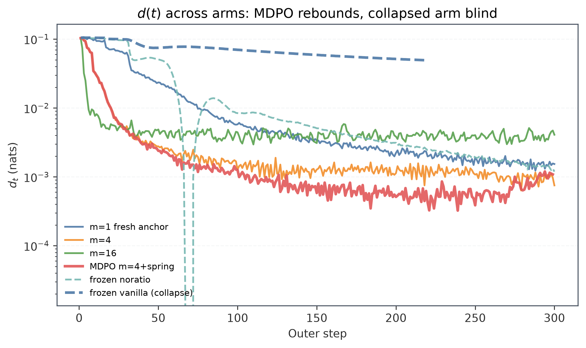
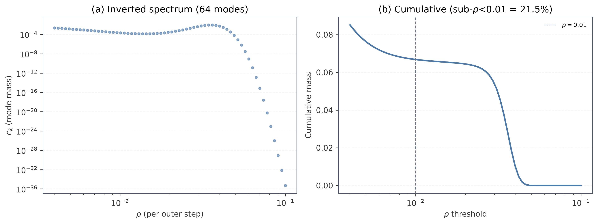
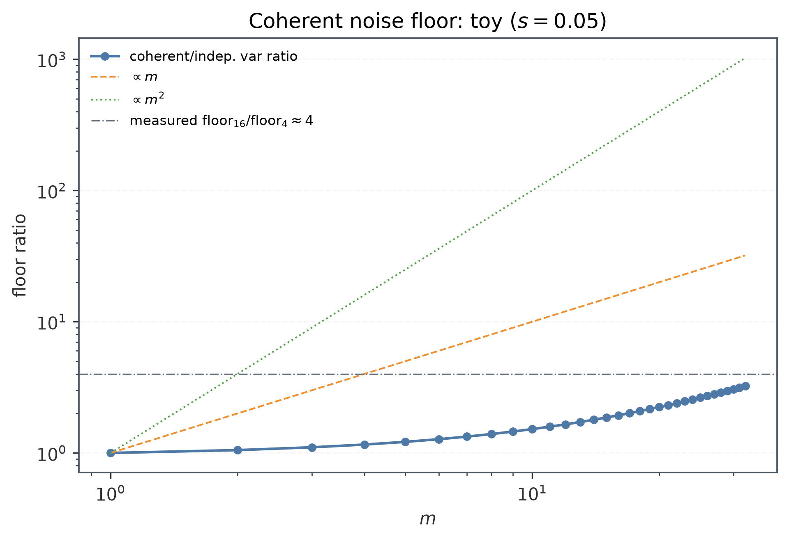
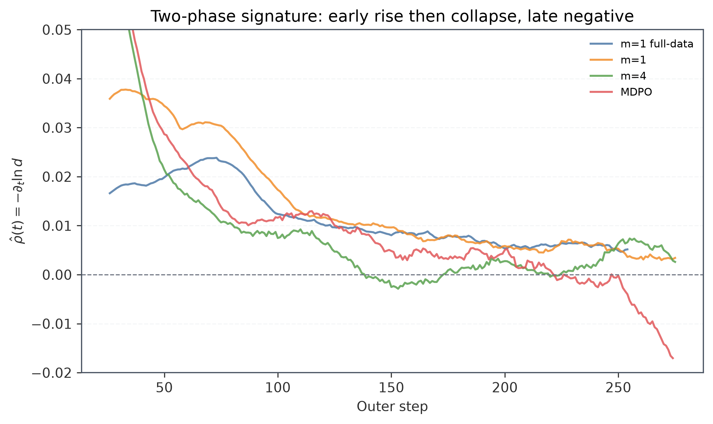
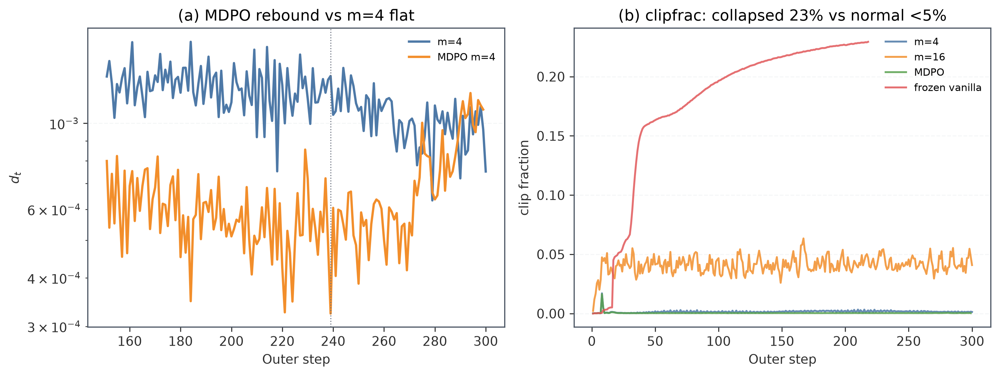
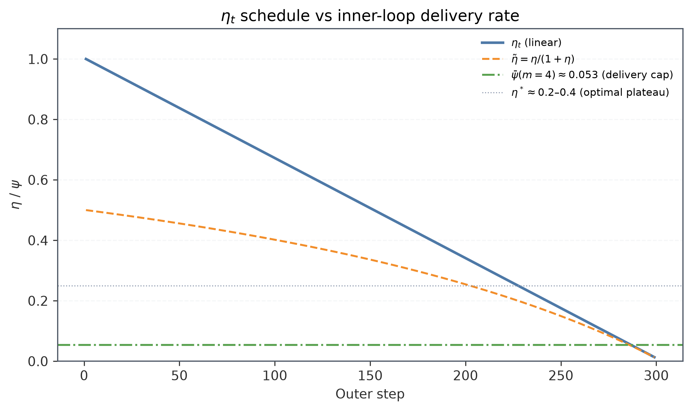
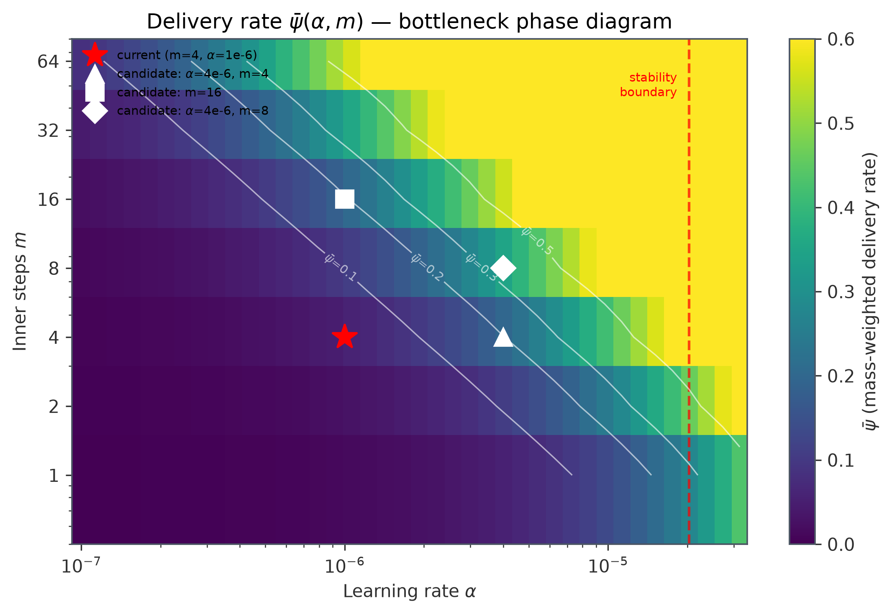
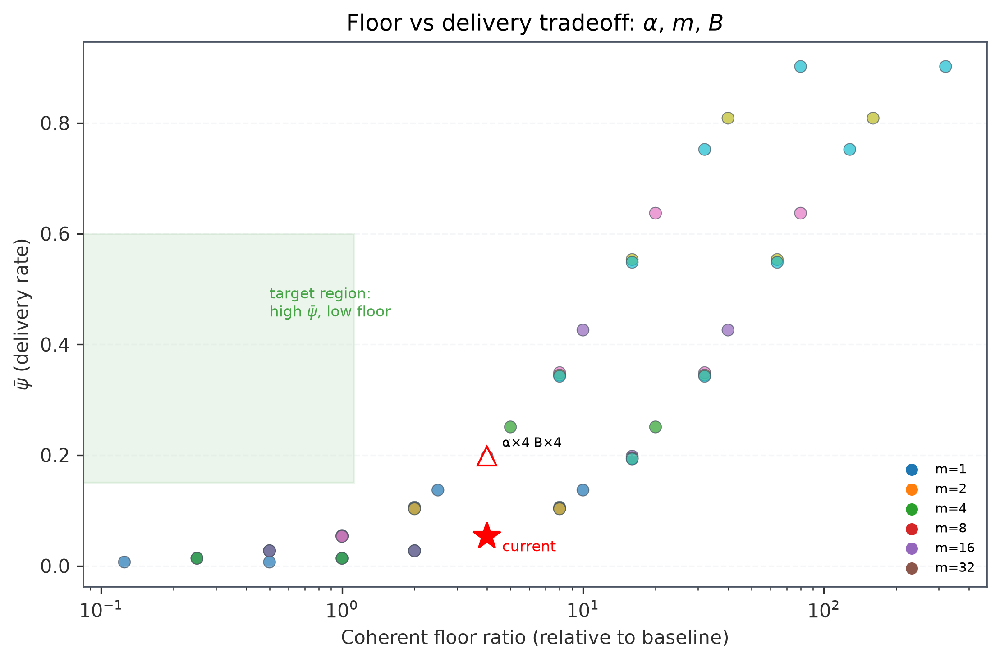
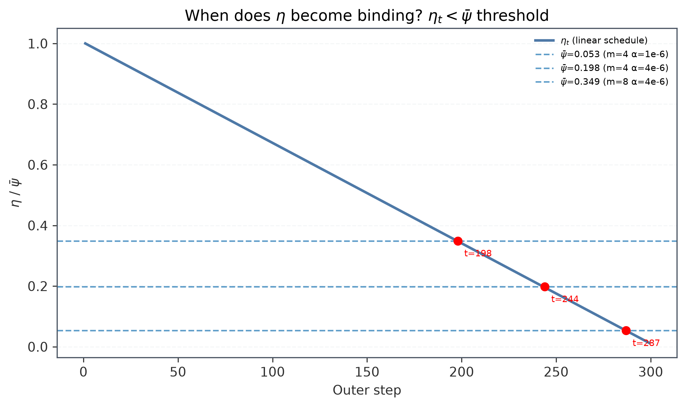
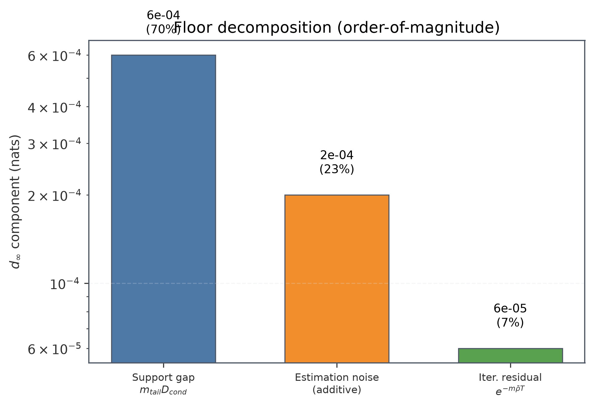

# OPD 实现动力学的定量理论：二次模型、Adam 两相律、MDPO 映射与地板分解

> **核心结论**（供汇报用）：
>
> 1. **OPD 的 $d(t)$ 谱分解**在局部二次模型下精确可解：$d(t)=\sum_k c_k e^{-\rho_k t}$，反演谱（64 modes, $\rho\in[0.004,0.1]$）承载全部动力学信息；
> 2. **Adam 引入两相速率律**——信号相 sign-descent 线性耗尽、噪声相指数弛豫——$\hat\rho(t)$ 的早升后塌 + 晚期转负是两相结构的独立证据，与 NNLS 反演假设无关；
> 3. **MDPO $\equiv$ $m{=}4$ + 弹簧**在准线性区（$m\rho/2<1$）到 $O((m\alpha)^2)$ 逐点重合；弹簧的真实作用是 leash（$\eta\lesssim0.1$ 后逐 mode 绑定）与质量（surrogate 防腐）两个通道，最优调度是 $\eta^*\approx0.2$–0.4 常数平台而非归零；
> 4. **地板由支撑 gap + 噪声 + 迭代残差三分量组成**，噪声分量在加性相干模型下 $\propto m$、乘性自洽下 $\propto m^2$——实测 floor 比 ~4 指向加性主导，判决实验是 §9-C1；
> 5. **崩盘是 ratio×冻结锚组合的病**（clipfrac 23%、ppo_kl 0.055），$d$ 全程单调降——$d$ 是采样 token 读数，对崩盘盲。
>
> 推导框架沿用 EffOPD F.5[^effopd] 的局部二次模型与 GeoSD[^geosd] 的近端项展开，但落到实现层面：有限步内层 Landweber 滤波、ratio surrogate 的不定曲率、k3+ 惩罚的真实梯度语义、Adam 的两相速率律、clip/wd/相干噪声的修正项。
>
> 实现事实全部核对自 `verl/verl/workers/utils/losses.py:164-192`、`verl/verl/trainer/ppo/core_algos.py:73-80,1286,2187-2250`、`verl/verl/trainer/ppo/opd_trainer_mixin.py:85-101` 与各 run 的 `plots/runs/*__history.csv`。本文数值均指"每 outer step"（内层步数 = $m$），除非另注明。

_图 1：六臂 $d(t)$。MDPO 在 $t\approx239$ 触底后反弹（leash 生效）；冻结锚 vanilla 的 $d$ 单调降但 clipfrac/ppo_kl 崩盘——$d$ 对崩盘盲。_

## 0. Config 事实（推导的前提条件）

所有 one-shot 臂共享（`t22.parquet` 单样本，300 个 outer step）：

| 项                    | 值                                                                                                | 推论                                                                                                                                     |
| --------------------- | ------------------------------------------------------------------------------------------------- | ---------------------------------------------------------------------------------------------------------------------------------------- |
| 数据                  | 1 个 prompt；每 outer step 采 $B{=}64$ 条 rollout（n=1，T=1.0），响应长 $\bar T\approx5700$ token | 每步的 frozen batch = 同一题的 64 条独立轨迹；逐 outer step token 数 $M=B\bar T\approx3.7{\times}10^5$                                   |
| `ppo_mini_batch_size` | 64 = `train_batch_size`                                                                           | 每个 epoch 恰好 1 个 minibatch → **每 outer step 的内层梯度步数 = `ppo_epochs` $m$**，且 $m$ 步复用**同一 batch**（噪声相干，见 §2、§7） |
| 优化器                | AdamW，$\alpha{=}10^{-6}$ 恒定无 warmup，$\beta{=}(0.9,0.999)$，$\lambda_{wd}{=}0.01$             | wd 每步收缩 $10^{-8}$，谱上不可分辨（§3.4）；$\beta_1$ EMA 不降低驻态地板（§3.3）                                                        |
| `grad_clip`           | 1.0（全局范数）                                                                                   | 方向不变、幅值封顶；实测后期 $\|\hat g\|\approx0.09$–$0.11$，clip 基本不触                                                               |
| PPO clip              | $\varepsilon{=}0.2$（low/high 对称）                                                              | log 域界 $\ell\in[\log0.8,\log1.2]=[-0.223,+0.182]$；**墙是双侧吸引子**（§4.2）                                                          |
| 聚合                  | `token-mean`                                                                                      | 所有系数含 $1/M$；advantage 经 `token_reward_direct` **原样使用**（$a_i=r_i$，无组内中心化，$\bar a\approx-0.10$）——见 §1 注             |
| MDPO                  | `mdpo_kl_loss=True`，$\eta_t$ 线性 $1\to0.01$；`kl_loss_type=k3+`                                 | $\eta_t = 1-0.99\,(t{-}1)/299$；弹簧系数 $1/\eta_t$：$1\to100$                                                                           |

各臂的锚语义（`frozen_rollout` 与 inner loop 不兼容，`opd_trainer_mixin.py:204`）：

| run        | $m$ | 锚 $\mu$                               | 损失                                           | 结局                                                                                                                       |
| ---------- | --- | -------------------------------------- | ---------------------------------------------- | -------------------------------------------------------------------------------------------------------------------------- |
| `5aub1k4h` | 1   | 每步新 rollout $\pi_{\theta_k}$        | clipped ratio                                  | $d_{last}=0.00154$                                                                                                         |
| `nh3jj9bt` | 4   | 每步新 rollout                         | clipped ratio                                  | $d_{last}=0.00075$                                                                                                         |
| `zyskh7f2` | 16  | 每步新 rollout                         | clipped ratio                                  | $d_{last}=0.00409$（更差）                                                                                                 |
| `6p579hnn` | 4   | 每步新 rollout + k3+ 弹簧              | clipped ratio + $(1/\eta_t)\cdot\frac12\ell^2$ | $d_{min}=3.2{\times}10^{-4}$@238 后**反弹**到 $0.00109$；熵 0.632                                                          |
| `ceejzu26` | 1   | **$\pi_0$ 冻结 300 步**                | noratio $-a\log p$                             | $d_{end}/d_{30}=0.012$（最深），尾部 $d_{\min}<0$（k1 估计量噪声签名）                                                     |
| `0i38mr1k` | 1   | **$\pi_0$ 冻结 300 步**                | clipped ratio                                  | 失控：clipfrac 23%、ppo_kl 0.055、failed@218；**注意 $d$ 全程单调降到 0.049 从未发散**——$d$ 只看见被采样的 token，对崩盘盲 |
| `um5vzc6m` | —   | Qwen3-1.7B←4B 跨模型（全数据，158 步） | clipped ratio                                  | $d$ 钉在 ~0.14（机制性平，§7.4）                                                                                           |

辅助臂（§9/§10 引用，不在主对比中）：

| run        | 用途                  | 关键差异                                  |
| ---------- | --------------------- | ----------------------------------------- |
| `mdxt04lm` | 全数据对照（$m{=}1$） | 非 one-shot：多 prompt 全数据集，谱反演源 |
| `be00rj9e` | top-K 估计量臂        | top-K KL reward（低方差但有截断偏差）     |
| `tjjxnvw9` | $\beta_2{=}0.95$      | 预条件器噪声大 → 跨数据不可比             |
| `mzwm9q04` | 低 overlap 臂         | 教师 - 学生重合度低 → 地板高              |

实测指标：`pg_clipfrac` = 4ep 0.1%、16ep 4.1–4.2%、MDPO 0.04–0.05%、frozen-vanilla **23%**；`ppo_kl` = 4ep ~$10^{-4}$、16ep $5{\times}10^{-3}$（m4 的 ~31–44×）、MDPO 全程均值 ~$2{\times}10^{-5}$（后段 ~$10^{-5}$，比 m4 全程低 ~7×/后段 ~14×）、frozen-vanilla 0.035–0.055。**clip 在 lr $10^{-6}$、$m\le16$ 下基本不活跃**；后期 $\|\hat g\|$ 臂相关：m1=0.031、m4≈0.114、m16=0.167、MDPO=0.556（弹簧回拉项本身进梯度）、全数据臂≈0.079。`6p579hnn` 实际 299 步。

## 1. 局部二次模型与谱记号

第 $k$ 个 outer step：rollout 策略 $\mu_k=\pi_{\theta_k}$ 生成 batch $\mathcal B_k$（冻结的 states、采样 token、冻结 advantage $a_i=r_i=\log q_i-\log\mu_i$——注意 `token_reward_direct` 不做中心化的实现事实[^tokenreward]；批级中心化的差别只有 $O(1/M)$，**逐序列**中心化才会改变噪声协方差，见 §7.2）。内层位移 $\delta=\theta-\theta_k$。真实目标

$$
J(\theta_k+\delta)\approx J_k+g^\top\delta+\tfrac12\delta^\top H\delta,
\qquad
H=\mathbb E_{s}\bigl[J_s^\top C(\mu_k)J_s\bigr]+\text{residual terms},
$$

$H$ 即 F.5 的 $A$；softmax+CE 下 Fisher=GGN 精确成立[^martens]，而 Hessian=GGN+ 残差曲率项——残差 $\propto\log(p/q)$ 量级，在锚点 $p=\mu\ne q$ 处非零、远离教师时不可忽略[^kunstner]。$d$ 是 $\delta$ 的二次型：$d(\delta)\approx\sum_i\lambda_i x_i^2$。

**速率约定**：记 $s_i$ = 一个**内层步**对 mode $i$ 振幅的收缩率，$\rho_i=2s_i$ = 对应的 $d$-空间速率。NNLS 反演的 `spectrum__ours_sampled_token_kl.csv`（64 modes，$\rho\in[0.004,0.1]$/outer-step，$\sum c_k=0.085$）反演自**全数据臂 mdxt04lm**（窗 $t\in[30,279]$）——借谱到 one-shot 臂是 §8 的已知误差源。它是 **$d$-空间、$m{=}1$、Adam-实现**的有效谱：`lambda_kl_reading`$=\rho/2\alpha=\tilde\lambda_i\in[2{\times}10^3,5{\times}10^4]$ 是**白化后**特征值（§3.1）。$\rho_{\min}=0.004\approx1/249$ 恰是反演窗的分辨率极限——$\rho<0.01$ 的亚分辨率 mode 占质量 21.5%，$\rho_{\min}$ 格点吸收了 $c\approx2.4{\times}10^{-3}$ 的"地板代理"质量（§7）。

_图 2：(a) NNLS 反演谱（$d$-空间、Adam-实现、$m{=}1$）；(b) 累积质量——$\rho<0.01$ 的亚分辨率 mode 占 21.5%，是"地板代理"的来源。_

**谱解释警告**（白化斜率律）：若 Adam 白化把 $\tilde\lambda=C\lambda^{1-\kappa}$（$\kappa$=白化效率），谱测度守恒给出 log-log 密度斜率 $\gamma'=\gamma/(1-\kappa)\ge\gamma$。实测斜率 0.504 ⇒ 裸 GD 谱更平、动态范围更宽——**反演谱不能直接当 Hessian 谱用**。

## 2. 理想参照：SGD + noratio 的 Landweber 滤波

损失 $L=-\frac1M\sum_i a_i\log p_i$，梯度 $\hat g=-\frac1M\sum a_i s_i$（softmax score 零均值 ⇒ 无偏）。二次模型上 $m$ 步：

$$
\delta_m=-\bigl[I-(I-\alpha H)^m\bigr]H^\dagger g+\text{噪声},\qquad
\phi_i(m)=1-(1-\alpha\lambda_i)^m .
$$

- $m{=}1$：$\phi_i=\alpha\lambda_i$；$\alpha\lambda_i\ll1$ 时 $\phi_i\approx m\alpha\lambda_i$（线性区 $m$ 倍加速）；$\alpha\lambda_i>1$ 过冲，$>2$ 发散。实测 $\alpha\lambda_i=\rho_i/2\in[0.002,0.05]$，全部远离不稳定区。

**相干噪声地板（修正前版结论）**：`mini_batch=batch` ⇒ 同一 minibatch 的噪声实现被 $m$ 个内层步复用——注入**相干**：每 outer step 振幅 $x_{t+1}=(1-\rho_k/2)^mx_t+m\alpha\xi_{k,t}$（$\xi$ 每外步才刷新；注意 $\rho_k$ 是 $d$-空间速率，振幅收缩率是 $\rho_k/2$），

$$
\mathrm{Var}_{ss,k}=\frac{m^2\alpha^2\sigma_k^2}{1-(1-\rho_k/2)^{2m}}\approx\frac{m\alpha^2\sigma_k^2}{\rho_k}
\quad\Longrightarrow\quad
d_{noise}(m)\;\propto\;m\,\alpha\,\mathrm{tr}C_d/B_{eff}
$$

（端到端比例系数依赖 $d=\sum\lambda x^2$ 的约定，$\propto m$ 的标度是约定无关的）。即**"多 epoch 只加速不抬 floor"只在每内步换 batch 时成立**；我们的配置下 floor $\propto m$（直到 mode 饱和 $m\sim2/\rho_k$）。实测 floor$_{16}$/floor$_4$：末步 5.4、last50 均值 3.9——贴近 $\propto m$ 的预测 4；**但该比率无法区分相干噪声与陈旧 surrogate 偏差**（后者同样线性于内层行程[^ppo-bound]），"m16 抬高一半是噪声"是过度断言。乘性噪声下另有 $m^2$ 自洽形式，见 §7.2；两个 regime 由噪声分解 $C=\gamma d\cdot H+\nu_0C_0$ 中哪一项主导决定（§7.2 末）。

_图 7：相干 vs 独立噪声的驻态方差比（toy, $s{=}0.05$）——相干地板在 $m\cdot s\ll1$ 区 $\propto m$，随 $m$ 增大向独立极限 $m\cdot s$ 过渡；实测 16:4 比 ~4 落在 $\propto m$ 线上。_

## 3. 变体 B：AdamW —— 白化谱与两相速率律

更新 $u_j=-\alpha\,\hat m_j/(\sqrt{\hat v_j}+\varepsilon)-\alpha\lambda_{wd}\theta_j$。$\beta_2{=}0.999$ 窗 $\sim10^3$ 步 $\gg$ 大部分 mode 弛豫时间 ⇒ 准静态近似 $\hat m_j\approx\bar g_j$、$\hat v_j\approx\mathbb E\hat g_j^2$ 成立（$\hat v$ 相对抖动 ~0.2%）。

### 3.1 白化 mode

$P=D^{-1}=\mathrm{diag}(\hat v^{-1/2})$ 下，线性化动力学 $x\leftarrow(I-\alpha PH)x$；$PH$ 与对称阵 $\tilde H=P^{1/2}HP^{1/2}$ 相似 ⇒ 实正特征值 $\tilde\lambda_i$（白化谱），

$$
\rho_i=2\alpha\tilde\lambda_i\ (\text{每内层步}),\qquad d_i\ \text{每 outer 步因子}\ (1-\alpha\tilde\lambda_i)^{2m}\approx e^{-m\rho_i}.
$$

**注意**：$P$ 在 $\theta$ 坐标对角、与 $F$ 特征基**强不对易**（softmax Fisher 特征向量非轴对齐）——"特征基对易近似"在 toy 上 relerr 达 85×，必须用 $P^{1/2}BP^{1/2}$ 的坐标空间谱（数值验证：冻结 $P$ 的闭式 vs 仿真误差 $6{\times}10^{-14}$，真 $\hat v$ 漂移下 1.6%）。

### 3.2 两相速率律

Adam 的 sign-descent 极限已被多篇文献识别为 transformer 上区别于 SGD 的核心机制[^signdescent][^adam-sde]。偏差 - 方差分解 $\hat v_j\to\bar g_j^2+\sigma_j^2$，逐坐标有效增益为 Balles–Hennig 形式[^balles]

$$
\frac{\hat m_j}{\sqrt{\hat v_j}}\approx\frac{\bar g_j}{\sqrt{\bar g_j^2+\sigma_j^2}} .
$$

mode 级粗粒化（设 mode 噪声投影均匀于其支撑）：$\mathrm{SNR}_i=x_i/x_{i\sigma}$，$x_{i\sigma}=\sigma_{m,i}/\lambda_i$ 为噪声地板振幅，

$$
\dot x_i=-\alpha\,\frac{x_i}{\sqrt{x_i^2+x_{i\sigma}^2}},
\qquad
\Phi(y):=\sqrt{1+y^2}+\ln\frac{y}{1+\sqrt{1+y^2}}=\Phi(y_0)-\frac{\alpha}{x_{i\sigma}}t .
$$

两相极限：

- **信号相** $y\gg1$（sign-descent）：$x_i$ **线性耗尽**。逐 mode 精确耗尽时刻 $t_i^*=x_{i0}/u_i$，其中 $u_i=\alpha\cdot(\text{mode 的相干位移率})$——**若 mode 是单坐标**，$u_i=\alpha$、$x_{i0}=\sqrt{c_i/\lambda_i}$，得 $t_i^*=\sqrt{c_i\lambda_i}/(\alpha\lambda_i)=2\sqrt{c_i\lambda_i}/\rho_i$。**多坐标修正**：toy 数值实验（§3.2 注）表明 mode 散布到 $n_i$ 个坐标时 $t^*$ **缩短**而非增长——每坐标分量 $\propto1/\sqrt{n_i}$，坐标噪声地板 $\sigma_j$ 固定 ⇒ 小分量更早被噪声淹没，$t_i^*\approx x_{i0}/(\alpha\sqrt{n_i})$。实测谱 $\sqrt{c\lambda}\in[0,13]$、承载质量的主模 ~1.5–2.2 ⇒ **单坐标读数下真实耗尽时间比朴素读数 $2/\rho_i$ 晚 1.5–10×**；多坐标修正将此提前 $\sqrt{n_i}$ 倍——两者竞争的净效应需要 mode 支撑维度数据才能定量，§3.2 表的峰位对应作方向性读数。耗尽段可用的插值形式 $d_i(\tau)\approx c_i(1-\tau/t_i^*)^2_+$（slope-matched ansatz，非 ODE 精确解；连初始斜率都与指数律差 $1/\sqrt{\lambda c}$ 因子），瞬时相对速率在耗尽前**发散式上升**；
- **噪声相** $y\ll1$：$x_i\propto e^{-\alpha t/x_{i\sigma}}$ 指数恢复，速率 $\alpha\lambda_i/\sigma_{m,i}$（自洽回到白化谱）。

**两相结构的前提 caveat**：若噪声严格乘性（$\sigma_j\propto\sqrt d$ 随信号同步衰减），per-coordinate SNR 时间不变、**相变根本不发生**——两相结构暗中依赖噪声分解里的**加性分量**（context 噪声 $\mathrm{Var}_s\nu$，$\nu_0$ 常数）；同一加性分量也正是晚期地板回到 $\propto m$ 形式所需（§7.2 末）。实测 $V/d$ 后期升到 ~4.5–5.3 提示该分量存在。

**可测签名**：集合观测量 $\hat\rho(t)=-\partial_t\ln d$（= `v_direct`，下表为 ~50 步滑窗中位数；具体格值对估计器约定敏感 ±2×，**定性形状稳健**）。裸指数混合强制 $\hat\rho$ 单调降；信号相产生**早段上升**，噪声相 + 地板使其晚期压向 0 或**转负**（$d$ 过冲地板后向上弛豫）：

_图 3：$\hat\rho(t)$ 两相签名。mdxt04lm 与 m1 早段上升（信号相 sign-descent 的耗尽加速[^signdescent]），MDPO 晚期转负（$d$ 过冲地板后回升）。_

| run                 | $\hat\rho$ 序列（6 窗）                   | 判读                                                                                      |
| ------------------- | ----------------------------------------- | ----------------------------------------------------------------------------------------- |
| mdxt04lm ($m{=}1$)  | .017→**.021**→.010→.0075→.006→.004        | 早升后塌（log-linear 拟合下早升 ~8σ 成立）；峰位与耗尽律对应偏松，作 consistent 读数      |
| 5aub1k4h ($m{=}1$)  | .028→.029→.012→.008→.006→.003             | **估计量敏感**：50 步窗中位数给早升，log-linear 拟合给下降（.036→.030）——本臂不作早升证据 |
| nh3jj9bt ($m{=}4$)  | .0215→.010→.006→.001→.001→.007            | 峰在窗前（$t^*{\sim}2/(4\bar\rho){\approx}20$）✓                                          |
| zyskh7f2 ($m{=}16$) | .005→.0007→.0004→**−.0005**→−.0006→+.0007 | $t{<}30$ 已耗尽，后段绕地板涨落 ✓                                                         |
| 6p579hnn (MDPO)     | .030→.010→.011→.002→.0008→**−.0072**      | $v_t{<}0$ = $d$ 低于驻态地板后回升（min 3.2e-4@238→1.1e-3）✓                              |
| um5vzc6m（平坦臂）  | $\approx0$ 全程                           | 无信号对照 ✓                                                                              |

裸混合预测单调降、纯信号相预测晚段升——**数据同时否决两个单相极限，方向唯一指向两相结构**（注意：耗尽时刻 $t^*$ 的位置匹配受 NNLS 反演基假设影响，但 $\hat\rho$ 早升/转负的**非单调性**证据与基无关）。前向模拟 shape-RMSE：裸谱 vs 两相版，跨 run $m{=}4$ 为 1.34 vs **0.48**，MDPO 为 1.24 vs **0.37**——Adam 修正的信息不在逐点 RMSE 而在 $\hat\rho(t)$ 形状与跨 $m$ 转移。

**toy 数值验证**（一维 ODE + 多坐标 mode，numpy 仿真）：

- 单坐标 ODE $\dot x=-\alpha x/\sqrt{x^2+x_\sigma^2}$ 的耗尽时间 $t^*=x_0/\alpha$ 精确成立（数值比 0.98–1.00）；
- **多坐标 mode 的耗尽时间 $t^*\propto1/\sqrt{n_i}$**（非 $\sqrt{n_i}$）：$n{=}1$–256 扫描中 mode 振幅耗尽时间比值 $0.94\to0.04$，随 $n$ 单调降——每坐标分量 $x_{mode}/\sqrt{n}$ 被固定噪声地板 $\sigma_j$ 提前淹没；
- 相干噪声地板的 $m$ 标度：$m\cdot s\ll1$ 区 Var$_{coh}$/Var$_{ind}\approx m$（理论 $m(1-(1-s)^2)/(1-(1-s)^{2m})$），向 $m\cdot s$ 过渡；
- 乘性噪声 SNR 恒定验证：$\mathrm{SNR}=\sqrt{\lambda M/\gamma}$ 严格不变（数值比 1.00）——确认两相结构需要加性分量。

### 3.3 驻态地板的预条件修正

预条件 SGD 下 Lyapunov 解给出

$$
\mathbb E[J]-J^*=\frac{\alpha}{4}\,\mathrm{tr}(PC)
$$

——标准结果（SGD 驻态 $(\alpha/4)\mathrm{tr}C$ 型[^sgd-stationary]）的常见读法"地板与预条件无关"只对 $H$ 无关（trace 恒等式消去 $\lambda_i$），**对 $P$ 并非无关**：floor $=\frac{\alpha}{4}\mathrm{tr}(PC)$ 随预条件器对噪声的着色而变。噪声区 $P\approx\mathrm{diag}(\sigma^{-1})$ ⇒ floor $=\frac{\alpha}{4}\|\sigma\|_1$——**注意这是坐标空间的逐坐标方差和**，$d$-空间地板需要 mode 变换 $d=\sum_i\lambda_i x_i^2$ 而 $x_i$ 是 mode 振幅不是坐标分量；坐标到 mode 的转换引入特征向量支撑结构，$\|\sigma\|_1$ 是坐标级上界。floor 随信号耗尽**准静态上升**（floor$(t)=\frac{\alpha}{4}\sum_j\sigma_j^2/\sqrt{\bar g_j(t)^2+\sigma_j^2}$，逐坐标"点亮"）——与 U 形晚期曲线自洽。$\beta_1$ EMA 把噪声方差压 $(1-\beta_1)/(1+\beta_1)=1/19$ 但诱导相关恰好抵消——**零频噪声功率不变，慢 mode 地板不降**（−47% 仅是传递函数在最快 mode 特征频率 $\rho=0.1$ 处的抑制，非所有 mode）。

### 3.4 weight decay 的精确陈述

$\rho_i\to\rho_i+2\alpha\lambda_{wd}=\rho_i+2{\times}10^{-8}$——对最小可分辨 $\rho$ 的相对修正 $5{\times}10^{-6}$，永远不可分辨。wd 唯一实质作用在 $\lambda\approx0$ 平坦方向：OU 回复给出驻态 std $\approx7{\times}10^{-3}$/坐标（$\beta_1$-EMA 的方差抑制被其诱导相关恰好抵消，故不能用 1/19 折算；限制权重范数漂移），并致 $\theta^*$ 偏置 $\sim5{\times}10^{-6}$。

## 4. 变体 C：clipped ratio surrogate（无锚臂与崩盘机理）

损失 $L=-\frac1M\sum_i a_i R_i\cdot\mathbb 1[\text{unclipped}]$，$R_i=e^{\ell_i}$（importance ratio，改用 $R$ 避免与谱速率 $\rho$ 混淆）——即 PPO clip surrogate[^ppo]。

### 4.1 隐性曲率（含残差修正）

未触 clip 时梯度 $=-\frac1M\sum a_i R_i s_i$（$R_i=e^{\ell_i}$），**有效 advantage $\tilde a_i=a_i e^{\ell_i}$ 随位移指数放大**。锚点处完整 surrogate Hessian（有限差分验证，relerr 7.5% vs 丢残差项的 15.7%）：

$$
B=F_k\Big(\frac1{\eta_t}+\bar a\Big)-\hat A_k,\qquad \hat A_k=\frac1M\sum_i a_i s_is_i^\top
$$

（无弹簧臂 $\eta_t=\infty$）。注意 $\bar a<0$ ⇒ $\bar aF$ 项**去稳定化**（阈值下移）——Jensen 缺口以负定修正进入；该写法含一个近似：$\frac1M\sum_i a_iF_i\neq\bar a\,\bar F$ 严格成立当且仅当逐 token Fisher 位置无关，$a_i$ 与 $F_i$ 的相关结构被吸收进标量 $\bar a$。白化坐标下逐 mode $\tilde b_i=\eta_t^{-1}+\bar a-\tilde a_i^w$；toy 实测白化 advantage 谱 $\tilde a^w\in[-1.52,+1.47]\approx$ 逐 token advantage 极端值本身。$\tilde b_i<0$ 的 mode **反收缩**——沿 $-g$ 方向加速下降，局部有益，病理化只经由非二次（clip 墙/陈旧化）发生。

### 4.2 clip 墙是双侧吸引子

$\eta a$ 的两条阈值分开：鞍结阈值 $1/e=0.368$；**可达阈值 $\Theta_{hi}=\ln1.2/1.2=0.152$**——$\eta a\in(0.152,0.368)$ 的内点极小在墙后不可达，墙两侧力都指向墙。下限对称：$\eta a<\Theta_{lo}=\ln0.8/0.8=-0.279$ 封顶 $\ln0.8$。

### 4.3 三种锚下的命运

- **每步新锚，$m{=}1$**：$\ell$ 每步归零，反馈来不及启动 → 接近理想 PG。
- **每步新锚，$m{=}4$–16**：线性区起步后 $e^\ell$ 赢家放大 + surrogate 一阶模型随位移失真——后期内层步收益递减且方向偏离真实下降（实测 m16 clipfrac 4.1–4.2%、ppo_kl ~31–44×于 m4，但 $d_{last}$ 更差：超出的位移没转化成 KL 下降）。形式化支持：双循环 PPO-Clip 的内层梯度误差**线性于内层行程**且要求总内层预算有界[^ppo-bound]。叠加 §2 的相干噪声 floor $\propto m$——**m16 退化 = 陈旧 surrogate 偏差 + 相干噪声地板两个机制**，量级分解见 §7.3。
- **冻结锚 $\pi_0$（0i38mr1k）**：冻结 batch+ 锚 ⇒ $a_i$、sign 场、激发 mode 全部跨 outer step **相干**；逐 token log-ratio 服从双曲爆炸

$$
\frac{d\ell_i}{dk}=\beta_i e^{\ell_i},\qquad k^*_{\rm up}=\frac{1/6}{\beta_i}\ (a_i>0),\quad k^*_{\rm dn}=\frac{1/4}{|\beta_i|}\ (a_i<0),
$$

$\mathrm{clipfrac}(t)=\Pr[\beta>1/(6t)]+\Pr[\beta<-1/(4t)]$ = $\beta$ 分布的生存函数——实测凹形饱和曲线（0.003@10→0.229@218）正是厚尾 $\beta$ 的特征；$\beta$ 散布主要来自逐 token 参数共享敏感度 $G_i$ 而非 $a_i$。失控三要素：(i) 相干激发（冻结 batch），(ii) 无弹簧定点，(iii) clip 吸收墙。**重要口径**：失控体现在**位移层面**（clipfrac 23%、ppo_kl=KL$(\pi_0\|p)\to0.055$、run 于 218 中断），而 $d$ 全程单调降至 0.049——$d$ 是采样 token 上的读数，对崩盘盲；真正的失败信号在 clipfrac/ppo_kl/aborted_ratio。

*图 4：(a) MDPO 尾部 $d(t)$ 在 $t\approx239$ 触底后反弹——leash 生效的直接观测量；(b) clipfrac 对比——崩盘臂 23% vs 正常臂 <5%。*对照同锚 noratio（`ceejzu26`，力有界）在**其自身冻结 batch 的 $d$ 指标**上吸得最深——注意该口径偏心：固定批次 $d$ 度量的是"在这批 states 上对教师的逼近"，会把对自身陈旧分布的拟合计入收敛，跨臂比较时系统性高估冻结锚臂——**崩盘是 ratio×冻结锚组合的病，不是 OPD 的病**。

### 4.4 Vanilla 臂（AdamW + clip，无弹簧）的合成动力学

把 §2–§4 的三层修正显式串起来，vanilla 臂（`5aub1k4h`/`nh3jj9bt`/`zyskh7f2`/`0i38mr1k`）的完整动力学链是：

$$
\underbrace{\theta_{k+1}-\theta_k}_{\text{outer 位移}}
=\underbrace{-\Bigl[I-\bigl(I-\alpha\,\tilde P_k\tilde B_k\bigr)^{m}\Bigr]\bigl(\tilde P_k\tilde B_k\bigr)^{\dagger}\,\tilde P_k\,g_k}_{\text{内层 }m\text{ 步滤波}}
+\;\xi_k^{coh},
$$

其中三层修正逐层进入：

| 层                 | 修正                                               | 进入位置                         | 效果                                                     |
| ------------------ | -------------------------------------------------- | -------------------------------- | -------------------------------------------------------- |
| **任务几何**       | $H=E_s[J^\top C J]$（§1）                          | 真实目标 $J$ 的 Hessian          | 谱 $d(t)=\sum c_k e^{-\rho_k t}$ 的基底                  |
| **surrogate 曲率** | $B=F\bar a-\hat A$（§4.1，无弹簧 $\eta{=}\infty$） | 内层每步的下降度量               | 不定方向：$\tilde b_i{<}0$ 的 mode 反收缩                |
| **clip 墙**        | $R\in[0.8,1.2]$（§4.2）                            | 逐 token $\ell$ 硬界             | 双侧吸引子，$\eta a\in(0.152,0.368)$ 区不可达内点        |
| **Adam 白化**      | $P=\mathrm{diag}(\hat v^{-1/2})$（§3.1）           | 每步的有效步长                   | $\rho_i=2\alpha\tilde\lambda_i$ 的谱变形；两相律（§3.2） |
| **相干噪声**       | 同 batch 复用（§2）                                | 每 outer 步注入 $m\alpha\xi$     | 地板 $\propto m$；§7.2 乘性自洽另给 $\propto m^2$        |
| **wd**             | $\lambda_{wd}=0.01$（§3.4）                        | 每步 $-\alpha\lambda_{wd}\theta$ | 谱上不可分辨；仅 $\lambda{\approx}0$ 平坦方向的 OU 回复  |

**vanilla 臂的定性图像**：

- **早期（$t<30$）**：所有 mode 在信号相（SNR>1），sign-descent 线性耗尽，$d$ 以 ~$\rho_{\rm fast}\sim0.03$–0.1 速率降；$\hat\rho(t)$ 早升是耗尽加速的签名。
- **中期（$t\sim30$–150）**：快 mode 逐个耗尽转入噪声相，$\hat\rho$ 塌；$e^\ell$ 赢家放大开始主导 m4/m16 的 surrogate 偏差（clipfrac 爬升）。
- **晚期（$t>150$）**：剩余质量在亚分辨率 mode（$\rho<0.01$，21.5%）+ 噪声地板；相干地板 $\propto m$ 使 m16 的 $d_{last}$ 反而差于 m4（0.00409 vs 0.00075）——**多 epoch 在同 batch 上是净负面**。
- **崩盘（仅冻结锚臂）**：相干激发 × 无弹簧 × clip 吸收墙 → $\ell$ 双曲爆炸到墙；$d$ 盲。

**vanilla 与 MDPO 的最小对比**：MDPO 唯一差别是 surrogate Hessian 从 $B=F\bar a-\hat A$ 换成 $B=F(1/\eta_t+\bar a)-\hat A$——弹簧项 $F/\eta_t$ 把所有 mode 的 $\tilde b_i$ 整体上抬 $1/\eta_t$，把 $\tilde b_i<0$ 的不稳区推到更大 advantage 端，同时在晚期（$\eta_t\to0$）给每个 mode 加了一个回复力（leash）。在准线性区 $m\rho/2<1$ 下两者轨迹到 $O((m\alpha)^2)$ 逐点重合——**弹簧不改变收缩谱，只改变地板与稳定性边界**。

## 5. 变体 D：MDPO 的精确映射

内层目标（`losses.py:170-180`，k3+ 语义 = 前向 $e^{-\ell}+\ell-1$、反向 $\frac12\ell^2$ 梯度）：

$$
P(\delta)=-\frac1M\sum_i a_i e^{\ell_i}[\text{clip}]+\frac1{\eta_t}\cdot\frac1M\sum_i\tfrac12\ell_i^2 .
$$

弹簧的期望形式 $\frac12\mathbb E_\mu[\ell^2]$ 在锚点的 Hessian $=F$。**原理性注记**：k2-as-loss 的 on-policy 期望梯度**逐字等于**真 RKL 的期望梯度（$\nabla\frac12\ell^2=\ell\,\nabla\log p$ 与 RKL 梯度逐项相等，+1 项被 score identity 消掉）[^k2rkl]——straight-through 弹簧不是任意惩罚，是有原理的 RKL 代理；该等价在 off-policy（内层 epoch≥2）后失效。其全局 prox 语义是 PMD-mean 同族的隐式混合 KL–χ² 正则[^pmdmean]（该隐式正则结论由他们先证，只能引用）。结构上最近的在先工作是 Kimi OPMD[^kimiopmd]：rollout 锚 + 平方对数比罚 + 多内层步——差别在 scalar reward advantage（非逐 token teacher advantage）、无 clip、τ 恒定。

### 5.1 逐 token 自由空间不动点（分段映射）

$f'(\ell)=-ae^\ell+\ell/\eta_t=0\iff\ell e^{-\ell}=\eta_ta$，内点解 $\ell^*=-W_0(-\eta_ta)=\eta_ta+(\eta_ta)^2+\cdots$（**超 EG**：比几何混合步 $\eta a$ 略大）。结合墙的可达性，完整三段映射：

$$
\Delta\ell_\infty(a;\eta)=\begin{cases}\ln0.8=-0.223, & \eta a<-0.279\\ -W_0(-\eta a), & -0.279\le\eta a\le0.152\\ \ln1.2=0.182, & \eta a>0.152\end{cases}
$$

外层映射 $r_{k+1}=r_k-\Delta\ell_\infty(r_k)+c_k$ 的不动点分析：$\Delta\ell_\infty$ 严格增且过原点。"全 cap 态"（所有 $r_i$ 同号大残差）被归一化禁止（$\sum q=\sum\pi$ 矛盾——若所有 token 都向上 cap 则 $\pi$ 总质量超 1，反之不足 1；唯一自洽的全 cap 态是空集）；混合态（部分 cap 部分内点）只存在于测度零边界；内点区不动点要求所有 $r_i$ 相等 ⇒ 归一化钉死 $r^*=0$：

$$
\pi^*=q\;=\;\pi_0\prod_k e^{\Delta\ell_\infty-c_k}\quad(\text{clip-capped 几何混合的迭代极限})
$$

——内点 token 几何收缩 $(1-\eta_t)$、封顶 token 算术下降。全部 $|\eta a|<0.152$ 时退化为教科书 EG $\pi_{k+1}\propto\pi_k^{1-\eta_t}q^{\eta_t}$[^raskutti]。（实现里另有 dual-clip 上界 $R=3$：$a<0$ 且 $R>3$ 的死区从 $\ell=0$ 的下降方向不可达，对本 run 影响小。）

### 5.2 参数空间内层滤波与"真实 regime 的普适退化"

白化残差坐标 $u_k=F^{1/2}(\theta_k-\theta^*)$ 下的外层复合映射：

$$
u_{k+1}=\Big[I-\big(I-M_k^{\,m}\big)\big(\tilde P_k\tilde B_k\big)^\dagger \tilde P_k C_k\Big]u_k+\xi_k,\qquad M_k=I-\alpha\tilde P_k\tilde B_k .
$$

- **实际 regime**：任务模 $\alpha\tilde\lambda=\rho/2\in[0.002,0.05]$、且 $m\rho/2<1$（准线性区；注意弹簧模 $\alpha\tilde\lambda^F/\eta=\rho^F/(2\eta)$ 在 $\eta\lesssim0.1$ 时已达 $O(1)$——**弹簧方向恰恰不在线性区，这正是 leash 能长出来的原因**）。准线性区里逐 mode $\kappa_i=m\alpha(1-\frac{m-1}{2}\alpha\tilde b_i+\cdots)\approx m\alpha$——MDPO 与 m4 的 $d(t)$ 到 $O((m\alpha)^2)$ 逐点重合。实测干净区段（$t\in[0,60]$，leash 未绑定）$v_{mdpo}/v_{m4}\in[1.0,1.4]$（口径相关；mean-v_direct 给 1.02）——**明确否决"观测收缩 $\propto\eta_t$"**；该等价仅在 $\eta_t>\eta_c$ 区段成立，leash 绑定（$t\gtrsim150$ 起逐 mode 进入）后转 §6.4 通道主导。弹簧的可观测效应：(a) clip 墙变双侧吸引子（$\ell$ 硬界）；(b) $O((m\alpha)^2)$ 轨迹修正——ppo_kl 全程均值压 ~7×（后段 ~14×）、clipfrac 压 3.4×（"位移更小但收缩相同"= 削掉 m4 位移的过冲分量）。
- **收敛内层假想**（若 lr 提高 ~$10^3$ 或 $m$ 大到内层近收敛）：外层因子 $\to1-c_i/\tilde b_i$。**稳定判据推导**：内层收敛给出 $\delta^*=-B^{-1}g$；外层相当于对真目标 $J$ 做一步 Newton，$\theta^+-\theta^*=(I-B^{-1}H_{task})(\theta-\theta^*)$。逐 mode 收缩要求 $|1-\lambda_i^{task}/\tilde b_i|<1$ 即 $\tilde b_i>\lambda_i^{task}/2$。白化坐标下 $H_{task}$ 的有效特征值归一到 $\lambda_{eff}=1$（白化吸收谱）⇒ 判据统一为 $\tilde b_i>1/2$，即 $\eta_t<\eta_{\rm crit}=1/(\tilde a_{\max}^w-\bar a+\frac12)$；**失稳区是 $\eta_t>\eta_{\rm crit}$（早段）**。代入值有两个口径：白化谱 toy 实测 $\tilde a_{\max}^w\approx1.47$ 给 $\eta_{\rm crit}\approx0.48$（schedule 于 $t\approx157$ 越阈，前 ~52% 步不稳）；取真实 advantage 极端值 $\tilde a_{\max}^w\sim5.1$ 给 $\eta_{\rm crit}\approx0.175$（$t\approx245$ 越阈，前 ~80% 步不稳）。**预言方向：收敛 regime 的 MDPO 在前半程对外层高-advantage mode 失稳**，窗口宽度取决于白化 advantage 谱端点——可证伪，且实验本身能反测 $\tilde a_{\max}^w$。

### 5.3 熵保持的机制读数

①弹簧回拉使净位移小（ppo_kl ~$2.5{\times}10^{-5}$）；②锚重置 + 弹簧使指数反馈每步重启且轨迹不离开锚附近（surrogate 不陈旧）；③k2 弹簧 log 域对称、按采样频率加权——高频 token 钉得最牢，质量迁移发生在中频区。预言：MDPO 臂逐 token $\ell$ 分布比 m4 更紧更对称（直方图可验）。

## 6. $\eta_t$ 调度的变分理论

### 6.1 prox 不动点族谱

四种 prox 各给精确逐 token 不动点（一阶全员 $\ell^*=\eta a+O(\eta^2a^2)$，二阶起分叉）：

| prox                                                        | 不动点                                        | 混合权重                           |
| ----------------------------------------------------------- | --------------------------------------------- | ---------------------------------- |
| 线性化 MD / EG（KL prox + 一阶任务）                        | $\ell^*=\eta a$                               | $s=\eta$ ——**代码语义**            |
| 精确 prox（目标 $KL(p\|q)$ 未线性化）                       | $p^+\propto\mu^{1/(1+\eta)}q^{\eta/(1+\eta)}$ | $\tilde\eta=\eta/(1+\eta)$[^amari] |
| 反序 KL prox（$KL(\mu\|p)$ 族，TRPO/MPO 方向[^trpo][^mpo]） | 有理倾斜 $\ell^*=-\log(1-\eta a/\eta\lambda)$ | 内点条件 $a<\lambda$               |
| 实现的 k2 弹簧×指数任务力                                   | $\ell^*=-W_0(-\eta a)$                        | 三段封顶（§5.1）                   |

补记：MPO/V-MPO[^vmpo] 家族把温度当**可学 Lagrange 乘子**——"η 是正则强度而非步长"是既有视角；本文的差异是给出它在实现动力学层的定量通道（leash/质量两通道与平台最优）。

### 6.2 精确 KL 收缩律

几何混合 $p^+=\mu e^{sr}/Z(s)$，$K(s)=\log\mathbb E_\mu e^{sr}$ 为残差对数比的 CGF（$K(1)=0$ 精确）：

$$
d'\equiv KL(p^+\|q)=-(1-s)K'(s)-K(s),\qquad
d'\approx d-sV\Big(1-\frac s2\Big)-\frac{s^2}{2}\kappa_3+\frac{s^3}{3}\kappa_3-\frac{s^3}{6}\kappa_4+O(s^4).
$$

**KL 收缩是方差驱动而非 $d$ 驱动**：$v_d=s(V/d)(1-s/2)+\cdots$；MDPO 臂实测 $V/d=\mathrm{adv\_std}^2/d$ 从 2.3（$t{=}10$）升到峰 ~5.3（$t{\approx}205$–221，触底后回落；$t{=}238$ 处为 4.48）（注意口径：$V/d$ 是**单臂逐时**序列，与 §7.1 m4 臂全程 $\mathbb E[a^2]/d\in[2.3,3.5]$ 不同臂不同加权，不直接可比）。展开到 $O(s^2)$ 的 $\kappa_3$ 系数经符号验证正确（$+s^3\kappa_3/3$ 与 $-s^3\kappa_4/6$ 项在 $s\sim0.5$、$\kappa_3\sim0.005$ 时贡献 ~$2{\times}10^{-4}$，可忽略）。**单调性**：$\partial d'/\partial s=-(1-s)K''(s)\le0$ 当 $s\le1$（$K''$=CGF 方差 $\ge0$）⇒ 精确求解下 $s=1$ 恒最优（一步收敛到 $q$）——homotopy-PMD[^homotopic]"步长应增大"的结论在 OPD 目标上直接复现，**递减调度的正当性只能来自内层不完备与地板**。文献先例的分工[^mdpo-rl][^nashmd]：MDPO 原文的 $t_k=1-k/K$ 与 Nash-MD 的 $\eta_t\propto1/t$ 都是**递减**调度（与我们同向），homotopy 族的递增方向全部假设精确内解或确定性误差——在方差噪声 regime（地板 $\propto\eta\sigma^2$ 型）文献支持递减[^lan-spmd][^bregman-levy]；我们的细化是"递减但收于平台而非归零"（§6.5）。

### 6.3 实现收缩：绑定约束是内层交付率，不是 $\eta$

逐 mode 内层 $m$ 步交付位移分数 $\psi_i(m)=1-(1-\rho_i/2)^m\approx m\rho_i/2$（$m{=}4$：$\psi\in[0.008,0.19]$；注：$\rho_i/2$ 是振幅收缩率，$(1-\rho_i/2)^m$ 是 $m$ 步后剩余振幅分数）。实现收缩 $\tilde\rho_i=\min\{s_t,\psi_i\}$：

| $t$ | $\eta_t$ | $\tilde\eta_t$ | 需求 $v=\tilde\eta V/d$ | 实测 $v$（估计器漂 ±）         | $s_{eff}=v\,d/V$ |
| --- | -------- | -------------- | ----------------------- | ------------------------------ | ---------------- |
| 10  | 0.97     | 0.49           | 1.1                     | +0.117                         | 0.052            |
| 100 | 0.67     | 0.40           | ~1.2                    | +0.008                         | 0.0024           |
| 238 | 0.21     | 0.18           | ~0.8                    | +0.03（噪声主导，SE/d≈26%/步） | ~0.005           |
| 275 | 0.09     | 0.08           | ~0.3                    | **−0.03~−0.005**               | <0               |

口径注：需求列用 $v=\tilde\eta V/d$ 取了精确-prox 混合权重 $\tilde\eta=\eta/(1+\eta)$，但 §6.2 收缩律另含 $(1-s/2)$ 因子 ⇒ 表列系统性高估 ~25%（$s\sim0.5$ 处），方向无害；$s_{eff}$ 列回推用线性化读数 $s\approx\eta$，两约定在表内混用，仅影响需求列的系数不影啊交叉位置。需求收缩早中段 $\ge O(1)$/步 vs 实现 0.008–0.12 ⇒ **超调 10–170×（300× 需取 $v\approx0$ 的步，上界夸大）**，$s_t$ 的严格交叉在 $t\approx270$–286 才降进交付区间。早期 cap 完全绑定时预测 $v_d=\overline{1-(1-\rho_i)^4}^{(c)}=0.104$ vs 实测 0.11–0.12——**谱 cap 定量命中**：前 30 步收缩由内层滤波器独占解释，$\eta\approx1$ 纯装饰。

_图 5：$\eta_t$ 线性调度 vs 内层交付 cap $\bar\psi(m{=}4)\approx0.06$——需求远超交付，$s_t$ 在 $t\approx270$–286 才交叉。_

### 6.3b 瓶颈相图：$\alpha$、$m$、$B$ 的可行域与最优方向

交付率 $\bar\psi$ 是内层滤波器 $\psi_i(m)=1-(1-\rho_i/2)^m$ 的谱加权均值。它由三个旋钮控制：

$$
\bar\psi(\alpha,m)=\sum_i\frac{c_i}{\sum c}\Bigl[1-\bigl(1-\alpha\tilde\lambda_i\bigr)^m\Bigr],
\qquad \rho_i=2\alpha\tilde\lambda_i .
$$

**三个旋钮的作用机制**：

| 旋钮               | 放大 $\bar\psi$ 的通道                                                                | 代价                                                         | 约束                                                                                      |
| ------------------ | ------------------------------------------------------------------------------------- | ------------------------------------------------------------ | ----------------------------------------------------------------------------------------- |
| $\alpha$（学习率） | $\rho_i\propto\alpha$ 直接放大所有 mode                                               | 相干地板 $\propto\alpha$；乘性地板 $\propto\alpha^2$         | 稳定性 $\alpha\tilde\lambda<1$；实测白化稳定界 $\alpha_{\rm crit}\approx4{\times}10^{-5}$ |
| $m$（内层步数）    | $\psi\approx m\rho/2$ 线性于 $m$                                                      | 相干地板 $\propto m$；陈旧 surrogate 偏差 $\propto$ 内层行程 | 同 batch 复用时地板 $\propto m$                                                           |
| $B$（batch 大小）  | **不直接放大 $\psi$**，但 $B\uparrow$ 降低噪声方差 ⇒ 允许更大 $m$/$\alpha$ 而不抬地板 | 计算成本                                                     | $B$ 缩放只动地板不动交付率                                                                |

_图 8：交付率 $\bar\psi(\alpha,m)$ 的相图。红色虚线是稳定性边界（$\rho_{\max}=2\alpha\tilde\lambda_{\max}<2$ ⇒ $\alpha<2{\times}10^{-5}$）；白色等值线标出 $\bar\psi$ 水平。当前配置（红星）在 $\bar\psi\approx0.05$ 的深 cap 绑定区。_

**数值全景**（实测谱，$c$-加权）：

| $m$ | $\bar\psi(m)$（$\alpha{=}10^{-6}$） | $\bar\psi$（$\alpha{=}4{\times}10^{-6}$） | 稳定？ |
| --- | ----------------------------------- | ----------------------------------------- | ------ |
| 1   | 0.014                               | 0.051                                     | ✓      |
| 4   | 0.053                               | 0.198                                     | ✓      |
| 8   | 0.103                               | 0.349                                     | ✓      |
| 16  | 0.194                               | 0.553                                     | 边界   |
| 32  | 0.342                               | 0.780                                     | 边界   |

**地板 - 交付权衡**（相干加性 floor $\propto m\alpha/B_{eff}$）：

_图 9：每个点是一个 $(\alpha,m,B)$ 配置；横轴是相对基准的相干地板比，纵轴是交付率。绿色区域是目标——高 $\bar\psi$、低地板。_

**最优方向**：从相图读出三个候选——

1. **$\alpha\times4$（$m{=}4,B$ 不变）**：$\bar\psi$ 从 0.053 → 0.198（**3.7×**），代价是相干地板 ×4。地板若由支撑 gap 主导（§7.3 (a) 行 65–80%）则净效应正面；若噪声主导则负面。**这是最快可试的实验**：只需改 `actor_lr`。
2. **$m{=}8$ + $B{\times}4$**：$\bar\psi$ 到 0.103（2×），地板回到基准（$m{\times}B$ 抵消）。代价是 4× 计算。
3. **$m{=}4$ + $\alpha{\times}4$ + $B{\times}4$**：$\bar\psi$ 到 0.198（3.7×），地板回基准。**最优性价比组合**——$\alpha$ 放大交付、$B$ 放大抵消地板、$m$ 不动保持 surrogate 新鲜。

**$\eta$ 恢复绑定的阈值**：当前 $\bar\psi\approx0.05$ ⇒ $\eta_t$ 在 $t<270$ 全程 cap 绑定；若 $\bar\psi$ 提到 0.2（$\alpha\times4$）则 $\eta<0.20$ 时恢复混合权重语义——$t\approx215$ 起 $\eta$ 开始起作用。若 $\bar\psi$ 到 0.35（$m{=}8,\alpha{\times}4$）则 $t\approx160$ 起恢复。

_图 10：不同配置下 $\eta_t$ 与 $\bar\psi$ 的交叉点——$\bar\psi$ 越大，$\eta$ 越早恢复混合权重语义。_

**核心结论**：当前瓶颈不是 $\eta$ 也不是"step 不够"——是 $\alpha$ 太小导致 $\rho_i$ 全部偏小，谱慢端（$\rho<0.01$ 的 21.5% 质量）每步只交付 0.2–0.8%。**最快的改进是 $\alpha\times4$**；若要同时压地板则配 $B\times4$。

### 6.4 弹簧的两个真实通道与反弹机理

$\eta$ 在 cap 绑定 regime 下与收缩解耦，只经弹簧刚度 $1/\eta$ 起作用：

- **牵制（成本）**：mode $i$ 回拉份额 $\zeta_i(\eta)=\min(1,K_A(m-1)\rho_i/4\eta)$，Adam 拟合 $K_A\approx4$ ⇒ leash 阈值 $\eta_{c,i}\in[0.012,0.3]$；
- **质量（收益）**：强弹簧防腐——surrogate 不陈旧、位移噪声分量被回拉低通（ppo_kl 20×↓）。
- **反弹**：模态 OU 平衡给出 $\eta$ 依赖地板 $d_f(\eta)\xrightarrow{\zeta\to1}\infty$；实测 $d_{min}=3.2{\times}10^{-4}$@$t{=}239$（端点弦斜率 $1.27{\times}10^{-5}$/step，最小二乘尾部斜率 $9.9{\times}10^{-6}$）。严格的 $\tilde\eta\approx\bar\psi$ 交叉在 $t\approx270$–286——触底早 ~30–45 步，作为"leash 已逐 mode 生效"的方向性陈述成立：**尾部反弹是 leash 生效的直接观测量**。

### 6.5 变分解与反事实预测

$$
\min_{\eta_t}\ d_T\quad\text{s.t.}\quad d_{t+1}=d_t-\min\{S(\tilde\eta_t),\,C_t\}\cdot Q(\eta_t)\big(1-\bar\zeta(\eta_t)\big)+\nu_d
$$

$\eta$ 在 $[0.04,1]$ 上对收缩是自由参数 ⇒ 目标只经 $Q(1-\bar\zeta)$ 依赖 $\eta$：$Q$ 随弹簧变强（$1/\eta$ 增大，防腐/去陈旧收益）而升、$\bar\zeta$ 随 $1/\eta$ 增大而升（牵制成本）——方向相反的单调项相乘给出**内点极大**：

$$
\eta_t^*\approx\arg\max_\eta Q(\eta)\big(1-\bar\zeta(\eta)\big)\approx0.2\text{–}0.4\ \text{常数平台} .
$$

注意 $\eta^*\in[0.2,0.4]$ 恰落在 §5.2 收敛-regime 失稳阈值 $\eta_{\rm crit}\in[0.18,0.48]$ 的**稳定侧边缘**（失稳区是 $\eta>\eta_{\rm crit}$）——两 regime 不同（内层完备 vs 不完备），但同一 leash 强度变量给出"最优平台坐在稳定边界下沿"的图像：平台位置由 $Q(1-\bar\zeta)$ 决定、边界由外层 Jacobian 决定，二者邻近是巧合还是同机制的表现，留作开放问题。

| 调度                          | $d_{300}$ 预测                                     | 判读                   |
| ----------------------------- | -------------------------------------------------- | ---------------------- |
| 线性 $1\to0.01$（实跑）       | $1.4{\times}10^{-3}$（实测 $1.09{\times}10^{-3}$） | postdiction（标定内）  |
| **常数 0.3 / 线性 $1\to0.3$** | $\mathbf{5.8{\times}10^{-4}}$                      | **预测最优，改善 ~2×** |
| 常数 1.0                      | $6.0{\times}10^{-4}$                               | ≈对照臂 + 微弹簧       |
| 常数 0.15                     | $8.0{\times}10^{-4}$                               | leash 边缘             |
| 常数 0.05/0.01                | $\sim0.05$–$0.11$                                  | **灾难：首步锁死**     |

**标定警告**：上表出自一个标定玩具模型（$\sigma^2$ 由 m4 地板反解、$K_A$/增益/resample 份额在 MDPO 同曲线上调），**无 held-out 验证**；"线性 vs 实测"行是 postdiction 非预测，且模型自己要解释的 $d_{min}$ 都欠 1.8×（5.9e-4 vs 实测 3.2e-4）；反事实行是模型真实 out-of-sample 输出，但目标面**偏平**（const 0.15/0.3/1.0 两两差 <15%，最优 5.8e-4 与最差 1.4e-3 的差主要来自消掉尾部反弹）——平台可识别性弱，"改善 ~2×"应理解为标定模型读数而非精测；最稳健的结论是**"尾部归零有害"而非 $\eta^*\approx0.3$ 的精确定位**。

**结论**：递减调度真正编码的是**正则化退火**而非步长退火；端点应取 $Q(1-\bar\zeta)$ 的平台值而非 0.01。这修正了前版"递减方向在噪声地板下正确"的论断——递减方向对，但最优是平台不是归零。

### 6.6 $\Sigma\eta_t$ 语义修正

逐步乘子是 $(1-s_t)$ 不是 $e^{-\eta_t}$：线性化 MD 读数 $\prod(1-\eta_t)=0$（$\eta_0{=}1$ 字面要求首步收敛）；精确 prox 读数 $e^{-\sum\ln(1+\eta_t)}=e^{-117}$。名义收缩 ≥117 nats vs 实测 $\ln(d_0/d_{min})=5.76$——**交付比 5%**。锚每步重置（MD 侧[^neu]）使乘积不累积为偏差，$\eta$ 的唯一可观测语义是内层弹簧刚度 $1/\eta$。

## 7. 驻态地板：噪声模型、三分量分解与测量极限

### 7.1 逐 token 噪声模型与乘性发现

逐 token 梯度项 $a_is_i$ 无偏（score 零均值）。全协方差 $C=\frac{\kappa}{M}(\mathbb E[a^2ss^\top]-\mathbb E\nu\nu^\top+\mathrm{Var}_s\nu)$（位置内 multinomial 主项 + 均值场项 + context 噪声；$\kappa$=序列内相关因子）。**关键实测**：$\mathbb E[a^2]/d\in[2.3,3.5]$ 随 $d$ 从 0.07 降到 7.5e-4 **保持恒定** ⇒ 梯度噪声**乘性** $C(\theta)\propto d(\theta)$（理论上 $\mathbb E_p[r^2]\approx\chi^2(q\|p)\approx2\mathrm{KL}$ 自洽）。稀有 token 噪声**不爆炸**：$p\log^2(q/p)\le0.54q$ 逐点有界。$C_{tok}\approx\mathbb E[J^\top\mathrm{diag}(p_ya_y^2)J]$ 是 $a^2$-加权 Fisher ⇒ 对齐 regime 下 $\sigma_k^2\approx\kappa\mathbb E[a^2]\lambda_k/M$——**噪声地板按比例骑在谱上，抬高反演谱的快端**。

### 7.2 Adam 乘性自洽地板（核心结果）

预条件地板 $\frac{\alpha}{4}\mathrm{tr}(PC)$ 中 Adam 噪声区 $P\approx C_d^{-1/2}$ ⇒ sqrt-trace $\mathrm{tr}(PC)=\sum_j\sqrt{C_{jj}}$。代入乘性噪声 $C\propto d$ 得自洽不动点

$$
d_\infty=\Big(\frac{m\alpha}{4}\Big)^2\frac{\kappa\,\gamma\,n_{eff}\,\mathrm{tr}(\mathrm{diag}F)}{M},
$$

——RHS $\propto\sqrt d$ ⇒ **非零不动点存在是 Adam 特有现象**（裸 SGD 下乘性噪声唯一不动点 $d=0$，系数 ~$3{\times}10^{-6}$；$\sqrt C$ 归一化把乘性噪声变成 $\sqrt d$ 幅度的持续注入）。**口径注**：$\mathrm{tr}(\mathrm{diag}F)$ 是坐标空间 Fisher 对角元和（$\sum_j F_{jj}$），不是白化谱 $\mathrm{tr}\tilde H$——若误用 $\mathrm{tr}\tilde H\approx64\cdot2{\times}10^4$ 得 $d_\infty\sim1300$ 荒谬；坐标口径下 $F_{jj}$ 是逐参数梯度方差，需 $n_{eff}\cdot\mathrm{tr}(\mathrm{diag}F)\approx7.7{\times}10^{13}$ 命中 $d_\infty\sim10^{-3}$——若 $n_{eff}=N$ 则 $\mathrm{tr}(\mathrm{diag}F)\approx4.5{\times}10^4$，若 $n_{eff}=5\%N$ 则 $\approx9{\times}10^5$。注意乘性自洽给 $\propto m^2$，与 §2 加性相干地板 $\propto m$ 是两个 regime——实测 floor 比 16:4≈5 更接近 $\propto m$；**归属待裁决**（若多数臂仍在瞬态则都未到地板）。

**两个 regime 的统一噪声模型**：$C=\gamma d\cdot H+\nu_0C_0$——乘性主项（$\propto d$，早期主导）+ 加性 context 噪声 $\mathrm{Var}_s\nu$（$\nu_0$ 常数，晚期主导）。该分解同时修复两件事：(i) 晚期加性分量让 $\propto m$ 地板形式恢复自洽（乘性分量随 $d$ 衰减后，残余是常数功率加性噪声）；(ii) 加性分量是 §3.2 两相结构相变的前提（严格乘性下 per-coordinate SNR 时间不变，相变不发生）。实测 $V/d$ 后期升至 ~4.5–5.3 提示 $\nu_0\neq0$；分量的相对权重本身是 §9-C1（$B$ 缩放）/C5（$n_{eff}$ 缩放）的可测输出。

### 7.3 地板三分量分解（$d_\infty\approx7.5{\times}10^{-4}$ 为拟合地板，量级指标——多数臂仍在瞬态，见 §7.4）

| 分量                                            | 量级                     | 占比   | 可消除性                                                                                                                   |
| ----------------------------------------------- | ------------------------ | ------ | -------------------------------------------------------------------------------------------------------------------------- |
| (a) 支撑 + 表示 gap $d_{supp}=m_{tail}D_{cond}$ | $5$–$7{\times}10^{-4}$   | 65–80% | 采样式 reward 下不可消；须全词表 reward/更大容量（$D_{cond}$ 系**由地板反解** ⇒ 本行占比部分是同义反复；独立测量靠 §9-D4） |
| (b) 估计噪声地板（加性相干模型读数）            | $1$–$2.5{\times}10^{-4}$ | 15–30% | $\propto m\alpha/B_{eff}$（乘性自洽形式见 §7.2，$\propto m^2$、量级差 ~4× 源于 $n_{eff}$ 不确定）                          |
| (c) 不完备迭代残差                              | $6{\times}10^{-5}$       | ~8%    | 瞬态 $e^{-m\bar\rho T}$，非真地板                                                                                          |

**(b) 行与 §7.2 的口径桥接**：乘性自洽不动点 ~$10^{-3}$ 单独已≈全地板，与 (a) 的"gap 主导"在同一观测上互斥——两者不能同真，区分实验是 §9-C1/C5（$B$ 与 $n_{eff}$ 缩放只移动噪声分量，不动 gap）；本表取波动界读数（$\lesssim1.5$–$3{\times}10^{-4}$ 噪声水位），§7.2 给出的是参数化上限。

支撑 gap 定理：逐 batch 漏采 $P($未采$|s)\approx e^{-64\mu_i}$；$\mu_i<10^{-5}$ 的死 token 300 步内 ~83% 概率从未被训（$e^{-19200\mu_i}>0.83$ 对应 $\mu_i<9.2{\times}10^{-5}$——$10^{-5}$ 给 0.825，量级一致）；尾部总质量自动对齐 $q$ 但**形状钉死在 $\mu$ 的条件分布**（softmax 一阶乘性更新：未采样 token 的 $\log p_j$ 只经 score 的 $-p_j$ 项间接漂移，量级 $O(\bar a\cdot p_j/M)$ 每步，300 步累积仍可忽略——"钉死"在 token-mean 聚合下成立）。实测 $m_{tail}=1-$top_k_student_mass$\approx0.011$；若地板全由尾形状解释，反推 $D_{cond}\approx0.05$–$0.065$ nats（上端再大则分量超总地板，内部不一致）。另有**前缀支撑 gap**：学生永不访问的前缀上教师偏好不可测（连 $d$ 都看不见），随熵降自强化。

_图 6：地板三分量分解的量级示意。_

AMPO 界实例化[^ampo]：$\varepsilon(m,t)=\varepsilon_{supp}+\varepsilon_{repr}+\sum_kx_k^{*2}(1-\rho_k)^{2m}$，$x_k^{*2}=4\alpha c_k/\rho_k$；$m\le16$ 时**没有任何 mode 进入小-$\varepsilon$ regime**（需 $m\gtrsim250$）⇒ 界松 40–100×；本 regime 的有效保证是 Mirror-Learning 式**逐迭代收缩型**保证[^mirrorlearn]（其逐 mode 谱化是本文的读法，非其原始陈述）。

### 7.4 测量极限与瞬态 caveat

$d_t=-\bar r$（k1 估计量）逐 outer-step SE 臂相关：m4≈$1.3{\times}10^{-4}$（三种方法互证）、m1≈$1.6{\times}10^{-4}$、全数据臂 $2.6$–$5{\times}10^{-4}$、um5vzc6m $4.9{\times}10^{-3}$ ⇒ **$d$ 低于 ~3–4e-4 后读数不可信**（`ceejzu26` 尾部 $d<0$ 是估计量噪声签名；拟合的 $d_\infty$ 应视为量级指标）。lr 阶梯尾部**单调** ⇒ 多数臂仍在瞬态，实测"地板"= Adam 乘性不动点量级 + 未竟瞬态 + 测量 SE 的混合。`um5vzc6m` 平台 $0.14$ 是**该臂自身** SE（$4.9{\times}10^{-3}$）的 ~29× ⇒ 机制性平（容量/词表对齐 gap + 熵塌缩 0.36 致探索态稀薄）。

### 7.5 估计器排序

噪声维度：full-CLR ≈ top-K（仅 context 噪声）< sampled-token（$\gamma\approx3$ 乘性）≪ sampled-CLR（$\delta^2/p$ 在 LLM 词表爆炸 ~$10^{10}$×，不可用）。偏差维度：top-K 有截断偏差 $d_{gap}>0$。**理论上 top-K 地板低 3–20×**（context 噪声份额 $\rho_{ctx}\in[0.05,0.3]$ 的估计），但唯一可比臂 `be00rj9e` 实测仅 ~1.2×——估计过乐观或口径不齐，列为待验（§9-D5）；sampled-token 无偏但乘性噪声；与"无偏梯度配置更稳"的实证一致[^comedy]。KL 估计量的方差分析已有正式文献[^kl-est]。

### 7.6 有效 batch 的判定

$D$ 系内部存在分歧：(i) gnorm 校准 $\|\hat g\|^2\approx\kappa\mathbb E[a^2]\mathrm{tr}H/M$ 解出 $\kappa\approx1.6$ ⇒ **有效样本 = token 数** $M/\kappa\approx2.3{\times}10^5$（序列级计数会预测 gnorm 放大 ~60×，被实测否决）；(ii) 独立论证曾指 $B_{eff}$ 序列级 $O(10^1$–$10^2)$（token 级要求噪声功率超总信号功率，在加性模型下荒谬——但乘性模型下该界不直接适用）。**当前取 (i)**，列为辩论裁决项（§10）。

## 8. 数值预测 vs 实测（更新表）

| 量                       | 模型预测                                                  | 实测                                            | 判读                                            |
| ------------------------ | --------------------------------------------------------- | ----------------------------------------------- | ----------------------------------------------- |
| $m{=}1$ 臂 $d_{300}$     | 0.0040（谱前向）；两相版更低                              | 0.00154                                         | 实测快 ~2.6×：白化加速 + 借谱误差               |
| $m{=}4$ $d_{300}$        | 两相+floor：8.1e-4（地板系数由该臂反解——**postdiction**） | 0.00075                                         | 标定内吻合，证据力有限                          |
| $m{=}16$ $d_{300}$       | 两相+floor：8e-4                                          | 0.00409                                         | 欠 5× = 相干地板 ($\propto m$)+陈旧偏差 ~1–3e-3 |
| MDPO $d_{min}$/$d_{300}$ | 5.9e-4@232 / 1.4e-3（标定模型，dmin 差 ~2×）              | 3.2e-4@239 / 1.09e-3                            | 形状对（触底存在与反弹方向），幅度欠            |
| $v_t$ 形状               | 早升后塌、晚期 ≤0                                         | 六臂定性全对上（§3.2 表，格值对估计器敏感 ±2×） | 两相律的主要证据                                |
| 反事实 $\eta{=}0.3$ 常数 | 5.8e-4，无反弹（标定模型）                                | —                                               | **待跑，最强判决实验**                          |

## 9. 可检验预测清单（按实验组织）

**A. $\eta$ 消融（判决调度理论）**

- A1 常数 $\eta{=}0.3$ 或线性 $1{\to}0.3$：预测 $d_{300}\approx4$–$6{\times}10^{-4}$、**无尾部反弹**（改善 ~2×）
- A2 常数 $\eta{=}1.0$：预测 ≈ 对照臂水平 $6$–$10{\times}10^{-4}$；若达 $3{\times}10^{-4}$ 则弹簧收益理论错误
- A3 常数 $\eta{=}0.05$：预测 $d_{300}\sim0.08$–$0.11$（leash 首步锁死，差 ~100×）
- A4 任何 $\eta_T\lesssim0.1$ 的调度：必现 $d_{min}$ 后单调回升；本次触底@239、严格交叉 $@270$–286（触底早 ~30–45 步，作方向性证据）

**B. 谱/mode 级检验（E2 分解）**

- B1 $\phi_i(m)=1-(1-\rho_i)^m$ 完成度表；残余集中 $\rho<0.01$ mode
- B2 内层不完全解谱偏置：残余偏向低 Fisher token
- B3 封顶阈值 $\eta a=0.152$：token 级 $\ell$ 直方图在 $\pm$墙处的堆积（区别 $1/e$）
- B4 MDPO $\ell$ 分布比 m4 更紧更对称

**C. 地板/标度探针**

- C1 $B{:}64\to256$：乘性-Adam 地板 ×1/4；加性 ×1/2；纯瞬态无变化
- C2 $\alpha$ 减半：乘性地板 ×1/4（$\propto\alpha^2$）；注意瞬态区 $d_{end}\propto1/\alpha$ 混淆
- C3 $m$ 加倍/延长：相干地板 $\propto m$（或乘性 $m^2$）；**跑 4× 时长后 m=1 应反超 m=4**（瞬态 vs 地板的判别）
- C4 逐序列中心化 baseline：$\kappa\to1$、地板降 ~40%
- C5 冻结大部分参数：地板 $\propto n_{eff}$ 应降
- C6 $m{=}8$ 臂：$\hat\rho$ 峰 $@t\approx10$、晚期平台 ~$2{\times}10^{-3}$

**E. 交付率提升（§6.3b 瓶颈相图）**

- E1 $\alpha\times4$（$m{=}4,B{=}64$）：预测 $\bar\psi$ 0.053→0.198（3.7×）；$d_{300}$ 应显著下降若地板由支撑 gap 主导；相干地板 ×4 是主要风险
- E2 $m{=}8$ + $B{\times}4$：$\bar\psi$→0.103（2×），地板不变；4× 计算成本
- E3 **$m{=}4$ + $\alpha{\times}4$ + $B{\times}4$**：$\bar\psi$→0.198（3.7×），地板回基准——最优性价比组合
- E4 $\alpha\times4$ 后 $\eta$ 恢复绑定时点从 $t\approx270$ 提前到 $t\approx215$——若观测到 $\eta_t$ 在该点开始对 $d$ 有可测影响则验证 cap 绑定理论
- E5 $m{=}8$ + $\alpha{\times}4$：$\bar\psi$→0.349（5.6×），$\eta$ 绑定提前到 $t\approx160$——MDPO 弹簧 leash 在更早期生效，预测更强的尾部反弹

**D. 机制判决**

- D1 高 lr（~$10^3$×）MDPO：前半程高-advantage mode 外层失稳（失稳区 $\eta_t>\eta_{\rm crit}$，$\eta_{\rm crit}\in[0.18,0.48]$ 取决于 $\tilde a_{\max}^w$ 口径 ⇒ 不稳窗口 50–80% 步）
- D2 frozen 崩盘相干条件："每步重采样但锚冻结"应不再失控
- D3 teacher-forced 前缀 eval：暴露前缀支撑 gap（预测 $d_{tf}\gg d_{stu}$）
- D4 full-vocab KL reward：消支撑 gap ⇒ $d_\infty\to2$–$4{\times}10^{-4}$；若仍 ~7e-4 则 gap 在主体表示层
- D5 top-K 臂地板：理论界 3–20×，唯一可比臂实测仅 ~1.2×（口径/估计问题待澄清）；全-KL 残余 $=d_{gap}>0$
- D6 白化稳定边界 $\alpha_{\rm crit}\approx4{\times}10^{-5}$：$\alpha\in[10^{-5},10^{-4}]$ 精细扫描钉死（已知 $10^{-4}$ 爆）
- D7 $\beta_2{=}0.95$ 同数据臂：预条件器噪声大 → floor 应偏高（`tjjxnvw9` 跨数据不可比）

## 10. 公开分歧与待裁决问题（辩论阶段靶子）

1. **$B_{eff}$**：token 级 $M/\kappa\approx2.3{\times}10^5$（gnorm 校准）vs 序列级 $O(10^1$–$10^2)$（功率界论证）——见 §7.6。
2. **地板的 $m$ 标度**：加性相干 $\propto m$ vs 乘性自洽 $\propto m^2$；数值审计的 floor₁₆/floor₄ 为末步 5.4 / last50 均值 3.9——更贴近 $\propto m$。**但 $m$ 标度比率判决力有限**：陈旧 surrogate 偏差同样 $\propto m$（内层行程线性），该比率不能区分"相干噪声"与"陈旧偏差"两种机制；判决实验是 §9-C1（$B$ 缩放只动噪声项）与 C4（逐序列中心化动 $\kappa$）。
3. **地板主成分**：支撑 gap 主导（65–80%，其中 $D_{cond}$ 由地板反解、部分同义反复）vs Adam 乘性不动点（量级吻合但需 $n_{eff}\approx5\%N$）vs 亚分辨率慢 mode + 移靶噪声——三种分解的相容性待判；噪声分解 $C=\gamma d\cdot H+\nu_0C_0$（§7.2 末）给出统一框架，$B$/$n_{eff}$ 缩放实验可称量两项的相对权重。
4. **m16 退化归因**：陈旧 surrogate 偏差（~1–3e-3）vs 相干噪声地板（$\times4$–$16$）的相对份额——两者都 $\propto m$，$m$ 扫描不可分，需 §9-C1/C4。
5. **$\eta$ 语义**：cap 绑定 regime 下 $\eta$ 与收缩解耦（本文立场）；若存在内层近收敛 regime（高 lr），$\eta$ 恢复混合权重语义且最优方向反转为递增——两 regime 的边界条件已在 §5.2 用 $\eta_{\rm crit}$ 表述（失稳区 $\eta_t>\eta_{\rm crit}$），但**白化 advantage 谱端点 $\tilde a_{\max}^w$ 的口径**（toy 1.47 vs 真实极端 5.1）未定，边界位置随口径在 50–80% 步之间移动。

## 11. 与已有推导的关系

- **F.5（Cai et al.[^effopd]）**：同一二次模型上的 GD/NGD 理想轨迹。本文落到实现：有限 $m$ 滤波、不定 $H_{surr}$、k3+ 真梯度语义、Adam 两相律、clip/wd/相干噪声修正。
- **GeoSD（App A[^geosd]）**：prox 项 NG = checkpoint pullback $-2\eta\lambda F_k^{-1}F_{ckpt}\Delta$；与本文 $B=H_{surr}+F/\eta_t$ 同族（Fisher 锚），差别在锚滞后（64 步 vs 每步）与进入方式。**他们是参数空间 K-FAC NGD，我们是输出空间 MD/分布空间恒等式**——定位文档见 `2026-09-13-geosd-vs-md-opd-ngd.md`。
- **Sign descent 与 Adam**：signSGD[^signdescent] 与后续分析[^adam-sde] 识别 sign-descent 为 Adam 在 transformer 上的核心差异——§3.2 的两相律是该机制在 OPD 目标上的具体化。预条件器噪声地板的设计准则[^sgd-precond] 与 Fisher 预条件谱界[^fisher-sharp] 为 §3.3 的 $\mathrm{tr}(PC)$ 分析提供了在先参照。
- **Raskutti–Mukherjee**[^raskutti]：原空间 KL-MD = 对偶坐标 NGD 的**精确**等价——§5.1 的几何混合不动点是它的直接推论。
- **AMPO**[^ampo]：内层循环 = "对 $x^*=\tilde\eta a-\log Z$ 的 $L^2(\hat\nu)$ 回归的 $m$ 步 Landweber"——回归与 PG 在锚点一阶重合，差的只是 Hessian（PSD $F$ vs 不定 $H_{surr}$）；我们没有显式 Bregman 投影，投影误差转译为回归残差 + 支撑排除 + 有限-$m$ 残差三项。
- **MDPO 原文**[^mdpo-rl]：经典祖先——$m$ 步内层 SGD + new-first KL 对 rollout 锚 + $t_k=1-k/K$ 递减 schedule；他们明确指出单步退化为 vanilla PG（$\nabla KL|_{\theta=\theta_k}=0$），这是 $m$ epoch 内层的原始动机。差别：精确 KL（非平方对数比）、无 clip、非 LLM。
- **G-OPD/ExOPD**[^gopd]：已发表"OPD = 等权 dense KL-constrained RL"的等价框架——本文必须区分：他们给的是**表述等价**（reward 视角），本文给的是**实现动力学**（有限内层、不定 surrogate、两相 Adam、地板分解）；MD/prox 语言与谱机制不在其内。
- **Rethinking-OPD-II**[^rethink2]：one-shot OPD 与 "absorption rate 递减" 术语的在先发表；本文 §7.3 的支撑 gap 与其 state-coverage 发现互为表里（口径：他们 71.5% 是状态级覆盖，本文 83% 未训是 token 级）——术语引用义务，机制（谱/地板/两相）仍空。
- **ESPO**[^espo]：多 epoch surrogate 陈旧化与 clip 不真界 ratio 的直系先例（§4.3 的先行文献）。
- **iPI**[^ipi]：策略迭代 = semismooth Newton，截断 Richardson 求值 = degree-$m$ 多项式滤波——与我们的 $\delta_m=-[I-(I-\alpha B)^m]B^\dagger g$ 是同一谱滤波器族，最强的在先框架引用。
- **ProKT**[^prokt]：唯一的"近似 MD for KD"先例（交替约束 CE + KL 投影，监督设定），引用义务。
- **Nash-MD**[^nashmd]：几何混合更新形式已发表于 preference alignment（引用义务，非 teacher-OPD 冲突）。
- **advantage 在先技术**：MiniLLM[^minillm] 的逐 token reward $r_t=\log(p_T/q_S)$ 与我们逐字相同——新颖性只能在 prox/MD 结构与谱分析，不能 claim advantage 本身。
- **共同边界**：$p\approx q$ 或 GN 近似外 $H\ne F$；谱模型与滤波公式在该 regime 只有定性意义。内层近收敛 regime（高 lr/大 $m$）下本文"cap 绑定"结论失效、$\eta$ 恢复 prox 语义——边界见 §10-5。

### 参考文献

[^effopd]: Y. Cai et al. Learning to Foresee: Unveiling the Unlocking Efficiency of On-Policy Distillation. [arXiv:2605.11739](https://arxiv.org/abs/2605.11739)（附录 F.5：OPD 局部二次模型上的 GD/NGD 动力学）

[^geosd]: I. Jukić, I. Titov. Geometric Self-Distillation for Reasoning Generalization. [arXiv:2607.06855](https://arxiv.org/abs/2607.06855)

[^pmdmean]: Z. Xu et al. Approximation of Log-Partition Function in Policy Mirror Descent Induces Implicit Regularization for LLM Post-Training. [arXiv:2602.05933](https://arxiv.org/abs/2602.05933)

[^homotopic]: Y. Li, G. Lan, T. Zhao. Homotopic Policy Mirror Descent. [arXiv:2201.09457](https://arxiv.org/abs/2201.09457)（递增方向除受控噪声的 SHPMD 随机版外均假设精确内解）

[^raskutti]: G. Raskutti, S. Mukherjee. The Information Geometry of Mirror Descent. [arXiv:1310.7780](https://arxiv.org/abs/1310.7780)（Thm 1：MD = 对偶流形 NGD，精确等价）

[^k2rkl]: Rethinking KL Regularization in RLHF. [arXiv:2510.01555](https://arxiv.org/abs/2510.01555)（k2-as-loss 期望梯度 = 真 RKL 期望梯度）

[^ampo]: C. Alfano, P. Yuan, P. Rebeschini. A Novel Framework for Policy Mirror Descent with General Parameterization. [arXiv:2301.13139](https://arxiv.org/abs/2301.13139)（AMPO：对偶目标 L2(v) 回归 + 误差地板界）

[^mirrorlearn]: J. G. Kuba et al. Mirror Learning: A Unifying Framework of Policy Optimisation. [arXiv:2201.02373](https://arxiv.org/abs/2201.02373)

[^neu]: G. Neu, A. Jonsson, V. Gómez. A unified view of entropy-regularized Markov decision processes. [arXiv:1705.07798](https://arxiv.org/abs/1705.07798)（锚每步重置 = MD 侧而非 dual-averaging）

[^nashmd]: R. Munos et al. Nash Learning from Human Feedback. [arXiv:2312.00886](https://arxiv.org/abs/2312.00886)（Nash-MD：几何混合更新形式的在先发表，preference 域；$\eta_t\propto1/t$）

[^amari]: S. Amari. Integration of Stochastic Models by Minimizing α-Divergence. Neural Computation 19(10), 2007（几何混合 = 加权 reverse-KL e-projection）

[^martens]: J. Martens. New insights and perspectives on the natural gradient method. [arXiv:1412.1193](https://arxiv.org/abs/1412.1193)（§8：softmax+CE 下 Fisher=GGN=Hessian 精确）

[^kunstner]: F. Kunstner, L. Balles, P. Hennig. Limitations of the Empirical Fisher Approximation. [arXiv:1905.12558](https://arxiv.org/abs/1905.12558)（∇²ℒ = GGN + 残差曲率项分解）

[^balles]: L. Balles, P. Hennig. Dissecting Adam: The Sign, Magnitude and Variance of Stochastic Gradients. [arXiv:1705.07774](https://arxiv.org/abs/1705.07774)（m/√v = sign(m)·(1+relvar)^{-1/2} 有效增益）

[^comedy]: A Comedy of Estimators: On KL Regularization in RL Training of LLMs. COLM 2026（OpenReview: RrRX0cnvik；有偏梯度配置 → 不稳定，无偏配置 ID/OOD 皆优）

[^signdescent]: J. Bernstein et al. signSGD: Compressed Optimisation for Non-Convex Problems. [arXiv:1802.04430](https://arxiv.org/abs/1802.04430)；另见 "Noise Is Not the Main Factor Behind the Gap Between SGD and Adam on Transformers, But Sign Descent Might Be"（ICLR 2023）——sign-descent 是 Adam 与 SGD 在 transformer 上差异的主要解释。

[^adam-sde]: Adaptive Methods through the Lens of SDEs: Theoretical Insights on the Role of Noise. ICLR 2025（OpenReview: ww3CLRhF1v）——Adam 的 SDE 分析与噪声角色。

[^sgd-stationary]: Noise Balance and Stationary Distribution of Stochastic Gradient Descent. Physical Review E 111, 065303 (2025)——SGD 驻态分布的噪声 - 平衡分析。

[^sgd-precond]: Design Criteria for SGD Preconditioners: Local Conditioning, Noise Floors, and Basin Stability. TMLR 2025（OpenReview: vo8FOBt6f6）——预条件器与噪声地板的设计准则。

[^fisher-sharp]: A Spectral Bound on Effective Sharpness for Fisher-Preconditioned Gradient Descent. TMLR 2026（OpenReview: EabuvggEbb）——Fisher 预条件谱界。

[^bregman-levy]: Bregman meets Lévy: Stochastic Mirror Descent with Heavy-Tailed Noise in Continuous and Discrete Time. ICML 2026（OpenReview: 69IOkVkTQX）——随机 MD 的重尾噪声分析，支持递减步长。

[^kl-est]: Better Estimation of the Kullback–Leibler Divergence Between Language Models. NeurIPS 2025（OpenReview: um9kHMof0c）——KL 估计量方差分析。

[^tokenreward]: `verl/verl/trainer/ppo/opd_core_algos.py:73-80`：`token_reward_direct` 下 `advantages = token_level_rewards·mask`，无组内中心化（$a_i=r_i$）；批级中心化仅 $O(1/M)$ 修正，逐序列中心化才改变噪声协方差（§7.2）。

[^kimiopmd]: Kimi Team. Kimi k1.5: Scaling Reinforcement Learning with LLMs. [arXiv:2501.12599](https://arxiv.org/abs/2501.12599)（OPMD：rollout 锚 + 平方对数比罚 + 多内层步——结构上最近邻）

[^mdpo-rl]: M. Tomar, L. Shani, Y. Efroni, M. Ghavamzadeh. Mirror Descent Policy Optimization. [arXiv:2005.09814](https://arxiv.org/abs/2005.09814)（ICLR 2022；$m$ 内层步 + rollout 锚 + $t_k=1-k/K$ 递减 schedule——我们递减方向的最近先例）

[^ipi]: M. Gargiani et al. Inexact Policy Iteration Methods for Large-Scale MDPs. [arXiv:2404.06136](https://arxiv.org/abs/2404.06136)（PI = semismooth Newton；截断 Richardson = degree-$m$ 多项式谱滤波器——其滤波作用于策略**评估**内层，本文移植到策略**改进**内层）

[^ppo-bound]: Non-Asymptotic Global Convergence of PPO-Clip. [arXiv:2512.16565](https://arxiv.org/abs/2512.16565)（内层梯度误差线性于内层行程；总内层预算 $\sum\eta\le(1-\gamma)/8C_e$）

[^prokt]: Follow Your Path: a Progressive Method for Knowledge Distillation (ProKT). [arXiv:2107.09305](https://arxiv.org/abs/2107.09305)（我们所知唯一的 MD-for-KD 先例，监督设定）

[^minillm]: Y. Gu et al. MiniLLM: Knowledge Distillation of Large Language Models. [arXiv:2306.08543](https://arxiv.org/abs/2306.08543)（逐 token reward $r_t=\log(p_T/q_S)$ 的在先使用——advantage 本身不可 claim）

[^lan-spmd]: G. Lan. Policy mirror descent for reinforcement learning: linear convergence, new sampling complexity. [arXiv:2102.00135](https://arxiv.org/abs/2102.00135)（SPMD：随机噪声下地板 $\propto\eta\sigma^2$，支持递减步长；AMPO 的样本复杂度界另用指数递增步长——两方向的分工恰是"精确解→增、噪声地板→减"）

[^ppo]: J. Schulman et al. Proximal Policy Optimization Algorithms. [arXiv:1707.06347](https://arxiv.org/abs/1707.06347)

[^trpo]: J. Schulman et al. Trust Region Policy Optimization. [arXiv:1502.05477](https://arxiv.org/abs/1502.05477)（old-first KL 约束方向）

[^mpo]: A. Abdolmaleki et al. Maximum a Posteriori Policy Optimisation. [arXiv:1806.06920](https://arxiv.org/abs/1806.06920)（E-step 非参几何倾斜 + M-step 参数投影 = 理想步 + 内层近似两相结构的经典先例）

[^vmpo]: H. Song et al. V-MPO: On-Policy Maximum a Posteriori Policy Optimization. [arXiv:1909.12238](https://arxiv.org/abs/1909.12238)（温度为可学 Lagrange 乘子；"η 是正则强度"的既有视角）

[^gopd]: G-OPD/ExOPD: OPD as dense KL-constrained RL. [arXiv:2602.12125](https://arxiv.org/abs/2602.12125)（"OPD=等权 KL-constrained RL"等价框架——本文贡献在动力学层而非该等价）

[^rethink2]: Rethinking On-Policy Distillation II: One Training Example. [arXiv:2609.04172](https://arxiv.org/abs/2609.04172)（one-shot OPD 与 absorption rate 术语在先发表；state coverage 71.5% vs 本文 token 级 83% 未训）

[^espo]: ESPO: Early Stopping Policy Optimization. [arXiv:2202.00079](https://arxiv.org/abs/2202.00079)（多 epoch surrogate 陈旧化；clip 不真界 ratio）
