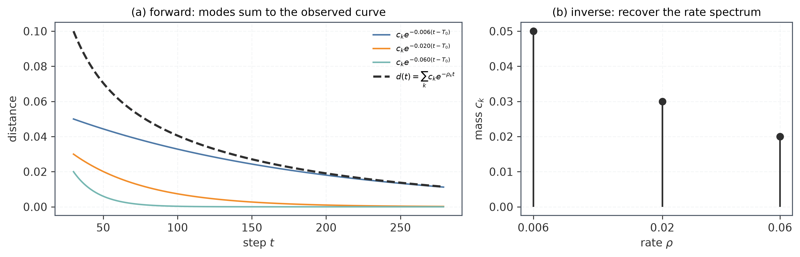
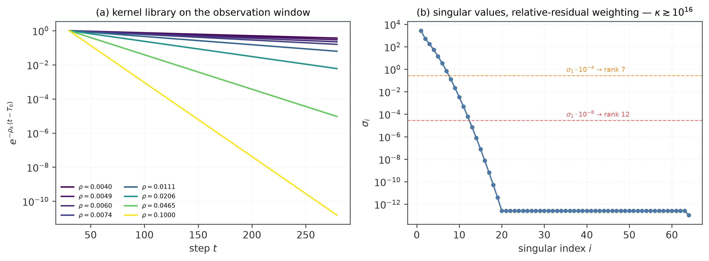
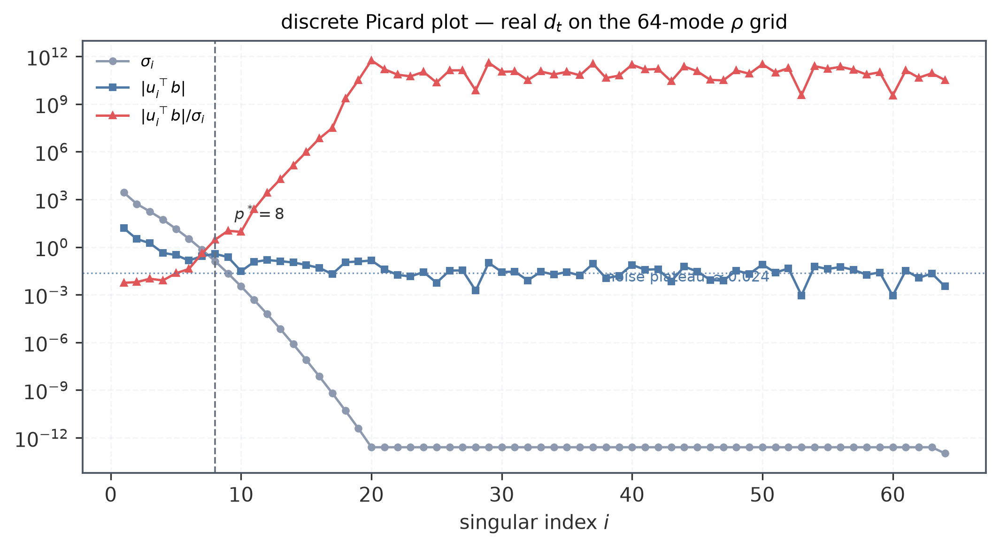
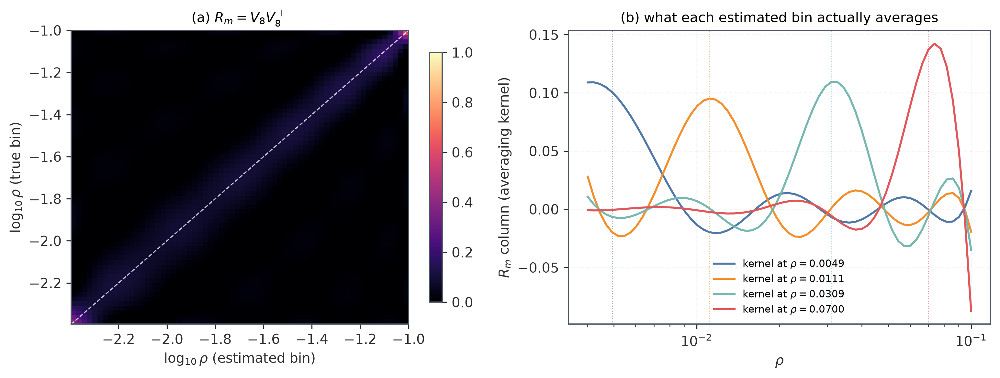
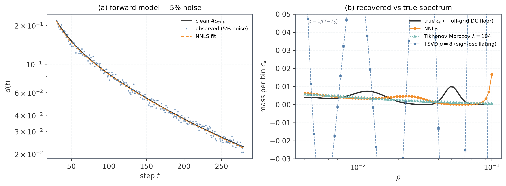
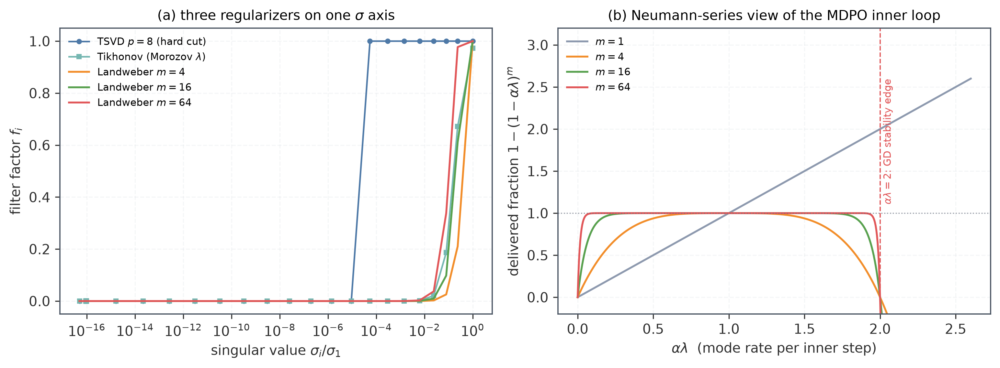

# OPD 的谱框架：自伴算子、拉普拉斯反演与滤波正则化

> 本文是"地球物理谱方法第 0 章"（泛函算子谱理论 + 矩阵谱分解 + 病态反演）在 MD-OPD 项目上的落点整理：一套自伴算子谱分解 + 第一类 Fredholm 反演的通用机械，原封不动地搬进 OPD。目的有三：(i) 把 `d(t) = Σc_k e^{-ρ_k t}` 这个吸收模型从"好用的拟合形式"升级为"有定理来源的分解"——核回归学习曲线理论里有逐符号对应的严格版本，本文再补上预条件子与蒸馏特有的部分；(ii) 把 NNLS 反演放进逆拉普拉斯变换的教科书框架，量化它到底能诚实给出几个数；(iii) 指出反演正则化（TSVD/Tikhonov/Landweber）与训练动力学（MDPO 内层、Muon、Adam）是**同一族谱滤波器**。所有数值实验可复现：`uv run --with numpy --with pandas --with matplotlib --with scipy python plots/inverse_lab.py`，输出在 `plots/derived/inverse_lab.json` 与 `docs/figures/2026-09-13-opd-spectral-inverse-primer/`。

## 0. 导引：同一条链的两端

整条框架是一个方向相反的两步：

- **正演（谱分解）**：在最优点附近把 OPD 损失二次化，Hessian/Fisher 是对称半正定算子；对称算子的谱定理给出实特征值与正交特征方向；梯度流沿每个特征方向独立指数衰减；距离 $d(t)$ 作为二次型，成为指数模态之和——$d(t)$ 是速率测度的**拉普拉斯变换**。
- **反演（谱测量）**：从实测曲线 $d_t$ 反推速率谱 $c(\rho)$，是求解核 $K(t,\rho)=e^{-\rho t}$ 的第一类 Fredholm 方程——拉普拉斯变换求逆，教科书承认的最病态问题之一[^epstein08]。

_图 0：左，三个速率模态 $c_ke^{-\rho_k(t-T_0)}$ 相加得到观测曲线 $d(t)$；右，反演要从曲线读回谱质量 $c_k$。正演是积分（平滑），反演是它的逆（放大）。_

地球物理那章与本项目的对象对照：

| 地球物理（谱方法第 0 章）                                 | MD-OPD                                         |
| --------------------------------------------------------- | ---------------------------------------------- |
| 自伴算子 $-\nabla^2$，特征函数 $e^{ik\cdot r}$ / $Y_{lm}$ | 对称半正定 Hessian/Fisher $H$，特征方向 $q_i$  |
| 谱变量：波数 $k$、阶数 $l$                                | 谱变量：衰减率 $\rho_i=2\alpha\tilde\lambda_i$ |
| 重力场向上延拓核 $e^{-kz}$                                | 时间观测核 $e^{-\rho t}$，$t$ 相当于"延拓高度" |
| 病态反演 $d=Gm$                                           | $d(t)=\int e^{-\rho t}\mu(d\rho)$ 的逆拉普拉斯 |
| 分辨率矩阵 $R_m=V_pV_p^\top$、averaging kernel            | 同物：每个估计 bin 是真谱的带符号平均          |
| Tikhonov 参数 $\lambda^2$、Morozov 偏差原理               | MDPO 近端权重 $1/\eta$、内层步数 $m$           |
| EOF（数据学的谱）vs 球谐（几何定的谱）                    | 曲线反演谱 vs Lanczos 实测 Hessian 谱          |

## 1. 正演：$d(t)$ 为什么是指数模态之和

本节把"距离曲线是多指数衰减"从假设变成推导，并顺手推出两件重要的事：谱权重 $c_i$ 非负是**结论不是假设**；反演出的谱是**激励加权**谱，不等于裸特征值密度。

**命题 1（预条件模态衰减）。** 设 OPD 损失在最优点附近二次化 $J(\theta)\approx J^*+\frac12\delta\theta^\top H\delta\theta$，$H$ 对称正定；优化器每步 $\theta_{t+1}=\theta_t-\alpha P\nabla J$，预条件子 $P$ 对称正定（GD 取 $P=I$，NGD 取 $P=H^{-1}$，Adam 噪声相取 $P=\mathrm{diag}\,1/\sqrt{\hat v}$ 的冻结近似）。则

$$
d(t)\approx \delta\theta_t^\top H\,\delta\theta_t
=\sum_i \tilde\lambda_i a_i^2\,(1-\alpha\tilde\lambda_i)^{2t}
\approx \sum_i \tilde\lambda_i a_i^2\,e^{-2\alpha\tilde\lambda_i t},
$$

其中 $\tilde\lambda_i$ 是白化矩阵 $M=P^{1/2}HP^{1/2}$ 的特征值，$a_i$ 是初始偏差在该方向上的分量。

**推导。** 递推 $\delta\theta_{t+1}=(I-\alpha PH)\delta\theta_t$。$PH$ 不对称，但它与对称矩阵 $M=P^{1/2}HP^{1/2}$ 相似（$PH=P^{1/2}MP^{-1/2}$），故特征值同为 $\tilde\lambda_i$。$M$ 的单位特征向量 $q_i$ 给出 $PH$ 的右特征向量 $u_i=P^{1/2}q_i$。把 $\delta\theta_0=\sum_i a_iu_i$ 展开得 $\delta\theta_t=\sum_i a_i(1-\alpha\tilde\lambda_i)^t u_i$。代入二次型，关键是 $H$-正交性：

$$
u_j^\top H u_i=\tilde\lambda_i\,u_j^\top P^{-1}u_i=\tilde\lambda_i\,q_j^\top q_i=\tilde\lambda_i\delta_{ij},
$$

（用到 $Hu_i=\tilde\lambda_iP^{-1}u_i$）。交叉项全部消失，$d(t)=\sum_i\tilde\lambda_i a_i^2(1-\alpha\tilde\lambda_i)^{2t}$。$\square$

三个直接推论：

1. **谱权非负是定理**：$c_i=\tilde\lambda_i a_i^2\ge0$。NNLS 的 $c\ge0$ 锥不是工程 hack，是这个分解的内在性质——这也解释了为什么 NNLS 在无显式正则时稳定（§2.5）。
2. **速率关系 $\rho_i=2\alpha\tilde\lambda_i$**：$d$ 是 $\theta$ 的二次型，平方把参数空间速率 $\alpha\tilde\lambda_i$ 翻倍。一致性检查：反演网格 $\rho_{\max}=0.1$/步对应白化谱上端 $\tilde\lambda_{\max}\approx5\times10^4$，恰与 `lambda_kl_reading` 的上端 $5\times10^4$ 吻合[^dyn]。
3. **激励加权**：反演给出的是 $c_i=\tilde\lambda_i a_i^2$——谱被初始条件与轨迹实际经过的方向**加权**。从未被激励的方向不出现在 $d(t)$ 里，无论它的特征值多大。M2（曲线反演）与 M5（Lanczos 实测 Hessian）对照时必须除以激励权重，否则比的不是同一个对象（§5）。

**离散时间修正。** 连续近似在 $\alpha\tilde\lambda\ll1$ 时成立；离散因子的真身是 $(1-\alpha\tilde\lambda)^{2t}$。$\alpha\tilde\lambda\in(1,2)$ 的模态每步翻号，能量仍按 $|1-\alpha\tilde\lambda|^{2t}$ 衰减但带 ringing；$\alpha\tilde\lambda>2$ 发散——这就是 edge of stability 边界，也是 §3.2 里 MDPO 内层震荡的同一根源。

**这个分解在核回归文献里是严格定理，不是类比。** Bordelon–Pehlevan 对结构化特征上 SGD 的总体动力学给出 $\langle L_t\rangle\sim\sum_k\lambda_kv_k^2(1-\eta\lambda_k)^{2t}$[^bordelon22]——与命题 1 逐符号对应（他们的 $v_k^2$ 即我们的激励 $a_k^2$）；Paquette 等的 Volterra 极限把 SGD 风险写成 Hessian 谱测度的连续拉普拉斯积分 $\int x^ke^{-2\gamma tx}\,d\mu(x)$[^paquette21]；Bordelon–Canatar–Pehlevan 的谱序定理严格证明大特征值模态先被学到[^bordelon20]。吸收模型于是获得准确身份：**核回归模态衰减在蒸馏目标上的实例化**——新增的只是预条件子 $P$ 进入速率、以及读数取采样 token 上的 reverse KL（其二阶展开恰是 $\frac12\delta^\top F\delta$，即 $H=F$ 不是任意选择）。一个直接预言稍后有用：若 $\lambda_k\sim k^{-b}$、$c_k\sim k^{-a}$ 是幂律连续谱，则 $d(t)\sim t^{-(a-1)/b}$ 呈现幂律尾[^bordelon24]。

## 2. 反演：逆拉普拉斯是教科书级的最病态问题

### 2.1 向上延拓类比

把速率测度 $\mu(\rho)$ 想成"埋在深度 $\rho$ 处的源强度"，$d(t)$ 是在"高度 $t$"测到的场。这与重力向上延拓 $e^{-kz}$ 完全同形：观测高度越高（$t$ 越大），高 $\rho$（快衰减）分量被指数压掉。晚期曲线只含慢模态，快模态的信息全在**早期曲率**里——这就是为什么反演对观测窗口的位置与长度极端敏感。

数学上，拉普拉斯核是**伸缩不变**的：在 $t=e^y$、$\rho=e^{-x}$ 的对数变量下变成卷积核，被 Mellin 变换对角化，奇异值几何衰减 $\sigma_k\asymp e^{-\pi^2k/W}$（$W$ 为对数窗口宽度，单位 nat）[^mcwhirter78]。可用模态数只随信噪比**对数**增长：$N_{\rm eff}\approx\frac{W}{\pi^2}\ln(1/\delta)$——这正是指数病态问题对数收敛率的一般结论的实例[^engl96]。我们的窗口 $W_t=\ln(279/30)\approx2.2$ nat、谱窗 $W_\rho=\ln25\approx3.2$ nat，把这个数压到个位数。

这个估计量也不是新东西：聚合物弛豫谱反演里的 CONTIN（Provencher）就是在对数速率网格上做带正则的逆拉普拉斯[^provencher82]，我们的 NNLS 是它的"非负约束替代显式正则"变体——该领域四十年的稳定性分析（bootstrap 置信带、带平均报告）可直接搬用。

### 2.2 实测：设计矩阵的病态程度

在真实反演对象上（`mdxt04lm` 臂，$t\in[30,279]$，64 点对数 $\rho$ 网格，相对残差加权 $X=A/y$、$b=\mathbf 1$——对应 NNLS 逼近的对数空间损失）：

- 奇异值几何衰减 $\sigma_{k}/\sigma_1\approx e^{-1.3k}$，与 McWhirter–Pike 的有限窗预言一致；
- $\kappa(X)\gtrsim10^{16}$——$\sigma_{\min}$ 已抵机器精度下限，"条件数"本身只是下界；
- 有效秩：$\#\{\sigma_i>10^{-4}\sigma_1\}=7$、$10^{-6}$ 档 10、$10^{-8}$ 档 12；
- **加密网格适得其反**：$\kappa$ 从 16 点的 $3\times10^{14}$ 单调涨到 256 点的 $4\times10^{18}$——列越来越共线，分辨率没有变高，只是噪声放大更狠。

_图 1：(a) 指数核库：$\rho\ll1/T$ 的慢模态在窗口内几乎是同一条平线，彼此不可区分；(b) 加权设计矩阵的奇异值几何衰减，$i\gtrsim20$ 后触及数值零。_

### 2.3 这条曲线里有几个独立的数

Istratov–Vyvenko 对多指数拟合的经典结论是残酷的：SNR 约 $10^3$ 时，分辨两个指数要求速率比 $\gtrsim2$；现实精度下总可分辨分量约 3–4 个，极端精度（$10^6$）也就 5–6 个[^istratov99]。Lanczos 五十年代就调侃过：三个不同速率的指数可以拟合同一条数据。

我们的实测：Picard 截断 $p^*=8$，且能量自洽——前 8 个奇异方向捕获 $\sum_{i\le8}|u_i^\top b|^2\approx249.3$（$\Vert b\Vert^2=250$），剩余残差 $\approx0.7$ 与噪声期望 $(n-p^*)\sigma_{\rm rel}^2=242\times0.064^2\approx1.0$ 同阶一致。**250 个点的训练曲线对谱的独立约束约 8 个自由度**——64 bin 密度图里其余的结构是先验（非负性 + 网格插值），不是数据。

**Picard 条件的操作版**[^hansen90][^hansen10]：离散反演可解的必要迹象是无噪系数 $|u_i^\top b|$ 比 $\sigma_i$ 衰减更快；画三线图 $\sigma_i$、$|u_i^\top b|$、$|u_i^\top b|/\sigma_i$——前者衰减到噪声平台处与 $\sigma_i$ 的交点即截断点。本文取 $p^*=\#\{i:\sigma_i>\text{平台}\}$：$\sigma_i$ 低于噪声底后，除以 $\sigma_i$ 把平台级噪声放大到 $O(1)$ 以上。

_图 2：真实 $d_t$ 的离散 Picard 图。$\sigma_i$（灰）几何衰减至数值零；$|u_i^\top b|$（蓝）在 $i\approx8$ 处跌入 ~0.024 的噪声平台；比值（红）从此单调爆炸——$i=8$ 之后每加一个模态，解范数被放大一个数量级以上。竖线即 $p^*=8$。_

两个"多花钱也买不来"的边界实测：

- **前移窗口收效甚微**：把拟合起点从 $T_0=30$ 前移到 $1$（多 29 个早期点），$p^*$ 仅从 8 涨到 9——快模态信息没有回来，瓶颈是噪声底不是时间覆盖。这与 McWhirter–Pike 的对数律一致：$N_{\rm eff}\sim\ln(1/\delta)$，多 2 个自由度需要噪声降一个数量级[^mcwhirter78]。
- **可行的增益方向**：降 $\delta$（多 seed/run 平均、更平滑的 $d_t$ 读数）几乎线性买自由度；拉长 $T$ 把亚分辨率慢模态拖进可分辨区，但对快端无效。

### 2.4 分辨率矩阵：$\rho_{\min}$ 堆积的机理

对任意线性反演 $\hat c=R_m\,c_{\rm true}$，TSVD 下 $R_m=V_pV_p^\top$；它的第 $j$ 行是 Backus–Gilbert 意义上的 **averaging kernel**：估计 bin $j$ 实际是真谱以该行为权重的带符号平均[^backus68]。图 3 显示：在诚实截断 $p=8$ 下，**没有一个 bin 是自分辨的**——连最快端的对角元也只有 0.59；慢端核几乎是整个亚分辨率区间的宽平均，带显著旁瓣。

这给出 $\rho_{\min}$ 堆积的精确机制：$\rho<1/(T-T_0)$ 的慢模态（含一个真"地板"，即 $\rho\to0$ 的常数分量）在窗口内全部近似常数，落在 $\text{span}\{1,t\}$ 这约 2 维空间里；它们在设计矩阵上的投影几乎完全落在最低格点列上——**估计谱把整条不可分辨的慢端折叠进了 $\rho_{\min}$ bin**。真实反演里这部分占 21.6% 质量，与动力学文档报的 21.5% 一致[^dyn]。

_图 3：$R_m$（$p=8$ 截断）。(a) 热图：只有快端保留对角脊；(b) 四个代表 bin 的 averaging kernel——每个估计值都是真谱的宽带符号平均，慢端尤其弥散。_

### 2.5 合成实验：四种反演在同一噪声下的命运

构造已知谱（两个对数正态峰 + 网格外的直流地板模态），正演加 5% 相对噪声，反演比较：

| 方法                          | 相对 $\ell_2$ 误差               | 行为                                           |
| ----------------------------- | -------------------------------- | ---------------------------------------------- |
| 裸伪逆 $V\Sigma^{-1}U^\top$   | $\Vert c\Vert\sim5\times10^{12}$ | 完全爆炸（$\kappa$ 机器极限）                  |
| TSVD $p=8$                    | 27                               | 不爆但**符号震荡**，密度无意义                 |
| Tikhonov（Morozov $\lambda$） | 0.62                             | 保守光滑，拿对总质量、丢结构                   |
| NNLS（项目现用）              | 0.92                             | 稳定、峰位大致正确，慢端质量堆到 $\rho_{\min}$ |

_图 4：(a) 正演 + 5% 噪声与 NNLS 拟合；(b) 反演对比（线性轴画每 bin 质量）：真谱（黑）、NNLS（橙）、Tikhonov-Morozov（青）、TSVD（蓝方点，正负剧烈震荡）。竖线是分辨率边 $\rho=1/(T-T_0)$。_

三点值得记下：

- **非负性本身就是正则化**。Slawski–Hein 证明正对设计矩阵上的 NNLS 无需正则参数即一致并恢复稀疏非负信号[^slawski13]；Morgenshtern–Candès 证明正源超分辨在正性下稳定，没有最小间距条件——正性把符号情形的指数病态（Prony/confluent-Vandermonde 的 $\Delta^{-(2r-2)}$ 放大[^batenkov13]）整个移除[^morgenshtern16]。Talenti 对矩问题的结论同样：指数病态在正性/矩约束下变为条件稳定[^talenti87]。这就是"本数据无需正则化即稳定"的理论解释——NNLS 的稳定不是运气好，是锥约束在干活。
- **Morozov 比 GCV 可靠**。噪声水平已知（对数残差 ~6%）时偏差原理 $\Vert Xc_\lambda-b\Vert^2=n\epsilon^2$ 给出有原则的 $\lambda$；GCV 在重病态问题上有欠光滑的已知失效模式[^vogel96]，合成实验里确实选了过小 $\lambda$。
- **诚实输出的单位**：按 Backus–Gilbert，谱应报成 $\ln\rho$ 上宽度 ~1 nat 的若干带平均（4–8 个），而非 64 点逐点密度。`-0.42` 的 log-log 密度斜率在这样的分辨率下只能当作被先验平滑过的指示，不是测量。
- **连续谱的多对一警告**。上游理论恰恰预言真谱可能是幂律连续谱（§1 末：$\lambda_k\sim k^{-b}$、$c_k\sim k^{-a}\Rightarrow d(t)\sim t^{-(a-1)/b}$[^bordelon24][^bahri24]）；而对幂律谱，正演映射是多对一的——无穷多个谱共享同一渐近指数[^paquette24]。这意味着 64 bin 反演出的"峰结构"可能部分是网格对连续密度的离散化伪影；判别"真有分立模态"与"幂律尾的离散读数"需要超出当前拟合的额外证据（例如不同窗口反演的峰位稳定性）。

## 3. 滤波因子：反演正则化与训练动力学是同族对象

### 3.1 统一表

在 $B$（或 $X^\top X$）的特征基下，各种"正则化/迭代"都是对谱系数的逐模态标量乘子 $f_i$：

| 方法                                            | 滤波因子 $f_i$                      | 正则参数     | 所在问题              |
| ----------------------------------------------- | ----------------------------------- | ------------ | --------------------- |
| TSVD                                            | $\mathbf 1[i\le p]$                 | 截断阶 $p$   | 反演                  |
| Tikhonov                                        | $\sigma_i^2/(\sigma_i^2+\lambda^2)$ | $\lambda$    | 反演                  |
| Landweber/Richardson $m$ 步                     | $1-(1-\alpha\sigma_i^2)^m$          | 迭代次数 $m$ | 反演[^landweber51]    |
| MDPO 内层 $\delta_m=-[I-(I-\alpha B)^m]B^{-1}g$ | $1-(1-\alpha\tilde\lambda_i)^m$     | 内层步数 $m$ | 动力学[^dyn]          |
| Muon（msign）                                   | $\sigma_i\to1$ 全拍平               | —            | 优化器几何[^jordan24] |

第三行与第四行是**同一个对象**：Richardson 迭代 $x_{k+1}=x_k+\alpha(b-Bx_k)$ 的截断 Neumann 级数 $\alpha\sum_{j<m}(I-\alpha B)^j$[^saad03]——MDPO 内层就是作用在近端子问题上的 Landweber 迭代，反演理论里"早停即正则化"的全部结果（收敛需 $\alpha\lambda_{\max}<2$、迭代数当正则参数、先快后慢的模态交付序）直接搬运。

### 3.2 内层交付率与尾部反弹的滤波解释

逐模态交付率 $f_m(\tilde\lambda)=1-(1-\alpha\tilde\lambda)^m$：$\alpha\tilde\lambda\ll1/m$ 的慢模态只交付 $m\alpha\tilde\lambda$ 比例——当前 $\bar\psi\approx0.05$ 的内层交付率，其滤波读法是"绝大多数模态的 $\alpha\tilde\lambda$ 远小于 $1/m$"。$1<\alpha\tilde\lambda<2$ 的模态进入 ringing 带，$\alpha\tilde\lambda>2$ 发散。

$\eta$ 收紧（leash 刚度 $\propto1/\eta$）把 leash 主导的模态推向大 $\tilde\lambda$：存在临界 $\eta^*$，低于它这批模态越过 $\alpha\tilde\lambda=2$ 边界——**这给"$\eta\to0.01$ 时尾部反弹"一个可检验的机制解释**：反弹模态就是 leash 模态进入内层 Richardson 发散区的部分[^dyn]。

_图 5：(a) 同一 $\sigma$ 轴上的三种反演滤波器：TSVD 硬截断、Tikhonov 光滑滚降、Landweber 随迭代数 $m$ 的渐硬滚降；(b) Neumann 视角下的内层交付率 $1-(1-\alpha\lambda)^m$：$\alpha\lambda=2$ 是 GD 稳定边，$m$ 越大 ringing 越陡。_

### 3.3 $\eta$ 与 Tikhonov 参数的对应，及"平台"的 Morozov 读法

MDPO 每个外层步最小化 $\{\text{对教师拟合}+(1/\eta)\,\mathrm{KL}(p\Vert p_{\rm old})\}$——近端权重 $1/\eta$ 就是 Tikhonov 的 $\lambda^2$。文献里两个表面矛盾的方向由此统一：

- PMD 理论（精确内解）说 $\eta$ 应几何递增[^johnson23]：$\lambda^2$ 递减 = 迭代越深越信任数据拟合项；
- 但信任不能无限增长：Morozov 偏差原理要求残差降到噪声水平就停[^morozov]——$\sim10^{-3}$ 地板就是那条水平线。

"$\eta$ 递减到平台而非归零"于是有了反演语言：正则化参数应停在 L 曲线拐角/Morozov 点，继续收紧（$\eta\to0.01$）等于过正则化（leash 压倒拟合）兼触发 §3.2 的内层发散。两件事用同一个机制解释。

## 4. 优化器即谱手术：Adam、Shampoo、Muon 在滤波框架里的位置

同一坐标系下比较三个优化器对谱的作用：

- **Adam**：对角预条件 $P=\mathrm{diag}\,1/\sqrt{\hat v}$。只能均衡**坐标对齐**的谱色散——Kunstner 等的重尾类不平衡机制要求 Fisher 的慢方向与坐标轴对齐（每个类一块权重），token 频率造成的色散满足这一点、参数共享造成的不满足[^kunstner24]。实证检验：把玩具 Hessian 特征基旋转 45°，Adam 的均衡即失效[^essence]。
- **Shampoo/SOAP**：预条件 $(L\otimes R)^{-1/4}$ 是 Kronecker 分解的 $1/2$ 次幂；Morwani 等的精确命题是"Shampoo 近似的**平方** = 最优 Kronecker 分解的一步幂迭代"[^morwani24]；SOAP = 在 Shampoo 特征基里跑 Adam[^vyas24]。
- **Muon**：方向是动量矩阵的极因子 $UV^\top$（Newton–Schulz 五重迭代逼近），即把更新矩阵的奇异值谱整体拍平到 1——与单样本 Shampoo 恒等 $(GG^\top)^{-1/4}G(G^\top G)^{-1/4}=UV^\top$[^bernstein24][^jordan24]。"半白化"是它的几何本质：奇异值取 $-1/2$ 次幂而非 $-1$。实测侧的同向证据：transformer 损失面的方向曲率谱是"EoS 处的易变头部 + 宽容体区"，拍平头部恰好对症[^specalloc26]。
- **NGD/全白化** $B=H$：所有模态同速衰减——反演语言里这是"完美但放大噪声的预条件"，Martens 定理给出地板 $\frac{\alpha}{4}\mathrm{tr}((B-\frac{\alpha}{2}H)^{-1}\Sigma_g)$，白化有效的必要条件是 $H$ 病态且噪声与曲率对齐[^martens20]；Ollivier 的 Kalman 视角进一步把逐方向增益写成阻尼型 $s_i^2/(s_i^2+\sigma_i^2)$——低 SNR 模态应降权而非放大[^ollivier17]。

用本文反演框架重新读项目的白化收益表（动力学文档 §3.5）：全均衡 3.7×、半白化 2.4×，对应的正是"把 $\tilde\lambda$ 的动态范围压扁"对 $d(t)$ 前沿的推进——谱域里压缩条件数 = 时间域里拉平速率分布。

## 5. 经验谱 vs 几何谱：EOF 视角下的 M2→M5

那章末尾的 EOF/球谐对照正是项目 M2→M5 纲领的统计学出处[^backus68]：

- **几何谱**（Hessian/Fisher 的特征值）由目标结构决定，对应"解析基"；
- **经验谱**（从 $d(t)$ 反演出的 $c(\rho)$）是数据沿轨迹学到的，对应"EOF"；
- 二者重合当且仅当轨迹对各方向激励均匀——即 $a_i^2$ 近似常数。实际不然：**支撑 gap**（未采样 token 300 步内 83% 从未被训）在正向映射 $\theta\mapsto$ 采样 token advantage 的字面零空间里，这些方向对 $d(t)$ 完全不可见。

由此得到一个可操作的判据：M5 用 Lanczos 实测的 Hessian 谱与 M2 反演谱对照时，要先除以激励权重（或对"谱的可观测部分"作限定）；性质 B 的 $n_{\rm eff}$ 则是噪声协方差 $\Sigma_g$ 特征谱的参与率 $(\sum\mu_i)^2/\sum\mu_i^2$——EOF 的"有效模态数"。

蒸馏理论还说明激励权重 $a_i^2$ 本身被教师系统性改写，不是中性的初始条件：

- 监督复杂度 $\sum_j(\boldsymbol Y^\top v_j)^2/\lambda_j$ 按 $1/\lambda_j$ 给模态定价，软标签的价值恰在于把教师信号集中到 NTK 主特征方向[^harutyunyan23]——$c_k$ 被前载到快模态，反演谱的快端质量部分是蒸馏信号的形状而非学生损失的形状。
- Mobahi 等的逐轮分析给出小特征值方向以 $d_k/(d_k+c_i)$ 逐轮收缩、死得最快；且理想化迭代蒸馏严格坍缩到零——这是"模型必须有非零地板项"的独立论据[^mobahi20]。投影极限是同一图景的端点：线性学生收敛到教师在数据张成上的正交投影，span 外教师内容严格归零[^phuong19]——正是支撑 gap 的理想化版本。
- 观测渐近线也未必是谱极限：Stanton 等的实证显示学生失败在**优化**而非容量，曲线可以停在一个优化器盆地里[^stanton21]；Busbridge 等的蒸馏律则把地板写成容量极限的函数[^busbridge25]。三种"地板"语义（优化盆地、容量极限、Morozov 噪声线）在曲线上不可区分——这又是 §6 说的"反向结论弱于正向"。

**M5 的可执行形态。** 实测谱的教科书方法是免矩阵 Lanczos：Pearlmutter R-算子给出精确 HVP（约 2–3× 梯度成本[^pearlmutter94]），SLQ 对每个 Hutchinson 向量跑 $m$ 步 Lanczos，把 Ritz 值汇成谱密度的 Gauss 求积估计[^lin16][^ghorbani19][^yao20]。把它落到我们的对照上，有四个非显然的点：

- **测哪个矩阵**。诚实对照对象是白化算子 $M=P^{1/2}HP^{1/2}$（HVP 外面裹对角预条件子）；PSD 参考取 GGN≡真 Fisher——对 softmax 型损失它半正定且不需要采样标签。全 Hessian 在训练中期可以有负特征值（残差项）。且要**按块测**：transformer 的 Hessian 有强块异质性，各块谱差异巨大[^zhang24]。
- **M5 自己也有分辨率矩阵**。SLQ 返回的不是真密度而是模糊化版本：体区分辨率 $\sim\lambda_{\rm range}/m$，累积谱的 Wasserstein 误差 $\lesssim12\lambda_{\rm range}/m$[^chen21]——与 §2.4 的 averaging kernel 同一种病。M2 与 M5 对照时两侧的"带平均"宽度都要先对齐，近简并的 $\rho_k$ 注定合并。
- **更好的对照对象不是密度**。直接用 SLQ 估谱的拉普拉斯变换 $\frac1n\mathrm{tr}\,e^{-tM}$（光滑函数正是 Gauss 求积的强项）在若干 $t$ 上与反演预言的 $\hat d(t)=d(t)/d(T_0)$ 比较——绕过两侧的模糊化，直接检验"速率加权"主张本身；外加 Hutchinson 迹 $\mathrm{tr}\,M$ 对照 $\sum_kc_k\rho_k$ 型矩[^lin16]。
- **成本与先例**。$n_v\approx10$–$30$ 向量 × $m\approx100$–$200$ 步 ≈ 1–6k 次 HVP，4 GPU 上 1–8B 可行；顶端 outlier 用带 deflate 的 Lanczos 几十步收敛。独立 sanity check：Adam 下白化谱上端应稳定在 $\tilde\lambda_{\max}\approx38/\alpha$ 量级（adaptive edge of stability[^cohen22]，对应 $\alpha\tilde\lambda_{\max}\approx38$）；LayerNorm transformer 的 FIM 存在可读出的**精确零方向**[^deaddir26]——零空间不是假设，是实测过的对象。先例侧：冻结 checkpoint 的二次模型已被证明能预言其后 ~10% 的 LLM 训练动力学[^meterez26]（全谱测量，150M）；7B 上有方向性尖锐度 proxy（critical sharpness[^kalra26]）；已发表的全谱密度测量止步 150M——我们做 1–8B 的 OPD 谱本身就是新数据，且尚无人在蒸馏/KL 目标上测过 Hessian 谱（现有都是权重更新 SVD 或 K-FAC Fisher）。

**谱的两个结构事实**（实测文献，支撑"少数速率主导 $d(t)$"）：

- 梯度活在极小主子空间里——维度 ~类别数、由头部特征向量张成，损失动力学主要由 outlier 特征值承载[^gurari18]；Hessian 谱的通例形态是"近零体区 + 数据决定的一撮 outlier"[^sagun17][^papyan19]，均值场 FIM 理论里 softmax 把 outlier 展成拖尾[^karakida19]——与幂律速率分布的猜想同向。
- softmax 的逐 token Fisher 是 $\mathrm{diag}(p)-pp^\top$：自信 token 贡献近零曲率——**OPD 损失谱实际由高熵学生 token 生成**；注意经验 Fisher ≠ 真 Fisher，前者只是梯度二阶矩[^kunstner19]。OPD/RLVR 更新的实测几何与支撑 gap 同向：更新谱集中且避开源模型主奇异方向[^dsup26][^opdgeo26]，RLVR 被证明在 off-principal 方向学习[^zhu25]。

## 6. 类比的断裂处（诚实边界）

1. **噪声模型分两层**。反演章的加性噪声 $d=Gm+n$ 只适用于对 $d_t$ 的**测量**（日志读数噪声在对数空间近似加性）；训练动力学本身的噪声是**乘性**的（$\Sigma_g\propto d$，性质 A）[^essence]，那套工具不能搬到 SGD 一侧。
2. **算子会漂，连测度都在漂**。$H(\theta_t)$ 的特征基随参数漂移——谱是移动目标，这是 $\nu_0C_0$ 加性分量的来源。上游谱理论全部假设固定数据测度；on-policy 下状态分布随 $\pi_\theta$ 走，Basri 等证明非均匀输入密度会把每模态的学习时钟改写成 $O(\kappa^d/p(x))$[^basri20]——on-policy 漂移对应同方向的修正，但没有人算过。文章的算子是固定的。
3. **谱变量语义不同**。$\rho$ 是衰减率（1/步），不是空间波数；但数学对象同构，全部数值结论照样成立。
4. **正向结论强于反向**。$\rho_i=2\alpha\tilde\lambda_i$、$c_i\ge0$、滤波因子表是精确的；"地板 = Morozov 点"目前是映射而非定理——$10^{-3}$ 地板的硬分量（bf16 失配）与"残差=噪声"的语义对应还需 D1 实验裁决[^essence]。
5. **模态瞬态未必是指数**。指数衰减是核/惰性极限的结果；特征学习显著时，单模态瞬态是 logistic 台阶（Saxe 深线性网的精确解[^saxe14]、自监督的逐步学习[^simon23b]、DMFT 在指数与 logistic 之间的连续插值[^dmft22]），onset $\tau_k\propto(1/\gamma_k)\ln(1/\gamma_k)$。若 $d(t)$ 实际是阶梯状，多指数混合就是错误模板——文献没有给出 LLM 蒸馏落在哪个区间的判据，这本身是个开放点。
6. **"无直接先例"的双面性**。没人从观测训练曲线反演速率谱——最近的先例只有动量设计用的矩法谱估计（Pedregosa–Scieur 用 $\frac1d\mathrm{tr}(H^k)$ 恢复谱密度[^pedregosa20]）与 edge-of-stability 的边缘单点推断（$\lambda_{\max}\approx2/\eta$[^cohen21]）。好处是我们的组合（非负 + 对数网格 + 带平均报告）有自由空间；代价是审稿级的正当性论证全要自己扛。

## 7. 对现有 pipeline 的具体改动建议

按代价排序：

1. **Picard 图进 `invert_spectrum.py`**：$X=A/y$、$b=\mathbf 1$ 的 SVD 三行代码画出 $\sigma_i$、$|u_i^\top b|$、比值三条线；报告 $p^*$（本文 8）作为"该曲线的谱自由度"。每个谱图都应带这个数。
2. **给设计矩阵加一列 $\rho=0$（常数列）**：地板质量从此是一个干净的标量 $d_\infty$，而不是被折叠进 $\rho_{\min}$ 的模糊堆积。代价一行 `np.column_stack`。
3. **分辨率矩阵/averaging kernel 随谱一起报**：$R_m=V_{p^*}V_{p^*}^\top$ 的行（或至少对角元与等效宽度）是"这个 bin 实际测了什么"的标准答案。
4. **Morozov 作为 L-curve 的交叉验证**：噪声水平 $\epsilon\approx6\%$ 已知，$\Vert Xc_\lambda-b\Vert^2=n\epsilon^2$ 单参数解，比"残差涨 10% 取最小"的手动规则有原则。
5. **报告谱时用带平均替代逐点密度**：$\ln\rho$ 上 ~1 nat 宽的 4–8 个带质量 + averaging kernel，替代 64 点密度图与 log-log 斜率。
6. **内层步数 $m$ 当正则参数调**：Landweber 视角下 $m$ 与 $\eta$ 分工明确（$m$ 定滤波形状、$\eta$ 定目标），rebound 预测可用 $\alpha\tilde\lambda$ 的分布直接算。

## 8. 与其他文档的接口

- 动力学推导文档[^dyn]：本文 §1 是它的线性化严格的代数补全（$H$-正交性、$c_i\ge0$ 的出处）；§3.2 的 rebound 机制是它的"leash 绑死"现象的内层谱解释。
- 本质/文献综述文档[^essence]：性质 B 的 $n_{\rm eff}$ 在 §5 取得 EOF 语义；"先修读数再谈干预"的排序在 §7 落成具体工具。
- 谱理论长文档[^spectral]：§2.9 的 NNLS 反演方法在本文获得完整的病态反演理论定位（向上延拓类比、Picard、Backus–Gilbert）；其"实测谱验证"纲领在本文 §5 落成具体协议（SLQ + $\mathrm{tr}\,e^{-tM}$ 对照 + AEoS 检查）。

### 参考文献

[^epstein08]: C. L. Epstein, J. Schotland. The Bad Truth about Laplace's Transform. SIAM Review 50(3), 2008. [DOI:10.1137/060657273](https://doi.org/10.1137/060657273)

[^mcwhirter78]: J. G. McWhirter, E. R. Pike. On the numerical inversion of the Laplace transform and similar Fredholm integral equations of the first kind. J. Phys. A 11(9), 1978. [DOI:10.1088/0305-4470/11/9/007](https://doi.org/10.1088/0305-4470/11/9/007)

[^istratov99]: A. A. Istratov, O. F. Vyvenko. Exponential analysis in physical phenomena. Rev. Sci. Instrum. 70(2), 1999. [DOI:10.1063/1.1149581](https://doi.org/10.1063/1.1149581)

[^hansen90]: P. C. Hansen. The discrete Picard condition for discrete ill-posed problems. BIT 30(4), 1990. [DOI:10.1007/BF01933214](https://doi.org/10.1007/BF01933214)

[^hansen10]: P. C. Hansen. Discrete Inverse Problems: Insight and Algorithms. SIAM 2010. [DOI:10.1137/1.9780898718836](https://doi.org/10.1137/1.9780898718836)

[^backus68]: G. Backus, F. Gilbert. The resolving power of gross Earth data. Geophys. J. R. Astron. Soc. 16(2), 1968. [DOI:10.1111/j.1365-246X.1968.tb00216.x](https://doi.org/10.1111/j.1365-246X.1968.tb00216.x)

[^slawski13]: M. Slawski, M. Hein. Non-negative least squares for high-dimensional linear models: consistency and sparse recovery without regularization. Electron. J. Statist. 7, 2013. [arXiv:1205.0953](https://arxiv.org/abs/1205.0953)

[^morgenshtern16]: V. I. Morgenshtern, E. J. Candès. Super-resolution of positive sources: the discrete setup. SIAM J. Imaging Sci. 9(1), 2016. [arXiv:1504.00717](https://arxiv.org/abs/1504.00717)

[^batenkov13]: D. Batenkov, Y. Yomdin. On the accuracy of solving confluent Prony systems. SIAM J. Appl. Math. 73(1), 2013. [DOI:10.1137/110836584](https://doi.org/10.1137/110836584)

[^talenti87]: G. Talenti. Recovering a function from a finite number of moments. Inverse Problems 3(3), 1987. [DOI:10.1088/0266-5611/3/3/016](https://doi.org/10.1088/0266-5611/3/3/016)

[^vogel96]: C. R. Vogel. Non-convergence of the L-curve regularization parameter selection method. Inverse Problems 12(4), 1996. [DOI:10.1088/0266-5611/12/4/013](https://doi.org/10.1088/0266-5611/12/4/013)

[^morozov]: V. A. Morozov. Methods for Solving Incorrectly Posed Problems. Springer 1984. [DOI:10.1007/978-1-4612-5280-1](https://doi.org/10.1007/978-1-4612-5280-1)

[^landweber51]: L. Landweber. An iteration formula for Fredholm integral equations of the first kind. Amer. J. Math. 73(3), 1951. [DOI:10.2307/2372313](https://doi.org/10.2307/2372313)

[^saad03]: Y. Saad. Iterative Methods for Sparse Linear Systems, 2nd ed. SIAM 2003.

[^jordan24]: K. Jordan. Muon: An optimizer for hidden layers. 2024. [blog post](https://kellerjordan.github.io/posts/muon/)

[^bernstein24]: J. Bernstein, L. Newhouse. Old Optimizer, New Norm: An Anthology. 2024. [arXiv:2409.20325](https://arxiv.org/abs/2409.20325)

[^morwani24]: D. Morwani, I. Shapira, N. Vyas, E. Malach, S. Kakade, L. Janson. A New Perspective on Shampoo's Preconditioner. ICML 2024. [arXiv:2406.17748](https://arxiv.org/abs/2406.17748)

[^vyas24]: N. Vyas et al. SOAP: Improving and Stabilizing Shampoo using Adam. ICLR 2025. [arXiv:2409.11321](https://arxiv.org/abs/2409.11321)

[^kunstner24]: F. Kunstner, R. Yadav, A. Milligan, M. Schmidt, A. Bietti. Heavy-Tailed Class Imbalance and Why Adam Outperforms Gradient Descent on Language Models. NeurIPS 2024. [arXiv:2402.19449](https://arxiv.org/abs/2402.19449)

[^martens20]: J. Martens. New Insights and Perspectives on the Natural Gradient Method. JMLR 2020. [arXiv:1412.1193](https://arxiv.org/abs/1412.1193)

[^ollivier17]: Y. Ollivier. Online Natural Gradient as a Kalman Filter. Entropy 2018. [arXiv:1703.00209](https://arxiv.org/abs/1703.00209)

[^johnson23]: E. Johnson, C. Pike-Burke, P. Rebeschini. Optimal Convergence Rate for Exact Policy Mirror Descent in Discounted MDPs. NeurIPS 2023. [arXiv:2302.11381](https://arxiv.org/abs/2302.11381)

[^engl96]: H. W. Engl, M. Hanke, A. Neubauer. Regularization of Inverse Problems. Kluwer 1996. [DOI:10.1007/978-94-009-1740-8](https://doi.org/10.1007/978-94-009-1740-8)

[^bordelon20]: B. Bordelon, A. Canatar, C. Pehlevan. Spectrum Dependent Learning Curves in Kernel Regression and Wide Neural Networks. ICML 2020. [arXiv:2002.02561](https://arxiv.org/abs/2002.02561)

[^bordelon22]: B. Bordelon, C. Pehlevan. Learning Curves for SGD on Structured Features. ICLR 2022. [arXiv:2106.02713](https://arxiv.org/abs/2106.02713)

[^bordelon24]: B. Bordelon, A. Atanasov, C. Pehlevan. A Dynamical Model of Neural Scaling Laws. ICML 2024. [arXiv:2402.01092](https://arxiv.org/abs/2402.01092)

[^paquette21]: C. Paquette, K. Lee, F. Pedregosa, E. Paquette. SGD in the Large: Average-case Analysis, Asymptotics, and Stepsize Criticality. COLT 2021. [arXiv:2102.04396](https://arxiv.org/abs/2102.04396)

[^paquette24]: E. Paquette, C. Paquette, L. Xiao, J. Pennington. 4+3 Phases of Compute-Optimal Neural Scaling Laws. NeurIPS 2024. [arXiv:2405.15074](https://arxiv.org/abs/2405.15074)

[^bahri24]: Y. Bahri, E. Dyer, J. Kaplan, J. Lee, U. Sharma. Explaining Neural Scaling Laws. PNAS 121(27), 2024. [arXiv:2102.06701](https://arxiv.org/abs/2102.06701)

[^provencher82]: S. W. Provencher. CONTIN: A general purpose constrained regularization program for inverting noisy linear algebraic and integral equations. Comput. Phys. Commun. 27(3), 1982. [DOI:10.1016/0010-4655(82)90174-6](<https://doi.org/10.1016/0010-4655(82)90174-6>)

[^harutyunyan23]: H. Harutyunyan, A. S. Rawat, A. K. Menon, S. Kim, S. Kumar. Supervision Complexity and its Role in Knowledge Distillation. ICLR 2023. [arXiv:2301.12245](https://arxiv.org/abs/2301.12245)

[^mobahi20]: H. Mobahi, M. Farajtabar, P. Bartlett. Self-Distillation Amplifies Regularization in Hilbert Space. NeurIPS 2020. [arXiv:2002.05715](https://arxiv.org/abs/2002.05715)

[^stanton21]: S. Stanton, P. Izmailov, P. Kirichenko, A. A. Alemi, A. G. Wilson. Does Knowledge Distillation Really Work? NeurIPS 2021. [arXiv:2106.05945](https://arxiv.org/abs/2106.05945)

[^busbridge25]: D. Busbridge et al. Distillation Scaling Laws. ICML 2025. [arXiv:2502.08606](https://arxiv.org/abs/2502.08606)

[^phuong19]: M. Phuong, C. H. Lampert. Towards Understanding Knowledge Distillation. ICML 2019. [arXiv:2105.13093](https://arxiv.org/abs/2105.13093)

[^saxe14]: A. M. Saxe, J. L. McClelland, S. Ganguli. Exact solutions to the nonlinear dynamics of learning in deep linear neural networks. ICLR 2014. [arXiv:1312.6120](https://arxiv.org/abs/1312.6120)

[^simon23b]: S. H. Simon et al. On the Stepwise Nature of Self-Supervised Learning. ICML 2023. [arXiv:2303.15438](https://arxiv.org/abs/2303.15438)

[^dmft22]: B. Bordelon, C. Pehlevan. Self-Consistent Dynamical Field Theory of Kernel Evolution in Wide Neural Networks. NeurIPS 2022. [arXiv:2205.09653](https://arxiv.org/abs/2205.09653)

[^basri20]: R. Basri, M. Galun, A. Geifman, D. Jacobs, Y. Kasten, S. Kritchman. Frequency Bias in Neural Networks for Input of Non-Uniform Density. ICML 2020. [arXiv:2003.04560](https://arxiv.org/abs/2003.04560)

[^pedregosa20]: F. Pedregosa, D. Scieur. Average-case Acceleration Through Spectral Density Estimation. ICML 2020. [arXiv:2002.04756](https://arxiv.org/abs/2002.04756)

[^cohen21]: J. Cohen et al. Gradient Descent on Neural Networks Typically Occurs at the Edge of Stability. ICML 2021. [arXiv:2103.00065](https://arxiv.org/abs/2103.00065)

[^cohen22]: J. Cohen et al. Adaptive Edge of Stability. 2022. [arXiv:2207.14484](https://arxiv.org/abs/2207.14484)

[^pearlmutter94]: B. A. Pearlmutter. Fast Exact Multiplication by the Hessian. Neural Computation 6(1), 1994. [DOI:10.1162/neco.1994.6.1.147](https://doi.org/10.1162/neco.1994.6.1.147)

[^lin16]: L. Lin, Y. Saad, C. Yang. Approximating Spectral Densities of Large Matrices. SIAM Review 58(1), 2016. [arXiv:1308.5467](https://arxiv.org/abs/1308.5467)

[^chen21]: J. Chen, T. Trogdon, S. Ubaru. Analysis of Stochastic Lanczos Quadrature for Spectrum Approximation. 2021. [arXiv:2105.06595](https://arxiv.org/abs/2105.06595)

[^ghorbani19]: B. Ghorbani, S. Krishnan, Y. Xiao. An Investigation into Neural Net Optimization via Hessian Eigenvalue Density. ICML 2019. [arXiv:1901.10159](https://arxiv.org/abs/1901.10159)

[^yao20]: Z. Yao, A. Gholami, K. Keutzer, M. W. Mahoney. PyHessian: Neural Networks Through the Lens of the Hessian. IEEE BigData 2020. [arXiv:1912.07145](https://arxiv.org/abs/1912.07145)

[^zhang24]: Y. Zhang et al. Why Transformers Need Adam: A Hessian Perspective. NeurIPS 2024. [arXiv:2402.16788](https://arxiv.org/abs/2402.16788)

[^meterez26]: A. Meterez, A. Nair, D. Morwani, C. Pehlevan, S. Kakade, A. Damian. A Defense of the Quadratic Model. 2026. [arXiv:2607.21716](https://arxiv.org/abs/2607.21716)

[^gurari18]: G. Gur-Ari, D. A. Roberts, E. Dyer. Gradient Descent Happens in a Tiny Subspace. 2018. [arXiv:1812.04754](https://arxiv.org/abs/1812.04754)

[^sagun17]: L. Sagun, L. Bottou, Y. LeCun. Eigenvalues of the Hessian in Deep Learning: Singularity and Beyond. 2017. [arXiv:1611.07476](https://arxiv.org/abs/1611.07476)

[^papyan19]: V. Papyan. The Full Spectrum of Deepnet Hessians at Scale: Dynamics with SGD Training and Sample Size. 2019. [arXiv:1811.07062](https://arxiv.org/abs/1811.07062)

[^karakida19]: R. Karakida, S. Akaho, S. Amari. Universal Statistics of Fisher Information in Deep Neural Networks: Mean Field Approach. AISTATS 2019. [arXiv:1806.01316](https://arxiv.org/abs/1806.01316)

[^kunstner19]: F. Kunstner, P. Hennig, L. Balles. Limitations of the Empirical Fisher Approximation. NeurIPS 2019. [arXiv:1905.12558](https://arxiv.org/abs/1905.12558)

[^dsup26]: Dense Supervision, Sparse Updates. 2026. [arXiv:2606.13657](https://arxiv.org/abs/2606.13657)

[^opdgeo26]: On the Geometry of On-Policy Distillation. 2026. [arXiv:2606.07082](https://arxiv.org/abs/2606.07082)

[^zhu25]: Z. Zhu et al. The Path Not Taken: RLVR Provably Learns Off the Principals. 2025. [arXiv:2511.08567](https://arxiv.org/abs/2511.08567)

[^kalra26]: G. S. Kalra et al. A Scalable Measure of Loss Landscape Curvature for Analyzing the Training Dynamics of LLMs. 2026. [arXiv:2601.16979](https://arxiv.org/abs/2601.16979)

[^deaddir26]: V. Shirodkar, D. Narayanan. Algebraic Dead Directions in LayerNorm Transformers. 2026. [arXiv:2606.19491](https://arxiv.org/abs/2606.19491)

[^specalloc26]: J. Wu et al. Spectral Allocation: Why Muon Outperforms Adam. 2026. [arXiv:2608.25990](https://arxiv.org/abs/2608.25990)

[^dyn]: 项目内部文档 `2026-09-13-implemented-opd-dynamics-derivation.md`。

[^essence]: 项目内部文档 `2026-09-13-opd-essence-literature-and-derivations.md`。

[^spectral]: 项目内部文档 `2026-09-06-absorption-rate-spectral-theory.md`。
