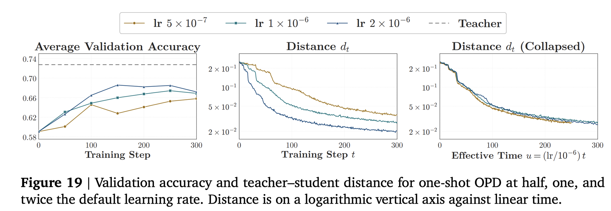
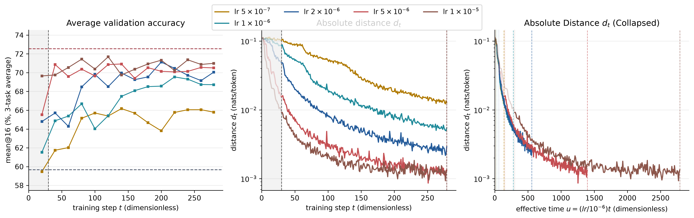
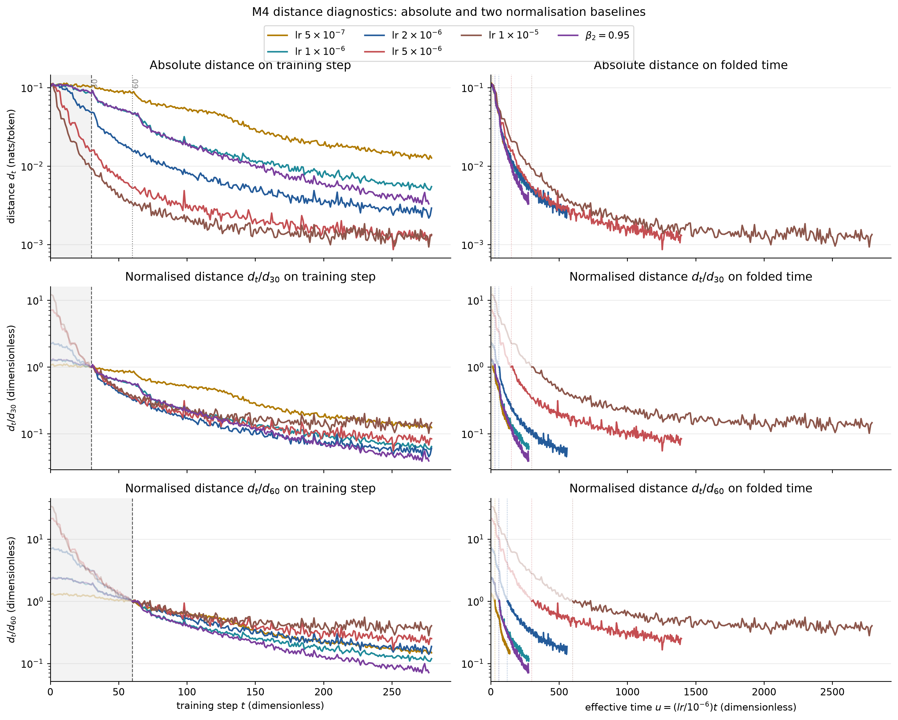
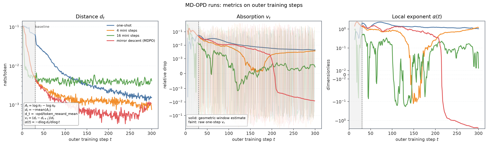
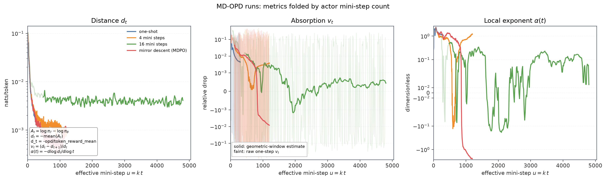
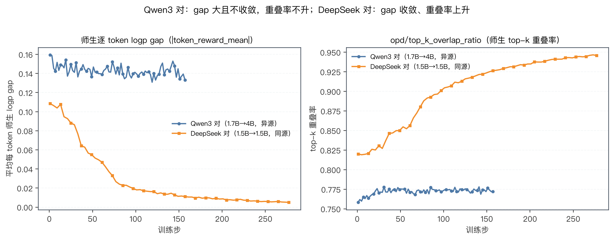

# OPD 周报：一条数据够学几百步，加速从哪来（2026-09-17）

> **30 秒版本**：本周读通了两篇构成我们问题背景的论文。One-Shot OPD[^opd2] 证明蒸馏的瓶颈不在数据量——一条 query 的 rollout 覆盖了全量数据 71.5% 的状态簇，1/4/16/17k 条数据的吸收曲线几乎重合，真正稀缺的是学生"吸收"监督的速率；固定一批状态也能稳定学约 200 步，慢在优化器，不在状态供给。EffOPD[^effopd] 从参数侧回答了"为什么慢"：OPD 目标局部二次化后，GD 逐特征方向以 $\eta\lambda_i$ 速率饱和，大曲率方向先学完、谱尾巴越拖越慢；他们用"checkpoint 位移外推 + 50 条验证贪心门控"拿到平均 3× 加速。我们自己的实验复现了 baseline 和 lr 扫描（lr 越大学得越快、floor 加深至 ~5e-6 饱和、1e-4 发散），补了 off-policy、跨族师生、序列级 KL 三组对照，结论与两篇论文的机制判断一致：lr 只是时间轴缩放，要加速得换算法。

---

## 1. 论文导读一：One-Shot OPD——数据富裕，学习稀缺

### 1.1 问题设定

OPD 让学生在**自己的 rollout** 上被教师逐 token 打分。学生在 prompt $x$ 下采样 $y\sim\pi_\theta$，教师在学生实际访问的每个 prefix $s_i=(x,y_{<i})$ 处给出稠密监督，目标等价于在学生诱导的状态分布上最小化逐 token 反向 KL：

$$
\mathcal{L}_{\mathrm{OPD}}(\theta)=\mathbb{E}_{x,\,y\sim\pi_\theta}\Big[\sum_i \mathrm{KL}\big(\pi_\theta(\cdot\mid s_i)\,\|\,\pi_T(\cdot\mid s_i)\big)\Big]
$$

实际训练中不算 KL，用 sampled-token advantage $A_i=\log\pi_T(y_i\mid s_i)-\log\pi_\theta(y_i\mid s_i)$ 走 policy gradient。这篇论文（Rethinking OPD 系列[^opd1]的第二篇，清华组）对标 one-shot RLVR[^oneshotrl]，把"数据最少极限"搬到蒸馏：只用 **一条** query 训练，为什么还能学这么久、涨这么多？

### 1.2 数据侧：一条 query 已经覆盖大部分状态

论文用教师最后一层 hidden vector 表示状态 $s$，把全量数据 run 访问的状态池做 PCA→50 维再 K-means 成 200 簇，coverage = rollout 触及的簇占比。结果：**1-shot 覆盖 71.5%（其中 step 100 已达 65.9%），4-shot 79.8%，16-shot 98.9%**；16 条同一语义簇的 query 只到 76.8%，16 条不同簇的到 98.9%——多样性买的是状态多样性，不是数量。对应验证集上 1-shot 300 步拿到全量增益的 87%（68.5 vs 69.8，top-16 口径）。

图：左为各 shot 数的状态簇覆盖率（K=200），右为 1-shot 与全量数据的 validation accuracy。来源：[^opd2] Fig.7–8。

### 1.3 算法侧：吸收速率衰减与数据量无关

图（论文 Figure 9）：1/4/16/all 条 query 训练的 teacher–student 距离 $d_t/d_{30}$（左）与吸收速率 $v_t$（右）。四条曲线几乎重合：$d_{300}/d_{30}$ 分别为 0.16/0.17/0.18/0.22，$v_t$ 从约 1.5% 衰减到 0.2%（$v_{50}/v_{200}\approx 5$），衰减形态与训练集大小基本无关。

这张图的读法：对数距离轴上恒速率应画直线，四条曲线一起弯平，说明"越学越慢"是 **OPD 算法的属性**，不是数据的属性。论文的概括是 "data-overfed, algorithm-starved"——数据早就是富裕的，稀缺的是每步算力能转化成多少师生对齐。

### 1.4 "一条数据要学 200+ 步"的证据

论文 Figure 10 做了固定状态消融：一个 always-off-policy run 从头到尾复用初始学生一次性采的 64 条轨迹（状态集合不变），结果 validation accuracy **稳定上涨约 200 步才停**，top-16 overlap 上升、overlap-token advantage 归零也都要花几百步。也就是说不需要新鲜状态供给来解释 run 的长度——慢在吸收速率本身，一条数据包含的状态量本来就够学几百步。这与我们自己的 frozen-rollout 实验（§3.3）是同一个现象的两个侧面。

### 1.5 lr 实验：学习率只是时间轴缩放

图（论文 Figure 19）：one-shot 在 half/1x/2x 学习率（5e-7/1e-6/2e-6）下的 validation accuracy 与距离曲线。更大 lr 只是更快到达同一距离；把横轴换成有效时间 $u=(\mathrm{lr}/10^{-6})\cdot t$ 后三条距离曲线塌缩成一条（离散度 ~2.2×→1.1×）。含义：在 4 倍范围内 lr 等比例缩短训练，却不改变"越走越慢"的曲线形状——要真正加速得改算法。这条结论是我们做 M4 lr 扫描的直接动机，也是我们谱模型里"所有 mode 共享同一个步长 $\eta$"的实验对应物。

## 2. 论文导读二：EffOPD——为什么慢，以及怎么加速

EffOPD（_Learning to Foresee_，USTC/Tencent/NUS，2026-05）要回答的问题和我们相同：OPD 一条数据为什么要学几百步，以及这几百步能不能省。他们的答案是分两层给的——附录里有一个局部二次型推导刻画"越学越慢"的机制，正文用"foresight"论证方向早期就锁定，然后算法直接外推。

### 2.1 附录推导：二次型上逐特征方向的饱和过程

推导分三步。**第一步，冻结目标、线性化 logits。** 在一个更新窗口内把学生看作在固定状态集合上优化，对 context $c$ 的 logits 在学生当前点 $\theta_0$ 一阶展开 $z_\theta(c)\approx z_0(c)+J_c\,\Delta\theta$（$J_c$ 是 logits 对参数的 Jacobian）。**第二步，KL 二阶展开得到 Fisher。** reverse-KL 在教师点展开的主导项是逐位置 Fisher $F_c=\mathrm{Diag}(p_0)-p_0p_0^\top$，于是 OPD 目标近似为凸二次型

$$
\mathcal{L}_{\mathrm{OPD}}(\Delta\theta)\approx\tfrac{1}{2}\Delta\theta^\top A\,\Delta\theta - b^\top\Delta\theta+\mathrm{const},\qquad A=\mathbb{E}_c\big[J_c^\top F_c J_c\big],\quad b=\mathbb{E}_c\big[J_c^\top F_c r_c\big]
$$

其中 $r_c=z^\star(c)-z_0(c)$ 是教师与学生的 logit 残差。**第三步，GD 闭式解。** 把 $A$ 对角化（特征对 $(\lambda_i,u_i)$），定步长 $\eta$（要求 $\eta<2/\lambda_{\max}$）走 $s$ 步后

$$
\Delta\theta_s=\sum_{i:\lambda_i>0}\frac{1-(1-\eta\lambda_i)^s}{\lambda_i}\,\beta_i\,u_i,\qquad \beta_i=\langle b,u_i\rangle
$$

每个特征方向以速率 $\eta\lambda_i$ 指数饱和到渐近值 $\beta_i/\lambda_i$：**大 $\lambda$ 方向几步就饱和，小 $\lambda$ 方向的残余质量按 $\eta\lambda_i$ 的慢速率拖出长尾**——这就是"先学曲率大的方向、越学越慢"的精确表述。在此之上他们给出方向锁定（lock-in）的充分条件：若驱动向量 $b$ 基本落在前 $k$ 个特征方向张成的子空间里（$\Vert P_{U_k^\perp}b\Vert\le\epsilon\Vert b\Vert$）且有谱隙 $\lambda_k\gg\lambda_{k+1}$，则尾部子空间的总贡献被 $\rho_\perp(s)\epsilon\Vert b\Vert$ 控制，$\rho_\perp(s)=\max_{i>k}\vert 1-(1-\eta\lambda_i)^s\vert/\lambda_i$——低秩驱动 + 谱隙 ⇒ 早期轨迹就决定了最终方向。

$b$ 为什么天然低秩：教师相对学生只在少数功能性 token（推理关键步、答案 token、格式 token）上 sharpen 分布，$r_c$ 的有效支撑本来就低维，经 $F_c$ 加权、$J_c^\top$ 投回参数空间后仍然集中。同一框架还顺手解释了 OPD 为什么比 RL 高效：OPD 单样本梯度 $\hat g_{\mathrm{OPD}}=J_c^\top F_c r_c$ 近似确定，RL 的 $\hat g_{\mathrm{RL}}=A_t J_c^\top(e_y-p_0)$ 带优势噪声且在词表空间全支撑，$\mathrm{Tr}(\Sigma_{\mathrm{RL}})>\mathrm{Tr}(\Sigma_{\mathrm{OPD}})$，方向弥散、需要持续校正。模块级推论：$b_m\approx0$ 的模块（embedding、最底/最顶层）在跨模块耦合弱时 $\Delta\theta_m^\ast\approx A_{mm}^{-1}b_m\approx0$，即"冗余更新被自动抑制"。

两个边界要说清楚：这是 $\theta_0$ 邻域的 NTK 式局部理论，作者自己在 Limitations 承认只刻画局部动力学；他们的"低秩"证据全部来自对更新矩阵 $\Delta W$ 的 SVD，$A$ 的谱只是理论构造、没有实测。我们的 NNLS 反演谱（40 个 support mode、$\rho\in[0.004,0.1]$/步、快慢差 25 倍）恰好补的是这块空白，推导链本身两边一致——距离曲线是谱的 Laplace 变换。

### 2.2 正文证据：foresight 的两个性质

论文主体用干预实验证明 OPD 更新方向的低秩结构在训练早期成型（foresight），分两个层面：

- **Functional Redundancy Avoidance（模块分配层）**：等更新范数下 OPD 的性能增益显著大于 RL（Fig.1）；层/模块敏感度分布呈倒 U 形——中层 MLP 最敏感、embedding 几乎无贡献，RL 在低敏感度的底层/顶层积累大量冗余更新范数，OPD 早期就把更新集中到中层 MLP（sliding-window 逐层干预实验，窗口 ±8 层，Fig.2）。
- **Early Low-Rank Lock-in（更新方向层）**：对每模块 $\Delta W$ 做 SVD，OPD 的低秩性显著强于 RL——8B 模型上 spectral/Frobenius 比 36.8% vs 32.7%，effective rank 2341 vs 2754，Top-1% 子空间范数占比 94.7% vs 88.5%（Table 1，1.5B/4B/14B 同趋势）。Top-10% 秩截断即可恢复 >95% 性能；中层模块早期与最终 checkpoint 的 Top-k 子空间 cosine similarity 达 ~0.9，且训练 0–30% 段就稳定，RL 则持续漂移。判决性干预：把 **10% 进度** checkpoint 的 $\Delta W$ 按模块 rescale 到最终范数，直接恢复约 **80%** 最终性能——方向早已成型，后续训练主要在长幅度（Fig.4c）。外推系数 $\beta$ 的安全边界在 $[0.8,1.2]$，超过 1.2 放大噪声方向性能下降。

### 2.3 EffOPD 算法：验证门控的位移外推

算法本身非常轻量，不是预条件子、不用二阶信息：

1. 在 $t=2^n$（step 1, 2, 4, 8, 16, …）处触发外推；
2. 取相邻指数点的位移 $\Delta_n=W_{2^n}-W_{2^{n-1}}$（$n{=}0$ 用 $W_1-W_{\mathrm{init}}$）；
3. 生成候选 $\widetilde W_{n,k}=W_{2^n}+2k\,\Delta_n$（$k=1,\dots,5$，即沿位移方向外推 2×–10×）；
4. 在训练集随机抽的 50 条上算可验证奖励，按 $k$ 递增贪心接受、**第一个失败者立即停止**；$k{=}1$ 就失败则退化为 vanilla OPD；
5. 继续正常 OPD 训练到下一个指数点。

开销是 $\log T$ 个 checkpoint 上各 ≤5 次 50 样本的验证，远小于每步 rollout 的成本。

### 2.4 加速实验结果

主结果：数学任务约 **10 步收敛**（vanilla OPD 需 30–40 步），各设置平均 **3× 训练加速**；规模覆盖 1.5B/4B/14B/32B，训练集 Eurus-RL-Code 与 DeepMath-103K，评测 Codeforces、Taco、AIME24/25/26、MINERVA、GPQA。对照基线是 Vanilla OPD 与两个固定系数外推变体（AlphaOPD、ExOPD）——EffOPD 的自适应步长选择更稳，最终性能上限还略高（作者归因于 vanilla 长跑过优化/语义漂移）；同 wall-clock 预算下性能仍占优（Fig.6c），极端例是 Qwen3-4B-Non-Thinking 第 4 步就达到强推理性能。消融：更大 lr 加快早期收敛但带来震荡，EffOPD 的验证门控自动过滤过激步子（Fig.6a）；验证集难度不敏感，作用只是查方向是否仍有效（Fig.6b）。训练配置：verl、lr 1e-6 无 warmup、prompt batch 1024×n=1、3 epochs、`grpo`+`only_reverse_kl_advantages`+`rollout_is=token`（threshold 5.0）实现 token 级 reverse-KL、grad clip 1.0。

### 2.5 与我们理论的对照

我们用反演谱模拟"完美白化"给出的速率均衡上限是 ~2–3× 到 floor（`docs/2026-09-13-md-ngd-assessment-and-next-experiments.md` §3），与 EffOPD 的 ~3× 量级自洽；但机制不同——白化均衡各 mode 速率，EffOPD 利用方向可预测性外插，两者正交，理论上可叠加。他们的充分条件（$b$ 低秩 + 谱隙）也给了我们一个可检验的预言：外推增益应当随残余质量向慢 mode 迁移而递减。原型已在 `plots/spectral_effopd.py`：checkpoint 模态外推（位移投影到 SVD 基、按 Rayleigh 曲率给每方向独立增益）与低秩 modal gradient step，尚未接入 trainer。

## 3. 本周实验进展

### 3.1 Baseline 复现

`mdxt04lm`（[wandb](https://wandb.ai/wncfht/One-Shot-OPD/runs/mdxt04lm)）：DeepSeek-R1-Distill-Qwen-1.5B 学生、JustRL-DeepSeek-1.5B 教师、DAPO-Math-17k 全量、vanilla ratio、lr 1e-6，即论文配方。sampled-token 距离 $d$ 从 ~0.10/token 降到 ~0.004（$d_{279}/d_{30}=0.064$），validation best 69.55%（AIME25/AMC23/MATH-500 均值 @16），与论文全量档位读数同量级，复现成立。tail 拟合：power-law $\alpha\approx1.31$，floor_exp 给出 $d_\infty\approx0.001$。

### 3.2 lr 扫描（M4）：越大越快，太快则炸

在 baseline 上只改 actor lr（另有 β2 对照臂），全部 279 步：

| run（wandb）                                                   | lr            | $d_{last}$ | $d_{last}/d_{30}$ | val best |
| -------------------------------------------------------------- | ------------- | ---------- | ----------------- | -------- |
| [ybi7q89v](https://wandb.ai/wncfht/One-Shot-OPD/runs/ybi7q89v) | 5e-7          | 0.0127     | 0.123             | 66.2%    |
| [mdxt04lm](https://wandb.ai/wncfht/One-Shot-OPD/runs/mdxt04lm) | 1e-6          | 0.0055     | 0.064             | 69.6%    |
| [yj2w13fq](https://wandb.ai/wncfht/One-Shot-OPD/runs/yj2w13fq) | 2e-6          | 0.0029     | 0.060             | 71.1%    |
| [ml6mz58f](https://wandb.ai/wncfht/One-Shot-OPD/runs/ml6mz58f) | 5e-6          | 0.0013     | 0.084             | 70.9%    |
| [l0a6rsc1](https://wandb.ai/wncfht/One-Shot-OPD/runs/l0a6rsc1) | 1e-5          | 0.0013     | 0.146             | 71.7%    |
| [vmk256kl](https://wandb.ai/wncfht/One-Shot-OPD/runs/vmk256kl) | 1e-4          | 0.0529     | 1.42              | 66.2%    |
| tjjxnvw9                                                       | 1e-6, β2=0.95 | 0.0033     | 0.039             | 70.3%    |

三个读数：

1. **越大越快**：$d_{last}$ 从 5e-7 的 0.0127 单调压到 5e-6 的 0.0013，验证集 best 同步走高（66.2%→71.7%）。高 lr 的 $d_{30}$ 已经很低（1e-5 时 0.009），说明大部分吸收发生在前 30 步——论文"前 30 步 clip 主导、读数不真实"的警告在高 lr 下更要注意。
2. **floor 加深至 ~5e-6 饱和**：5e-6 与 1e-5 的 $d_{last}$ 同为 ~0.0013——这正是我们 floor 分解预言的形态（噪声 floor $\propto\eta\sigma^2$，继续加 lr 不再压深）。
3. **1e-4 发散**：距离曲线不降反升（$d_{last}/d_{30}=1.42$）、val 回落到 61.8%——超出谱模型稳定边界 $\eta<2/\lambda_{max}$ 的形态。另外 β2=0.95 同 lr 下 floor 更深（0.0033 vs 0.0055），提示 Adam 二阶矩估计本身参与"谱"的构成。

图：我们的 lr 扫描复现论文 Figure 19 结构——val accuracy、绝对距离、按 $u=(\mathrm{lr}/10^{-6})\cdot t$ 折叠的距离三面板。折叠后低中 lr 各臂基本重合，1e-5 臂在折叠轴上偏离（已触及噪声 floor）。

图：绝对距离（上）与 $d/d_{30}$、$d/d_{60}$ 归一距离（下）在 step 轴（左）和有效时间轴（中、右）的对照。折叠在绝对口径下成立；归一化后高 lr 臂系统性偏离——因为它们更早碰到 floor，残余段不再服从同一条曲线。

### 3.3 off-policy：固定状态够学，但 loss 形式决定成败

one-shot t22 上三组对照（300 步）：

| run                                                            | 设置                             | $d_{end}/d_{30}$        | entropy 首→末 | val best  |
| -------------------------------------------------------------- | -------------------------------- | ----------------------- | ------------- | --------- |
| [5aub1k4h](https://wandb.ai/wncfht/One-Shot-OPD/runs/5aub1k4h) | online rollout + vanilla         | 0.024                   | 0.772→0.598   | 66.9%     |
| [ceejzu26](https://wandb.ai/wncfht/One-Shot-OPD/runs/ceejzu26) | **frozen** rollout + opd_noratio | **0.012**               | 0.764→0.770   | 65.9%     |
| 0i38mr1k                                                       | frozen rollout + vanilla ratio   | 崩盘 d≈0.50，failed@218 | →0.82（发散） | ~64% 平台 |

两点结论：其一，frozen rollout（从头到尾同一批状态）不但不崩，反而吸收最深、且全程没有 entropy collapse——独立验证了论文 Figure 10 的"固定状态够学几百步"，同时省掉每步 rollout 开销（throughput 中位数 ~2400 vs ~370 tokens/s），这对后续动力学实验是性价比最高的配方。其二，frozen 状态下 vanilla ratio surrogate 崩盘（ppo_kl→0.055、clipfrac→0.23、reward 卡在 -300 后 failed@218），而 score-function 形式的 opd_noratio 无此问题——ratio surrogate 的 clip/非线性在冻结 anchor 上放大离轴漂移，loss 形式在 off-policy 下是决定性变量。

### 3.4 MD-OPD：多内层 epoch 的收益是边际的

one-shot t22 上另一组干预——同一批 rollout 上跑 $m$ 个 inner epoch（任务项 + old-policy k3 KL 锚，MDPO 臂的 $\eta$ 从 1 线性退到 0.01 即 KL 系数 1→100）。这是"换算法加速"方向我们跑过的第一个 arm：

| run        | 机制                                        | $d_{last}$ | entropy 首→末 | val best |
| ---------- | ------------------------------------------- | ---------- | ------------- | -------- |
| `5aub1k4h` | 1 inner epoch                               | 0.00154    | 0.772→0.598   | 66.9%    |
| `nh3jj9bt` | 4 inner epochs                              | 0.00075    | 0.768→0.587   | 68.4%    |
| `zyskh7f2` | 16 inner epochs                             | 0.00409    | 0.761→0.629   | 69.2%    |
| `6p579hnn` | MDPO：4 epochs + old-policy k3 KL，η 1→0.01 | 0.00109    | 0.761→0.632   | 69.1%    |

图：上为外步轴，下为按 actor mini-step 数折叠的 $u=k\cdot t$ 轴（$d_t$、$v_t$、局部幂律指数 $\alpha(t)$ 三列）。按外步看 MDPO（红）最快到 floor；折到内层梯度步轴后，四个 arm 在 ~1000–1200 个梯度步内全部碰到 ~1e-3 的 floor——**MDPO 省的是外步，每梯度步的吸收增益是边际的**。16-epoch 臂（绿）反而停在 ~4e-3：陈旧 surrogate 饱和，在已走掉的分布上过优化不再转化为真实 KL 下降，直接证伪"内层越多越好"。MDPO 是唯一 300 步后熵仍站在 0.63 的臂，且 $v_t$ 在 ~200 步后趋零转负——按我们的谱模型这是"可吸收分量吸完、顶到 floor"的签名而不是失败。val 差异（68.4–69.2）在单 seed 噪声内。

### 3.5 跨族师生对：平坦的不可对齐分量

`um5vzc6m`（Qwen3-1.7B→Qwen3-4B，同 lr 同配方）：gap 平在 ~0.14/token 共 158 步（幂律拟合 $\alpha=0.0096$），top-k overlap 0.76→0.77 纹丝不动；对照同族 DeepSeek 对同窗口衰减 89%、overlap 0.82→0.94。诊断（`docs/2026-09-07-qwen3-pair-opd-flat-gap.md`）：gap 大而不是小，排除"学生太强没东西可学"（AIME 段教师仍领先 25–30pp）；main 成分是跨族分布的不可对齐分量 $d_{gap}$——优化器压不掉，可教信号被淹没。教训：**换师生对时不可约分量是第一个要控制的变量，跨族对不能用来问算法问题**。

### 3.6 序列级 KL：方差过大，效果不好

尝试把逐 token 的 KL 信号聚合成序列级（seq 级 KL 估计，对应 verl 里 seq_sum/seq_mean 一族口径）：序列 log-ratio 是数千个相关 token 项的和，单条轨迹的估计方差远大于逐 token 形式，训练信号噪声主导，效果不好。与论文脚注的口径观察一致——sampled-token 与 top-k 截断形式就是拿尾部精度换方差，序列级聚合把这个权衡推到了不可用的极端。该方向不再继续。

## 4. 讨论与下周计划

把两篇论文与本周数据放在一起，图景是自洽的：OPD 的吸收过程由谱决定——数据只扩展覆盖的状态集合（1 条就够 71.5%），lr 只做时间轴缩放（4 倍内折叠），吸收速率衰减来自快慢 mode 的先后耗尽，floor 由噪声和不可对齐分量构成。加速的正交杠杆因此清晰：速率均衡（预条件/NGD，上限 ~2–3×；MD-OPD 系列已实测出边际增益形态）、方向外推（EffOPD 型，~3×）、方差工程（压噪声 floor）、换师生对（碰 $d_{gap}$）。下周按优先级：

1. **EffOPD 式外推在我们配方上的复现**：`plots/spectral_effopd.py` 已有 trainer-agnostic 原型，先在 frozen-rollout 配方（便宜、状态固定）上验证位移外推是否拿到同量级加速；
2. **E1 floor 成因分辨**：frozen 平台后 lr 退火，floor 降→噪声主导（方差工程有用），不降→gap 主导（预条件无用）；
3. **E2 残余分解**：逐 token 频率十分位分解剩余 $d$，量出 NGD 可服务的市场占比；
4. **E3 单步 CLR 手术探针**：frozen checkpoint 上 head+OTHER CLR loss 走一步 SGD/Adam，测"自然化方向"每步多吸收多少，决定整个 NGD 方向的 go/no-go。

### 参考文献

[^opd2]: Z. Fu, B. He, Y. Zuo, et al. Rethinking On-Policy Distillation of Large Language Models II: One Training Example. arXiv 2026. [arXiv:2609.04172](https://arxiv.org/abs/2609.04172)

[^effopd]: Y. Cai, D. Cao, L. Lin, et al. Learning to Foresee: Unveiling the Unlocking Efficiency of On-Policy Distillation. arXiv 2026. [arXiv:2605.11739](https://arxiv.org/abs/2605.11739)

[^oneshotrl]: Y. Wang et al. One-Shot RLVR: Reinforcement Learning with Verifiable Rewards from a Single Example. arXiv 2025. [arXiv:2504.20571](https://arxiv.org/abs/2504.20571)

[^opd1]: Rethinking On-Policy Distillation of Large Language Models I. arXiv 2026. [arXiv:2604.13016](https://arxiv.org/abs/2604.13016)
